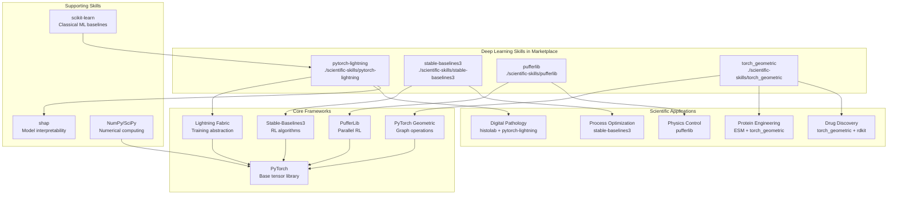
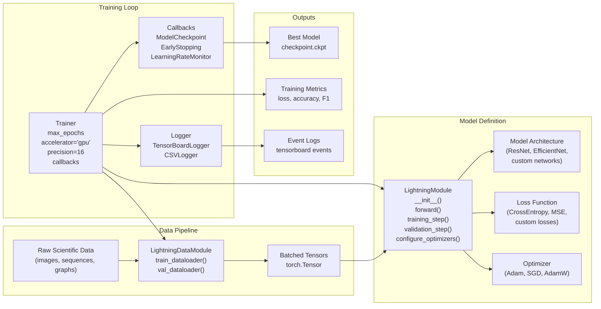
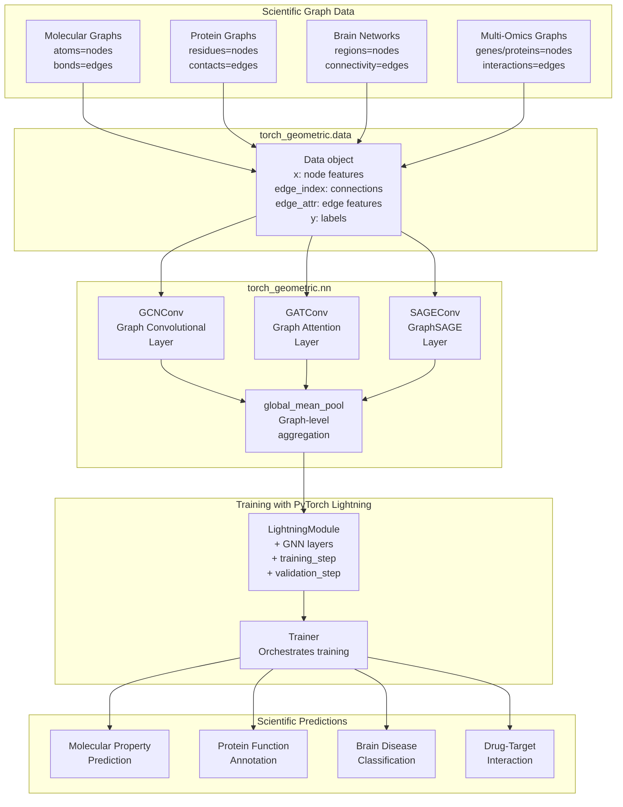
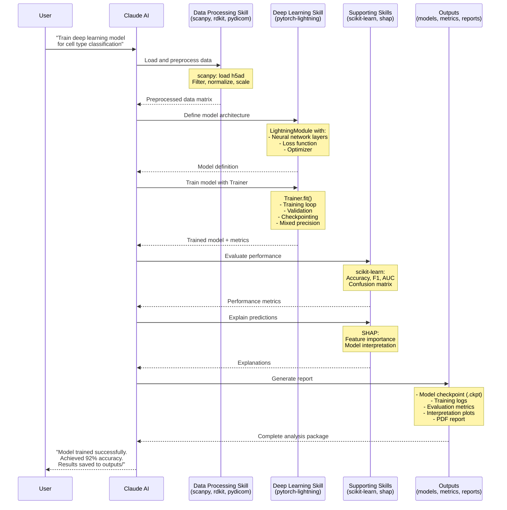

<!-- source: DeepWiki mcp.deepwiki.com · repo K-Dense-AI/claude-scientific-skills · extra page Deep Learning Frameworks · fetched 2026-10-26 -->

# Deep Learning Frameworks

<details>
<summary>Relevant source files</summary>

The following files were used as context for generating this wiki page:

- [.claude-plugin/marketplace.json](.claude-plugin/marketplace.json)
- [README.md](README.md)
- [docs/scientific-skills.md](docs/scientific-skills.md)
- [scientific-skills/ginkgo-cloud-lab/SKILL.md](scientific-skills/ginkgo-cloud-lab/SKILL.md)
- [scientific-skills/ginkgo-cloud-lab/references/cell-free-protein-expression-optimization.md](scientific-skills/ginkgo-cloud-lab/references/cell-free-protein-expression-optimization.md)
- [scientific-skills/ginkgo-cloud-lab/references/cell-free-protein-expression-validation.md](scientific-skills/ginkgo-cloud-lab/references/cell-free-protein-expression-validation.md)
- [scientific-skills/ginkgo-cloud-lab/references/fluorescent-pixel-art-generation.md](scientific-skills/ginkgo-cloud-lab/references/fluorescent-pixel-art-generation.md)

</details>


This page documents the deep learning framework skills available in Claude Scientific Skills for training neural networks, reinforcement learning, and graph-based deep learning. These skills provide access to modern deep learning libraries optimized for scientific computing workflows.

**Scope**: This page covers PyTorch Lightning for supervised learning, Stable Baselines3 and PufferLib for reinforcement learning, and Torch Geometric for graph neural networks. For natural language processing with Transformers, see [Natural Language Processing](#9.2). For classical machine learning algorithms, see the parent section [Machine Learning and AI](#9).

---

## Overview

The repository includes four primary deep learning framework skills, each optimized for different scientific computing scenarios:

| Skill Name | Framework | Primary Use Case | Skill Path |
|------------|-----------|------------------|------------|
| `pytorch-lightning` | PyTorch Lightning | Supervised learning, model training automation | `./scientific-skills/pytorch-lightning` |
| `stable-baselines3` | Stable-Baselines3 | Reinforcement learning algorithms (RL) | `./scientific-skills/stable-baselines3` |
| `pufferlib` | PufferLib | Massively parallel RL training | `./scientific-skills/pufferlib` |
| `torch_geometric` | PyTorch Geometric | Graph neural networks (GNNs) | `./scientific-skills/torch_geometric` |

These frameworks are designed to integrate with scientific workflows involving bioinformatics, cheminformatics, physics simulations, and clinical machine learning.

**Sources**: [.claude-plugin/marketplace.json:72-89](), [README.md:377-379]()

---

## Deep Learning Framework Architecture



**Diagram: Deep Learning Framework Ecosystem**

This diagram shows how the four deep learning skills map to their underlying frameworks and integrate with scientific applications. All frameworks build on PyTorch as the base tensor library. The skills are registered in [.claude-plugin/marketplace.json]() and integrate with other scientific skills like `histolab`, `esm`, `rdkit`, and numerical computing libraries.

**Sources**: [.claude-plugin/marketplace.json:72-89](), [README.md:377-389](), [docs/examples.md:1140-1253]()

---

## PyTorch Lightning Skill

### Purpose and Capabilities

The `pytorch-lightning` skill provides access to PyTorch Lightning, a high-level framework that automates training loops, distributed training, model checkpointing, and logging. It eliminates boilerplate code while maintaining flexibility for scientific computing.

**Key features**:
- Automated training/validation/test loops with metrics tracking
- Multi-GPU and distributed training (DDP, FSDP)
- 16-bit mixed precision training for faster computation
- Model checkpointing with best model selection
- Early stopping and learning rate scheduling
- Integration with experiment tracking (TensorBoard, Weights & Biases)
- Gradient accumulation and gradient clipping

**Sources**: [README.md:374-379]()

### Training Pipeline Architecture



**Diagram: PyTorch Lightning Training Pipeline Components**

This shows the core components of a PyTorch Lightning training pipeline: `LightningDataModule` handles data loading, `LightningModule` defines the model and training logic, and `Trainer` orchestrates the training loop with callbacks and logging.

**Sources**: [docs/examples.md:1183-1200]()

### Scientific Workflow Integration

PyTorch Lightning integrates with multiple scientific domains:

#### Digital Pathology (Histopathology Image Classification)

From [docs/examples.md:1183-1200]():
```
Step 5: Build deep learning model with PyTorch Lightning
- Architecture: ResNet50 or EfficientNet backbone
- Add custom classification head for tissue types
- Define training pipeline:
  * Loss function: Cross-entropy or Focal loss
  * Optimizer: Adam with learning rate scheduling
  * Augmentations: rotation, flip, color jitter, elastic deformation
  * Batch size: 32
  * Mixed precision training

Step 6: Train model
- Train on tile-level labels
- Monitor metrics: accuracy, F1 score, AUC
- Use early stopping on validation loss
- Save best model checkpoint
- Training time: ~6-12 hours on GPU
```

The `pytorch-lightning` skill enables automated training of deep learning models for whole slide image analysis when combined with the `histolab` and `pathml` skills.

**Sources**: [docs/examples.md:1183-1200]()

#### Protein Engineering (Graph Neural Networks)

From [docs/examples.md:2082-2090]():
```
Step 12: Graph neural network for integrated prediction
- Build heterogeneous graph with Torch Geometric:
  * Nodes: samples, genes, proteins, pathways
  * Edges: gene-protein, protein-protein, gene-pathway
  * Node features: expression, mutation status
- Train GNN to predict:
  * Subtype classification
  * Survival risk
  * Treatment response
- Extract learned embeddings for interpretation
```

PyTorch Lightning's training infrastructure supports graph neural networks built with `torch_geometric` for multi-omics integration.

**Sources**: [docs/examples.md:2082-2090]()

#### Quantum Machine Learning

PyTorch Lightning can orchestrate training of quantum-classical hybrid models when combined with quantum computing skills (`qiskit`, `pennylane`):
- Variational quantum circuits as PyTorch layers
- Classical pre/post-processing with neural networks
- Backpropagation through quantum simulations
- Integration with quantum hardware backends

**Sources**: [README.md:17-18](), [README.md:387]()

### Model Checkpointing and Distributed Training

PyTorch Lightning provides built-in support for:

**Model Checkpointing**:
- Saves best models based on validation metrics
- Checkpoint files stored as `.ckpt` format
- Resume training from checkpoints
- Load pre-trained weights for fine-tuning

**Distributed Training**:
- `accelerator='gpu'` for single GPU
- `devices=[0,1,2,3]` for multi-GPU data parallel
- `strategy='ddp'` for DistributedDataParallel
- `strategy='fsdp'` for Fully Sharded Data Parallel
- `precision=16` for mixed precision training
- Automatic gradient synchronization across GPUs

**Sources**: [docs/examples.md:1196-1199]()

---

## Reinforcement Learning Skills

### Stable Baselines3

The `stable-baselines3` skill provides access to production-ready reinforcement learning algorithms for scientific applications including:

**Available Algorithms**:
- **PPO** (Proximal Policy Optimization): General-purpose, stable
- **A2C** (Advantage Actor-Critic): Synchronous policy gradient
- **SAC** (Soft Actor-Critic): Off-policy, continuous control
- **TD3** (Twin Delayed DDPG): Deterministic policy, robust
- **DQN** (Deep Q-Network): Discrete action spaces

**Scientific Applications**:

From [docs/examples.md:2226-2230]():
```
Step 8: Reinforcement learning for trigger optimization
- Use Stable-Baselines3 to optimize trigger thresholds
- Environment: detector simulator
- Action: adjust trigger thresholds
- Reward: maximize signal efficiency while controlling rate
- Train PPO or SAC agent
- Validate on real data
```

From [docs/examples.md:2407-2417]():
```
Step 10: Reinforcement learning for advanced control
- Use Stable-Baselines3 to train RL agent:
  * Environment: reactor simulation (SimPy-based)
  * State: T, P, concentrations, flow rates
  * Actions: adjust setpoints, flow rates, heating/cooling
  * Reward: +yield -energy cost -deviation from setpoint
- Train PPO or TD3 agent
- Compare with conventional PID control
- Evaluate performance under disturbances
- Implement model-free adaptive control
```

The skill integrates with simulation frameworks (`simpy`) for process optimization and experimental control.

**Sources**: [docs/examples.md:2226-2230](), [docs/examples.md:2407-2417](), [README.md:374-379]()

### PufferLib

The `pufferlib` skill provides massively parallel reinforcement learning for large-scale scientific simulations:

**Features**:
- Vectorized environments for parallel rollouts
- Asynchronous training across multiple processes
- Integration with PyTorch for custom policy networks
- Optimized for throughput-critical applications

**Use Cases**:
- High-throughput molecular dynamics control
- Multi-agent simulations
- Evolutionary algorithm integration
- Large-scale hyperparameter sweeps

**Sources**: [.claude-plugin/marketplace.json:69](), [README.md:374-379]()

---

## Graph Neural Networks (Torch Geometric)

### Purpose and Graph Operations

The `torch_geometric` skill provides PyTorch Geometric for learning on graph-structured scientific data:

**Core Components**:
- `torch_geometric.data.Data`: Graph data structure (nodes, edges, features)
- `torch_geometric.nn`: Graph neural network layers (GCN, GAT, GraphSAGE)
- `torch_geometric.transforms`: Graph preprocessing operations
- `torch_geometric.utils`: Graph utilities and conversions

**Graph Operations**:
- Message passing between nodes
- Graph convolutions (spatial and spectral)
- Graph pooling (global, hierarchical)
- Edge prediction and link analysis
- Node classification and graph classification

**Sources**: [.claude-plugin/marketplace.json:87](), [README.md:379]()

### Scientific Graph Applications



**Diagram: Graph Neural Network Pipeline with Torch Geometric**

This shows the flow from scientific graph data structures through PyTorch Geometric layers to trained models. The `Data` object encapsulates node features (`x`), edge connectivity (`edge_index`), and labels (`y`). GNN layers perform message passing, and global pooling aggregates to graph-level predictions.

**Sources**: [docs/examples.md:1620-1626](), [docs/examples.md:2082-2090]()

### Drug Discovery with Graph Neural Networks

From [docs/examples.md:80-120]():

Drug discovery workflows combine `torch_geometric` with cheminformatics skills:
1. **RDKit** converts molecular SMILES to graphs (atoms→nodes, bonds→edges)
2. **Torch Geometric** trains GNN to predict molecular properties
3. **DiffDock** uses graph representations for molecular docking
4. **DeepChem** provides pre-trained graph models for ADMET prediction

Example molecular property prediction pipeline:
- Load molecules with `rdkit`
- Generate molecular graphs (nodes=atoms with features, edges=bonds)
- Train Graph Convolutional Network (GCN) or Graph Attention Network (GAT)
- Predict: pIC50, solubility, permeability, toxicity
- Rank candidates by predicted properties

**Sources**: [docs/examples.md:86-96](), [README.md:350-356]()

### Brain Connectivity Analysis

From [docs/examples.md:1620-1626]():

```
Step 9: Graph neural network analysis with Torch Geometric
- Build graph neural network (GCN or GAT)
- Input: connectivity matrices as adjacency matrices
- Train to predict diagnosis
- Extract learned representations
- Visualize latent space (UMAP)
- Interpret which brain regions are most important
```

The `torch_geometric` skill enables analysis of functional brain networks where:
- Nodes represent brain regions (ROIs)
- Edges represent functional connectivity (correlation strengths)
- Node features include activity patterns, anatomical properties
- GNN learns to classify healthy vs disease states
- Attention mechanisms identify critical brain regions

**Sources**: [docs/examples.md:1620-1626]()

### Multi-Omics Integration

From [docs/examples.md:2082-2090]():

Graph neural networks integrate heterogeneous biological networks:
- **Nodes**: genes, proteins, metabolites, pathways, samples
- **Edges**: protein-protein interactions, gene-pathway membership, regulatory relationships
- **Node features**: expression levels, mutation status, abundance
- **Tasks**: subtype classification, survival prediction, drug response

The `torch_geometric` skill combined with `string-database`, `reactome-database`, and `kegg-database` enables end-to-end multi-omics graph learning.

**Sources**: [docs/examples.md:2082-2090](), [docs/examples.md:2057-2060]()

---

## Integration Patterns

### Common Deep Learning Workflow Pattern



**Diagram: Multi-Skill Deep Learning Workflow Sequence**

This sequence shows Claude orchestrating multiple skills to execute a complete deep learning workflow: data preprocessing with domain-specific tools, model training with PyTorch Lightning, evaluation with scikit-learn, and interpretation with SHAP.

**Sources**: [docs/examples.md:1183-1253](), [docs/examples.md:2082-2090]()

### Cross-Domain Integration Examples

| Scientific Domain | Data Skill | Deep Learning Skill | Supporting Skills | Output |
|-------------------|-----------|---------------------|-------------------|--------|
| **Digital Pathology** | `histolab`, `pathml` | `pytorch-lightning` | `scikit-learn`, `shap` | Tumor detection model |
| **Drug Discovery** | `rdkit`, `datamol` | `torch_geometric` | `deepchem`, `chembl-database` | Molecular property predictor |
| **Brain Imaging** | `neurokit2`, `pydicom` | `pytorch-lightning` | `statsmodels`, `networkx` | Connectivity classifier |
| **Multi-Omics** | `scanpy`, `pydeseq2` | `torch_geometric` | `string-database`, `reactome-database` | Cancer subtype model |
| **Process Control** | `simpy`, `scipy` | `stable-baselines3` | `pymoo`, `sympy` | Optimal control policy |
| **Physics Experiments** | `astropy`, `vaex` | `stable-baselines3` | `scikit-learn`, `dask` | Trigger optimization |

**Sources**: [docs/examples.md:1140-1253](), [docs/examples.md:1967-2137](), [docs/examples.md:2226-2230]()

---

## Dependency Management

All deep learning skills use the `uv` package manager for dependency installation as defined in individual `SKILL.md` files.

### Installation Pattern

From [.claude-plugin/marketplace.json:72-89](), each skill is located at:
- `./scientific-skills/pytorch-lightning`
- `./scientific-skills/stable-baselines3`
- `./scientific-skills/pufferlib`
- `./scientific-skills/torch_geometric`

When Claude invokes a deep learning skill, the workflow is:
1. Claude identifies required skill from prompt (e.g., "train a neural network")
2. Reads `SKILL.md` for dependencies: `uv pip install pytorch-lightning`
3. `uv` installs dependencies lazily on first use
4. Subsequent executions use cached dependencies
5. Skills execute Python scripts or provide API guidance

**GPU Acceleration**: PyTorch-based skills automatically detect CUDA GPUs. Users may need to install CUDA toolkit separately for GPU training.

**Sources**: [README.md:168-197](), [.claude-plugin/marketplace.json:72-89]()

---

## Model Interpretability with SHAP

The `shap` skill provides model-agnostic interpretability for all deep learning frameworks:

**SHAP Integration**:
- **TreeExplainer**: For Random Forest, XGBoost, LightGBM
- **DeepExplainer**: For PyTorch and TensorFlow neural networks
- **GradientExplainer**: For differentiable models
- **KernelExplainer**: Model-agnostic (slower)

**Outputs**:
- Feature importance plots (bar plots, beeswarm plots)
- Waterfall plots for individual predictions
- Dependence plots showing feature interactions
- Force plots for local explanations

From [docs/examples.md:706-707]():
```
Step 7: Predict hepatotoxicity risk
- Train models on DILI (drug-induced liver injury) datasets
- Extract features: reactive metabolites, mitochondrial toxicity
- Predict hepatotoxicity risk class (low/medium/high)
- Use SHAP values to explain predictions
```

SHAP explanations help validate that deep learning models learn scientifically meaningful patterns rather than artifacts.

**Sources**: [docs/examples.md:706-707](), [docs/examples.md:1219-1220](), [README.md:374-379]()

---

## Best Practices

### Model Development Workflow

1. **Start with Classical ML Baselines** (`scikit-learn`)
   - Establish baseline performance
   - Understand feature importance
   - Identify if deep learning is necessary

2. **Data Preparation**
   - Use domain-specific skills for preprocessing
   - Ensure proper train/validation/test splits
   - Apply data augmentation for small datasets

3. **Model Training** (`pytorch-lightning`)
   - Start with standard architectures (ResNet, EfficientNet)
   - Use mixed precision for faster training (`precision=16`)
   - Enable early stopping to prevent overfitting
   - Save checkpoints regularly

4. **Evaluation** (`scikit-learn`)
   - Calculate multiple metrics (accuracy, F1, AUC)
   - Analyze confusion matrices
   - Validate on held-out test data

5. **Interpretation** (`shap`)
   - Generate SHAP values for model explanations
   - Verify learned features are scientifically meaningful
   - Identify potential biases or artifacts

6. **Reporting** (`reportlab`, `scientific-writing`)
   - Document model architecture and hyperparameters
   - Report performance with confidence intervals
   - Include interpretation visualizations

**Sources**: [docs/examples.md:1183-1253]()

### GPU and Performance Optimization

**Training Acceleration**:
- **Mixed Precision**: `Trainer(precision=16)` reduces memory and speeds up training
- **Gradient Accumulation**: Simulate larger batch sizes on limited memory
- **Multi-GPU**: `Trainer(accelerator='gpu', devices=[0,1,2,3])`
- **Distributed Training**: `strategy='ddp'` for data parallelism

**Memory Management**:
- Use gradient checkpointing for large models
- Reduce batch size if OOM errors occur
- Profile memory usage with PyTorch profiler

**Sources**: [docs/examples.md:1196-1199]()

---

## Limitations and Considerations

**Hardware Requirements**:
- GPU recommended for training neural networks (CUDA-compatible)
- CPU training possible but significantly slower
- Memory constraints may limit model size and batch size

**Skill Boundaries**:
- PyTorch Lightning focuses on training automation, not model architectures
- Custom architectures require direct PyTorch implementation
- Pre-trained models (ImageNet, BERT) not included in skill definitions

**Integration Complexity**:
- Deep learning workflows often require 5-10 different skills
- Data preprocessing is domain-specific (biology, chemistry, physics)
- Users must understand both the scientific domain and deep learning principles

**Sources**: [README.md:168-171](), [docs/examples.md:1-2668]()

---

## Related Skills

- **[Natural Language Processing](#9.2)**: Transformers skill for scientific text and protein sequences
- **[Quantum Computing Skills](#5)**: Integration with quantum machine learning (PennyLane, Qiskit)
- **[Cheminformatics](#7)**: DeepChem for molecular property prediction
- **[Machine Learning and AI](#9)**: Parent section with classical ML, Bayesian methods, optimization
- **[Bioinformatics](#6)**: scVI-tools for single-cell variational inference

**Sources**: [README.md:374-391]()

---

