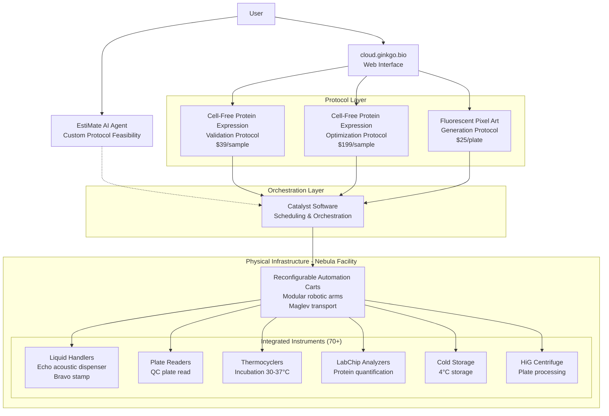
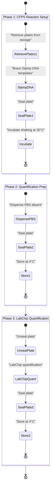
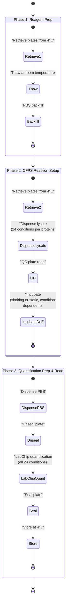
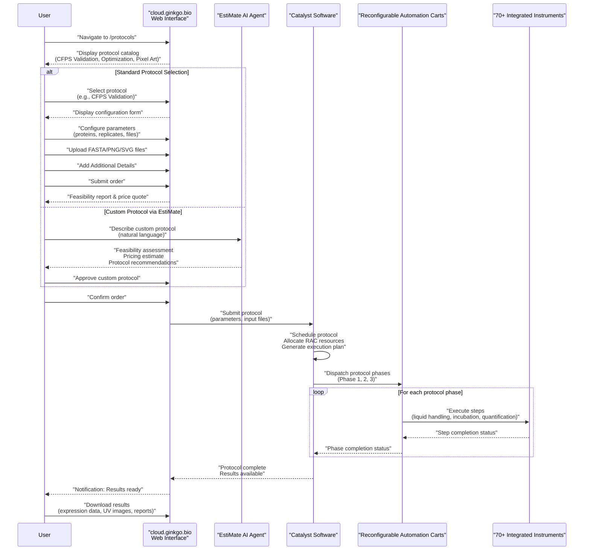

<!-- source: DeepWiki mcp.deepwiki.com · repo K-Dense-AI/claude-scientific-skills · extra page Ginkgo Cloud Lab Protocols · fetched 2026-10-26 -->

# Ginkgo Cloud Lab Protocols

Relevant source files

The following files were used as context for generating this wiki page:

- [.claude-plugin/marketplace.json](.claude-plugin/marketplace.json)
- [README.md](README.md)
- [docs/scientific-skills.md](docs/scientific-skills.md)
- [scientific-skills/ginkgo-cloud-lab/SKILL.md](scientific-skills/ginkgo-cloud-lab/SKILL.md)
- [scientific-skills/ginkgo-cloud-lab/references/cell-free-protein-expression-optimization.md](scientific-skills/ginkgo-cloud-lab/references/cell-free-protein-expression-optimization.md)
- [scientific-skills/ginkgo-cloud-lab/references/cell-free-protein-expression-validation.md](scientific-skills/ginkgo-cloud-lab/references/cell-free-protein-expression-validation.md)
- [scientific-skills/ginkgo-cloud-lab/references/fluorescent-pixel-art-generation.md](scientific-skills/ginkgo-cloud-lab/references/fluorescent-pixel-art-generation.md)

## Purpose and Scope

This document provides comprehensive technical documentation for the three certified and beta protocols available through Ginkgo Cloud Lab: Cell-Free Protein Expression Validation, Cell-Free Protein Expression Optimization, and Fluorescent Pixel Art Generation. Coverage includes protocol specifications, pricing, automated workflow phases, input/output formats, and infrastructure details for interacting with Ginkgo Bioworks' autonomous lab platform via `cloud.ginkgo.bio`.

For general laboratory automation concepts and other platforms, see [Laboratory Automation](#4.6). For broader scientific integration capabilities, see [Infrastructure & Platforms](#5) in the skill catalog.

**Sources:** [scientific-skills/ginkgo-cloud-lab/SKILL.md:1-57]()

---

## System Overview

Ginkgo Cloud Lab (`https://cloud.ginkgo.bio`) provides remote access to Ginkgo Bioworks' autonomous lab infrastructure. Protocols execute on **Reconfigurable Automation Carts (RACs)**—modular robotic units with high-precision arms, maglev sample transport, and integration with 70+ instruments. The **Catalyst** software orchestrates protocol scheduling, parameterization, and real-time monitoring across the facility.

The platform also includes **EstiMate**, an AI agent that accepts human-language protocol descriptions and returns feasibility assessments and pricing for custom workflows beyond the three listed protocols.

### System Architecture

**Sources:** [scientific-skills/ginkgo-cloud-lab/SKILL.md:8-57](), [README.md:476-479]()

---

## Protocol Catalog

The following table summarizes the three protocols available through Ginkgo Cloud Lab:

| Protocol | Status | Price | Turnaround | Input Format | Output |
|----------|--------|-------|------------|--------------|--------|
| Cell-Free Protein Expression Validation | Certified | $39/sample | 5-10 days | FASTA (≤1800 bp) | Expression confirmation, baseline titer (mg/L), purity % |
| Cell-Free Protein Expression Optimization | Certified | $199/sample | 6-11 days | FASTA | Comparative yield across 24 conditions, purity profiling, optimal conditions |
| Fluorescent Pixel Art Generation | Beta | $25/plate | 5-7 days | PNG/SVG (48x48 to 96x96 px) | High-res UV photographs (TIFF/JPEG) |

**Sources:** [scientific-skills/ginkgo-cloud-lab/SKILL.md:14-36](), [scientific-skills/ginkgo-cloud-lab/references/cell-free-protein-expression-validation.md:1-6](), [scientific-skills/ginkgo-cloud-lab/references/cell-free-protein-expression-optimization.md:1-6](), [scientific-skills/ginkgo-cloud-lab/references/fluorescent-pixel-art-generation.md:1-6]()

---

## Cell-Free Protein Expression Validation

### Protocol Specification

**URL:** `https://cloud.ginkgo.bio/protocols/cell-free-protein-expression-validation`  
**Status:** Ginkgo Certified  
**Price:** $39/sample (default order: 8 proteins × 3 replicates = 24 samples = $936)  
**Turnaround:** 5-10 days

This protocol provides rapid go/no-go expression screening using a proprietary reconstituted *E. coli* transcription-translation system (cell-free protein synthesis, CFPS). Reactions complete in 4-16 hours. Designed for early-stage screening, novel construct evaluation, and rapid triage before committing to downstream optimization or purification.

### Input Requirements

- **DNA sequence:** FASTA format
- **Sequence length:** Up to 1800 bp
- **File formats accepted:** CSV, Excel, FASTA, TXT, PDF, ZIP

### Output Deliverables

- **Expression Confirmation:** Verification of target protein at expected molecular weight
- **Baseline Titer:** Quantitative yield measurement (mg/L)
- **Initial Purity:** Percentage of target protein vs. impurities with virtual gel images

**Sources:** [scientific-skills/ginkgo-cloud-lab/references/cell-free-protein-expression-validation.md:8-21]()

### Automated Workflow

The validation protocol executes in three phases orchestrated by Catalyst software and executed by RACs:

**Workflow Details:**

**Phase 1 - CFPS Reaction Setup & Incubation:**
1. Retrieve plates from storage
2. Stamp DNA templates using Bravo liquid handler
3. Seal plate
4. Incubate shaking at 30°C (4-16 hours)

**Phase 2 - Quantification Prep:**
1. Dispense PBS diluent
2. Seal plate
3. Store at 4°C

**Phase 3 - LabChip Quantification:**
1. Unseal plate
2. Perform LabChip quantification (protein sizing and quantification)
3. Seal plate
4. Store at 4°C

**Sources:** [scientific-skills/ginkgo-cloud-lab/references/cell-free-protein-expression-validation.md:23-43]()

### Protocol Parameters

The validation protocol supports configuration of the following parameters via `cloud.ginkgo.bio`:

| Parameter | Type | Description |
|-----------|------|-------------|
| Number of Proteins | Integer | Configurable number of protein sequences to test |
| Number of Replicates | Integer | Technical replicates per protein (default: 3) |
| File Upload | CSV/Excel/FASTA/TXT/PDF/ZIP | DNA sequence input files |
| Additional Details | Free-text | Special requirements or notes |

### Certification Status

All validation protocol milestones are complete:
- ✓ Dry Run Complete
- ✓ Wet Run Complete
- ✓ Biovalidation Complete
- ✓ App Note Complete

**Sources:** [scientific-skills/ginkgo-cloud-lab/references/cell-free-protein-expression-validation.md:45-64]()

### Use Cases

- Screening candidate protein sequences for expressibility
- Go/no-go decisions before investing in optimization
- Evaluating novel constructs in a cell-free system
- Comparing expression levels across sequence variants

**Sources:** [scientific-skills/ginkgo-cloud-lab/references/cell-free-protein-expression-validation.md:66-72]()

---

## Cell-Free Protein Expression Optimization

### Protocol Specification

**URL:** `https://cloud.ginkgo.bio/protocols/cell-free-protein-expression-optimization`  
**Status:** Ginkgo Certified  
**Price:** $199/sample (default order: 1 protein × 3 replicates = 3 samples = $597)  
**Turnaround:** 6-11 days

Design of Experiment (DoE) approach to expressing protein targets in a proprietary reconstituted *E. coli* transcription-translation system. Each construct is evaluated in up to **24 reaction conditions per protein**, including target-specific additives such as chaperones, disulfide-bond enhancers, and cofactors. Designed for difficult-to-express proteins including membrane proteins and targets with disulfide or cofactor requirements.

### Input Requirements

- **DNA sequence:** FASTA format
- **File formats accepted:** CSV, Excel, FASTA, TXT, PDF, ZIP

### Output Deliverables

- **Comparative Yield:** Titer data mapped across all tested variables (lysates, temperatures, additives)
- **Purity Profiling:** Target protein vs. background impurities to identify highest quality yield
- **Optimal Conditions:** Overlaid electropherograms pinpointing the exact formulation for a given sequence

**Sources:** [scientific-skills/ginkgo-cloud-lab/references/cell-free-protein-expression-optimization.md:8-20]()

### Automated Workflow

The optimization protocol executes in three phases, testing up to 24 conditions per protein:

**Workflow Details:**

**Phase 1 - Reagent Prep:**
1. Retrieve plates from 4°C storage
2. Thaw at room temperature
3. PBS backfill

**Phase 2 - CFPS Reaction Setup & Incubation:**
1. Retrieve plates from 4°C storage
2. Dispense lysate (24 conditions per protein)
3. QC plate read
4. Incubate (shaking or static, condition-dependent)

**Phase 3 - Quantification Prep & Read:**
1. Dispense PBS
2. Unseal plate
3. LabChip quantification (all 24 conditions)
4. Seal plate
5. Store at 4°C

**Sources:** [scientific-skills/ginkgo-cloud-lab/references/cell-free-protein-expression-optimization.md:22-43]()

### Optimization Variables - DoE Matrix

The DoE matrix spans up to 24 conditions per protein, varying:

| Variable Category | Options |
|-------------------|---------|
| **Lysate Composition** | Different *E. coli* extract formulations |
| **Temperature** | Multiple incubation temperature profiles |
| **Chaperones** | Folding-challenged targets |
| **Disulfide-Bond Enhancers** | Targets requiring disulfide bridges |
| **Cofactors** | Metal ions, coenzymes, prosthetic groups |
| **Other Additives** | Target-specific supplements |

**Sources:** [scientific-skills/ginkgo-cloud-lab/references/cell-free-protein-expression-optimization.md:52-63]()

### Protocol Parameters

| Parameter | Type | Description |
|-----------|------|-------------|
| Number of Proteins | Integer | Configurable number of protein sequences to optimize |
| Number of Replicates | Integer | Technical replicates per protein (default: 3) |
| File Upload | CSV/Excel/FASTA/TXT/PDF/ZIP | DNA sequence input files |
| Additional Details | Free-text | Special requirements for DoE matrix customization |

**Sources:** [scientific-skills/ginkgo-cloud-lab/references/cell-free-protein-expression-optimization.md:65-69]()

### Use Cases

- Optimizing expression of difficult-to-express proteins
- Membrane protein expression screening
- Identifying optimal conditions for disulfide-bonded proteins
- Cofactor-dependent protein expression
- Systematic exploration of expression parameter space
- Finding the best formulation before scaling up production

**Sources:** [scientific-skills/ginkgo-cloud-lab/references/cell-free-protein-expression-optimization.md:78-86]()

---

## Fluorescent Pixel Art Generation

### Protocol Specification

**URL:** `https://cloud.ginkgo.bio/protocols/fluorescent-pixel-art-generation`  
**Status:** Beta  
**Price:** $25/plate  
**Turnaround:** 5-7 days

Transforms a digital image into living, fluorescent bacterial artwork printed on an agar omni-tray. Customers submit a pixel art design and colors are mapped to distinct fluorescent *E. coli* strains. Overnight cultures are prepared from frozen glycerol stocks, diluted, and dispensed onto selective LB-chloramphenicol agar plates via **Echo acoustic liquid handling** at 50 nL per spot. Plates are incubated at 30°C for 16 hours, followed by 4°C for 12 hours to stabilize colony morphology and fluorescence. High-resolution photographs are captured under UV illumination and delivered digitally.

### Input Requirements

- **Image file:** PNG or SVG format
- **Resolution:** 48×48 to 96×96 pixels
- **Color mapping:** Match image colors to fluorescent strain palette (11 colors available)
- **Orientation:** Confirm plate orientation and multi-plate designs
- **File formats accepted:** CSV, Excel, FASTA, TXT, PDF, ZIP, PNG, JPG, GIF, SVG, WEBP

### Output Deliverables

- **Digital delivery:** High-resolution UV images in TIFF/JPEG format
- **Optional add-ons:** Framed archival prints

**Sources:** [scientific-skills/ginkgo-cloud-lab/references/fluorescent-pixel-art-generation.md:8-38]()

### Available Fluorescent E. coli Strains

The protocol supports 11 fluorescent protein strains for color mapping:

| Strain/Protein | Color | Fluorescence Characteristics |
|----------------|-------|------------------------------|
| sfGFP | Green | Super-folder GFP |
| mRFP | Red | Monomeric red fluorescent protein |
| mKO2 | Orange | Orange fluorescent protein |
| Venus | Yellow | Enhanced yellow fluorescent protein |
| Azurite | Blue | Blue fluorescent protein |
| mClover3 | Bright Green | Bright green variant |
| mJuniper | Dark Green | Dark green variant |
| mTurquoise2 | Cyan | Cyan fluorescent protein |
| Electra2 | Electric Blue | Electric blue variant |
| mWasabi | Light Green | Light green fluorescent protein |
| mScarlet-I | Scarlet | Far-red fluorescent protein |

**Sources:** [scientific-skills/ginkgo-cloud-lab/references/fluorescent-pixel-art-generation.md:19-34]()

### Automated Workflow

The pixel art protocol executes in three phases using Echo acoustic dispensing:

```mermaid
stateDiagram-v2
    [*] --> Phase1
    
    state "Phase 1: Source Plate Preparation" as Phase1 {
        [*] --> Shake: "Shake source plate"
        Shake --> Centrifuge1: "Centrifuge source plate"
        Centrifuge1 --> PeelSource: "Peel source plate seal"
        PeelSource --> [*]
    }
    
    Phase1 --> Phase2
    
    state "Phase 2: Acoustic Dispensing<br/>(per destination plate)" as Phase2 {
        [*] --> PeelDest: "Peel destination seal"
        PeelDest --> EchoDispense: "Echo hit-pick dispensing<br/>(50 nL per spot)"
        EchoDispense --> SealDest: "Seal destination plate"
        SealDest --> ShakeDest: "Shake destination plate"
        ShakeDest --> CentrifugeDest: "Centrifuge destination"
        CentrifugeDest --> Store30: "Store at 30°C<br/>(16 hr incubation)"
        Store30 --> [*]
    }
    
    Phase2 --> Phase3
    
    state "Phase 3: Source Storage" as Phase3 {
        [*] --> SealSource: "Seal source plate"
        SealSource --> StoreSource: "Store source plate"
        StoreSource --> [*]
    }
    
    Phase3 --> PostProcess
    
    state "Post-Processing" as PostProcess {
        [*] --> Transfer4C: "Transfer to 4°C<br/>(12 hr stabilization)"
        Transfer4C --> UVPhoto: "UV illumination photography"
        UVPhoto --> ImageProc: "Image processing and delivery"
        ImageProc --> [*]
    }
    
    PostProcess --> [*]
```

**Workflow Details:**

**Phase 1 - Source Plate Preparation:**
1. Shake source plate (overnight cultures)
2. Centrifuge source plate
3. Peel source plate seal

**Phase 2 - Acoustic Dispensing (per destination plate):**
1. Peel destination seal
2. **Echo hit-pick dispensing** at 50 nL per spot
3. Seal destination plate
4. Shake destination plate
5. Centrifuge destination
6. Store at 30°C for 16 hours (incubation)

**Phase 3 - Source Storage:**
1. Seal source plate
2. Store source plate

**Post-Processing:**
1. Transfer to 4°C for 12 hours (fluorescence stabilization)
2. UV illumination photography
3. Image processing and delivery

**Sources:** [scientific-skills/ginkgo-cloud-lab/references/fluorescent-pixel-art-generation.md:40-67]()

### Protocol Parameters

| Parameter | Type | Description |
|-----------|------|-------------|
| Number of Plates | Integer | Configurable number of destination plates |
| File Upload | CSV/Excel/PNG/JPG/SVG/PDF/ZIP | Image files for pixel art |
| Additional Details | Free-text | Orientation, color mapping, special requirements |

**Sources:** [scientific-skills/ginkgo-cloud-lab/references/fluorescent-pixel-art-generation.md:69-72]()

### Use Cases

- Educational outreach and demonstrations
- Unique scientific art and gifts
- Conference displays and promotional materials
- Lab team celebrations
- Visualizing biological art concepts

**Sources:** [scientific-skills/ginkgo-cloud-lab/references/fluorescent-pixel-art-generation.md:81-88]()

---

## General Ordering Workflow

The following sequence diagram illustrates the end-to-end ordering process for all Ginkgo Cloud Lab protocols:

### Ordering Steps

1. **Navigate to** `https://cloud.ginkgo.bio/protocols`
2. **Select a protocol:**
   - Cell-Free Protein Expression Validation
   - Cell-Free Protein Expression Optimization
   - Fluorescent Pixel Art Generation
3. **Configure parameters:**
   - Number of samples/proteins/plates
   - Number of replicates
4. **Upload input files:**
   - FASTA for protein protocols
   - PNG/SVG for pixel art
5. **Add special requirements** in the Additional Details field
6. **Submit order** and receive feasibility report and price quote
7. **Confirm order** to initiate execution

For protocols not listed, use the **EstiMate** chat to describe a custom protocol in plain language and receive compatibility assessment and pricing.

**Sources:** [scientific-skills/ginkgo-cloud-lab/SKILL.md:37-45]()

---

## Infrastructure Details

### Key Components

| Component | Description |
|-----------|-------------|
| **RACs (Reconfigurable Automation Carts)** | Modular robotic units with high-precision arms and maglev transport for sample movement |
| **Catalyst Software** | Protocol orchestration, scheduling, parameterization, and real-time monitoring system |
| **70+ Integrated Instruments** | Sample prep, liquid handling (Echo, Bravo), analytical readouts (LabChip), storage, incubation |
| **Nebula Facility** | Ginkgo's autonomous lab facility in Boston, MA where RACs operate |

### Instrument Integration

The following diagram shows how Catalyst orchestrates instrument coordination across protocol phases:

```mermaid
graph TB
    Catalyst["Catalyst Software<br/>Protocol Orchestration"]
    
    subgraph "Sample Preparation"
        PlateRetrieval["Plate Retrieval<br/>4°C Storage System"]
        Centrifuge["HiG Centrifuge<br/>Plate Processing"]
        Sealing["Plate Sealing<br/>Automated Seal/Unseal"]
    end
    
    subgraph "Liquid Handling"
        Bravo["Bravo Stamp<br/>DNA Template Stamping"]
        Echo["Echo Acoustic Dispenser<br/>50 nL precision<br/>(Pixel Art)"]
        Dispense["Reagent Dispensers<br/>PBS, Lysates"]
    end
    
    subgraph "Incubation"
        Thermal30["30°C Incubator<br/>Shaking/Static<br/>(CFPS, Pixel Art)"]
        Thermal37["37°C Incubator<br/>(CFPS)"]
        Storage4C["4°C Storage<br/>Post-reaction"]
    end
    
    subgraph "Analysis"
        QC["QC Plate Reader<br/>Pre-quantification"]
        LabChip["LabChip Analyzer<br/>Protein Quantification<br/>Electropherograms"]
        UVImaging["UV Photography<br/>High-res Imaging<br/>(Pixel Art)"]
    end
    
    Catalyst --> PlateRetrieval
    Catalyst --> Centrifuge
    Catalyst --> Sealing
    Catalyst --> Bravo
    Catalyst --> Echo
    Catalyst --> Dispense
    Catalyst --> Thermal30
    Catalyst --> Thermal37
    Catalyst --> Storage4C
    Catalyst --> QC
    Catalyst --> LabChip
    Catalyst --> UVImaging
```

**Sources:** [scientific-skills/ginkgo-cloud-lab/SKILL.md:51-57]()

---

## Authentication and Access

Access Ginkgo Cloud Lab at `https://cloud.ginkgo.bio`. Account creation or institutional access may be required.

For access questions, contact Ginkgo at:
- **Email:** `cloud@ginkgo.bio`

**Sources:** [scientific-skills/ginkgo-cloud-lab/SKILL.md:47-49]()

---

## Certification Status

All protocols undergo a four-milestone certification process:

| Milestone | Description |
|-----------|-------------|
| **Dry Run Complete** | Protocol validated without biological materials |
| **Wet Run Complete** | Protocol executed with biological materials |
| **Biovalidation Complete** | Biological results verified against expected outcomes |
| **App Note Complete** | Application note published documenting protocol performance |

**Current Status:**
- Cell-Free Protein Expression Validation: ✓ All milestones complete (Certified)
- Cell-Free Protein Expression Optimization: ✓ All milestones complete (Certified)
- Fluorescent Pixel Art Generation: In progress (Beta)

**Sources:** [scientific-skills/ginkgo-cloud-lab/references/cell-free-protein-expression-validation.md:59-64](), [scientific-skills/ginkgo-cloud-lab/references/cell-free-protein-expression-optimization.md:71-77](), [scientific-skills/ginkgo-cloud-lab/references/fluorescent-pixel-art-generation.md:74-79]()

---

## Pricing Summary

| Protocol | Base Price | Default Order Configuration | Default Total |
|----------|------------|----------------------------|---------------|
| CFPS Validation | $39/sample | 8 proteins × 3 replicates = 24 samples | $936 |
| CFPS Optimization | $199/sample | 1 protein × 3 replicates = 3 samples | $597 |
| Fluorescent Pixel Art | $25/plate | 1 plate | $25 |

All pricing is configurable based on the number of proteins, samples, replicates, or plates required.

**Sources:** [scientific-skills/ginkgo-cloud-lab/references/cell-free-protein-expression-validation.md:5](), [scientific-skills/ginkgo-cloud-lab/references/cell-free-protein-expression-optimization.md:5](), [scientific-skills/ginkgo-cloud-lab/references/fluorescent-pixel-art-generation.md:5]()

---

