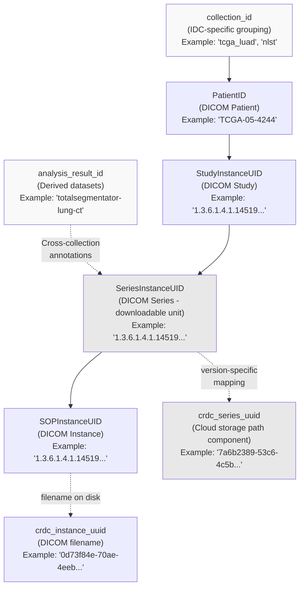
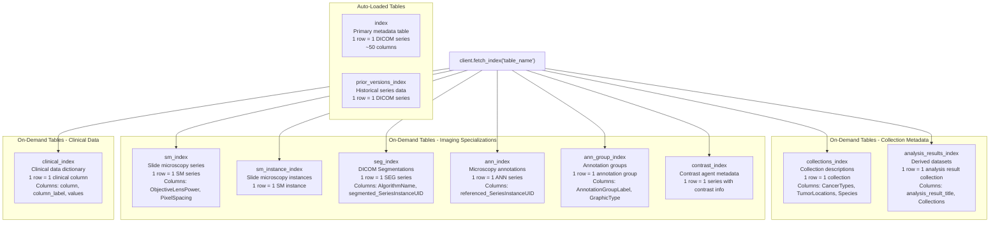
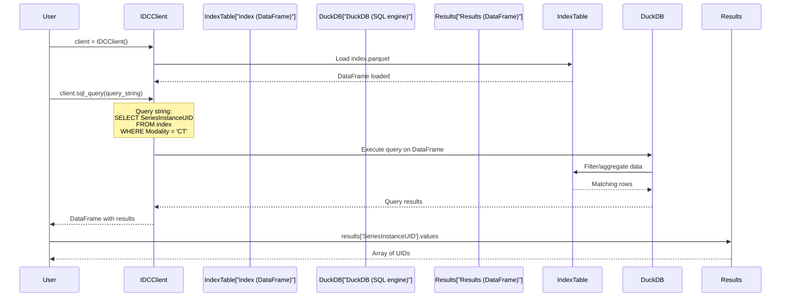
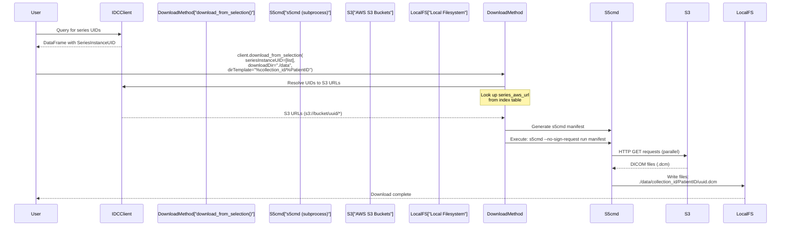
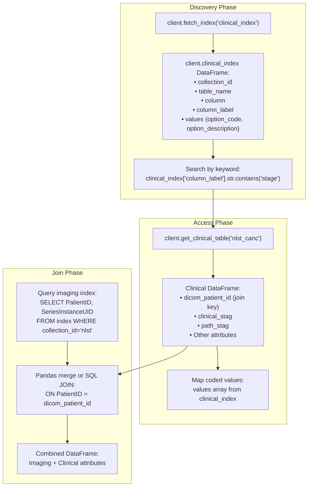
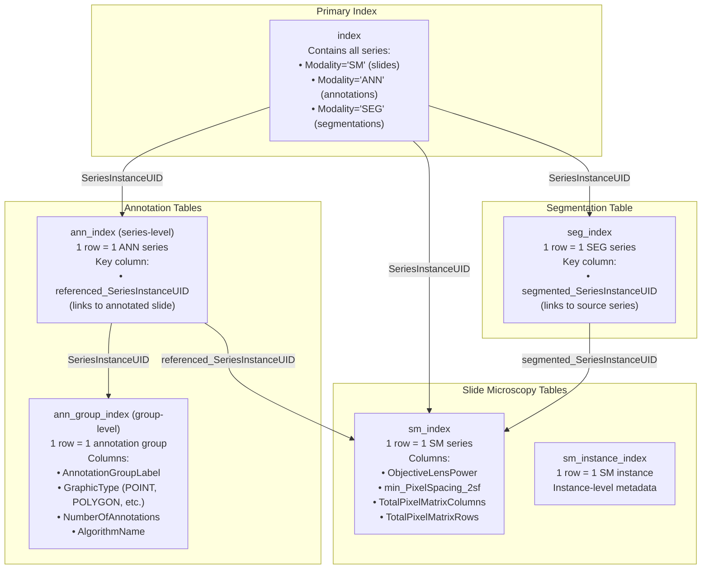
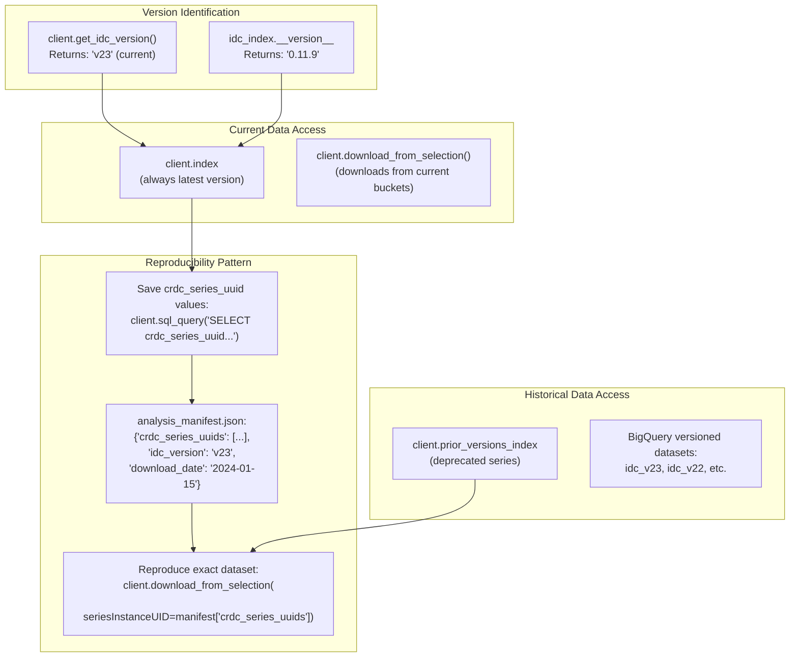
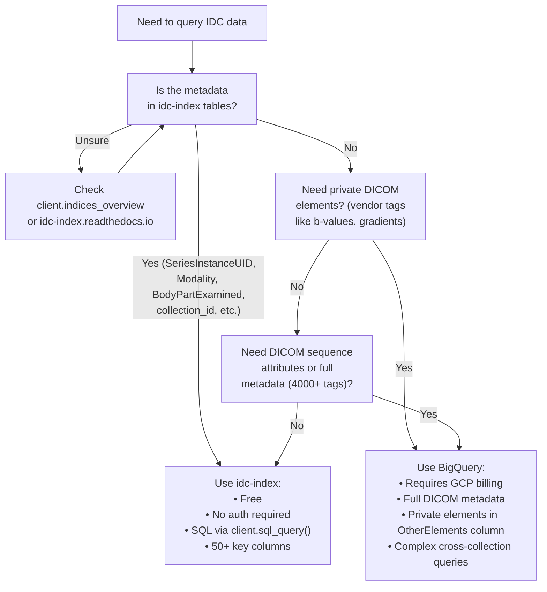

<!-- source: DeepWiki mcp.deepwiki.com · repo K-Dense-AI/claude-scientific-skills · extra page Imaging Data Commons · fetched 2026-10-26 -->

# Imaging Data Commons

<details>
<summary>Relevant source files</summary>

The following files were used as context for generating this wiki page:

- [scientific-skills/imaging-data-commons/SKILL.md](scientific-skills/imaging-data-commons/SKILL.md)
- [scientific-skills/imaging-data-commons/references/bigquery_guide.md](scientific-skills/imaging-data-commons/references/bigquery_guide.md)
- [scientific-skills/imaging-data-commons/references/cli_guide.md](scientific-skills/imaging-data-commons/references/cli_guide.md)
- [scientific-skills/imaging-data-commons/references/clinical_data_guide.md](scientific-skills/imaging-data-commons/references/clinical_data_guide.md)
- [scientific-skills/imaging-data-commons/references/cloud_storage_guide.md](scientific-skills/imaging-data-commons/references/cloud_storage_guide.md)
- [scientific-skills/imaging-data-commons/references/dicomweb_guide.md](scientific-skills/imaging-data-commons/references/dicomweb_guide.md)
- [scientific-skills/imaging-data-commons/references/digital_pathology_guide.md](scientific-skills/imaging-data-commons/references/digital_pathology_guide.md)
- [scientific-skills/imaging-data-commons/references/index_tables_guide.md](scientific-skills/imaging-data-commons/references/index_tables_guide.md)
- [scientific-skills/imaging-data-commons/references/sql_patterns.md](scientific-skills/imaging-data-commons/references/sql_patterns.md)
- [scientific-skills/imaging-data-commons/references/use_cases.md](scientific-skills/imaging-data-commons/references/use_cases.md)

</details>


## Purpose and Scope

This document covers the **Imaging Data Commons (IDC)** skill for accessing the National Cancer Institute's public repository of cancer imaging data through the `idc-index` Python package. The skill provides programmatic access to 250+ cancer imaging collections (>100TB of radiology and pathology data) with no authentication required. For clinical variant databases and cancer genomics resources, see [Clinical Databases and Variant Interpretation](#4.3.1).

**Core capabilities:**
- Query metadata across 73M+ DICOM instances using SQL or pandas DataFrames
- Download imaging series with automatic cloud storage routing (S3/GCS)
- Access clinical data tables with patient-image linkage
- Visualize DICOM data in browser without local installation
- Generate citations for data attribution
- Access specialized indices for segmentations, annotations, slide microscopy

**Current IDC version:** v23 (always verify with `IDCClient().get_idc_version()`)

**Sources:** [scientific-skills/imaging-data-commons/SKILL.md:1-100]()

---

## IDCClient Architecture

The `IDCClient` class provides the primary interface for all IDC operations. It initializes with two automatically loaded index tables (`index` and `prior_versions_index`) and provides methods for fetching additional specialized indices on demand.

### IDCClient Class Structure

```mermaid
graph TB
    subgraph "IDCClient Initialization"
        Init["IDCClient()"]
        LoadIndex["Auto-loads:<br/>• index (primary)<br/>• prior_versions_index"]
        Init --> LoadIndex
    end
    
    subgraph "Core Methods"
        SQLQuery["sql_query(query_string)"]
        FetchIndex["fetch_index(table_name)"]
        Download["download_from_selection(**filters)"]
        ViewerURL["get_viewer_URL(seriesInstanceUID=...)"]
        Citations["citations_from_selection(**filters)"]
        GetVersion["get_idc_version()"]
        GetClinical["get_clinical_table(table_name)"]
    end
    
    subgraph "Index Tables - DataFrames"
        PrimaryIndex["client.index<br/>(DataFrame)"]
        PriorVersions["client.prior_versions_index<br/>(DataFrame)"]
        CollectionsIndex["client.collections_index<br/>(fetch_index required)"]
        AnalysisResults["client.analysis_results_index<br/>(fetch_index required)"]
        SMIndex["client.sm_index<br/>(fetch_index required)"]
        SegIndex["client.seg_index<br/>(fetch_index required)"]
        AnnIndex["client.ann_index<br/>(fetch_index required)"]
        ClinicalIndex["client.clinical_index<br/>(fetch_index required)"]
    end
    
    subgraph "Storage Backend"
        S3["AWS S3 Buckets:<br/>• idc-open-data<br/>• idc-open-data-two<br/>• idc-open-data-cr"]
        GCS["GCS Buckets:<br/>• idc-open-data<br/>• idc-open-idc1<br/>• idc-open-cr"]
        S5cmd["s5cmd<br/>(internal downloader)"]
    end
    
    LoadIndex --> PrimaryIndex
    LoadIndex --> PriorVersions
    
    FetchIndex --> CollectionsIndex
    FetchIndex --> AnalysisResults
    FetchIndex --> SMIndex
    FetchIndex --> SegIndex
    FetchIndex --> AnnIndex
    FetchIndex --> ClinicalIndex
    
    SQLQuery --> PrimaryIndex
    SQLQuery --> CollectionsIndex
    
    Download --> S5cmd
    S5cmd --> S3
    S5cmd --> GCS
    
    ViewerURL --> OHIFViewer["OHIF Viewer (radiology)"]
    ViewerURL --> SlimViewer["Slim Viewer (pathology)"]
```



**Sources:** [scientific-skills/imaging-data-commons/SKILL.md:23-63, 239-277]()

---

## Data Model and Identifiers

IDC organizes imaging data in a hierarchy that extends the standard DICOM model with two additional grouping levels: `collection_id` and `analysis_result_id`.

### Identifier Hierarchy



**Key identifier types:**

| Identifier | Type | Scope | Use For | Example |
|------------|------|-------|---------|---------|
| `collection_id` | STRING | Dataset grouping | Filtering by project/study | `tcga_luad`, `nlst` |
| `analysis_result_id` | STRING | Derived datasets | Finding annotations/segmentations | `totalsegmentator-v1` |
| `PatientID` | STRING (DICOM) | Patient | Grouping images by patient | `TCGA-05-4244` |
| `StudyInstanceUID` | STRING (DICOM) | Study | Multi-series exam grouping | `1.3.6.1.4...` |
| `SeriesInstanceUID` | STRING (DICOM) | Series | **Primary query/download unit** | `1.3.6.1.4...` |
| `SOPInstanceUID` | STRING (DICOM) | Instance | Individual file identification | `1.3.6.1.4...` |
| `crdc_series_uuid` | STRING (UUID) | Series version | Cloud storage paths, reproducibility | `7a6b2389-53c6...` |
| `crdc_instance_uuid` | STRING (UUID) | Instance version | DICOM filenames on disk | `0d73f84e-70ae...` |

**Note:** A patient belongs to exactly one `collection_id`. Multiple `analysis_result_id` collections can reference the same source series for derived annotations.

**Sources:** [scientific-skills/imaging-data-commons/SKILL.md:101-117](), [scientific-skills/imaging-data-commons/references/cloud_storage_guide.md:61-68]()

---

## Index Table System

The `idc-index` package provides 11 specialized index tables for querying metadata without requiring BigQuery authentication. Tables are accessed via SQL queries (`client.sql_query()`) or as pandas DataFrames (`client.table_name`).

### Index Table Schema Discovery

```python
# Get complete schema for any index table
client = IDCClient()
schema = client.indices_overview["index"]["schema"]

# List all columns with types and descriptions
for col in schema['columns']:
    print(f"{col['name']} ({col['type']}): {col.get('description', '')}")

# Check which columns are sourced from DICOM attributes
dicom_cols = [c['name'] for c in schema['columns'] 
              if 'DICOM' in c.get('description', '').upper()]
```

**Sources:** [scientific-skills/imaging-data-commons/references/index_tables_guide.md:55-88]()

### Available Index Tables



**Key join columns:**

| Table A | Table B | Join Condition |
|---------|---------|----------------|
| `index` | `collections_index` | `index.collection_id = collections_index.collection_id` |
| `index` | `sm_index` | `index.SeriesInstanceUID = sm_index.SeriesInstanceUID` |
| `index` | `seg_index` | `index.SeriesInstanceUID = seg_index.segmented_SeriesInstanceUID` |
| `index` | `ann_index` | `index.SeriesInstanceUID = ann_index.referenced_SeriesInstanceUID` |
| `ann_index` | `ann_group_index` | `ann_index.SeriesInstanceUID = ann_group_index.SeriesInstanceUID` |

**Sources:** [scientific-skills/imaging-data-commons/SKILL.md:119-165](), [scientific-skills/imaging-data-commons/references/index_tables_guide.md:1-147]()

---

## Query and Download Workflows

### SQL Query Workflow



**Example query patterns:**

```python
from idc_index import IDCClient
client = IDCClient()

# Basic filtering
ct_series = client.sql_query("""
    SELECT SeriesInstanceUID, PatientID, collection_id
    FROM index
    WHERE Modality = 'CT' AND BodyPartExamined = 'CHEST'
    LIMIT 100
""")

# Join with collections for cancer type filtering
client.fetch_index("collections_index")
lung_cancer_ct = client.sql_query("""
    SELECT i.SeriesInstanceUID, i.PatientID, c.CancerTypes
    FROM index i
    JOIN collections_index c ON i.collection_id = c.collection_id
    WHERE c.CancerTypes LIKE '%Lung%' AND i.Modality = 'CT'
""")

# Find segmentations for specific source images
client.fetch_index("seg_index")
segmentations = client.sql_query("""
    SELECT 
        s.SeriesInstanceUID as seg_series,
        s.AlgorithmName,
        src.SeriesInstanceUID as source_series
    FROM seg_index s
    JOIN index src ON s.segmented_SeriesInstanceUID = src.SeriesInstanceUID
    WHERE src.Modality = 'CT' AND src.BodyPartExamined = 'CHEST'
""")
```

**Sources:** [scientific-skills/imaging-data-commons/SKILL.md:283-347](), [scientific-skills/imaging-data-commons/references/sql_patterns.md:1-208]()

### Download Workflow



**Download method signatures:**

```python
# Download by filters (collection_id, patientId, studyInstanceUID, seriesInstanceUID)
client.download_from_selection(
    collection_id="nlst",
    downloadDir="./data",
    dirTemplate="%collection_id/%PatientID/%Modality_%SeriesInstanceUID"
)

# Download from query results
series_uids = query_results['SeriesInstanceUID'].tolist()
client.download_from_selection(
    seriesInstanceUID=series_uids,
    downloadDir="./data"
)

# Download specific series with custom structure
client.download_from_selection(
    seriesInstanceUID=["1.3.6.1.4.1.14519..."],
    downloadDir="./data",
    dirTemplate=""  # Flat structure
)
```

**CLI alternative:**

```bash
# Command-line download without Python
idc download nlst --download-dir ./data
idc download "1.3.6.1.4.1.14519..." --download-dir ./data
idc download manifest.txt --download-dir ./data
```

**Sources:** [scientific-skills/imaging-data-commons/SKILL.md:359-424](), [scientific-skills/imaging-data-commons/references/cli_guide.md:1-273]()

---

## Access Methods Comparison

IDC data is accessible through five distinct methods, each with different coverage, authentication requirements, and use cases.

```mermaid
graph TB
    subgraph "Access Methods"
        IDCIndex["idc-index<br/>Python package<br/>pip install idc-index"]
        Portal["IDC Portal<br/>portal.imaging.datacommons.cancer.gov"]
        Proxy["DICOMweb Public Proxy<br/>proxy.imaging.datacommons.cancer.gov"]
        Healthcare["Google Healthcare API<br/>healthcare.googleapis.com"]
        DirectCloud["Direct Cloud Storage<br/>AWS S3 / Google Cloud Storage"]
    end
    
    subgraph "Storage Backends"
        S3Open["s3://idc-open-data<br/>(>90% of data)"]
        S3Two["s3://idc-open-data-two<br/>(head scans)"]
        S3CR["s3://idc-open-data-cr<br/>(CC BY-NC ~4%)"]
    end
    
    subgraph "Use Cases"
        Query["Metadata Queries"]
        Download["Bulk Downloads"]
        Visualization["Browser Visualization"]
        Integration["Tool Integration"]
        AdvancedQuery["Advanced Queries"]
    end
    
    IDCIndex -->|"100% coverage"| S3Open
    IDCIndex -->|"100% coverage"| S3Two
    IDCIndex -->|"100% coverage"| S3CR
    
    Portal -->|"100% coverage"| S3Open
    Portal -->|"100% coverage"| S3Two
    Portal -->|"100% coverage"| S3CR
    
    Proxy -->|"100% coverage"| S3Open
    Proxy -->|"100% coverage"| S3Two
    Proxy -->|"100% coverage"| S3CR
    
    Healthcare -->|"~96% coverage<br/>(idc-open-data only)"| S3Open
    
    DirectCloud --> S3Open
    DirectCloud --> S3Two
    DirectCloud --> S3CR
    
    IDCIndex --> Query
    IDCIndex --> Download
    Portal --> Visualization
    Proxy --> Integration
    Healthcare --> Integration
    DirectCloud --> Download
```



**Method comparison table:**

| Method | Auth Required | Coverage | Version Access | Best For |
|--------|---------------|----------|----------------|----------|
| `idc-index` (Python) | No | 100% | Current + prior_versions_index | Programmatic queries, batch downloads |
| IDC Portal (Web) | No | 100% | Current only | Interactive exploration, cohort building |
| DICOMweb Public Proxy | No | 100% | Current only | PACS integration, DICOMweb tools |
| Google Healthcare API | Yes (GCP account) | ~96% | Current only | Production DICOMweb with high quotas |
| Direct Cloud Storage | No | 100% | All versions | Custom pipelines, maximum performance |

**DICOMweb endpoints:**

```python
# Public proxy (no auth, 100% coverage)
PROXY_URL = "https://proxy.imaging.datacommons.cancer.gov/current/viewer-only-no-downloads-see-tinyurl-dot-com-slash-3j3d9jyp/dicomWeb"

# Google Healthcare (auth required, ~96% coverage)
# Replace {VERSION} with output from client.get_idc_version()
HEALTHCARE_URL = "https://healthcare.googleapis.com/v1/projects/nci-idc-data/locations/us-central1/datasets/idc/dicomStores/idc-store-v{VERSION}/dicomWeb"
```

**Sources:** [scientific-skills/imaging-data-commons/SKILL.md:183-216](), [scientific-skills/imaging-data-commons/references/dicomweb_guide.md:1-400]()

---

## Integration with Clinical Data

IDC provides clinical data tables (demographics, staging, treatments, outcomes) for ~70 collections. The `clinical_index` table serves as a dictionary/catalog, and individual clinical tables are accessed via `client.get_clinical_table()`.

### Clinical Data Access Pattern



**Example workflow:**

```python
from idc_index import IDCClient
import pandas as pd

client = IDCClient()
client.fetch_index('clinical_index')

# 1. Discover available clinical data
stage_columns = client.clinical_index[
    client.clinical_index['column_label'].str.contains('[Ss]tage', na=False)
]
print(stage_columns[['collection_id', 'short_table_name', 'column', 'column_label']])

# 2. Load clinical table
nlst_canc = client.get_clinical_table("nlst_canc")

# 3. Map coded values to descriptions
stage_values = client.clinical_index[
    (client.clinical_index['collection_id']=='nlst') &
    (client.clinical_index['column']=='clinical_stag')
]['values'].values[0]

# Create mapping dictionary
mapping = {item['option_code']: item['option_description'] 
           for item in stage_values}

nlst_canc['stage_description'] = nlst_canc['clinical_stag'].astype(str).map(mapping)

# 4. Join with imaging data
imaging = client.sql_query("""
    SELECT PatientID, SeriesInstanceUID, Modality
    FROM index WHERE collection_id = 'nlst' AND Modality = 'CT'
""")

combined = pd.merge(
    imaging,
    nlst_canc[['dicom_patient_id', 'clinical_stag', 'stage_description']],
    left_on='PatientID',
    right_on='dicom_patient_id',
    how='inner'
)

# Filter for Stage IV patients
stage_iv_ct = combined[combined['clinical_stag'] == '400']
print(f"Found {len(stage_iv_ct)} Stage IV CT series")
```

**Sources:** [scientific-skills/imaging-data-commons/SKILL.md:167-181](), [scientific-skills/imaging-data-commons/references/clinical_data_guide.md:1-325]()

---

## Digital Pathology Support

IDC provides specialized index tables for slide microscopy imaging and annotations: `sm_index`, `sm_instance_index`, `ann_index`, `ann_group_index`. These enable queries for whole slide images (WSI) and AI-generated annotations.

### Slide Microscopy and Annotation Architecture



**Query patterns:**

```python
client = IDCClient()
client.fetch_index("sm_index")
client.fetch_index("ann_index")
client.fetch_index("ann_group_index")
client.fetch_index("seg_index")

# Find high-resolution slides
slides = client.sql_query("""
    SELECT i.collection_id, s.ObjectiveLensPower, s.min_PixelSpacing_2sf
    FROM sm_index s
    JOIN index i ON s.SeriesInstanceUID = i.SeriesInstanceUID
    WHERE s.ObjectiveLensPower >= 40
    ORDER BY s.min_PixelSpacing_2sf
    LIMIT 20
""")

# Find annotations by label (e.g., "blast" cell annotations)
annotations = client.sql_query("""
    SELECT 
        g.AnnotationGroupLabel,
        g.GraphicType,
        g.NumberOfAnnotations,
        i.collection_id
    FROM ann_group_index g
    JOIN ann_index a ON g.SeriesInstanceUID = a.SeriesInstanceUID
    JOIN index i ON a.SeriesInstanceUID = i.SeriesInstanceUID
    WHERE LOWER(g.AnnotationGroupLabel) LIKE '%blast%'
    ORDER BY g.NumberOfAnnotations DESC
""")

# Find segmentations on slide microscopy images
seg_on_sm = client.sql_query("""
    SELECT 
        seg.AlgorithmName,
        seg.total_segments,
        src.collection_id
    FROM seg_index seg
    JOIN index src ON seg.segmented_SeriesInstanceUID = src.SeriesInstanceUID
    WHERE src.Modality = 'SM'
    LIMIT 20
""")
```

**Sources:** [scientific-skills/imaging-data-commons/references/digital_pathology_guide.md:1-255]()

---

## Versioning and Reproducibility

IDC releases new data versions every 2-4 months. The CRDC UUID system enables exact reproducibility by preserving all historical file versions in cloud storage.

### Version Management



**Reproducibility workflow:**

```python
from idc_index import IDCClient
import json
from datetime import date

client = IDCClient()

# Select data for analysis
selection = client.sql_query("""
    SELECT crdc_series_uuid, SeriesInstanceUID, collection_id
    FROM index
    WHERE collection_id = 'tcga_luad' AND Modality = 'CT'
    LIMIT 10
""")

# Download data
series_uuids = list(selection['crdc_series_uuid'])
client.download_from_selection(
    seriesInstanceUID=series_uuids,
    downloadDir="./data"
)

# Save manifest for reproducibility
manifest = {
    "crdc_series_uuids": series_uuids,
    "dicom_series_uids": list(selection['SeriesInstanceUID']),
    "collection_id": "tcga_luad",
    "idc_version": client.get_idc_version(),
    "idc_index_version": idc_index.__version__,
    "download_date": str(date.today()),
    "description": "CT scans for lung cancer analysis"
}

with open("analysis_manifest.json", "w") as f:
    json.dump(manifest, f, indent=2)

# Later, reproduce exact dataset:
with open("analysis_manifest.json") as f:
    manifest = json.load(f)

client.download_from_selection(
    seriesInstanceUID=manifest["crdc_series_uuids"],
    downloadDir="./reproduced_data"
)
```

**Key versioning concepts:**

| Concept | Explanation |
|---------|-------------|
| **IDC version** | Data release version (v23, v24, etc.) - new releases every 2-4 months |
| **idc-index version** | Python package version - always matches IDC version (0.11.9 → v23) |
| **CRDC UUID** | Immutable identifier for specific file version - enables exact reproducibility |
| **DICOM UID** | Clinical identifier - may map to multiple CRDC UUIDs across versions |
| **prior_versions_index** | Contains deprecated series from previous releases |

**Sources:** [scientific-skills/imaging-data-commons/references/cloud_storage_guide.md:202-271]()

---

## Visualization and Citations

### Browser-Based Visualization

```python
from idc_index import IDCClient
import webbrowser

client = IDCClient()

# Get series UID from query
series = client.sql_query("""
    SELECT SeriesInstanceUID, Modality
    FROM index
    WHERE collection_id = 'rider_pilot' AND Modality = 'CT'
    LIMIT 1
""")

# Generate viewer URL (auto-selects OHIF for radiology, Slim for pathology)
viewer_url = client.get_viewer_URL(
    seriesInstanceUID=series.iloc[0]['SeriesInstanceUID']
)
webbrowser.open(viewer_url)

# View all series in a study (multi-series exams)
study = client.sql_query("""
    SELECT StudyInstanceUID
    FROM index
    WHERE PatientID = 'RIDER-1007893286'
    LIMIT 1
""")

viewer_url = client.get_viewer_URL(
    studyInstanceUID=study.iloc[0]['StudyInstanceUID']
)
```

**Viewer selection:**
- **OHIF Viewer v3** - Radiology (CT, MR, PT, etc.)
- **Slim Viewer** - Slide microscopy (SM modality)

### Citation Generation

```python
from idc_index import IDCClient

client = IDCClient()

# Generate APA citations from DOIs
citations = client.citations_from_selection(
    collection_id="rider_pilot"
)

for citation in citations:
    print(citation)

# BibTeX format for LaTeX
bibtex_citations = client.citations_from_selection(
    collection_id="tcga_luad",
    citation_format=IDCClient.CITATION_FORMAT_BIBTEX
)

# Available formats:
# - CITATION_FORMAT_APA (default)
# - CITATION_FORMAT_BIBTEX
# - CITATION_FORMAT_JSON (CSL JSON)
# - CITATION_FORMAT_TURTLE (RDF)
```

**Sources:** [scientific-skills/imaging-data-commons/SKILL.md:490-592]()

---

## BigQuery Advanced Queries

For queries requiring full DICOM metadata (4000+ tags), private vendor elements, or complex cross-collection analysis, use Google BigQuery. Requires GCP account with billing enabled (first 1 TB/month free).

### BigQuery vs idc-index Decision Tree



**BigQuery access pattern:**

```python
from google.cloud import bigquery
from idc_index import IDCClient

# BigQuery for complex metadata query
bq_client = bigquery.Client(project="your-gcp-project-id")

query = """
SELECT 
    collection_id,
    SeriesInstanceUID,
    Manufacturer,
    OtherElements
FROM `bigquery-public-data.idc_current.dicom_all`
WHERE Modality = 'MR'
  AND BodyPartExamined = 'BRAIN'
LIMIT 100
"""

df = bq_client.query(query).to_dataframe()

# Download using idc-index (no GCP auth for downloads)
idc_client = IDCClient()
idc_client.download_from_selection(
    seriesInstanceUID=list(df['SeriesInstanceUID'].values),
    downloadDir="./brain_mr"
)
```

**Private element access (vendor-specific DICOM tags):**

```python
# Query private elements in BigQuery
query = """
SELECT
    SeriesInstanceUID,
    other_elements.Tag,
    other_elements.Data[SAFE_OFFSET(0)] AS value
FROM `bigquery-public-data.idc_current.dicom_all`,
    UNNEST(OtherElements) AS other_elements
WHERE collection_id = 'qin_prostate_repeatability'
  AND Modality = 'MR'
  AND other_elements.Tag = 'Tag_00431039'  -- GE b-value
LIMIT 10
"""
```

**Sources:** [scientific-skills/imaging-data-commons/references/bigquery_guide.md:1-557]()

---

## Related Skills

### DICOM Processing
- **pydicom** - Read, write, manipulate downloaded DICOM files. Extract pixel arrays, metadata, convert formats. Essential for working with IDC radiology data (CT, MR, PET).

### Medical Imaging Analysis
- **SimpleITK** - Medical image processing toolkit. Load DICOM series, apply filters, registration, segmentation. Use after downloading IDC data for preprocessing pipelines.
- **highdicom** - High-level DICOM abstractions. Create and read DICOM Segmentations (SEG), Structured Reports (SR), parametric maps. Works with IDC pathology and radiology data.

### Digital Pathology Tools
- **wsidicom** - Read DICOM whole slide images. Parse metadata, extract tiles from IDC slide microscopy collections (Modality='SM').
- **TIA-Toolbox** - Computational pathology library with `DICOMWSIReader`. Feature extraction, pretrained models for IDC pathology data.
- **Slim Viewer** - Web-based DICOM slide microscopy viewer (automatically used by `client.get_viewer_URL()` for SM modality).

### Data Exploration
- **exploratory-data-analysis** - Comprehensive EDA on downloaded DICOM files. Understand file structure, quality checks before analysis.
- **matplotlib** / **seaborn** / **plotly** - Visualize IDC metadata distributions (modality counts, series sizes, scanner manufacturers).

### Clinical Research
- See [Clinical Databases and Variant Interpretation](#4.3.1) for ClinVar, COSMIC, cBioPortal skills that complement IDC imaging with genomic/clinical data.

**Sources:** [scientific-skills/imaging-data-commons/SKILL.md:795-811]()

---

