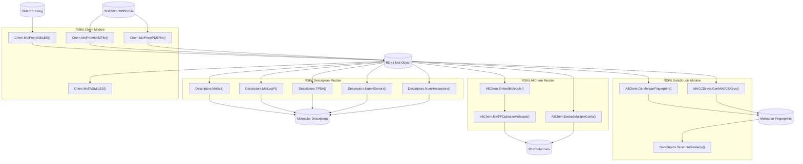
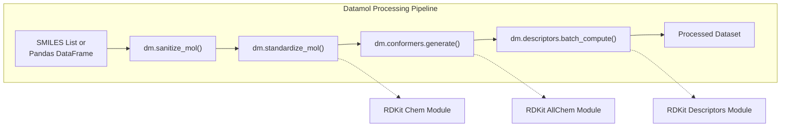
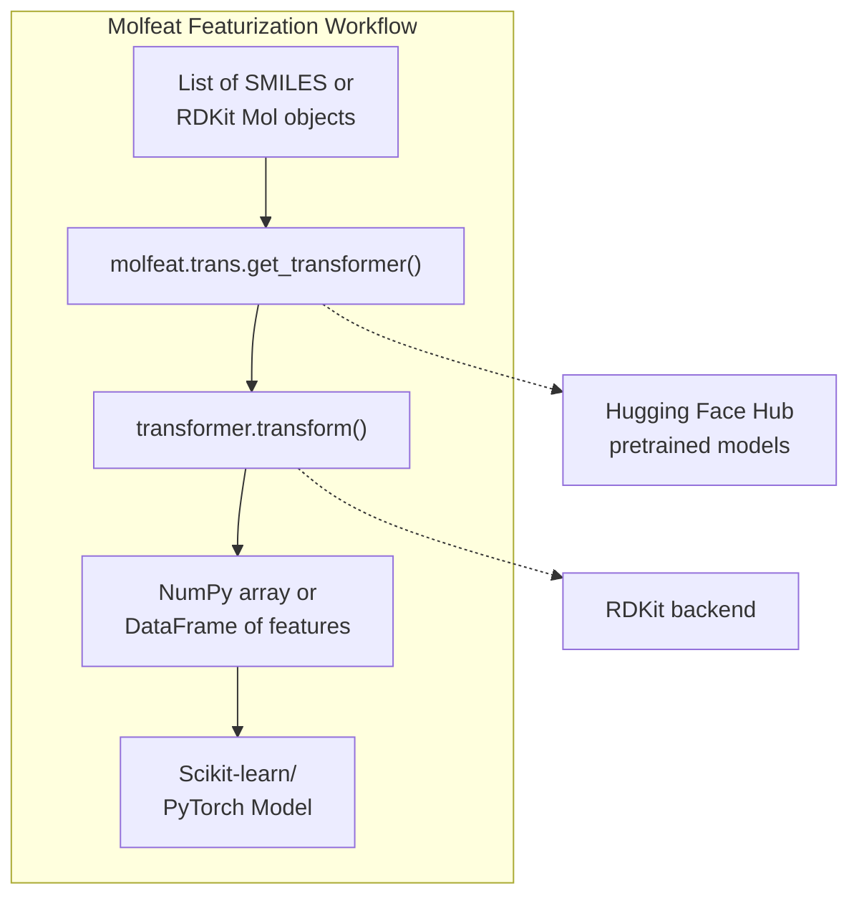
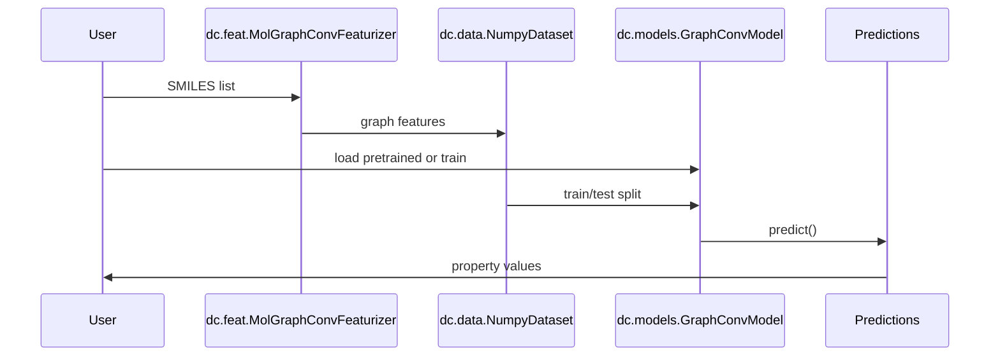
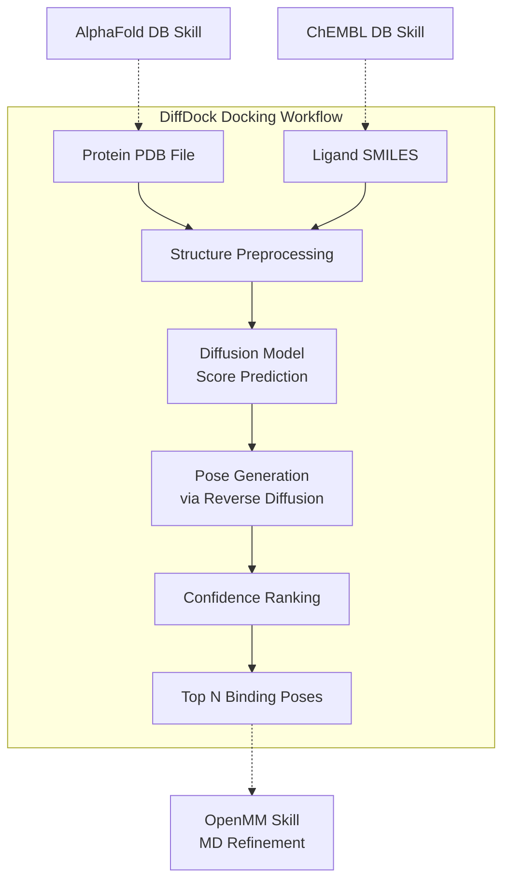
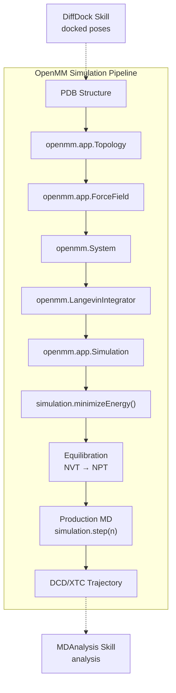
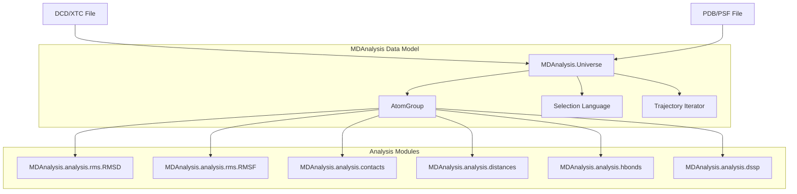
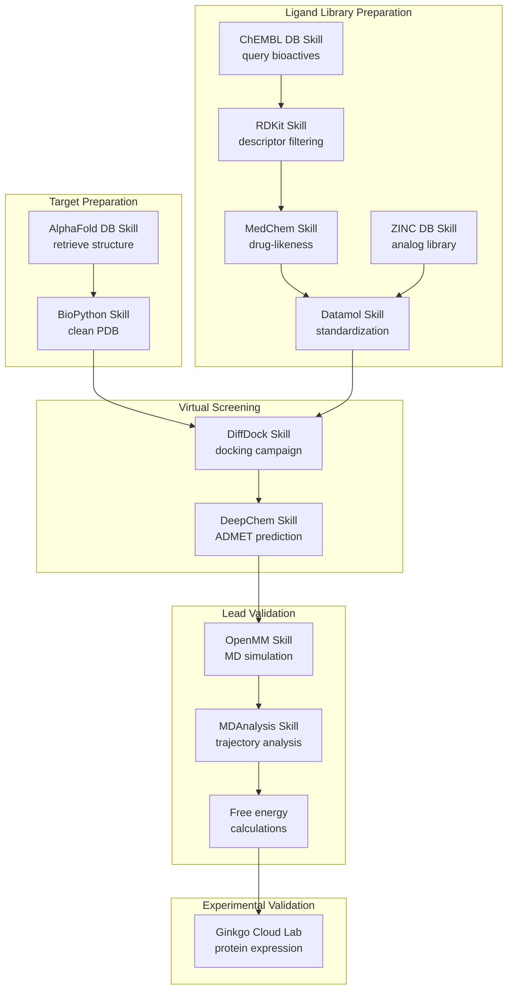

<!-- source: DeepWiki mcp.deepwiki.com · repo K-Dense-AI/claude-scientific-skills · extra page Molecular Modeling and Simulation · fetched 2026-10-26 -->

# Molecular Modeling and Simulation

<details>
<summary>Relevant source files</summary>

The following files were used as context for generating this wiki page:

- [.claude-plugin/marketplace.json](.claude-plugin/marketplace.json)
- [README.md](README.md)
- [docs/scientific-skills.md](docs/scientific-skills.md)
- [scientific-skills/ginkgo-cloud-lab/SKILL.md](scientific-skills/ginkgo-cloud-lab/SKILL.md)
- [scientific-skills/ginkgo-cloud-lab/references/cell-free-protein-expression-optimization.md](scientific-skills/ginkgo-cloud-lab/references/cell-free-protein-expression-optimization.md)
- [scientific-skills/ginkgo-cloud-lab/references/cell-free-protein-expression-validation.md](scientific-skills/ginkgo-cloud-lab/references/cell-free-protein-expression-validation.md)
- [scientific-skills/ginkgo-cloud-lab/references/fluorescent-pixel-art-generation.md](scientific-skills/ginkgo-cloud-lab/references/fluorescent-pixel-art-generation.md)

</details>


## Purpose and Scope

This document covers the molecular modeling and simulation skills in the Claude Scientific Skills ecosystem, focusing on computational chemistry and physics-based approaches to understanding molecular behavior. These skills enable structure-based drug design workflows including molecular manipulation, property prediction, docking, molecular dynamics simulation, and trajectory analysis.

For AI-driven drug discovery workflows that integrate these tools into end-to-end pipelines, see [4.2.2 AI-Driven Drug Discovery Workflows](#4.2.2). For chemical database access (ChEMBL, PubChem, ZINC, DrugBank), see [5.4 Chemical and Drug Databases](#5.4).

---

## Overview

The molecular modeling and simulation domain provides five core skill categories organized by computational complexity and use case:

| Skill Category | Primary Tools | Use Cases |
|---------------|--------------|-----------|
| Molecular Manipulation | RDKit, Datamol | SMILES parsing, substructure search, descriptor calculation, 2D/3D structure generation |
| Molecular Featurization | Molfeat, MedChem | Converting molecules to ML-ready feature vectors, drug-likeness scoring |
| Deep Learning for Molecules | DeepChem, TorchDrug | ADMET prediction, property prediction, graph neural networks |
| Molecular Docking | DiffDock, Rowan | Protein-ligand binding pose prediction, binding affinity estimation |
| Molecular Dynamics | OpenMM, MDAnalysis | Physics-based simulation, trajectory analysis, conformational sampling |

**Sources:** [README.md:412-420](), [docs/scientific-skills.md:1-100]()

---

## Molecular Manipulation Skills

### RDKit Skill

RDKit provides core cheminformatics functionality for molecular structure handling, property calculation, and 2D/3D coordinate generation. The skill is organized around the following modules:

**Core Modules:**
- `Chem` module: SMILES/SMARTS parsing, molecular graphs, substructure matching
- `Descriptors` module: 200+ molecular descriptors (molecular weight, logP, TPSA, H-bond donors/acceptors)
- `AllChem` module: 3D coordinate generation, MMFF/UFF force fields, conformer generation
- `DataStructs` module: molecular fingerprints (Morgan, MACCS keys, topological) for similarity search

**Key Operations:**



**Typical Workflow Pattern:**
1. Parse SMILES/structure file → `Mol` object
2. Calculate descriptors → property dictionary
3. Generate 3D coordinates → conformer ensemble
4. Generate fingerprints → similarity search

**Sources:** [README.md:413](), [.claude-plugin/marketplace.json:85]()

---

### Datamol Skill

Datamol wraps RDKit with a simplified API focused on data pipeline integration. Key modules include standardization, 3D generation, and batch processing utilities.

**Core Functions:**
- `dm.to_mol()` / `dm.to_smiles()`: Conversion between SMILES and Mol objects with error handling
- `dm.standardize_mol()`: Molecular standardization (neutralization, tautomer canonicalization, fragment removal)
- `dm.conformers.generate()`: Conformer generation with ETKDG algorithm
- `dm.descriptors.batch_compute()`: Batch descriptor calculation for datasets

**Integration Pattern:**



**Use Cases:**
- Large-scale molecule preprocessing for ML pipelines
- Standardizing ChEMBL/PubChem downloads before analysis
- Generating analog libraries with consistent conformer generation

**Sources:** [README.md:413](), [.claude-plugin/marketplace.json:30]()

---

## Molecular Featurization Skills

### Molfeat Skill

Molfeat provides unified access to 20+ molecular featurization methods for machine learning applications. Transforms molecules into fixed-length feature vectors compatible with scikit-learn, PyTorch, and TensorFlow.

**Featurizer Types:**

| Featurizer | Output | Use Case |
|-----------|--------|----------|
| `MorganFeaturizer` | Binary/count fingerprints | Similarity search, QSAR |
| `MACCSKeysFeaturizer` | 166-bit binary vector | Substructure-based similarity |
| `AtomPairFeaturizer` | Atom pair descriptors | Local chemistry patterns |
| `RDKitDescriptors2D` | 200+ scalar descriptors | Classical QSAR modeling |
| `PharmacophoreFeaturizer` | Pharmacophore fingerprints | Virtual screening |
| `PretrainedMolTransformer` | 768-1024d embeddings | Transfer learning |

**Code Pattern:**



**Integration with ML Libraries:**
- Scikit-learn: Direct pipeline integration via `transformer.transform()`
- PyTorch: Convert to tensors with `torch.from_numpy()`
- DeepChem: Compatible with `dc.data.NumpyDataset`

**Sources:** [README.md:58](), [.claude-plugin/marketplace.json:58]()

---

### MedChem Skill

MedChem focuses on drug-likeness assessment and medicinal chemistry rules. Evaluates compounds against Lipinski's Rule of Five, Veber rules, PAINS filters, and structural alerts.

**Key Modules:**
- `medchem.rules`: Lipinski, Veber, Ghose, Egan drug-likeness rules
- `medchem.structural_alerts`: PAINS, Brenk, NIH filters for reactive/toxic substructures
- `medchem.complexity`: Synthetic accessibility (SA) score, Bertz complexity index

**Typical Usage Pattern:**
```
Input SMILES → medchem.check_rules() → Pass/fail flags + violations
```

**Sources:** [README.md:418](), [.claude-plugin/marketplace.json:55]()

---

## Deep Learning for Molecular Property Prediction

### DeepChem Skill

DeepChem provides deep learning models for molecular property prediction, especially ADMET (Absorption, Distribution, Metabolism, Excretion, Toxicity) properties. Built on top of TensorFlow and PyTorch.

**Model Zoo:**

```mermaid
graph TB
    subgraph "DeepChem Model Categories"
        GraphConv["Graph Convolutional Models"]
        MessagePass["Message Passing Neural Networks"]
        Transformers["Molecular Transformers"]
        Classical["Classical ML Models"]
    end
    
    subgraph "Graph Convolutional Models"
        GCN["GraphConvModel"]
        GAT["GATModel"]
        GIN["GINModel"]
    end
    
    subgraph "Message Passing Neural Networks"
        MPNN["MPNNModel"]
        AttentiveFP["AttentiveFPModel"]
        DMPNN["DMPNNModel"]
    end
    
    subgraph "Molecular Transformers"
        ChemBERTa["ChemBERTa"]
        MolBERT["MolBERT"]
        GROVER["GROVER"]
    end
    
    subgraph "Classical ML Models"
        RF["RandomForestModel"]
        XGBoost["XGBoostModel"]
        SVM["SVMModel"]
    end
    
    GraphConv --> GCN
    GraphConv --> GAT
    GraphConv --> GIN
    
    MessagePass --> MPNN
    MessagePass --> AttentiveFP
    MessagePass --> DMPNN
    
    Transformers --> ChemBERTa
    Transformers --> MolBERT
    Transformers --> GROVER
    
    Classical --> RF
    Classical --> XGBoost
    Classical --> SVM
```



**Core Data Structures:**
- `dc.data.NumpyDataset`: Container for features, labels, weights, IDs
- `dc.feat.MolGraphConvFeaturizer`: Converts SMILES to graph representations
- `dc.molnet`: Pre-configured benchmark datasets (Tox21, BACE, BBBP, ClinTox)

**Prediction Workflow:**



**Pre-trained Models:**
- ADMET properties: solubility, permeability, hERG inhibition, CYP450 inhibition
- Toxicity: Tox21, ClinTox, SIDER side effects
- Bioactivity: BACE, BBBP (blood-brain barrier penetration)

**Sources:** [README.md:414](), [.claude-plugin/marketplace.json:31]()

---

### TorchDrug Skill

TorchDrug extends PyTorch for drug discovery with graph neural networks, pre-trained models, and drug-target interaction prediction.

**Key Modules:**
- `torchdrug.models`: GCN, GAT, GIN, SchNet, RGCN for molecular graphs
- `torchdrug.tasks`: Property prediction, drug-target interaction, retrosynthesis
- `torchdrug.datasets`: MoleculeNet, BindingDB, Davis kinase datasets

**Sources:** [README.md:414](), [.claude-plugin/marketplace.json:102]()

---

## Molecular Docking Skills

### DiffDock Skill

DiffDock performs diffusion-based molecular docking for predicting protein-ligand binding poses without requiring explicit pockets or prior structural knowledge.

**Input Requirements:**
- Protein structure: PDB file or AlphaFold prediction
- Ligand: SMILES string or SDF file
- Optional: binding site coordinates for focused docking

**Workflow Architecture:**



**Output Format:**
- Multiple binding poses ranked by confidence score
- SDF files with 3D coordinates
- Confidence metrics for pose reliability

**Integration Points:**
- Upstream: AlphaFold DB for target structures, ChEMBL/ZINC for compound libraries
- Downstream: OpenMM for MD refinement, DeepChem for ADMET filtering

**Sources:** [README.md:414](), [.claude-plugin/marketplace.json:35]()

---

### Rowan Skill

Rowan provides cloud-based quantum chemistry calculations via API for pKa prediction, docking, and protein-ligand cofolding simulations.

**API Endpoints:**
- pKa prediction: Fast electrostatic pKa calculations
- Molecular docking: Quantum-accurate binding energy calculations
- Cofolding: Simultaneous protein-ligand optimization

**Sources:** [README.md:417](), [.claude-plugin/marketplace.json:86]()

---

## Molecular Dynamics Simulation Skills

### OpenMM and MDAnalysis (Molecular-Dynamics Skill)

The `molecular-dynamics` skill combines OpenMM (simulation engine) and MDAnalysis (trajectory analysis) for physics-based molecular dynamics workflows.

#### OpenMM Components

**System Setup:**
- `openmm.app.Topology`: Molecular topology (atoms, bonds, residues)
- `openmm.app.ForceField`: AMBER, CHARMM, GROMOS force fields
- `openmm.app.Simulation`: Simulation driver with integrators and thermostats

**Force Fields and Water Models:**

| Force Field | Use Case |
|------------|----------|
| `amber14-all.xml` | Proteins (AMBER ff14SB) |
| `amber14/protein.ff14SB.xml` | Protein-only systems |
| `amber14/tip3p.xml` | Explicit water solvent |
| `charmm36.xml` | Proteins, lipids, nucleic acids |

**Integrator Options:**
- `LangevinIntegrator`: Stochastic dynamics with friction
- `VariableVerletIntegrator`: Adaptive timestep for stability
- `BrownianIntegrator`: Overdamped dynamics

**Simulation Workflow:**



**Key Classes:**
- `openmm.Platform`: CPU, CUDA, OpenCL backends
- `openmm.Context`: GPU state management
- `openmm.app.Modeller`: System building (solvation, ionization)

#### MDAnalysis Components

MDAnalysis reads and analyzes molecular dynamics trajectories from multiple formats (DCD, XTC, TRR, NetCDF, H5MD).

**Core Classes:**



**Analysis Functions:**
- `MDAnalysis.Universe()`: Load topology + trajectory
- `universe.select_atoms()`: Atom selection with Boolean logic
- `MDAnalysis.analysis.rms.RMSD`: Root-mean-square deviation calculations
- `MDAnalysis.analysis.rms.RMSF`: Per-residue fluctuations
- `MDAnalysis.analysis.contacts.Contacts`: Contact maps and hydrogen bonds
- `MDAnalysis.analysis.dssp.DSSP`: Secondary structure assignment

**Typical Analysis Pattern:**
```
1. Load trajectory: u = MDAnalysis.Universe("topology.pdb", "trajectory.dcd")
2. Define atom groups: protein = u.select_atoms("protein")
3. Iterate frames: for ts in u.trajectory:
4. Calculate properties: rmsd.run(), rmsf.run()
5. Export results: to NumPy arrays or pandas DataFrames
```

**Sources:** [README.md:416](), [.claude-plugin/marketplace.json:57]()

---

## End-to-End Integration Example

The following diagram shows how molecular modeling and simulation skills compose in a structure-based drug discovery workflow:



**Workflow Stages:**
1. **Target Preparation**: Retrieve AlphaFold structure → clean with BioPython
2. **Ligand Library**: Query ChEMBL → filter by descriptors (RDKit) → check drug-likeness (MedChem) → standardize (Datamol)
3. **Virtual Screening**: Dock with DiffDock → predict ADMET (DeepChem)
4. **Lead Validation**: Run MD simulations (OpenMM) → analyze trajectories (MDAnalysis) → compute binding free energies
5. **Experimental Validation**: Order protein expression via Ginkgo Cloud Lab

**Sources:** [README.md:220-234](), [README.md:358-364]()

---

## Skill Directory Structure

All molecular modeling and simulation skills follow the standard SKILL.md format with organized documentation:

```
scientific-skills/
├── rdkit/
│   ├── SKILL.md
│   ├── examples/
│   └── references/
├── datamol/
│   ├── SKILL.md
│   └── examples/
├── molfeat/
│   ├── SKILL.md
│   └── references/
├── deepchem/
│   ├── SKILL.md
│   ├── examples/
│   └── references/
├── diffdock/
│   ├── SKILL.md
│   └── examples/
├── molecular-dynamics/
│   ├── SKILL.md           (covers OpenMM + MDAnalysis)
│   ├── examples/
│   └── references/
├── rowan/
│   ├── SKILL.md
│   └── references/
└── medchem/
    ├── SKILL.md
    └── examples/
```

Each `SKILL.md` includes:
- Installation instructions (via `uv pip install`)
- API examples with code snippets
- Integration patterns with other skills
- Use cases and best practices
- References to official documentation

**Sources:** [.claude-plugin/marketplace.json:17-191]()

---

## Installation and Dependencies

All molecular modeling skills are installed via `uv` package manager:

```bash
# RDKit and cheminformatics
uv pip install rdkit datamol molfeat medchem

# Deep learning for molecules
uv pip install deepchem torchdrug

# Molecular docking
# DiffDock: see specific SKILL.md for model download instructions

# Molecular dynamics
uv pip install openmm mdanalysis
```

**System Requirements:**
- Python 3.9+ (3.12+ recommended)
- For OpenMM GPU acceleration: CUDA toolkit 11.0+
- For DiffDock: PyTorch with GPU support

**Sources:** [README.md:180-213]()

---

## Performance Considerations

| Task | Bottleneck | Optimization Strategy |
|------|-----------|----------------------|
| Large compound screening | RDKit descriptor calculation | Use Datamol batch processing, Dask parallelization |
| Molecular docking | DiffDock inference time | GPU acceleration, batch processing, pre-filter with 2D similarity |
| MD simulation | OpenMM timestep integration | CUDA platform, mixed precision, hydrogen mass repartitioning |
| Trajectory analysis | MDAnalysis I/O | Memory-mapped files, chunked processing, on-the-fly analysis |
| ADMET prediction | DeepChem model loading | Cache loaded models, use TorchScript compilation |

**Sources:** [README.md:358-396]()

---

