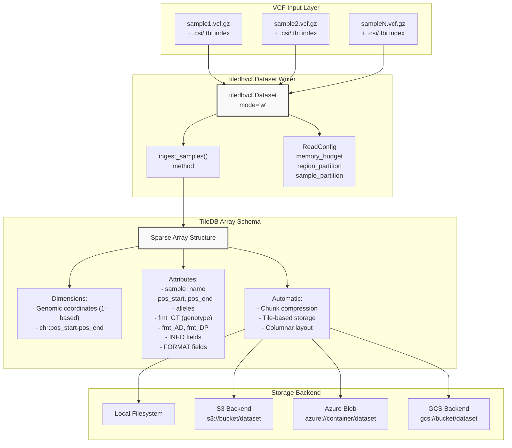
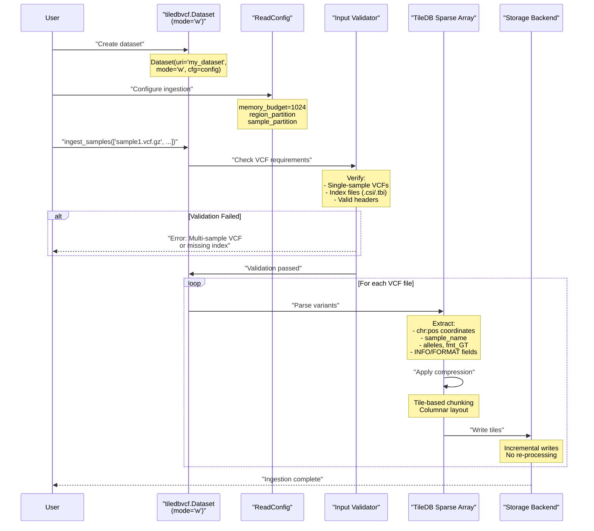
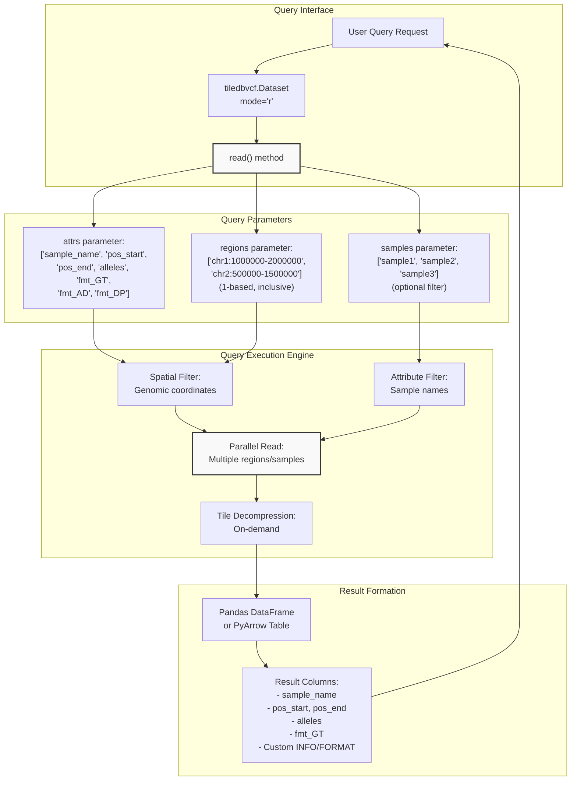
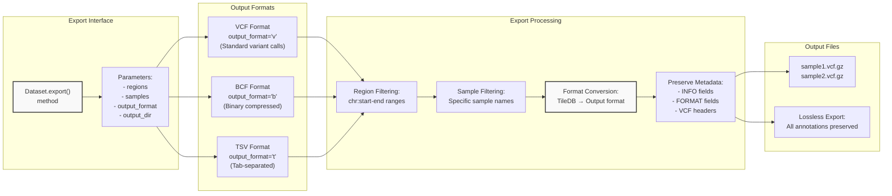
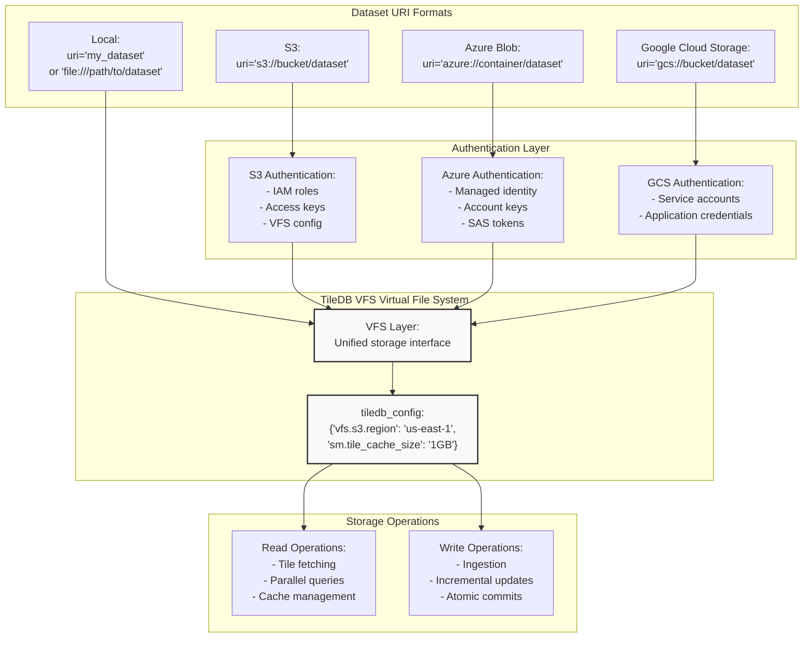
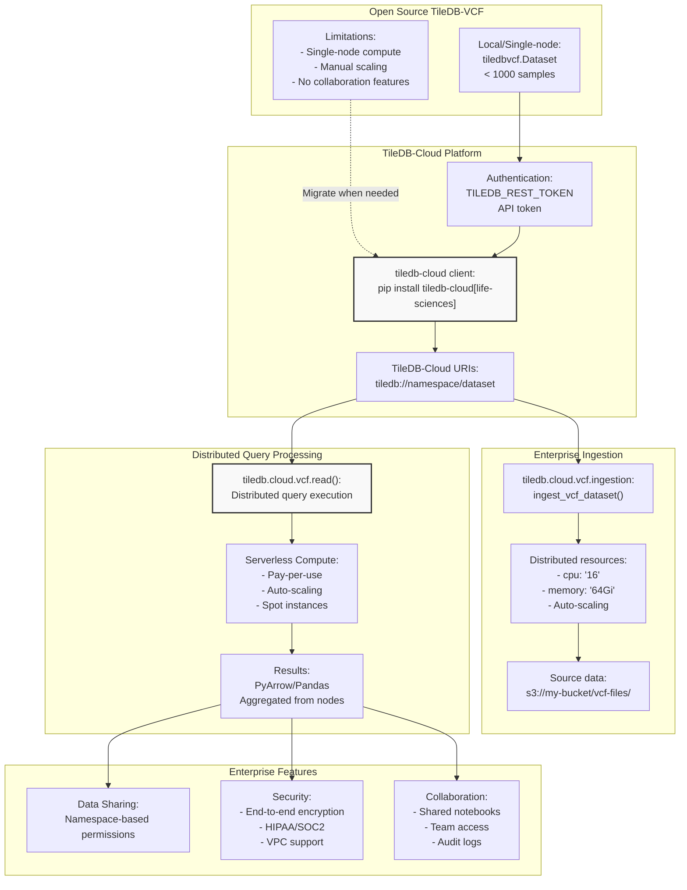

<!-- source: DeepWiki mcp.deepwiki.com · repo K-Dense-AI/claude-scientific-skills · extra page TileDB-VCF Genomic Variant Storage · fetched 2026-10-26 -->

# TileDB-VCF Genomic Variant Storage

<details>
<summary>Relevant source files</summary>

The following files were used as context for generating this wiki page:

- [scientific-skills/tiledbvcf/SKILL.md](scientific-skills/tiledbvcf/SKILL.md)

</details>


## Purpose and Scope

This document provides a deep dive into TileDB-VCF, a high-performance library for scalable storage and retrieval of genomic variant data. TileDB-VCF enables efficient ingestion of VCF/BCF files, incremental sample addition without expensive merging operations, and parallel queries of variant data stored locally or in the cloud. This page covers the data model, ingestion workflows, query architecture, export capabilities, and cloud integration patterns.

For general bioinformatics skills including sequence analysis and single-cell RNA-seq, see [Core Bioinformatics Skills](#4.1.1). For database integration patterns across multiple genomics databases, see [Protein and Genomics Databases](#5.3). For complete end-to-end workflows using TileDB-VCF for population genomics, see [Genomic Variant Analysis](#8.3).

**Sources:** [scientific-skills/tiledbvcf/SKILL.md:1-20]()

## System Overview

TileDB-VCF is a C++ library with Python and CLI interfaces built on TileDB's sparse array technology. It addresses the core challenge of genomic variant storage: efficiently managing millions of variants across thousands of samples while supporting incremental updates and region-specific queries.

### Key Architecture Components

| Component | Technology | Purpose |
|-----------|-----------|---------|
| Storage Engine | TileDB sparse arrays | Coordinates-based variant storage with automatic compression |
| Python API | `tiledbvcf.Dataset` class | High-level interface for ingestion, queries, and exports |
| CLI Tool | `tiledbvcf` command | Command-line operations for dataset management |
| Cloud Backend | S3/Azure/GCS integration | Seamless cloud storage support |

### Design Principles

1. **Incremental Ingestion**: Add new samples without re-processing existing data
2. **Sparse Storage**: Only store actual variants, not reference-matching positions
3. **Parallel Operations**: Concurrent ingestion and distributed queries
4. **1-Based Coordinates**: VCF-standard genomic coordinate system
5. **Cloud-Native**: First-class support for object storage backends

**Sources:** [scientific-skills/tiledbvcf/SKILL.md:9-27]()

## Data Model and Storage Architecture



**TileDB-VCF Data Model Architecture**

### Coordinate System

TileDB-VCF uses **1-based genomic coordinates** following VCF standard conventions:

| Coordinate Type | Format | Example | Interpretation |
|----------------|--------|---------|----------------|
| Single region | `chr:start-end` | `chr1:1000000-2000000` | Positions 1000000-2000000 inclusive |
| Whole chromosome | `chr` | `chr1` | Entire chromosome 1 |
| Multiple regions | List of regions | `["chr1:1000000-2000000", "chr2:500000-1500000"]` | Multiple disjoint regions |

**Critical**: Ranges are inclusive on both ends. Region `chr1:1000-2000` includes 1001 bases (positions 1000 through 2000).

### Schema Configuration

The `tiledbvcf.ReadConfig` class controls array partitioning and memory management:

```python
# Example from SKILL.md:173-180
config = tiledbvcf.ReadConfig(
    memory_budget=2048,  # MB
    region_partition=(0, 3095677412),  # Full genome
    sample_partition=(0, 10000)  # Up to 10k samples
)
```

**Sources:** [scientific-skills/tiledbvcf/SKILL.md:162-227]()

## Ingestion Workflow



**TileDB-VCF Ingestion Sequence**

### Ingestion Requirements

**Critical constraints enforced by the validator** [scientific-skills/tiledbvcf/SKILL.md:106-109]():

1. **Single-sample VCFs only**: Multi-sample VCFs are not supported
2. **Index files required**: VCF/BCF files must have `.csi` (bcftools) or `.tbi` (tabix) indexes

### Incremental Sample Addition

A key advantage of TileDB-VCF is incremental ingestion [scientific-skills/tiledbvcf/SKILL.md:59-71]():

```python
# Initial dataset creation
ds = tiledbvcf.Dataset(uri="my_dataset", mode="w",
                      cfg=tiledbvcf.ReadConfig(memory_budget=1024))
ds.ingest_samples(["sample1.vcf.gz", "sample2.vcf.gz"])

# Later: add new samples without re-processing sample1 and sample2
ds.ingest_samples(["sample3.vcf.gz", "sample4.vcf.gz"])
```

### Memory Management During Ingestion

Performance considerations [scientific-skills/tiledbvcf/SKILL.md:206-213]():

| Strategy | Configuration | Use Case |
|----------|--------------|----------|
| Memory budget | `ReadConfig(memory_budget=2048)` | Control RAM usage during ingestion |
| Batch processing | Ingest subsets of files | Avoid memory exhaustion with large VCFs |
| Parallel ingestion | Multiple files concurrently | Leverage multi-core systems |

**Sources:** [scientific-skills/tiledbvcf/SKILL.md:102-118](), [scientific-skills/tiledbvcf/SKILL.md:59-71](), [scientific-skills/tiledbvcf/SKILL.md:206-213]()

## Query Architecture



**TileDB-VCF Query Processing Architecture**

### Query Methods and Parameters

The `Dataset.read()` method provides flexible querying [scientific-skills/tiledbvcf/SKILL.md:74-85]():

| Parameter | Type | Purpose | Example |
|-----------|------|---------|---------|
| `attrs` | List[str] | Select which fields to retrieve | `["sample_name", "pos_start", "alleles", "fmt_GT"]` |
| `regions` | List[str] | Genomic regions to query (1-based) | `["chr1:1000000-2000000", "chr2:500000-1500000"]` |
| `samples` | List[str] | Filter by sample names | `["sample1", "sample2", "sample3"]` |

### Common Query Patterns

**1. Region-specific queries** [scientific-skills/tiledbvcf/SKILL.md:74-85]():
```python
ds = tiledbvcf.Dataset(uri="my_dataset", mode="r")
df = ds.read(
    attrs=["sample_name", "pos_start", "pos_end", "alleles", "fmt_GT"],
    regions=["chr1:1000000-2000000", "chr2:500000-1500000"],
    samples=["sample1", "sample2", "sample3"]
)
```

**2. Whole chromosome queries** [scientific-skills/tiledbvcf/SKILL.md:198]():
```python
regions = ["chr1"]  # Query entire chromosome
```

**3. Multiple disjoint regions** [scientific-skills/tiledbvcf/SKILL.md:195]():
```python
regions = ["chr1:1000000-2000000", "chr2:500000-1500000"]
```

### Query Optimization

Performance considerations [scientific-skills/tiledbvcf/SKILL.md:206-213]():

| Optimization | Implementation | Benefit |
|-------------|----------------|---------|
| Combine nearby regions | Merge adjacent regions into single query | Reduces I/O overhead |
| Set tile cache | `tiledb_config={"sm.tile_cache_size": "1000000000"}` | Improves repeated access |
| Use streaming | For queries returning millions of variants | Avoids memory exhaustion |
| Partition queries | Break large queries into batches | Controls memory usage |

**Sources:** [scientific-skills/tiledbvcf/SKILL.md:120-132](), [scientific-skills/tiledbvcf/SKILL.md:74-85](), [scientific-skills/tiledbvcf/SKILL.md:189-213]()

## Export Capabilities



**TileDB-VCF Export Architecture**

### Export Methods

The `Dataset.export()` method supports multiple output formats [scientific-skills/tiledbvcf/SKILL.md:88-98]():

```python
import os

# Export two VCF samples
ds.export(
    regions=["chr21:8220186-8405573"],
    samples=["HG00101", "HG00097"],
    output_format="v",  # 'v' = VCF, 'b' = BCF, 't' = TSV
    output_dir=os.path.expanduser("~"),
)
```

### Export Format Options

| Format | Code | Extension | Use Case |
|--------|------|-----------|----------|
| VCF | `"v"` | `.vcf.gz` | Standard variant files for downstream tools |
| BCF | `"b"` | `.bcf` | Binary compressed for storage efficiency |
| TSV | `"t"` | `.tsv` | Tab-separated for custom analysis |

### CLI Export Operations

The `tiledbvcf` CLI provides command-line export [scientific-skills/tiledbvcf/SKILL.md:258-261]():

```bash
tiledbvcf export --uri my_dataset \
  --regions "chr1:1000000-2000000" \
  --sample-names "sample1,sample2"
```

**Sources:** [scientific-skills/tiledbvcf/SKILL.md:134-146](), [scientific-skills/tiledbvcf/SKILL.md:88-98](), [scientific-skills/tiledbvcf/SKILL.md:258-268]()

## Cloud Storage Integration



**TileDB-VCF Cloud Storage Architecture**

### Cloud URI Patterns

TileDB-VCF provides seamless cloud integration [scientific-skills/tiledbvcf/SKILL.md:214-227]():

| Cloud Provider | URI Format | Example |
|---------------|------------|---------|
| AWS S3 | `s3://bucket/path` | `s3://my-genomics-bucket/cohort-dataset` |
| Azure Blob | `azure://container/path` | `azure://genomics-container/dataset` |
| Google Cloud | `gcs://bucket/path` | `gcs://my-genomics-bucket/dataset` |
| Local | `file:///path` or relative | `my_dataset` or `/data/variants` |

### Cloud Configuration

Advanced VFS configuration [scientific-skills/tiledbvcf/SKILL.md:293-301]():

```python
config = tiledbvcf.ReadConfig(
    memory_budget=4096,
    tiledb_config={
        "sm.tile_cache_size": "1000000000",
        "vfs.s3.region": "us-east-1"
    }
)
```

### Common Cloud Pitfalls

| Issue | Symptom | Solution |
|-------|---------|----------|
| Missing credentials | Authentication errors | Set IAM roles or access keys |
| Wrong region | Slow performance | Configure `vfs.s3.region` |
| Insufficient cache | Repeated downloads | Increase `sm.tile_cache_size` |
| Concurrent writes | Data corruption | Use appropriate locking mechanisms |

**Sources:** [scientific-skills/tiledbvcf/SKILL.md:214-227](), [scientific-skills/tiledbvcf/SKILL.md:293-301](), [scientific-skills/tiledbvcf/SKILL.md:228-237]()

## CLI Operations

The `tiledbvcf` command-line tool provides dataset management capabilities [scientific-skills/tiledbvcf/SKILL.md:238-268]():

### CLI Subcommands

| Subcommand | Purpose | Example |
|------------|---------|---------|
| `create` | Creates empty TileDB-VCF dataset | `tiledbvcf create --uri my_dataset` |
| `store` | Ingests samples into dataset | `tiledbvcf store --uri my_dataset --samples sample1.vcf.gz,sample2.vcf.gz` |
| `export` | Exports data from dataset | `tiledbvcf export --uri my_dataset --regions "chr1:1000000-2000000" --sample-names "sample1,sample2"` |
| `list` | Lists all sample names | `tiledbvcf list --uri my_dataset` |
| `stat` | Prints dataset statistics | `tiledbvcf stat --uri my_dataset` |
| `utils` | Utility operations | Various dataset management tasks |
| `version` | Print version information | `tiledbvcf version` |

### CLI Workflow Example

```bash
# Create empty dataset
tiledbvcf create --uri my_dataset

# Ingest samples (requires single-sample VCFs with indexes)
tiledbvcf store --uri my_dataset --samples sample1.vcf.gz,sample2.vcf.gz

# List all samples
tiledbvcf list --uri my_dataset

# Show dataset statistics
tiledbvcf stat --uri my_dataset

# Export data
tiledbvcf export --uri my_dataset \
  --regions "chr1:1000000-2000000" \
  --sample-names "sample1,sample2"
```

**Sources:** [scientific-skills/tiledbvcf/SKILL.md:238-268]()

## Population Genomics Workflows

TileDB-VCF excels at large-scale population genomics analyses [scientific-skills/tiledbvcf/SKILL.md:148-160]():

### Common Workflow Patterns

| Workflow | TileDB-VCF Role | Key Methods |
|----------|----------------|-------------|
| GWAS data preparation | Efficient extraction of variant genotypes across cohorts | `read()` with region filtering |
| Rare variant burden testing | Query low-frequency variants across samples | `read()` with allele frequency filtering |
| Population stratification | Extract variants for PCA analysis | `read()` with sample grouping |
| Allele frequency calculation | Compute frequencies across populations | `read_allele_frequency()` |
| Quality control | Sample-level and variant-level QC metrics | `sample_qc()` |
| Variant annotation | Extract variants for annotation pipelines | `export()` to VCF for VEP/ANNOVAR |
| Cross-population analysis | Compare variants across ancestries | `read()` with population samples |

### Allele Frequency Analysis

Advanced analysis methods [scientific-skills/tiledbvcf/SKILL.md:272-280]():

```python
# Calculate allele frequencies
af_df = tiledbvcf.read_allele_frequency(
    uri="my_dataset",
    regions=["chr1:1000000-2000000"],
    samples=["sample1", "sample2", "sample3"]
)
```

### Sample Quality Control

QC operations [scientific-skills/tiledbvcf/SKILL.md:282-289]():

```python
# Perform sample QC
qc_results = tiledbvcf.sample_qc(
    uri="my_dataset",
    samples=["sample1", "sample2"]
)
```

**Sources:** [scientific-skills/tiledbvcf/SKILL.md:148-160](), [scientific-skills/tiledbvcf/SKILL.md:270-301]()

## Scaling to TileDB-Cloud

For production genomics at scale beyond 1000 samples, TileDB-Cloud provides enterprise capabilities [scientific-skills/tiledbvcf/SKILL.md:325-456]().

### TileDB-Cloud Architecture



**TileDB-Cloud Enterprise Architecture**

### Setup and Authentication

**1. Account Creation** [scientific-skills/tiledbvcf/SKILL.md:332-337]():
```bash
# Sign up at https://cloud.tiledb.com
# Generate API token in account settings
```

**2. Client Installation** [scientific-skills/tiledbvcf/SKILL.md:339-346]():
```bash
# Base installation
pip install tiledb-cloud

# With genomics-specific functionality
pip install tiledb-cloud[life-sciences]
```

**3. Authentication Configuration** [scientific-skills/tiledbvcf/SKILL.md:348-359]():
```bash
# Set environment variable with API token
export TILEDB_REST_TOKEN="your_api_token"
```

### Distributed Ingestion

Large-scale VCF ingestion [scientific-skills/tiledbvcf/SKILL.md:363-378]():

```python
import tiledb.cloud.vcf

# Distributed VCF ingestion with specified compute resources
tiledb.cloud.vcf.ingestion.ingest_vcf_dataset(
    source="s3://my-bucket/vcf-files/",
    output="tiledb://my-namespace/large-dataset",
    namespace="my-namespace",
    acn="my-s3-credentials",
    ingest_resources={"cpu": "16", "memory": "64Gi"}
)
```

### Distributed Query Processing

Cloud-based queries [scientific-skills/tiledbvcf/SKILL.md:380-406]():

```python
import tiledb.cloud.vcf
import tiledbvcf

# Define dataset URI
dataset_uri = "tiledb://TileDB-Inc/gvcf-1kg-dragen-v376"

# Get all samples from dataset
ds = tiledbvcf.Dataset(dataset_uri, tiledb_config=cfg)
samples = ds.samples()

# Define attributes and ranges
attrs = ["sample_name", "fmt_GT", "fmt_AD", "fmt_DP"]
regions = ["chr13:32396898-32397044", "chr13:32398162-32400268"]

# Perform distributed read
df = tiledb.cloud.vcf.read(
    dataset_uri=dataset_uri,
    regions=regions,
    samples=samples,
    attrs=attrs,
    namespace="my-namespace",  # Specifies which account to charge
)
df.to_pandas()
```

### Migration Decision Checklist

Migrate to TileDB-Cloud when [scientific-skills/tiledbvcf/SKILL.md:434-444]():

| Criterion | Threshold | Reason |
|-----------|-----------|--------|
| Dataset size | > 1000 samples | Distributed compute required |
| VCF data volume | > 100GB | Storage and processing optimization |
| Team collaboration | Multiple users | Shared access and permissions |
| Security requirements | HIPAA/SOC2 | Enterprise compliance needed |
| Production workloads | 24/7 uptime | Managed infrastructure |
| Cost optimization | Variable workloads | Serverless pay-per-use |

### Enterprise Features

**Data Sharing and Collaboration** [scientific-skills/tiledbvcf/SKILL.md:409-420]():
- Namespace-based permissions
- Group management
- Shared notebooks and compute resources
- Audit logs

**Cost Optimization** [scientific-skills/tiledbvcf/SKILL.md:422-427]():
- Serverless compute (pay-per-use)
- Auto-scaling based on workload
- Spot instances for batch jobs
- Automatic hot/cold storage tiering

**Security and Compliance** [scientific-skills/tiledbvcf/SKILL.md:428-433]():
- End-to-end encryption
- Fine-grained access controls
- HIPAA/SOC2 compliance
- VPC deployment support

**Sources:** [scientific-skills/tiledbvcf/SKILL.md:325-456]()

## Installation and Configuration

### Conda/Mamba Installation (Recommended)

[scientific-skills/tiledbvcf/SKILL.md:31-48]():

```bash
# M1 Mac compatibility (if applicable)
CONDA_SUBDIR=osx-64
conda config --env --set subdir osx-64

# Create conda environment (Python < 3.10 required)
conda create -n tiledb-vcf "python<3.10"
conda activate tiledb-vcf

# Install mamba for faster dependency resolution
conda install -c conda-forge mamba

# Install TileDB-VCF and dependencies
mamba install -y -c conda-forge -c bioconda -c tiledb tiledb-py tiledbvcf-py pandas pyarrow numpy
```

### Docker Installation (Alternative)

[scientific-skills/tiledbvcf/SKILL.md:50-54]():

```bash
# Python interface
docker pull tiledb/tiledbvcf-py

# Command-line interface
docker pull tiledb/tiledbvcf-cli
```

**Sources:** [scientific-skills/tiledbvcf/SKILL.md:31-54]()

## Common Pitfalls and Solutions

| Issue | Symptom | Solution | Reference |
|-------|---------|----------|-----------|
| Memory exhaustion | OOM during ingestion | Use appropriate `memory_budget` and batch processing | [SKILL.md:230]() |
| Inefficient queries | Slow region queries | Combine nearby regions instead of many separate queries | [SKILL.md:231]() |
| Missing samples | Empty query results | Verify sample names in VCF headers match query specifications | [SKILL.md:232]() |
| Coordinate confusion | Off-by-one errors | Remember 1-based coordinates (VCF standard) | [SKILL.md:233]() |
| Large result sets | Memory overflow | Use streaming or pagination for millions of variants | [SKILL.md:234]() |
| Cloud permission errors | Authentication failures | Ensure proper IAM roles/credentials for cloud storage | [SKILL.md:235]() |
| Data corruption | Inconsistent results | Avoid concurrent writers—use locking mechanisms | [SKILL.md:236]() |

**Sources:** [scientific-skills/tiledbvcf/SKILL.md:228-237]()

## Resources and Documentation

### Open Source Resources

| Resource | URL | Purpose |
|----------|-----|---------|
| TileDB Academy | https://cloud.tiledb.com/academy/ | Comprehensive tutorials |
| Population Genomics Guide | https://cloud.tiledb.com/academy/structure/life-sciences/population-genomics/ | Genomics-specific workflows |
| TileDB-VCF GitHub | https://github.com/TileDB-Inc/TileDB-VCF | Source code and issues |

### TileDB-Cloud Resources

| Resource | Purpose |
|----------|---------|
| TileDB-Cloud Platform | https://cloud.tiledb.com |
| Free account signup | Evaluation and small projects |
| Enterprise support | sales@tiledb.com |

**Sources:** [scientific-skills/tiledbvcf/SKILL.md:304-324](), [scientific-skills/tiledbvcf/SKILL.md:445-456]()

---

