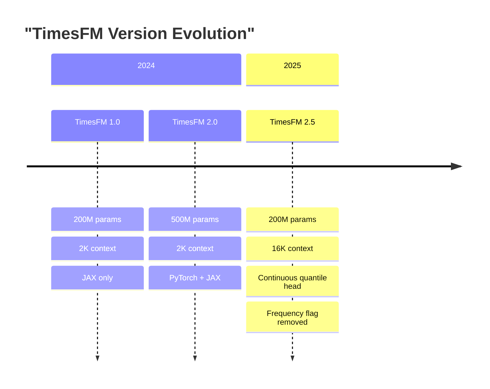
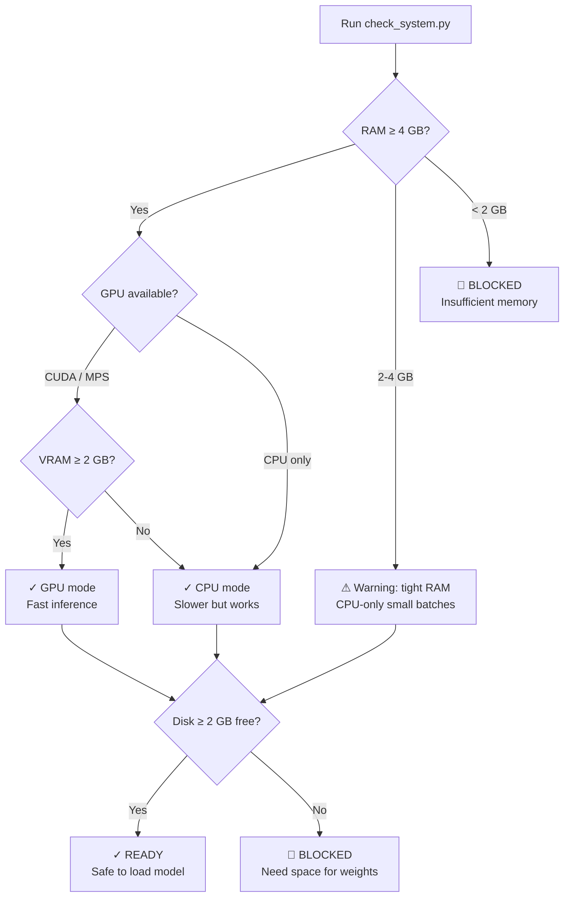
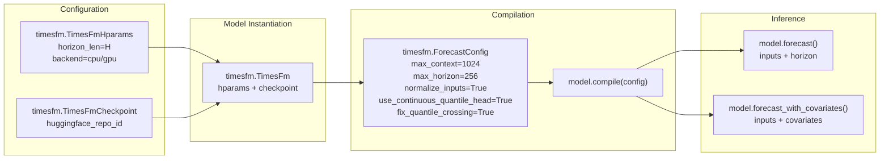
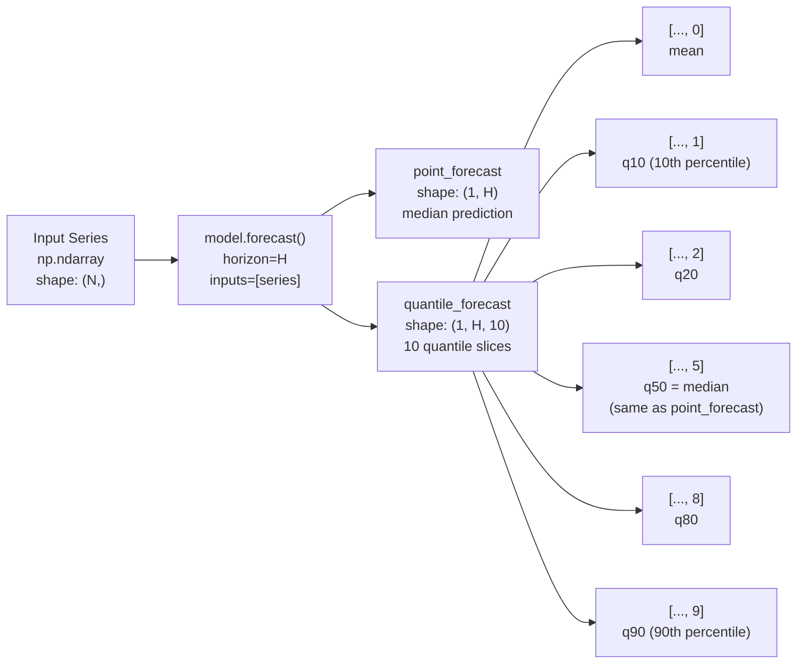
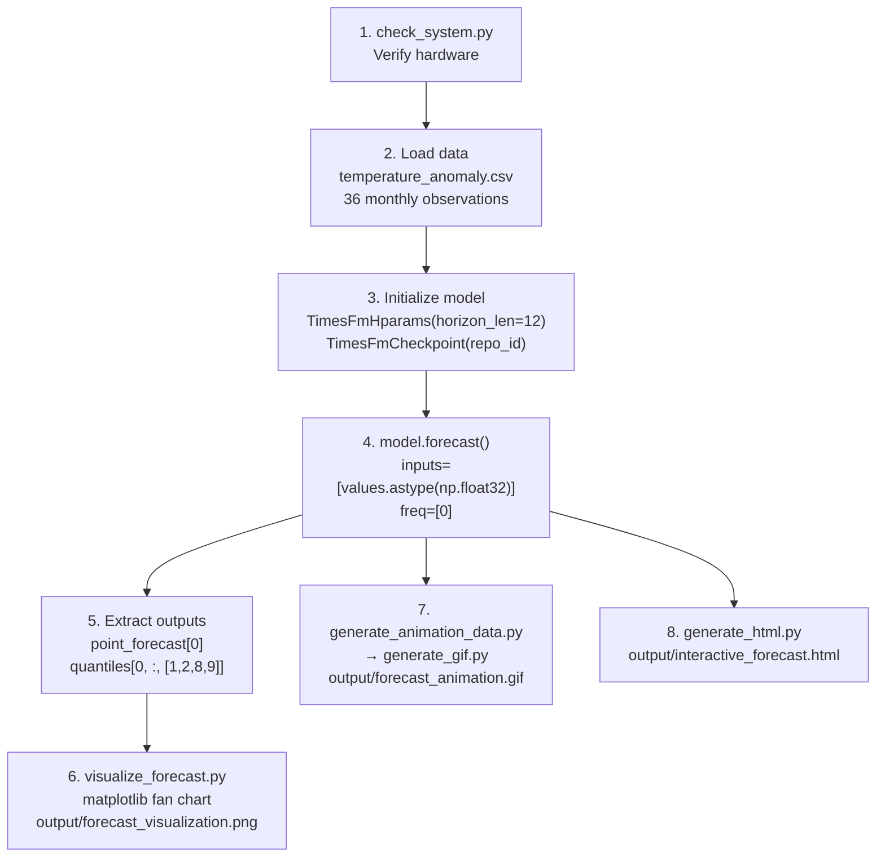
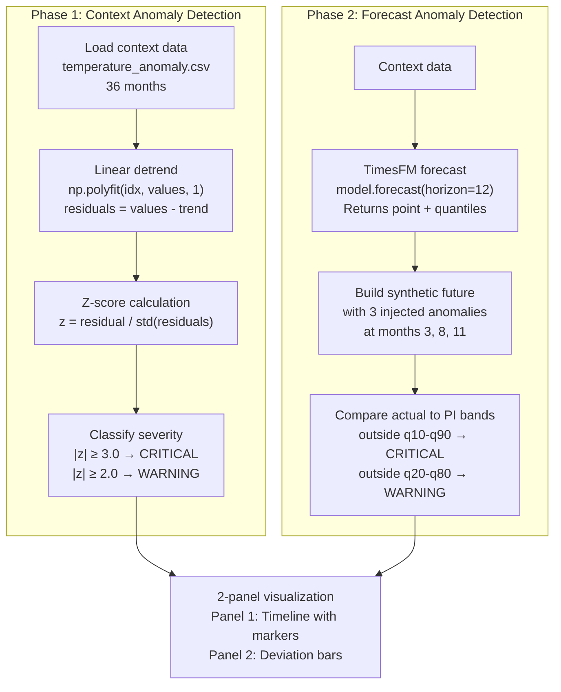
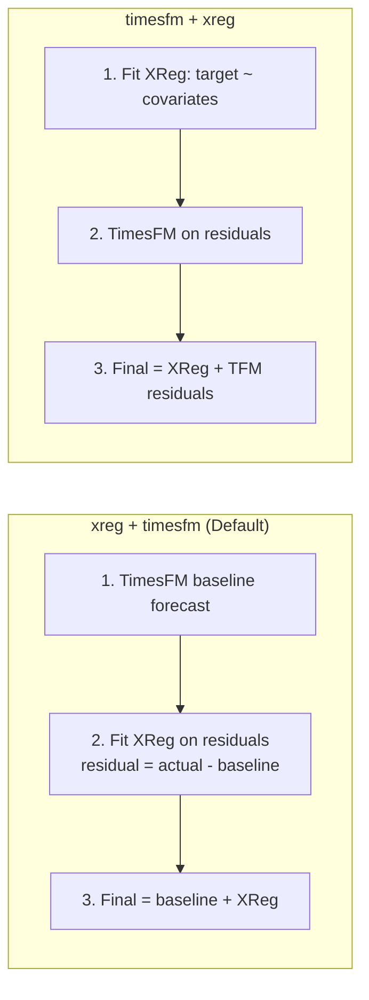
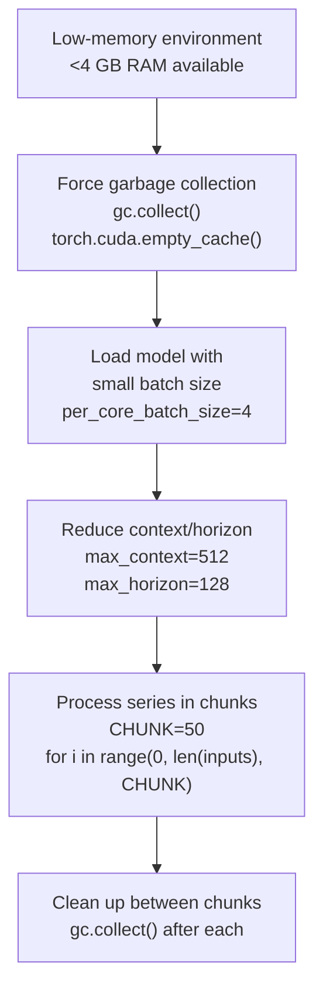

<!-- source: DeepWiki mcp.deepwiki.com · repo K-Dense-AI/claude-scientific-skills · extra page TimesFM Time Series Forecasting · fetched 2026-10-26 -->

# TimesFM Time Series Forecasting

<details>
<summary>Relevant source files</summary>

The following files were used as context for generating this wiki page:

- [.gitattributes](.gitattributes)
- [scientific-skills/timesfm-forecasting/SKILL.md](scientific-skills/timesfm-forecasting/SKILL.md)
- [scientific-skills/timesfm-forecasting/examples/anomaly-detection/detect_anomalies.py](scientific-skills/timesfm-forecasting/examples/anomaly-detection/detect_anomalies.py)
- [scientific-skills/timesfm-forecasting/examples/anomaly-detection/output/anomaly_detection.json](scientific-skills/timesfm-forecasting/examples/anomaly-detection/output/anomaly_detection.json)
- [scientific-skills/timesfm-forecasting/examples/anomaly-detection/output/anomaly_detection.png](scientific-skills/timesfm-forecasting/examples/anomaly-detection/output/anomaly_detection.png)
- [scientific-skills/timesfm-forecasting/examples/covariates-forecasting/demo_covariates.py](scientific-skills/timesfm-forecasting/examples/covariates-forecasting/demo_covariates.py)
- [scientific-skills/timesfm-forecasting/examples/covariates-forecasting/output/covariates_data.png](scientific-skills/timesfm-forecasting/examples/covariates-forecasting/output/covariates_data.png)
- [scientific-skills/timesfm-forecasting/examples/covariates-forecasting/output/covariates_metadata.json](scientific-skills/timesfm-forecasting/examples/covariates-forecasting/output/covariates_metadata.json)
- [scientific-skills/timesfm-forecasting/examples/covariates-forecasting/output/sales_with_covariates.csv](scientific-skills/timesfm-forecasting/examples/covariates-forecasting/output/sales_with_covariates.csv)
- [scientific-skills/timesfm-forecasting/examples/global-temperature/README.md](scientific-skills/timesfm-forecasting/examples/global-temperature/README.md)
- [scientific-skills/timesfm-forecasting/examples/global-temperature/generate_animation_data.py](scientific-skills/timesfm-forecasting/examples/global-temperature/generate_animation_data.py)
- [scientific-skills/timesfm-forecasting/examples/global-temperature/generate_gif.py](scientific-skills/timesfm-forecasting/examples/global-temperature/generate_gif.py)
- [scientific-skills/timesfm-forecasting/examples/global-temperature/generate_html.py](scientific-skills/timesfm-forecasting/examples/global-temperature/generate_html.py)
- [scientific-skills/timesfm-forecasting/examples/global-temperature/output/forecast_animation.gif](scientific-skills/timesfm-forecasting/examples/global-temperature/output/forecast_animation.gif)
- [scientific-skills/timesfm-forecasting/examples/global-temperature/output/forecast_visualization.png](scientific-skills/timesfm-forecasting/examples/global-temperature/output/forecast_visualization.png)
- [scientific-skills/timesfm-forecasting/examples/global-temperature/run_example.sh](scientific-skills/timesfm-forecasting/examples/global-temperature/run_example.sh)
- [scientific-skills/timesfm-forecasting/examples/global-temperature/run_forecast.py](scientific-skills/timesfm-forecasting/examples/global-temperature/run_forecast.py)
- [scientific-skills/timesfm-forecasting/examples/global-temperature/temperature_anomaly.csv](scientific-skills/timesfm-forecasting/examples/global-temperature/temperature_anomaly.csv)
- [scientific-skills/timesfm-forecasting/examples/global-temperature/visualize_forecast.py](scientific-skills/timesfm-forecasting/examples/global-temperature/visualize_forecast.py)

</details>


## Purpose and Scope

This page documents the TimesFM (Time Series Foundation Model) forecasting skill, which provides zero-shot time series forecasting capabilities using Google's pretrained decoder-only foundation model. TimesFM enables forecasting of any univariate time series—sales, sensor readings, stock prices, energy demand, patient vitals, weather, or scientific measurements—without training a custom model.

**What this page covers:**
- TimesFM model architecture and system requirements
- Preflight system checking and model loading workflow
- Core forecasting API (`model.forecast()` and `model.forecast_with_covariates()`)
- Three reference examples: global temperature, anomaly detection, and covariate forecasting
- Hardware requirements and performance tuning

**Related pages:**
- For classical statistical models (ARIMA, SARIMAX, VAR), see the statsmodels skill (not TimesFM)
- For time series classification/clustering, see the aeon skill (not TimesFM)
- For general machine learning frameworks, see [Deep Learning Frameworks](#4.4.1)

**Sources:**
- [scientific-skills/timesfm-forecasting/SKILL.md:1-60]()

---

## When to Use TimesFM

TimesFM is appropriate when:
- You need **zero-shot forecasting** without model training
- You want **probabilistic forecasts** with calibrated prediction intervals (10th–90th percentile quantiles)
- Your time series has **any length** (1–16,384 context points supported)
- You need to **batch-forecast** hundreds or thousands of series efficiently
- You prefer a **foundation model** approach over hand-tuning ARIMA/ETS parameters

TimesFM is **not** appropriate when:
- You need coefficient interpretation from statistical models → use `statsmodels`
- You need time series classification or clustering → use `aeon`
- You need multivariate vector autoregression or Granger causality → use `statsmodels`
- Your data is tabular (not temporal) → use `scikit-learn`

**Sources:**
- [scientific-skills/timesfm-forecasting/SKILL.md:36-53]()

---

## Model Architecture and Versions

### TimesFM Model Timeline



### Version Comparison Table

| Version | Parameters | Context | VRAM (GPU) | RAM (CPU) | Disk | Quantile Head | Status |
|---------|-----------|---------|------------|-----------|------|---------------|--------|
| **2.5** | 200M | 16,384 | ≥ 2 GB | ≥ 4 GB | ~800 MB | Continuous (30M) | **Latest** |
| 2.0 | 500M | 2,048 | ≥ 8 GB | ≥ 16 GB | ~2 GB | Fixed buckets | Archived |
| 1.0 | 200M | 2,048 | ≥ 4 GB | ≥ 8 GB | ~800 MB | Fixed buckets | Archived |

**Recommendation:** Always use TimesFM 2.5 (`google/timesfm-2.5-200m-pytorch`) unless you have a specific reason to use an older checkpoint. Version 2.5 is smaller, faster, and supports 8× longer context windows.

**Sources:**
- [scientific-skills/timesfm-forecasting/SKILL.md:108-118]()
- [scientific-skills/timesfm-forecasting/SKILL.md:661-686]()

---

## Preflight System Requirements Check

### Critical: Always Run `check_system.py` First

TimesFM requires significant system resources. The skill includes a **mandatory preflight checker** at `scripts/check_system.py` that verifies RAM, GPU memory, and disk space before model loading to prevent crashes.

```bash
python scripts/check_system.py
```

### System Check Decision Flow



### Checks Performed

1. **Available RAM** — Warns if below 4 GB, blocks if below 2 GB
2. **GPU availability** — Detects CUDA/MPS devices and VRAM
3. **Disk space** — Verifies room for the ~800 MB model download
4. **Python version** — Requires 3.10+
5. **Existing installation** — Checks if `timesfm` and `torch` are installed

**Note:** Model weights are **not stored in the repository**. TimesFM downloads ~800 MB from HuggingFace on first use and caches in `~/.cache/huggingface/`.

**Sources:**
- [scientific-skills/timesfm-forecasting/SKILL.md:58-106]()
- [scientific-skills/timesfm-forecasting/scripts/check_system.py]()

---

## Core API: Model Loading and Configuration

### API Architecture: `TimesFmHparams` → `TimesFmCheckpoint` → `TimesFm`



### Minimal Example: 5 Lines

```python
import torch, numpy as np, timesfm

torch.set_float32_matmul_precision("high")

model = timesfm.TimesFM_2p5_200M_torch.from_pretrained(
    "google/timesfm-2.5-200m-pytorch"
)
model.compile(timesfm.ForecastConfig(
    max_context=1024, max_horizon=256, normalize_inputs=True,
    use_continuous_quantile_head=True, fix_quantile_crossing=True,
))

point, quantiles = model.forecast(horizon=24, inputs=[
    np.sin(np.linspace(0, 20, 200)),  # any 1-D array
])
# point.shape == (1, 24)        — median forecast
# quantiles.shape == (1, 24, 10) — 10th–90th percentile bands
```

### API Discovery: Documented vs. Actual

The TimesFM PyTorch API differs from GitHub README documentation:

**Documented (GitHub README):**
```python
model = timesfm.TimesFm(context_len=512, horizon_len=128, backend="gpu")
model.load_from_google_repo("google/timesfm-2.5-200m-pytorch")
```

**Actual Working API:**
```python
hparams = timesfm.TimesFmHparams(horizon_len=12)
checkpoint = timesfm.TimesFmCheckpoint(
    huggingface_repo_id="google/timesfm-1.0-200m-pytorch"
)
model = timesfm.TimesFm(hparams=hparams, checkpoint=checkpoint)
```

**Sources:**
- [scientific-skills/timesfm-forecasting/SKILL.md:162-185]()
- [scientific-skills/timesfm-forecasting/examples/global-temperature/README.md:149-175]()
- [scientific-skills/timesfm-forecasting/examples/global-temperature/run_forecast.py:42-49]()

---

## ForecastConfig Reference

All forecasting behavior is controlled by the `timesfm.ForecastConfig` object passed to `model.compile()`:

| Parameter | Default | When to Change |
|-----------|---------|----------------|
| `max_context` | 0 | Set to match longest historical window (512, 1024, 4096) |
| `max_horizon` | 0 | Set to maximum forecast length |
| `normalize_inputs` | False | **Always set True** — prevents scale-dependent instability |
| `per_core_batch_size` | 1 | Increase for throughput; decrease if OOM |
| `use_continuous_quantile_head` | False | **Set True** for calibrated prediction intervals |
| `force_flip_invariance` | True | Keep True unless profiling shows it hurts |
| `infer_is_positive` | True | Set False for series that can be negative (temperature, returns) |
| `fix_quantile_crossing` | False | **Set True** to guarantee monotonic quantiles (q10 ≤ q20 ≤ ... ≤ q90) |

**Critical settings for production:**
- `normalize_inputs=True` — Mandatory for stability with large-scale series
- `use_continuous_quantile_head=True` — Required for calibrated prediction intervals
- `fix_quantile_crossing=True` — Ensures quantiles are monotonic

**Sources:**
- [scientific-skills/timesfm-forecasting/SKILL.md:341-369]()

---

## Output Structure: Point Forecast and Quantiles

### Quantile Forecast Anatomy

TimesFM returns `(point_forecast, quantile_forecast)`:

- **`point_forecast`**: shape `(batch, horizon)` — median (0.5 quantile)
- **`quantile_forecast`**: shape `(batch, horizon, 10)` — ten quantile slices



### Quantile Index Mapping

| Index | Quantile | Use |
|-------|----------|-----|
| 0 | Mean | Average prediction |
| 1 | 0.1 | Lower bound of 80% PI |
| 2 | 0.2 | Lower bound of 60% PI |
| 3 | 0.3 | — |
| 4 | 0.4 | — |
| **5** | **0.5** | **Median (= `point_forecast`)** |
| 6 | 0.6 | — |
| 7 | 0.7 | — |
| 8 | 0.8 | Upper bound of 60% PI |
| 9 | 0.9 | Upper bound of 80% PI |

### Extracting Prediction Intervals

```python
point, q = model.forecast(horizon=H, inputs=data)

# 80% prediction interval (most common)
lower_80 = q[:, :, 1]  # 10th percentile
upper_80 = q[:, :, 9]  # 90th percentile

# 60% prediction interval (tighter)
lower_60 = q[:, :, 2]  # 20th percentile
upper_60 = q[:, :, 8]  # 80th percentile

# Median (same as point forecast)
median = q[:, :, 5]
```

**Sources:**
- [scientific-skills/timesfm-forecasting/SKILL.md:281-339]()

---

## Example 1: Global Temperature Forecasting

### Overview

The global temperature example (`examples/global-temperature/`) demonstrates basic TimesFM usage with 36 months of NOAA GISTEMP data (2022-2024) to forecast 12 months ahead (2025).

### Workflow



### Code Entities

| File | Key Functions/Classes | Purpose |
|------|----------------------|---------|
| `run_forecast.py:42-49` | `timesfm.TimesFmHparams`, `timesfm.TimesFmCheckpoint`, `timesfm.TimesFm` | Model initialization |
| `run_forecast.py:56-59` | `model.forecast(forecast_input, freq=frequency_input)` | Core forecasting call |
| `visualize_forecast.py:30-120` | `matplotlib.pyplot`, `pd.read_csv()`, `ax.fill_between()` | Static visualization with fan chart |
| `generate_animation_data.py:50-110` | Incremental forecasting loop, `pd.DateOffset(months=i)` | Generate animation frames |
| `generate_gif.py:26-155` | `PIL.Image`, `frames[0].save(...)`, fixed axis extents | GIF creation |

### Expected Output

- **`forecast_output.json`**: Point forecast with 10 quantiles for 12 months
- **`forecast_visualization.png`**: Static fan chart showing historical + forecast with 80%/90% CI
- **`forecast_animation.gif`**: 37-frame animation showing forecast evolution as data accumulates
- **`interactive_forecast.html`**: Self-contained HTML with Chart.js for browser-based exploration

**Sources:**
- [scientific-skills/timesfm-forecasting/examples/global-temperature/run_forecast.py:1-168]()
- [scientific-skills/timesfm-forecasting/examples/global-temperature/visualize_forecast.py:1-124]()
- [scientific-skills/timesfm-forecasting/examples/global-temperature/README.md:1-179]()

---

## Example 2: Anomaly Detection via Quantile Intervals

### Two-Phase Detection Method

The anomaly detection example (`examples/anomaly-detection/`) demonstrates how to use TimesFM's quantile forecasts for anomaly detection without built-in anomaly detection capabilities.

**Phase 1 (Context):** Linear detrend + Z-score on 36 months of historical data  
**Phase 2 (Forecast):** TimesFM quantile prediction intervals on 12-month synthetic future



### Code Entities for Anomaly Detection

| File | Lines | Key Constructs | Purpose |
|------|-------|----------------|---------|
| `detect_anomalies.py` | 40 | `CRITICAL_Z = 3.0`, `WARNING_Z = 2.0` | Threshold constants |
| `detect_anomalies.py` | 40 | `IDX_Q10, IDX_Q20, IDX_Q80, IDX_Q90 = 1, 2, 8, 9` | Quantile index mapping |
| `detect_anomalies.py` | 50-90 | `detect_context_anomalies()` | Linear detrend + Z-score |
| `detect_anomalies.py` | 98-119 | `build_synthetic_future()` | Generate synthetic data with injected anomalies |
| `detect_anomalies.py` | 121-164 | `detect_forecast_anomalies()` | Classify by quantile interval |

### Severity Classification

| Severity | Context (Phase 1) | Forecast (Phase 2) |
|----------|-------------------|-------------------|
| **CRITICAL** | \|Z\| ≥ 3.0 | Outside 80% PI (q10–q90) |
| **WARNING** | \|Z\| ≥ 2.0 | Outside 60% PI (q20–q80) but inside 80% PI |
| **NORMAL** | \|Z\| < 2.0 | Inside 60% PI |

### Example Output

From `examples/anomaly-detection/output/anomaly_detection.json`:
- **Context**: 1 CRITICAL anomaly (Sep 2023: z=3.029, value=1.47°C)
- **Forecast**: 4 CRITICAL, 1 WARNING out of 12 months with synthetic anomalies

**Sources:**
- [scientific-skills/timesfm-forecasting/examples/anomaly-detection/detect_anomalies.py:1-525]()
- [scientific-skills/timesfm-forecasting/examples/anomaly-detection/output/anomaly_detection.json:1-448]()
- [scientific-skills/timesfm-forecasting/SKILL.md:241-269]()

---

## Example 3: Covariate Forecasting (XReg)

### Overview

The covariates example (`examples/covariates-forecasting/`) demonstrates TimesFM 2.5's `forecast_with_covariates()` API using synthetic retail sales data with exogenous variables.

**Requires:** TimesFM 2.5 + `pip install timesfm[xreg]`

### Covariate Types

| Type | Description | Example | Shape |
|------|-------------|---------|-------|
| `dynamic_numerical` | Time-varying numeric | price, temperature | `dict[str, list[np.ndarray]]` |
| `dynamic_categorical` | Time-varying categorical | holiday, day_of_week | `dict[str, list[np.ndarray]]` |
| `static_numerical` | Per-series numeric | store size, account age | `dict[str, list[float]]` |
| `static_categorical` | Per-series categorical | store type, region | `dict[str, list[str]]` |

### XReg Modes



**When to use each mode:**
- `"xreg + timesfm"` (default): Covariates explain residual variation (e.g., promotions)
- `"timesfm + xreg"`: Covariates explain the main signal (e.g., temperature for energy demand)

### Code Entities

| File | Lines | Key Constructs | Purpose |
|------|-------|----------------|---------|
| `demo_covariates.py` | 49-129 | `generate_sales_data()` | Generate synthetic 3-store sales with price/promo/holiday effects |
| `demo_covariates.py` | 76-119 | `prices_by_store`, `promos_by_store`, `holidays_by_store` | Per-store covariate arrays (fixed shadowing bug in v3) |
| `demo_covariates.py` | 405-428 | `model.forecast_with_covariates()` API call | Demonstrates XReg usage |
| `demo_covariates.py` | 132-403 | `create_visualization()` | 2x2 shared-axis plot showing sales, baseline, price, and effect decomposition |

### Bug Fix v3: Variable Shadowing

**Problem (v1-v2):** Inner dict comprehension `{store_id: arr[store_id] for store_id in stores}` overwrote outer loop variable, causing all stores to get identical covariate arrays.

**Solution (v3):** Accumulate per-store arrays separately before building covariate dict:
```python
prices_by_store: dict[str, np.ndarray] = {}
for store_id, config in stores.items():
    prices_by_store[store_id] = compute_price(config)
# Then assemble dict without shadowing
data["covariates"]["price"] = prices_by_store
```

**Sources:**
- [scientific-skills/timesfm-forecasting/examples/covariates-forecasting/demo_covariates.py:1-569]()
- [scientific-skills/timesfm-forecasting/examples/covariates-forecasting/demo_covariates.py:49-129]()
- [scientific-skills/timesfm-forecasting/SKILL.md:213-240]()

---

## Performance Tuning

### Batch Size Tuning by Hardware

| Hardware | `per_core_batch_size` | Notes |
|----------|----------------------|-------|
| GPU with 8 GB VRAM | 64 | Start here, increase until OOM |
| GPU with 16 GB VRAM | 128 | Good for RTX 3090, A5000 |
| GPU with 24 GB VRAM | 256 | A100, RTX 4090 |
| CPU with 8 GB RAM | 8 | Small batches only |
| CPU with 16 GB RAM | 32 | Moderate throughput |
| CPU with 32 GB RAM | 64 | Best CPU performance |

### GPU Acceleration

```python
import torch

# Always set this for Ampere+ GPUs (A100, RTX 3090, etc.)
torch.set_float32_matmul_precision("high")

# Check GPU availability
if torch.cuda.is_available():
    print(f"GPU: {torch.cuda.get_device_name(0)}")
    print(f"VRAM: {torch.cuda.get_device_properties(0).total_mem / 1e9:.1f} GB")
elif hasattr(torch.backends, "mps") and torch.backends.mps.is_available():
    print("Apple Silicon MPS available")
```

### Memory-Constrained Workflow



**Sources:**
- [scientific-skills/timesfm-forecasting/SKILL.md:492-566]()

---

## Common Pitfalls and Solutions

### Top 10 Mistakes

1. **Not running `check_system.py`** → Model load crashes on low-RAM machines. Always run preflight first.

2. **Forgetting `model.compile()`** → `RuntimeError: Model is not compiled`. Must call `compile()` before `forecast()`.

3. **Not setting `normalize_inputs=True`** → Unstable forecasts for series with large values.

4. **Using v1/v2 on machines with < 32 GB RAM** → Use TimesFM 2.5 (200M params) instead.

5. **Not setting `fix_quantile_crossing=True`** → Quantiles may not be monotonic (q10 > q50).

6. **Huge `per_core_batch_size` on small GPU** → CUDA OOM. Start small (32), increase gradually.

7. **Passing 2-D arrays** → TimesFM expects a **list of 1-D arrays**, not a 2-D matrix:
   ```python
   # WRONG
   inputs = np.array([[1,2,3], [4,5,6]])
   # CORRECT
   inputs = [np.array([1,2,3]), np.array([4,5,6])]
   ```

8. **Forgetting `torch.set_float32_matmul_precision("high")`** → Slower inference on Ampere+ GPUs.

9. **Not handling NaN in output** → Always check `np.isnan(point).any()` for edge cases with short series.

10. **Using `infer_is_positive=True` for series that can be negative** → Clamps forecasts at zero. Set False for temperature anomalies, financial returns, etc.

**Sources:**
- [scientific-skills/timesfm-forecasting/SKILL.md:647-659]()
- [scientific-skills/timesfm-forecasting/SKILL.md:742-769]()

---

## Quality Checklist

Run this checklist after every TimesFM task:

- [ ] **Output shape correct** — `point_fc` is `(n_series, horizon)`, `quant_fc` is `(n_series, horizon, 10)`
- [ ] **Quantile indices** — index 0 = mean, 1 = q10, 2 = q20, ..., 9 = q90. **NOT** 0 = q0.
- [ ] **Frequency flag** — TimesFM 1.0/2.0: pass `freq=[0]` for monthly. TimesFM 2.5: no freq flag.
- [ ] **Series length** — Context must be ≥ 32 data points (model minimum). Warn if shorter.
- [ ] **No NaN** — `np.isnan(point_fc).any()` should be False. Check input series for gaps first.
- [ ] **Visualization axes** — If multiple panels share data, use `sharex=True`.
- [ ] **Binary outputs in Git LFS** — PNG and GIF tracked via `.gitattributes`.
- [ ] **No large datasets committed** — Datasets > 1 MB downloaded to `tempfile.mkdtemp()`.
- [ ] **`matplotlib.use('Agg')`** — Must appear before any pyplot import when running headless.
- [ ] **`infer_is_positive`** — Set False for temperature anomalies, financial returns, or negative series.

**Sources:**
- [scientific-skills/timesfm-forecasting/SKILL.md:726-740]()

---

## Integration with Other Skills

### With statsmodels

Use `statsmodels` for classical models (ARIMA, SARIMAX) as a **comparison baseline**:

```python
# TimesFM forecast
tfm_point, tfm_q = model.forecast(horizon=H, inputs=[values])

# statsmodels ARIMA forecast
from statsmodels.tsa.arima.model import ARIMA
arima = ARIMA(values, order=(1,1,1)).fit()
arima_forecast = arima.forecast(steps=H)

# Compare
print(f"TimesFM MAE: {np.mean(np.abs(actual - tfm_point[0])):.2f}")
print(f"ARIMA MAE:   {np.mean(np.abs(actual - arima_forecast)):.2f}")
```

### With matplotlib / scientific-visualization

Plot forecasts with prediction intervals as publication-quality figures using fan charts, as demonstrated in `examples/global-temperature/visualize_forecast.py:46-117`.

### With exploratory-data-analysis

Run EDA on time series before forecasting to understand trends, seasonality, and stationarity. Check for:
- Missing values → `df.isna().sum()`
- Trend → `np.polyfit()` or seasonal decomposition
- Stationarity → Augmented Dickey-Fuller test (in statsmodels)

**Sources:**
- [scientific-skills/timesfm-forecasting/SKILL.md:568-595]()

---

## Installation

### Step 1: Verify System (Mandatory)

```bash
python scripts/check_system.py
```

### Step 2: Install TimesFM

```bash
# Using uv (recommended by this repo)
uv pip install timesfm[torch]

# Or using pip
pip install timesfm[torch]

# For JAX/Flax backend (faster on TPU/GPU)
uv pip install timesfm[flax]

# For covariate support (TimesFM 2.5+)
uv pip install timesfm[xreg]
```

### Step 3: Install PyTorch for Your Hardware

```bash
# CUDA 12.1 (NVIDIA GPU)
pip install torch>=2.0.0 --index-url https://download.pytorch.org/whl/cu121

# CPU only
pip install torch>=2.0.0 --index-url https://download.pytorch.org/whl/cpu

# Apple Silicon (MPS)
pip install torch>=2.0.0  # MPS support is built-in
```

### Step 4: Verify Installation

```python
import timesfm
import numpy as np
print(f"TimesFM version: {timesfm.__version__}")
print("Installation OK")
```

**Sources:**
- [scientific-skills/timesfm-forecasting/SKILL.md:119-161]()

---

## Resources

- **Paper**: [A Decoder-Only Foundation Model for Time-Series Forecasting](https://arxiv.org/abs/2310.10688) (ICML 2024)
- **Repository**: https://github.com/google-research/timesfm
- **Hugging Face**: https://huggingface.co/collections/google/timesfm-release-66e4be5fdb56e960c1e482a6
- **Google Blog**: https://research.google/blog/a-decoder-only-foundation-model-for-time-series-forecasting/
- **BigQuery Integration**: https://cloud.google.com/bigquery/docs/timesfm-model

**Sources:**
- [scientific-skills/timesfm-forecasting/SKILL.md:687-694]()

---

