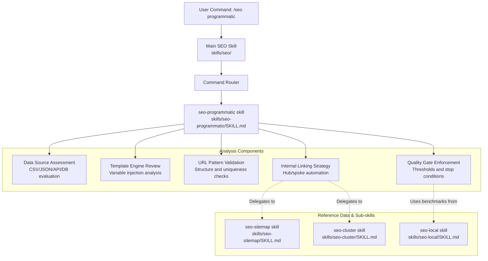
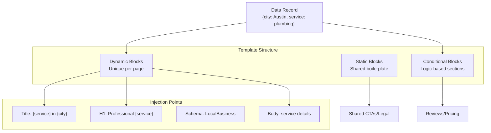

<!-- source: DeepWiki mcp.deepwiki.com · repo AgriciDaniel/claude-seo · page 10 Programmatic SEO · fetched 2026-10-26 -->

# Programmatic SEO

Relevant source files

The following files were used as context for generating this wiki page:

- [skills/seo-audit/SKILL.md](skills/seo-audit/SKILL.md)
- [skills/seo-cluster/SKILL.md](skills/seo-cluster/SKILL.md)
- [skills/seo-competitor-pages/SKILL.md](skills/seo-competitor-pages/SKILL.md)
- [skills/seo-drift/SKILL.md](skills/seo-drift/SKILL.md)
- [skills/seo-ecommerce/SKILL.md](skills/seo-ecommerce/SKILL.md)
- [skills/seo-flow/SKILL.md](skills/seo-flow/SKILL.md)
- [skills/seo-hreflang/SKILL.md](skills/seo-hreflang/SKILL.md)
- [skills/seo-plan/SKILL.md](skills/seo-plan/SKILL.md)
- [skills/seo-programmatic/SKILL.md](skills/seo-programmatic/SKILL.md)
- [skills/seo-schema/SKILL.md](skills/seo-schema/SKILL.md)
- [skills/seo-sitemap/SKILL.md](skills/seo-sitemap/SKILL.md)
- [skills/seo-sxo/SKILL.md](skills/seo-sxo/SKILL.md)

This document covers building and auditing SEO pages at scale from structured data sources. Programmatic SEO involves generating hundreds or thousands of pages from databases, APIs, or static data files using template-based systems. The `claude-seo` system provides the `seo-programmatic` skill to analyze existing scaled content implementations and plan new ones while enforcing quality gates that prevent thin content penalties under Google's Scaled Content Abuse policy.

For technical SEO fundamentals and crawlability analysis, see [Technical SEO Analysis](#5). For content quality evaluation criteria, see [Content Quality & E-E-A-T](#6). For schema markup integration with programmatic pages, see [Schema Markup Management](#7).

---

## Skill Architecture and Command Flow

The programmatic SEO functionality is implemented as a dedicated sub-skill within the `claude-seo` ecosystem. The skill is invoked via `/seo programmatic [url or plan]` and operates independently or as part of a larger strategy, often triggered by the orchestration layer when dynamic page patterns are detected [skills/seo-audit/SKILL.md:3-5]().

### Programmatic SEO System Context

**Sources:** [skills/seo-programmatic/SKILL.md:1-16](), [skills/seo-audit/SKILL.md:3-5]()

---

## Data Source Assessment

Programmatic SEO begins with evaluating the structured data that will populate page templates. The skill examines data completeness, uniqueness, and freshness to determine whether the data can support valuable, distinct pages at scale.

### Data Source Types

| Source Type | Assessment Criteria | Key Metrics |
|-------------|---------------------|-------------|
| **CSV/JSON files** | Row count, column uniqueness, missing values | Duplicate record detection (>80% field overlap) |
| **API endpoints** | Response structure, data freshness, rate limits | Field completeness per record |
| **Database queries** | Record count, field completeness, update frequency | Record density and attribute variance |

### Data Quality Checks

The skill enforces specific data quality requirements before approving programmatic page generation:

1. **Unique Attributes Per Record:** Each record must contain enough distinct attributes to generate genuinely different content [skills/seo-programmatic/SKILL.md:29-31]().
2. **Duplicate Detection:** Flag records with >80% field overlap as potential duplicates [skills/seo-programmatic/SKILL.md:31-31]().
3. **Data Freshness:** Stale data produces stale pages; the system verifies update frequency [skills/seo-programmatic/SKILL.md:32-32]().

**Sources:** [skills/seo-programmatic/SKILL.md:23-33]()

---

## Template Design and Content Generation

Template-based page generation must produce unique, standalone-valuable content rather than "mad-libs" patterns that simply swap keywords into identical text.

### Variable Injection Architecture

### Template Review Checklist

The skill applies a three-part test to template designs [skills/seo-programmatic/SKILL.md:41-45]():
- **Standalone Value Test:** Would this page be worth publishing even if no other similar pages existed? [skills/seo-programmatic/SKILL.md:95-95]()
- **Uniqueness Calculation:** Unique content % = (words unique to this page) / (total words on page) × 100 [skills/seo-programmatic/SKILL.md:115-115]().
- **Dynamic Section Value-Add:** Dynamic sections must add genuine information, not just keyword variations [skills/seo-programmatic/SKILL.md:44-45]().

**Sources:** [skills/seo-programmatic/SKILL.md:34-45](), [skills/seo-programmatic/SKILL.md:114-118]()

---

## Quality Gates and Scaled Content Abuse Policy

The system enforces multi-tier quality gates that prevent Google penalties under the Scaled Content Abuse policy (March 2024), which saw major enforcement escalation in 2025 [skills/seo-programmatic/SKILL.md:85-89]().

### Quality Gate Thresholds

| Metric | Threshold | Action |
|--------|-----------|--------|
| Pages without content review | 100+ | ⚠️ WARNING: require content audit [skills/seo-programmatic/SKILL.md:78-78]() |
| Pages without justification | 500+ | 🛑 HARD STOP: require explicit approval [skills/seo-programmatic/SKILL.md:79-79]() |
| Unique content per page | <40% | ❌ Flag as thin content (likely penalty risk) [skills/seo-programmatic/SKILL.md:80-80]() |
| Word count per page | <300 | ⚠️ Flag for review [skills/seo-programmatic/SKILL.md:81-81]() |

### Safe vs. Penalty-Risk Patterns

**Safe at Scale (✅):**
- Integration pages with real setup docs and API details [skills/seo-programmatic/SKILL.md:101-101]().
- Template/tool pages with downloadable content [skills/seo-programmatic/SKILL.md:102-102]().
- Glossary pages with 200+ word definitions [skills/seo-programmatic/SKILL.md:103-103]().
- Data-driven pages with unique statistics and charts [skills/seo-programmatic/SKILL.md:105-105]().

**Penalty Risk (❌ Avoid):**
- Location pages with only city name swapped in identical text [skills/seo-programmatic/SKILL.md:108-108]().
- AI-generated pages without human review [skills/seo-programmatic/SKILL.md:111-111]().
- Pages where >60% of content is shared template boilerplate [skills/seo-programmatic/SKILL.md:112-112]().

**Sources:** [skills/seo-programmatic/SKILL.md:72-113]()

---

## URL Pattern Strategy

Programmatic pages require predictable, scalable URL structures derived from data attributes. Slugs should be lowercase, hyphenated, and under 100 characters [skills/seo-programmatic/SKILL.md:56-59]().

### Common Patterns
- `/tools/[tool-name]`: Tool/product directory pages [skills/seo-programmatic/SKILL.md:49-49]().
- `/[city]/[service]`: Location + service pages [skills/seo-programmatic/SKILL.md:50-50]().
- `/integrations/[platform]`: Integration landing pages [skills/seo-programmatic/SKILL.md:51-51]().
- `/glossary/[term]`: Definition/reference pages [skills/seo-programmatic/SKILL.md:52-52]().

**Sources:** [skills/seo-programmatic/SKILL.md:46-62]()

---

## Internal Linking Automation

Programmatic pages must integrate into the site's link architecture through automated internal linking strategies, typically following a hub-and-spoke model [skills/seo-programmatic/SKILL.md:65-65]().

### Linking Models
- **Hub/spoke model**: Category hub pages linking to individual programmatic pages.
- **Related items**: Auto-link to 3-5 related pages based on data attributes [skills/seo-programmatic/SKILL.md:66-66]().
- **Breadcrumbs**: Generate `BreadcrumbList` schema from URL hierarchy [skills/seo-programmatic/SKILL.md:67-67]().
- **Link density**: 3-5 internal links per 1000 words [skills/seo-programmatic/SKILL.md:70-70]().

**Sources:** [skills/seo-programmatic/SKILL.md:63-71]()

---

## Indexing and Sitemaps

Large-scale programmatic implementations require careful canonicalization and sitemap management. The `seo-sitemap` skill handles the generation and validation of these files, enforcing protocol limits [skills/seo-sitemap/SKILL.md:34-34]().

### Canonical Strategy
- Every programmatic page must have a self-referencing canonical tag [skills/seo-programmatic/SKILL.md:121-121]().
- Parameter variations (sort, filter) canonical to the base URL [skills/seo-programmatic/SKILL.md:122-122]().
- If programmatic pages overlap with manual pages, the manual page is canonical [skills/seo-programmatic/SKILL.md:124-124]().

### Sitemap Integration
- Auto-generate sitemap entries for all programmatic pages [skills/seo-programmatic/SKILL.md:129-129]().
- Split at 50,000 URLs OR 50MB uncompressed per sitemap file (protocol limit) [skills/seo-sitemap/SKILL.md:34-34]().
- Use sitemap index if multiple sitemap files are needed [skills/seo-sitemap/SKILL.md:93-93]().

**Sources:** [skills/seo-programmatic/SKILL.md:119-136](), [skills/seo-sitemap/SKILL.md:32-52]()

---

## Child Pages

For deeper technical implementation details, refer to the following child pages:

- [Data Sources and Templates](#10.1) — Detailed data quality assessment, template injection strategies, and industry-specific templates like `saas.md` and `ecommerce.md`.
- [Quality Gates and Scaled Content Abuse](#10.2) — Deep dive into uniqueness thresholds, March 2024 policy enforcement, and the `parasite_risk.py` scanner.
- [URL Strategy and Internal Linking](#10.3) — Automated internal linking models, hub/spoke architecture, and `seo-cluster` semantic clustering.

---

