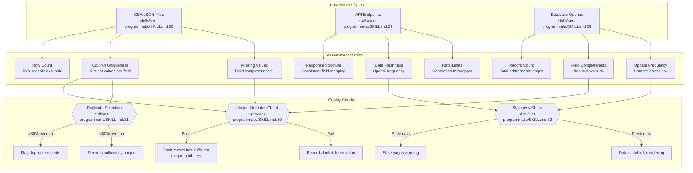
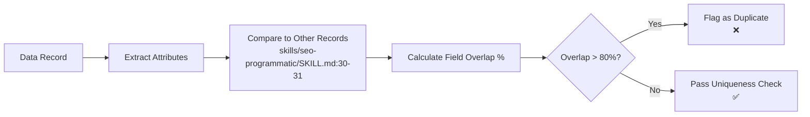
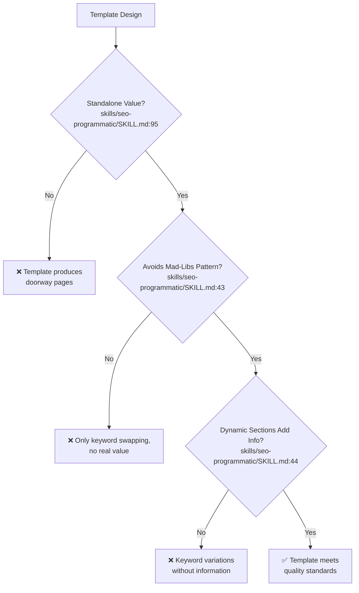

<!-- source: DeepWiki mcp.deepwiki.com · repo AgriciDaniel/claude-seo · page 10.1 Data Sources and Templates · fetched 2026-10-26 -->

# Data Sources and Templates

Relevant source files

The following files were used as context for generating this wiki page:

- [skills/seo-competitor-pages/SKILL.md](skills/seo-competitor-pages/SKILL.md)
- [skills/seo-hreflang/SKILL.md](skills/seo-hreflang/SKILL.md)
- [skills/seo-plan/SKILL.md](skills/seo-plan/SKILL.md)
- [skills/seo-plan/assets/agency.md](skills/seo-plan/assets/agency.md)
- [skills/seo-plan/assets/ecommerce.md](skills/seo-plan/assets/ecommerce.md)
- [skills/seo-plan/assets/generic.md](skills/seo-plan/assets/generic.md)
- [skills/seo-plan/assets/local-service.md](skills/seo-plan/assets/local-service.md)
- [skills/seo-plan/assets/publisher.md](skills/seo-plan/assets/publisher.md)
- [skills/seo-plan/assets/saas.md](skills/seo-plan/assets/saas.md)
- [skills/seo-programmatic/SKILL.md](skills/seo-programmatic/SKILL.md)
- [skills/seo-schema/SKILL.md](skills/seo-schema/SKILL.md)
- [skills/seo-sitemap/SKILL.md](skills/seo-sitemap/SKILL.md)

This document covers the foundational elements of programmatic SEO: evaluating data sources that power pages at scale and designing templates that generate unique, valuable content. This page focuses on pre-generation planning—the data assessment and template structure that determine whether programmatic pages will provide genuine value or trigger thin content penalties.

For information about quality thresholds and enforcement mechanisms, see [10.2 Quality Gates and Scaled Content Abuse](). For URL patterns and internal linking at scale, see [10.3 URL Strategy and Internal Linking](). For schema.org JSON-LD templates, see [7.2 Schema Generation and Templates]().

## Data Source Types

Programmatic SEO pages derive their content from structured data sources. The quality and completeness of these sources directly determine whether generated pages meet uniqueness thresholds.

### Data Source Categories

**Sources:** [skills/seo-programmatic/SKILL.md:23-33]()

### Data Source Assessment Criteria

| Data Source Type | Assessment Criteria | Critical Thresholds |
|------------------|---------------------|---------------------|
| **CSV/JSON Files** | Row count, column uniqueness, missing values | Each record must have sufficient unique attributes [skills/seo-programmatic/SKILL.md:30]() |
| **API Endpoints** | Response structure, data freshness, rate limits | Field overlap <80% between records [skills/seo-programmatic/SKILL.md:31]() |
| **Database Queries** | Record count, field completeness, update frequency | Verified data freshness [skills/seo-programmatic/SKILL.md:32]() |

**Sources:** [skills/seo-programmatic/SKILL.md:26-32]()

## Data Quality Validation

The system enforces critical data quality checks before template generation:

### Unique Attributes Check

Each record must contain enough unique attributes to generate distinct content. Records sharing >80% field overlap are flagged as duplicates [skills/seo-programmatic/SKILL.md:31]().

**Sources:** [skills/seo-programmatic/SKILL.md:30-31]()

### Data Freshness Verification

Stale data produces stale pages that fail to provide current value to users. The system explicitly flags duplicate or near-duplicate records (>80% field overlap) [skills/seo-programmatic/SKILL.md:31-32]().

**Sources:** [skills/seo-programmatic/SKILL.md:31-32]()

## Template Design Principles

Templates must produce pages that pass the "standalone value test": each page should be worth publishing even if no other similar pages existed [skills/seo-programmatic/SKILL.md:95]().

### Variable Injection Points

The system identifies key injection points to ensure content is dynamic:

- **Title Tag, H1, Meta Description**: Derived from primary attributes [skills/seo-programmatic/SKILL.md:37]().
- **Body Sections**: Static vs dynamic content blocks [skills/seo-programmatic/SKILL.md:38]().
- **Schema**: Injecting variables into JSON-LD templates [skills/seo-programmatic/SKILL.md:37]().

**Sources:** [skills/seo-programmatic/SKILL.md:37-45]()

### Content Block Classification

| Block Type | Definition | Uniqueness Impact | Examples |
|------------|------------|-------------------|----------|
| **Static** | Shared across all pages | 0% unique content | Header, footer, navigation [skills/seo-programmatic/SKILL.md:38, 117]() |
| **Dynamic** | Unique per page | 100% unique content | Product specs, unique data points [skills/seo-programmatic/SKILL.md:38]() |
| **Conditional** | Show/hide based on data | Variable | Sections shown only if data exists [skills/seo-programmatic/SKILL.md:39]() |
| **Supplementary** | Related items/context | Partial unique | Related items, contextual tips [skills/seo-programmatic/SKILL.md:40]() |

**Sources:** [skills/seo-programmatic/SKILL.md:38-40, 117]()

### Template Review Checklist

The system enforces these criteria during template validation:

**Sources:** [skills/seo-programmatic/SKILL.md:41-45, 95]()

## Industry-Specific Templates (seo-plan)

The `seo-plan` skill provides specific assets for different business types, ensuring that templates align with industry characteristics and architecture best practices.

### Template Comparison

| Industry | Key Characteristic | Architecture Focus | Schema Focus |
|----------|-------------------|--------------------|--------------|
| **SaaS** | Long sales cycles [skills/seo-plan/assets/saas.md:6]() | Integrations, features, comparison [skills/seo-plan/assets/saas.md:15-55]() | `SoftwareApplication`, `Offer` [skills/seo-plan/assets/saas.md:81-83]() |
| **E-commerce** | High transaction intent [skills/seo-plan/assets/ecommerce.md:6]() | Collections, products, brands [skills/seo-plan/assets/ecommerce.md:16-44]() | `Product`, `OfferShippingDetails` [skills/seo-plan/assets/ecommerce.md:50, 59]() |
| **Local Service** | Geographic focus [skills/seo-plan/assets/local-service.md:6]() | Locations, service area pages [skills/seo-plan/assets/local-service.md:15-35]() | `LocalBusiness`, `GeoCoordinates` [skills/seo-plan/assets/local-service.md:62, 83]() |
| **Publisher** | High content volume [skills/seo-plan/assets/publisher.md:6]() | Topics, authors, news [skills/seo-plan/assets/publisher.md:15-37]() | `NewsArticle`, `Person` (Author) [skills/seo-plan/assets/publisher.md:43, 50-77]() |
| **Agency** | Expertise and trust [skills/seo-plan/assets/agency.md:7]() | Case studies, team, process [skills/seo-plan/assets/agency.md:15-45]() | `ProfessionalService`, `ProfilePage` [skills/seo-plan/assets/agency.md:51, 54, 57-89]() |

**Sources:** [skills/seo-plan/assets/saas.md:1-135](), [skills/seo-plan/assets/ecommerce.md:1-167](), [skills/seo-plan/assets/local-service.md:1-160](), [skills/seo-plan/assets/publisher.md:1-153](), [skills/seo-plan/assets/agency.md:1-175]()

## Safe Programmatic Page Patterns

The system recognizes these programmatic page types as safe for scale when they meet the **30-40% uniqueness** threshold [skills/seo-programmatic/SKILL.md:92]():

- **Integration pages**: Real setup docs, API details [skills/seo-programmatic/SKILL.md:101]().
- **Template/tool pages**: Downloadable content, usage instructions [skills/seo-programmatic/SKILL.md:102]().
- **Glossary pages**: 200+ word definitions with examples [skills/seo-programmatic/SKILL.md:103]().
- **Product pages**: Unique specs, reviews, comparison data [skills/seo-programmatic/SKILL.md:104]().
- **Data-driven pages**: Unique statistics, charts, analysis per record [skills/seo-programmatic/SKILL.md:105]().

**Sources:** [skills/seo-programmatic/SKILL.md:92-105]()

## Penalty Risk Patterns

The following patterns trigger **Hard Stops** or **Warnings** due to risk of Scaled Content Abuse:

- **Location pages** with only city name swapped in identical text [skills/seo-programmatic/SKILL.md:108]().
- **"Best [tool] for [industry]"** without industry-specific value [skills/seo-programmatic/SKILL.md:109]().
- **"[Competitor] alternative"** without real comparison data [skills/seo-programmatic/SKILL.md:110]().
- **AI-generated pages** without human review [skills/seo-programmatic/SKILL.md:111]().
- **High Boilerplate**: Pages where >60% of content is shared template boilerplate [skills/seo-programmatic/SKILL.md:112]().

**Sources:** [skills/seo-programmatic/SKILL.md:107-112]()

## Uniqueness Calculation

Uniqueness is calculated using the following formula:
`Unique content % = (words unique to this page) / (total words on page) × 100` [skills/seo-programmatic/SKILL.md:115]().

The calculation excludes shared headers, footers, and navigation, but **includes** template boilerplate text [skills/seo-programmatic/SKILL.md:117]().

**Sources:** [skills/seo-programmatic/SKILL.md:114-118]()

---

