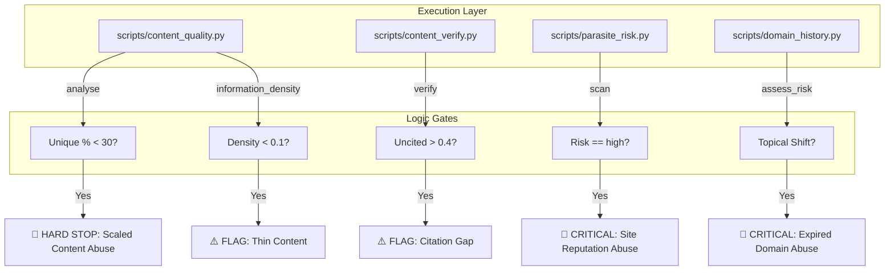
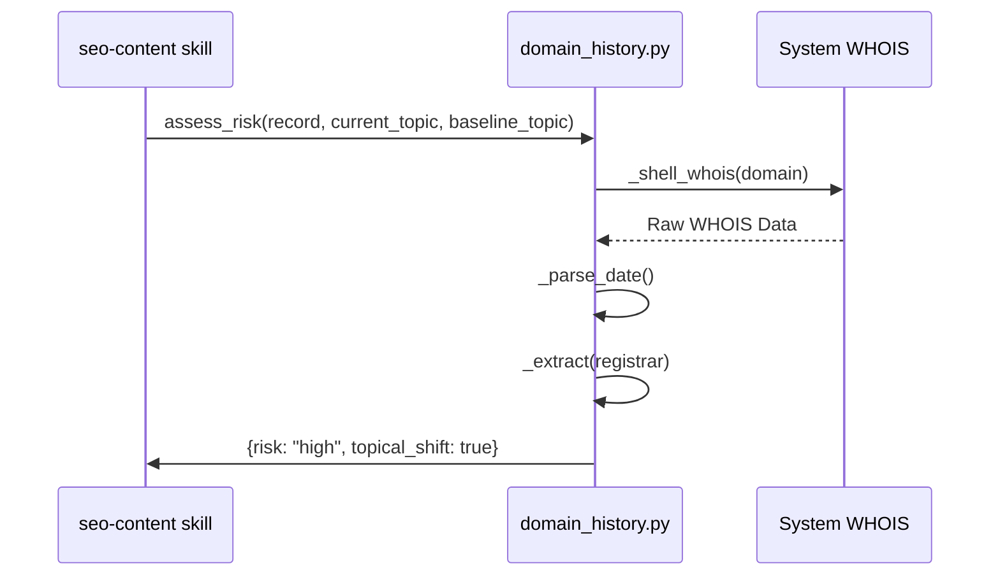

<!-- source: DeepWiki mcp.deepwiki.com · repo AgriciDaniel/claude-seo · page 10.2 Quality Gates and Scaled Content Abuse · fetched 2026-10-26 -->

# Quality Gates and Scaled Content Abuse

Relevant source files

The following files were used as context for generating this wiki page:

- [data/google-updates.json](data/google-updates.json)
- [extensions/ahrefs/skills/seo-ahrefs/SKILL.md](extensions/ahrefs/skills/seo-ahrefs/SKILL.md)
- [extensions/bing-webmaster/skills/seo-bing/SKILL.md](extensions/bing-webmaster/skills/seo-bing/SKILL.md)
- [extensions/profound/skills/seo-profound/SKILL.md](extensions/profound/skills/seo-profound/SKILL.md)
- [extensions/seranking/skills/seo-seranking/SKILL.md](extensions/seranking/skills/seo-seranking/SKILL.md)
- [extensions/unlighthouse/skills/seo-unlighthouse/SKILL.md](extensions/unlighthouse/skills/seo-unlighthouse/SKILL.md)
- [scripts/content_humanize.py](scripts/content_humanize.py)
- [scripts/content_quality.py](scripts/content_quality.py)
- [scripts/content_verify.py](scripts/content_verify.py)
- [scripts/domain_history.py](scripts/domain_history.py)
- [scripts/seo_updates.py](scripts/seo_updates.py)
- [tests/test_content_quality.py](tests/test_content_quality.py)
- [tests/test_parasite_risk_and_extensions.py](tests/test_parasite_risk_and_extensions.py)

## Purpose and Scope

This document details the quality gate thresholds and enforcement mechanisms for programmatic SEO content at scale. It covers uniqueness requirements, page count limits, Google's March 2024 Scaled Content Abuse policy, thin content prevention, and the `parasite_risk.py` site-reputation-abuse scanner. These systems are designed to align with the September 2025 Quality Rater Guidelines (QRG) updates regarding generative AI, scaled automation, and brand mention tracking.

---

## Quality Gate Threshold System

The system enforces a multi-tier quality gate system to prevent thin content penalties and scaled content abuse violations.

### Threshold Matrix

| Metric | Warning Threshold | Hard Stop Threshold | Action |
|--------|------------------|---------------------|--------|
| **Unique Content %** | <40% | <30% | Block publication at <30%, flag for review at 30-40%. |
| **Location Pages** | 30+ pages | 50+ pages | Require 60%+ unique content at 30+, block without justification at 50+. |
| **Total Programmatic Pages** | 100+ pages | 500+ pages | Require content audit at 100+, explicit approval at 500+. |
| **Information Density** | <0.2 | <0.1 | Entities + numbers per token. Flagged as "low-density" [scripts/content_quality.py:195](). |
| **Filler Score** | >40 | >60 | Based on QRG §4.6 padding phrases [scripts/content_quality.py:205](). |
| **AI Pattern Score** | >30 | >50 | Based on LLM-typical phrasings [scripts/content_quality.py:206](). |
| **Uncited Claim Ratio**| >0.4 | N/A | Exit non-zero if ratio of claims without nearby citations exceeds 40% [scripts/content_verify.py:168](). |

**Sources:** [scripts/content_quality.py:189-211](), [scripts/content_quality.py:205-206](), [scripts/content_verify.py:166-171]()

### Enforcement Logic and Data Flow

The following diagram maps the logical gates to the specific Python entities responsible for enforcement.

**Sources:** [scripts/content_quality.py:167-211](), [scripts/parasite_risk.py:121-170](), [scripts/domain_history.py:214-230](), [scripts/content_verify.py:147-155]()

---

## Content Quality and AI Pattern Detection

The system uses `scripts/content_quality.py` to score text against Google's September 11, 2025 QRG update (§4.6.5, §4.6.6).

### Key Functions and Metrics
- **`analyse(text)`**: The entry point that calculates composite quality scores [scripts/content_quality.py:167-180]().
- **Information Density**: Calculated as `(entities + numbers) * 100 / tokens`. A typical high-density article (data journalism) lands at ~5+; generic filler lands at <2 [scripts/content_quality.py:189-195]().
- **AI Patterns**: Detects 40+ LLM-typical phrasings such as "delve into", "tapestry of", and "ever-evolving landscape" [scripts/content_quality.py:94-141]().
- **Filler Detection**: Flags phrases like "it's important to note that" and "in today's fast-paced world" which add little-to-no value per QRG §4.6 [scripts/content_quality.py:60-87]().

### Remediation: `content_humanize.py`
The `humanize(text)` function performs deterministic 1:1 swaps of AI patterns for direct prose (e.g., "leverage" -> "use") to improve readability and lower the AI pattern score [scripts/content_humanize.py:105-131]().

**Sources:** [scripts/content_quality.py:1-45](), [scripts/content_humanize.py:1-23](), [scripts/content_quality.py:167-211]()

---

## Site Reputation and Parasite SEO Risk

The `scripts/parasite_risk.py` scanner addresses the November 19, 2024 policy update targeting "Parasite SEO" (third-party content on high-authority domains).

### Risk Signals
1. **Third-party Authorship Density**: Detects bylines like "Partner Content" or "Brand Studio" [scripts/parasite_risk.py:84-93]().
2. **Commercial-intent Skew**: Measures "Buy Now" CTAs and affiliate link density relative to the site's root corpus [scripts/parasite_risk.py:84-93]().
3. **Topical Drift**: Flags subfolders that diverge significantly from the primary domain topic (e.g., a news site with a `/deals/` section) [scripts/parasite_risk.py:160-170]().

### Risk Classification Table

| Risk Level | Trigger | Action |
|------------|---------|--------|
| **High** | Third-party density hits OR (Commerce skew AND Affiliate density) | Critical Finding in Audit |
| **Medium** | Commercial-intent drift > 4x site mean | Warning; investigation required |
| **Low** | No flags detected | Pass |

**Sources:** [scripts/parasite_risk.py:121-170](), [tests/test_parasite_risk_and_extensions.py:45-83]()

---

## Google Policy Enforcement Timeline

The system tracks confirmed Google updates in `data/google-updates.json` to ensure audit recommendations are based on primary sources.

| Date | Update Name | Impact on Scaled Content |
|------|-------------|--------------------------|
| **2024-03-05** | March 2024 Core/Spam | Helpful Content System merged into core; new scaled content policies [data/google-updates.json:29-34](). |
| **2024-05-05** | Site Reputation Abuse | Manual actions begin against third-party sections [data/google-updates.json:43-48](). |
| **2024-11-19** | Policy Clarification | Clarified that first-party involvement does not exempt third-party content [data/google-updates.json:71-76](). |
| **2024-12-19** | Dec 2024 Spam Update | Targeted scaled content abuse [data/google-updates.json:85-90](). |
| **2025-01-23** | QRG Update (Jan 2025) | Formal definition of generative AI and scaled content abuse in §4.6 [data/google-updates.json:92-97](). |
| **2025-09-11** | QRG Update (Sept 2025) | Adds AI Overview rating examples; expands YMYL topics [data/google-updates.json:141-146](). |

**Sources:** [data/google-updates.json:27-154](), [scripts/seo_updates.py:1-21]()

---

## Expired Domain Abuse Detection

The `scripts/domain_history.py` tool identifies "Expired Domain Abuse" as defined in Sept 2025 QRG §4.6.7.

### Implementation Detail
- **`lookup(domain)`**: Uses the system `whois` binary or a socket-based IANA fallback to extract `years_registered` [scripts/domain_history.py:172-213]().
- **Topical Shift**: Compares the historical registration purpose against the current detected topic. A site registered 18 years ago for veterinary services now publishing crypto signals is flagged [scripts/domain_history.py:5-9]().

**Sources:** [scripts/domain_history.py:1-51](), [scripts/domain_history.py:216-230]()

---

## Extension-Based Visibility Audits

For scaled content that requires external validation of brand authority and AI visibility, the system integrates with specialized extensions.

| Extension | Skill | Purpose |
|-----------|-------|---------|
| **Ahrefs** | `seo-ahrefs` | Backlink quality signals and toxic link assessment [extensions/ahrefs/skills/seo-ahrefs/SKILL.md:27-38](). |
| **SE Ranking** | `seo-seranking` | Tracks AI Share-of-Voice across ChatGPT, Gemini, Perplexity, and AI Overviews [extensions/seranking/skills/seo-seranking/SKILL.md:28-39](). |
| **Profound** | `seo-profound` | Time-series brand citation rates across LLMs [extensions/profound/skills/seo-profound/SKILL.md:1-6](). |
| **Unlighthouse** | `seo-unlighthouse` | Site-wide Lighthouse audits (up to 200 routes) for performance regressions [extensions/unlighthouse/skills/seo-unlighthouse/SKILL.md:9-17](). |
| **Bing** | `seo-bing` | Microsoft Copilot AI citation eligibility via Bing index ingestion [extensions/bing-webmaster/skills/seo-bing/SKILL.md:9-14](). |

**Sources:** [extensions/ahrefs/skills/seo-ahrefs/SKILL.md:1-53](), [extensions/seranking/skills/seo-seranking/SKILL.md:1-51](), [extensions/profound/skills/seo-profound/SKILL.md:1-42](), [extensions/unlighthouse/skills/seo-unlighthouse/SKILL.md:1-47](), [extensions/bing-webmaster/skills/seo-bing/SKILL.md:1-47]()

---

