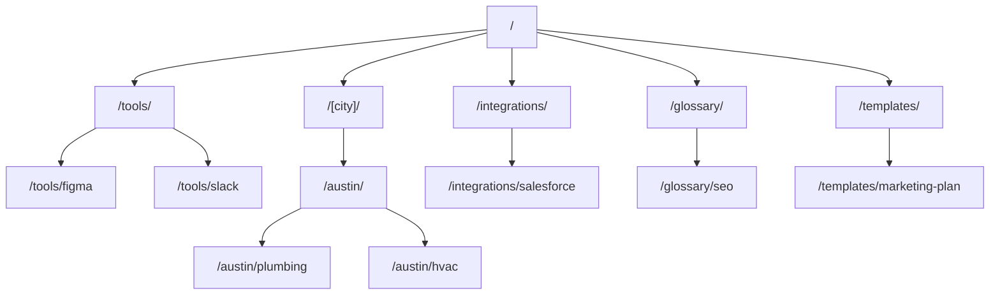
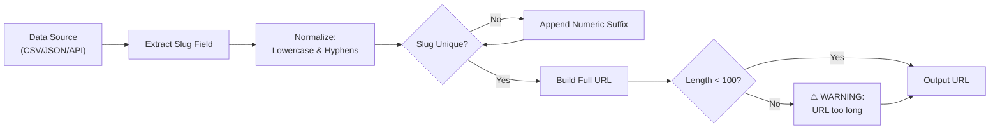
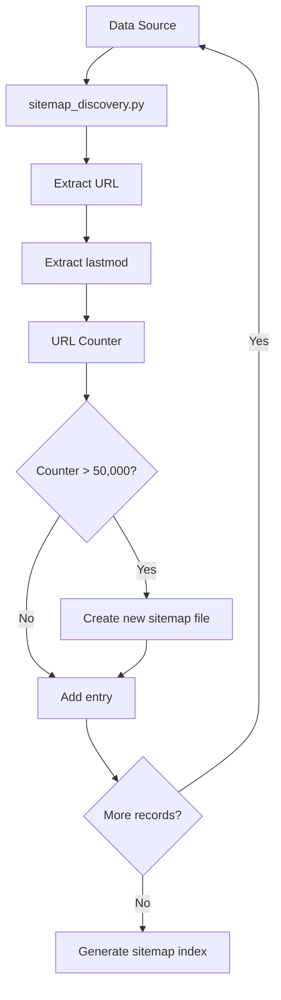

<!-- source: DeepWiki mcp.deepwiki.com · repo AgriciDaniel/claude-seo · page 10.3 URL Strategy and Internal Linking · fetched 2026-10-26 -->

# URL Strategy and Internal Linking

Relevant source files

The following files were used as context for generating this wiki page:

- [agents/seo-maps.md](agents/seo-maps.md)
- [agents/seo-sitemap.md](agents/seo-sitemap.md)
- [skills/seo-audit/SKILL.md](skills/seo-audit/SKILL.md)
- [skills/seo-cluster/SKILL.md](skills/seo-cluster/SKILL.md)
- [skills/seo-drift/SKILL.md](skills/seo-drift/SKILL.md)
- [skills/seo-ecommerce/SKILL.md](skills/seo-ecommerce/SKILL.md)
- [skills/seo-flow/SKILL.md](skills/seo-flow/SKILL.md)
- [skills/seo-sxo/SKILL.md](skills/seo-sxo/SKILL.md)

**Purpose**: This document details URL pattern design and automated internal linking strategies for programmatic SEO implementations. It covers URL construction rules, hierarchical site architecture, linking automation patterns (hub/spoke, related items, breadcrumbs, cross-linking), canonical tag strategy, and sitemap integration for pages generated at scale.

**Scope**: This documentation applies specifically to pages generated from structured data sources. For general technical SEO considerations including crawlability and indexability, see [5.1](). For quality gates and content thresholds governing programmatic pages, see [10.2](). For data source evaluation and template design, see [10.1]().

---

## URL Pattern Strategy

The `seo-programmatic` skill defines standard URL patterns for common programmatic page types. These patterns establish hierarchical relationships between pages and enable automated internal linking.

### Common URL Patterns

The following patterns are specified in [skills/seo-programmatic/SKILL.md:48-53]():

| Pattern | Use Case | Example |
|---------|----------|---------|
| `/tools/[tool-name]` | Tool/product directory pages | `/tools/figma`, `/tools/slack` |
| `/[city]/[service]` | Location + service pages | `/austin/plumbing`, `/boston/roofing` |
| `/integrations/[platform]` | Integration landing pages | `/integrations/salesforce`, `/integrations/zapier` |
| `/glossary/[term]` | Definition/reference pages | `/glossary/seo`, `/glossary/canonical-tag` |
| `/templates/[template-name]` | Downloadable template pages | `/templates/marketing-plan`, `/templates/budget-tracker` |

**URL Hierarchy Diagram**

Sources: [skills/seo-programmatic/SKILL.md:48-53]()

### URL Construction Rules

The skill enforces specific URL construction rules at [skills/seo-programmatic/SKILL.md:55-61]():

| Rule | Specification | Rationale |
|------|---------------|-----------|
| **Slug Format** | Lowercase, hyphenated slugs derived from data | Consistency and search engine preference |
| **Hierarchy** | Logical hierarchy reflecting site architecture | Enables breadcrumb generation and hub/spoke linking |
| **Uniqueness** | No duplicate slugs; enforce uniqueness at generation time | Prevents URL collision and 404 errors |
| **Length Limit** | Keep URLs under 100 characters | Prevents truncation in SERPs |
| **Query Parameters** | No query parameters for primary content URLs | Prevents duplicate content and crawl budget waste |
| **Trailing Slashes** | Consistent trailing slash usage | Matches existing site patterns |

**URL Generation Flow**

Sources: [skills/seo-programmatic/SKILL.md:55-61]()

---

## Internal Linking Automation

The `seo-programmatic` skill defines four automated linking patterns to establish hierarchical relationships and contextual connections.

### Hub/Spoke Model

The hub/spoke model establishes bidirectional links between category hub pages and individual entity pages [skills/seo-programmatic/SKILL.md:65]().

### Related Items and Cross-Linking

The skill specifies auto-linking to 3-5 related pages based on data attributes [skills/seo-programmatic/SKILL.md:66]() and linking between programmatic pages sharing attributes like the same category, city, or feature [skills/seo-programmatic/SKILL.md:68]().

### Breadcrumb Navigation

Breadcrumb navigation is auto-generated from URL hierarchy [skills/seo-programmatic/SKILL.md:67](). The system generates `BreadcrumbList` schema to reflect this structure.

### Anchor Text and Density

The system enforces descriptive, varied anchor text [skills/seo-programmatic/SKILL.md:69]() and a link density of 3-5 internal links per 1000 words [skills/seo-programmatic/SKILL.md:70]().

Sources: [skills/seo-programmatic/SKILL.md:63-71]()

---

## Semantic Topic Clustering (`seo-cluster`)

The `seo-cluster` skill uses SERP-overlap-driven keyword clustering to design content architectures. This process groups keywords by how Google actually ranks them (shared top-10 results), not by text similarity [skills/seo-cluster/SKILL.md:23-26]().

### SERP Overlap Methodology

Keywords are grouped based on the number of shared organic results in the top 10 [skills/seo-cluster/SKILL.md:61-75]().

| Shared Results | Relationship | Action |
|---------------|-------------|--------|
| 7-10 | Same post | Merge into single target page |
| 4-6 | Same cluster | Group under same spoke cluster |
| 2-3 | Interlink | Place in adjacent clusters, add cross-links |
| 0-1 | Separate | Assign to different clusters or exclude |

Sources: [skills/seo-cluster/SKILL.md:61-75]()

### Internal Link Matrix

The `seo-cluster` skill generates a bidirectional linking structure [skills/seo-cluster/SKILL.md:131-141]():

| Link Type | Direction | Requirement |
|-----------|-----------|-------------|
| Spoke to pillar | spoke -> pillar | Mandatory (every spoke) |
| Pillar to spoke | pillar -> spoke | Mandatory (every spoke) |
| Spoke to spoke (within cluster) | spoke <-> spoke | 2-3 links per post |
| Cross-cluster | spoke -> spoke (other) | 0-1 links per post |

Sources: [skills/seo-cluster/SKILL.md:131-156]()

---

## Canonical Strategy

Canonical tags prevent duplicate content issues in programmatic implementations [skills/seo-programmatic/SKILL.md:119-125]().

| Scenario | Canonical Target |
|----------|------------------|
| **Self-referencing** | Every programmatic page must have a self-referencing canonical |
| **Parameter variations** | Parameter variations (sort, filter, pagination) canonical to base URL |
| **Manual vs programmatic** | If programmatic pages overlap with manual pages, the manual page is canonical |

Sources: [skills/seo-programmatic/SKILL.md:119-125]()

---

## Sitemap Integration (`seo-sitemap`)

The `seo-sitemap` skill handles the generation and analysis of XML sitemaps for programmatic pages [skills/seo-sitemap/SKILL.md:2-3]().

### Sitemap Generation and Quality Gates

The `seo-sitemap` agent enforces strict quality gates, particularly for location pages, to avoid "doorway page" penalties [agents/seo-sitemap.md:22-30]().

| Check | Threshold | Severity |
|-------|-----------|----------|
| Location Pages | 30+ pages | ⚠️ WARNING: Require 60%+ unique content |
| Location Pages | 50+ pages | 🛑 HARD STOP: Require explicit justification |
| Sitemap Size | >50,000 URLs | Critical: Must split with index |
| Sitemap Size | >50MB | Critical: Must split with index |

Sources: [agents/seo-sitemap.md:19-30](), [agents/seo-sitemap.md:33-41]()

### Sitemap Discovery and Architecture

The system uses `sitemap_discovery.py` to identify existing sitemaps [agents/seo-sitemap.md:13]().

**Sitemap Generation Architecture**

Sources: [agents/seo-sitemap.md:13-20](), [skills/seo-programmatic/SKILL.md:127-136]()

---

