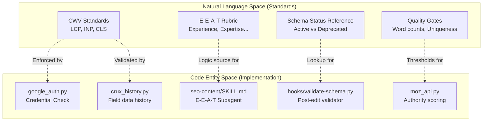
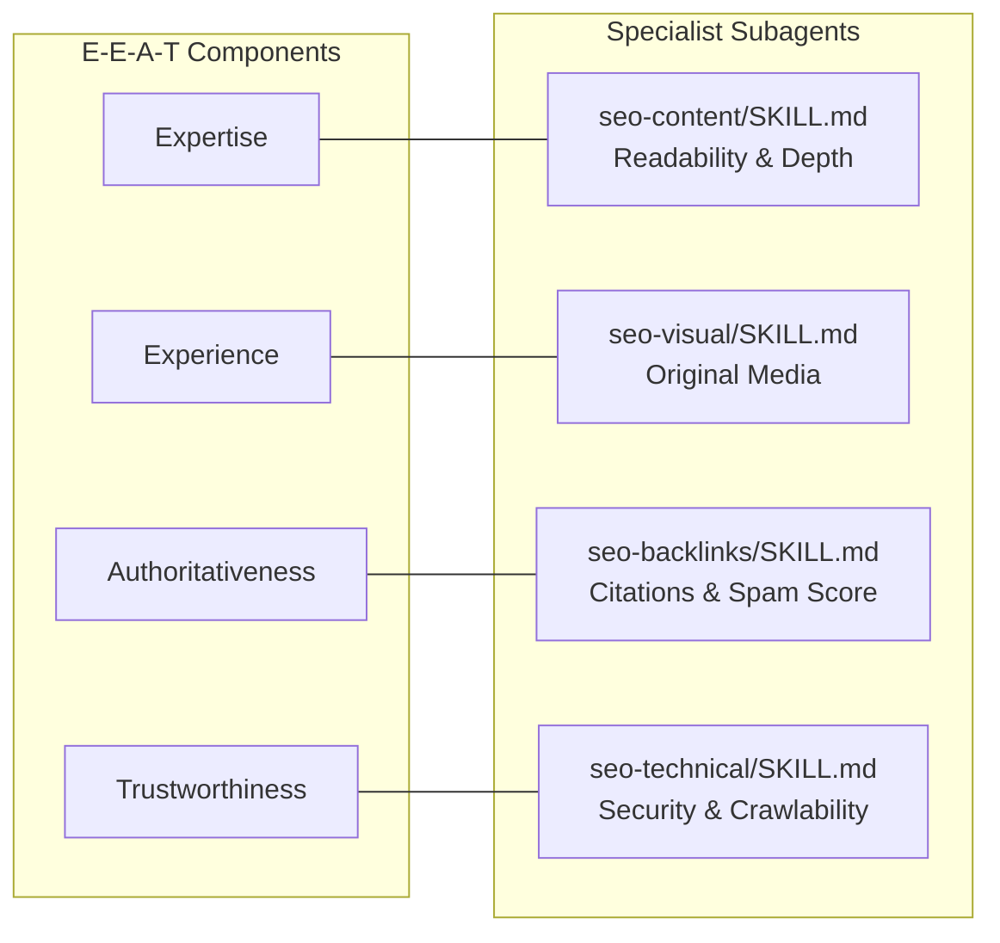

<!-- source: DeepWiki mcp.deepwiki.com · repo AgriciDaniel/claude-seo · page 11 Reference Documentation · fetched 2026-10-26 -->

# Reference Documentation

Relevant source files

The following files were used as context for generating this wiki page:

- [docs/MCP-INTEGRATION.md](docs/MCP-INTEGRATION.md)
- [extensions/banana/scripts/edit.py](extensions/banana/scripts/edit.py)
- [extensions/banana/scripts/generate.py](extensions/banana/scripts/generate.py)
- [extensions/firecrawl/skills/seo-firecrawl/SKILL.md](extensions/firecrawl/skills/seo-firecrawl/SKILL.md)
- [skills/seo-backlinks/SKILL.md](skills/seo-backlinks/SKILL.md)
- [skills/seo-google/references/auth-setup.md](skills/seo-google/references/auth-setup.md)
- [skills/seo-google/references/nlp-api.md](skills/seo-google/references/nlp-api.md)
- [skills/seo-google/references/pagespeed-crux-api.md](skills/seo-google/references/pagespeed-crux-api.md)
- [skills/seo/SKILL.md](skills/seo/SKILL.md)
- [skills/seo/references/cwv-thresholds.md](skills/seo/references/cwv-thresholds.md)

This page provides centralized reference information for all standards, thresholds, and frameworks used throughout the **claude-seo** system. These references serve as the single source of truth for SEO best practices, Google policies, and quality enforcement rules that guide analysis and recommendations across all 25 sub-skills and 18 specialist agents [skills/seo/SKILL.md:22-25]().

For detailed technical standards and evaluation rubrics, see the following child pages:
- [Core Web Vitals Thresholds](#11.1) — Official thresholds for LCP (≤2.5s), INP (≤200ms), and CLS (≤0.1) with the 75th percentile evaluation standard.
- [E-E-A-T Evaluation Criteria](#11.2) — September 2025 Quality Rater Guidelines framework and the Who/How/Why heuristics used by the `seo-content` skill.
- [Quality Gate Thresholds](#11.3) — Reference for content minimums, uniqueness requirements, and GEO Health Score weighting (Citability 25%, Authority 20%).

## Reference System Architecture

The reference system consists of specialized markdown files and JSON template libraries stored within the skill structure. This architecture ensures that agents are "temporally aware" of policy shifts, such as the March 2024 INP transition and the September 2024 removal of FID from field tools [skills/seo/references/cwv-thresholds.md:13-18]().

### Natural Language to Code Entity Space: Reference Loading
The following diagram illustrates how the natural language requirements defined in reference documents are associated with specific code entities and scripts.

**Sources:** [skills/seo/SKILL.md:72-85](), [docs/MCP-INTEGRATION.md:113-134](), [skills/seo/references/cwv-thresholds.md:47-58]()

## Core Web Vitals (CWV) Reference
Core Web Vitals are measured at the **75th percentile** of real user data (field data) [skills/seo/references/cwv-thresholds.md:14](). The system prioritizes field data from the Chrome User Experience Report (CrUX) via `crux_history.py` over lab data from Lighthouse [skills/seo/references/cwv-thresholds.md:59-60]().

| Metric | Good | Needs Improvement | Poor | Code Entity |
| :--- | :--- | :--- | :--- | :--- |
| **LCP** | ≤ 2.5s | 2.5s – 4.0s | > 4.0s | `crux_history.py` |
| **INP** | ≤ 200ms | 200ms – 500ms | > 500ms | `mcp-server-pagespeed` |
| **CLS** | ≤ 0.1 | 0.1 – 0.25 | > 0.25 | `unlighthouse_run.py` |

> **Historical Note:** INP replaced FID on March 12, 2024. FID was fully removed from CrUX and PSI APIs on September 9, 2024 [skills/seo/references/cwv-thresholds.md:13]().

For details, see [Core Web Vitals Thresholds](#11.1).

**Sources:** [skills/seo/references/cwv-thresholds.md:1-18](), [docs/MCP-INTEGRATION.md:126-133]()

## E-E-A-T Framework Reference
The system implements Google's **September 2025 Quality Rater Guidelines (QRG)** update, evaluating Experience, Expertise, Authoritativeness, and Trustworthiness [skills/seo/SKILL.md:37]().

### E-E-A-T to Agent Mapping
This diagram shows how specific subagents are responsible for different facets of the E-E-A-T framework as defined in the system's orchestration logic.

For details, see [E-E-A-T Evaluation Criteria](#11.2).

**Sources:** [skills/seo/SKILL.md:72-84](), [skills/seo-backlinks/SKILL.md:107-121]()

## Backlink Quality Benchmarks
The `seo-backlinks` skill utilizes vendor-specific and community benchmarks to assess link profile health [skills/seo-backlinks/SKILL.md:55-62]().

| Metric | Good | Warning | Critical |
| :--- | :--- | :--- | :--- |
| **Follow Ratio** | > 60% | 40-60% | < 40% |
| **Domain Diversity** | No domain > 5% | 1 domain > 10% | 1 domain > 25% |
| **Exact Match Anchor** | 3-10% | > 15% (signal) | > 25% (spam) |

**Sources:** [skills/seo-backlinks/SKILL.md:57-62](), [skills/seo-backlinks/SKILL.md:72-83]()

## Quality Gate Thresholds
Quality gates are programmatic checks that trigger warnings or hard stops during content generation and site audits. The `seo-geo` skill specifically uses a weighted scoring model to evaluate AI Overview readiness [skills/seo/SKILL.md:39]().

### GEO Health Score Weighting
- **Citability:** 25% (Quotable facts/stats)
- **Structural:** 20% (Headings, lists, tables)
- **Multi-Modal:** 15% (Images, video context)
- **Authority:** 20% (Credentials, sources)
- **Technical:** 20% (Structured data, crawler access)

### Programmatic Enforcement
The system enforces strict uniqueness and volume limits to prevent scaled content abuse:
- **Location Page Cap:** Maximum 50 pages for local landing page sets.
- **Uniqueness Threshold:** Minimum 30% content variance required for scaled pages.

For details, see [Quality Gate Thresholds](#11.3).

**Sources:** [skills/seo/SKILL.md:84-86](), [skills/seo-backlinks/SKILL.md:107-113]()

---

