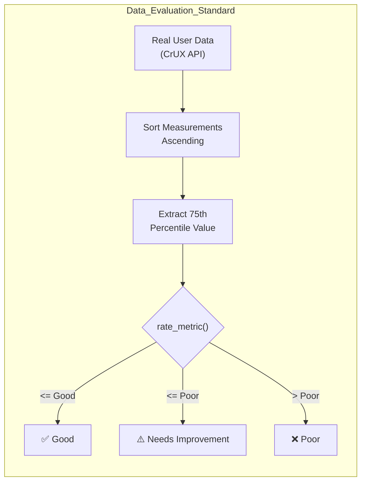
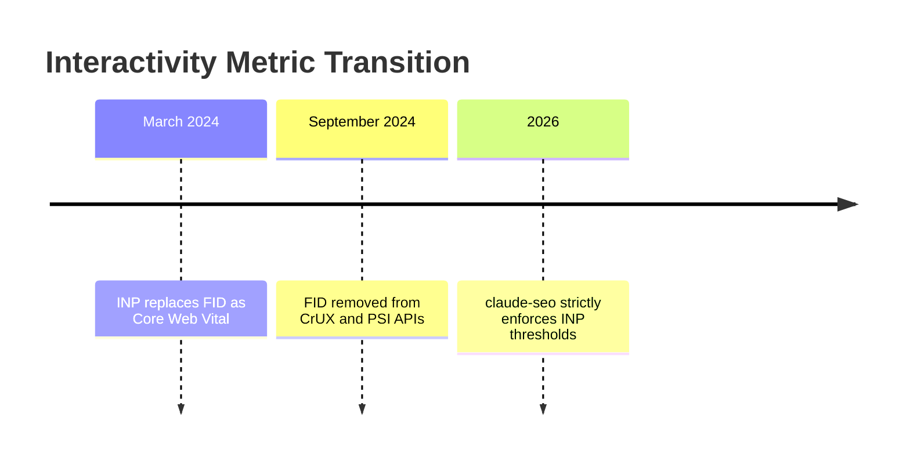
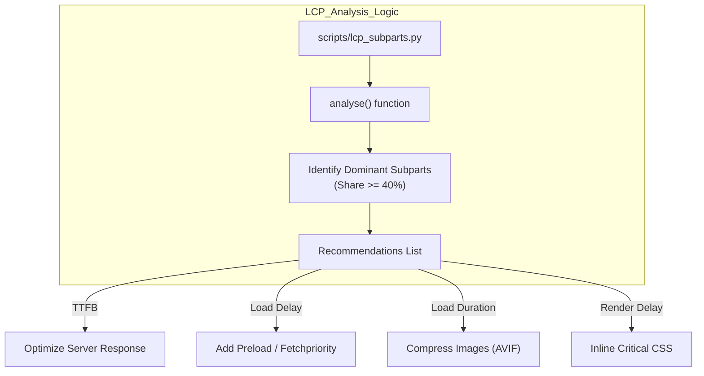
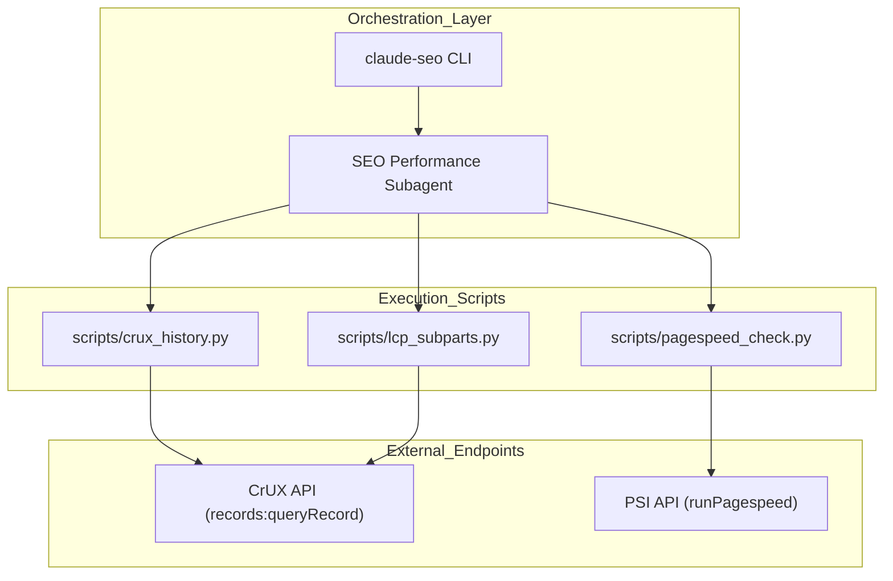

<!-- source: DeepWiki mcp.deepwiki.com · repo AgriciDaniel/claude-seo · page 11.1 Core Web Vitals Thresholds · fetched 2026-10-26 -->

# Core Web Vitals Thresholds

Relevant source files

The following files were used as context for generating this wiki page:

- [docs/MCP-INTEGRATION.md](docs/MCP-INTEGRATION.md)
- [extensions/banana/scripts/edit.py](extensions/banana/scripts/edit.py)
- [extensions/banana/scripts/generate.py](extensions/banana/scripts/generate.py)
- [scripts/crux_history.py](scripts/crux_history.py)
- [scripts/lcp_subparts.py](scripts/lcp_subparts.py)
- [scripts/pagespeed_check.py](scripts/pagespeed_check.py)
- [scripts/verify_backlinks.py](scripts/verify_backlinks.py)
- [skills/seo-google/references/auth-setup.md](skills/seo-google/references/auth-setup.md)
- [skills/seo-google/references/nlp-api.md](skills/seo-google/references/nlp-api.md)
- [skills/seo-google/references/pagespeed-crux-api.md](skills/seo-google/references/pagespeed-crux-api.md)
- [skills/seo/references/cwv-thresholds.md](skills/seo/references/cwv-thresholds.md)

## Purpose and Scope

This document provides the official Core Web Vitals (CWV) thresholds used throughout the `claude-seo` system for performance evaluation. These thresholds are referenced by the performance analysis engine and technical SEO agents to determine pass/fail status for web pages based on the 75th percentile standard.

The system specifically aligns with Google's March 2024 transition where **INP** replaced **FID** as the primary interactivity metric.

## Current Thresholds (2026)

The `claude-seo` system enforces the following thresholds for Core Web Vitals metrics, as defined in the `scripts/pagespeed_check.py` implementation and reference documentation:

| Metric | Good | Needs Improvement | Poor | Unit |
|--------|------|-------------------|------|------|
| **LCP** (Largest Contentful Paint) | ≤ 2.5s | 2.5s–4.0s | > 4.0s | seconds |
| **INP** (Interaction to Next Paint) | ≤ 200ms | 200ms–500ms | > 500ms | milliseconds |
| **CLS** (Cumulative Layout Shift) | ≤ 0.1 | 0.1–0.25 | > 0.25 | unitless |
| **FCP** (First Contentful Paint) | ≤ 1.8s | 1.8s–3.0s | > 3.0s | seconds |
| **TTFB** (Time to First Byte) | ≤ 0.8s | 0.8s–1.8s | > 1.8s | seconds |

**Sources:** [scripts/pagespeed_check.py:52-58](), [skills/seo/references/cwv-thresholds.md:6-10](), [skills/seo-google/references/pagespeed-crux-api.md:205-211]()

### Metric Definitions

- **LCP (Largest Contentful Paint)**: Measures loading performance. Specifically, the time from page load start to when the largest visible content element is rendered. [skills/seo/references/cwv-thresholds.md:8]()
- **INP (Interaction to Next Paint)**: Measures responsiveness. It tracks the latency of all user interactions throughout the page lifecycle. [skills/seo/references/cwv-thresholds.md:9]()
- **CLS (Cumulative Layout Shift)**: Measures visual stability by quantifying unexpected layout shifts. [skills/seo/references/cwv-thresholds.md:10]()

## Evaluation Method

### 75th Percentile Assessment
Google evaluates Core Web Vitals using the **75th percentile** (p75) of page visits. The system analyzes real user data from the Chrome User Experience Report (CrUX) via `scripts/crux_history.py` and `scripts/pagespeed_check.py`. [skills/seo/references/cwv-thresholds.md:14](), [scripts/pagespeed_check.py:187-195]()

**Diagram: 75th Percentile Evaluation Flow**
**Sources:** [scripts/pagespeed_check.py:69-80](), [scripts/crux_history.py:140-160]()

## Historical Timeline: FID to INP Transition

### Critical Dates
- **March 12, 2024**: INP officially replaced FID as a Core Web Vitals metric. [skills/seo/references/cwv-thresholds.md:13]()
- **September 9, 2024**: FID was fully removed from all Chrome tools (CrUX API, PageSpeed Insights). [skills/seo/references/cwv-thresholds.md:13]()
- **Current (2026)**: INP is the sole interactivity metric. The system ignores FID and focuses on main-thread blocking tasks. [skills/seo/references/cwv-thresholds.md:18]()

**Sources:** [skills/seo/references/cwv-thresholds.md:13-18](), [skills/seo-google/references/pagespeed-crux-api.md:203-213]()

## LCP Subparts (Diagnostic Breakdown)

Since January 2025, the CrUX API exposes four diagnostic sub-metrics for LCP. The script `scripts/lcp_subparts.py` decomposes a slow LCP into actionable phases. [scripts/lcp_subparts.py:5-15]()

| Subpart | Code Identifier | Target Optimization |
|---------|-----------------|---------------------|
| **TTFB** | `largest_contentful_paint_image_time_to_first_byte` | Server response, CDN edge cache |
| **Resource Load Delay** | `largest_contentful_paint_image_resource_load_delay` | Preload hero image, `fetchpriority` |
| **Resource Load Time** | `largest_contentful_paint_image_resource_load_duration` | Responsive sizes, AVIF/WebP formats |
| **Element Render Delay** | `largest_contentful_paint_image_element_render_delay` | Reduce render-blocking CSS/JS |

**Sources:** [scripts/lcp_subparts.py:45-50](), [scripts/lcp_subparts.py:128-153]()

**Diagram: LCP Subpart Analysis in Code Entity Space**
**Sources:** [scripts/lcp_subparts.py:90-162](), [skills/seo/references/cwv-thresholds.md:21-34]()

## Performance Tooling Integration

The system interfaces with multiple APIs to fetch and validate these thresholds:

1.  **`scripts/pagespeed_check.py`**: Merges PSI lab data and CrUX field data. [scripts/pagespeed_check.py:3-13]()
2.  **`scripts/crux_history.py`**: Fetches up to 25 weekly data points to identify performance trends (improving/degrading). [scripts/crux_history.py:3-12]()
3.  **`scripts/lcp_subparts.py`**: Queries the CrUX API for granular LCP diagnostic sub-metrics. [scripts/lcp_subparts.py:53-78]()
4.  **`docs/MCP-INTEGRATION.md`**: Provides configuration for `mcp-server-pagespeed` to automate these checks via Claude. [docs/MCP-INTEGRATION.md:44-62]()

**Diagram: Performance Tooling Architecture**
**Sources:** [scripts/pagespeed_check.py:48-49](), [scripts/crux_history.py:43-44](), [docs/MCP-INTEGRATION.md:78-111]()

## Implementation Details

### Data Normalization
The system handles metric inconsistencies across APIs:
- **CLS Handling**: The CrUX API returns CLS as a string (e.g., `"0.05"`). The system uses `float(str(val))` to ensure numeric comparison. [scripts/crux_history.py:147-151]()
- **Rate Limiting**: The system respects the 150 QPM shared limit between CrUX and CrUX History APIs. [skills/seo-google/references/pagespeed-crux-api.md:146-148](), [scripts/crux_history.py:111-113]()

**Sources:** [scripts/crux_history.py:142-152](), [skills/seo-google/references/pagespeed-crux-api.md:146-148]()

---

