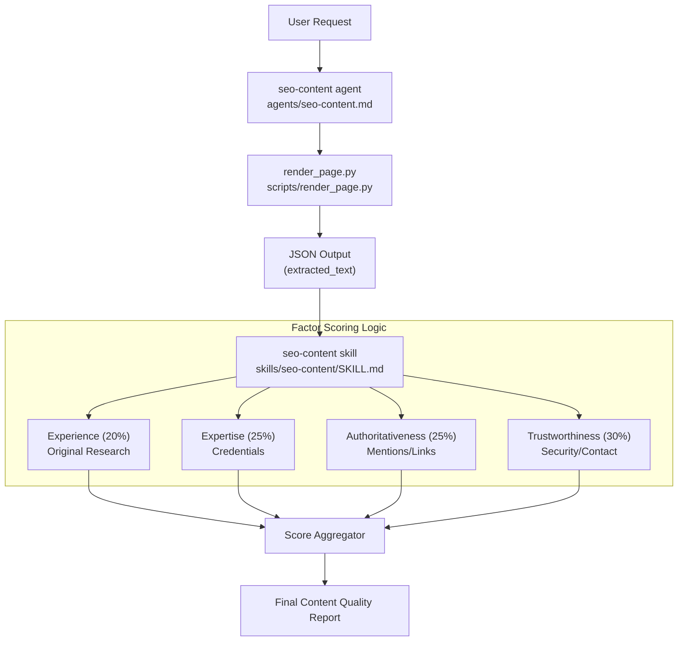
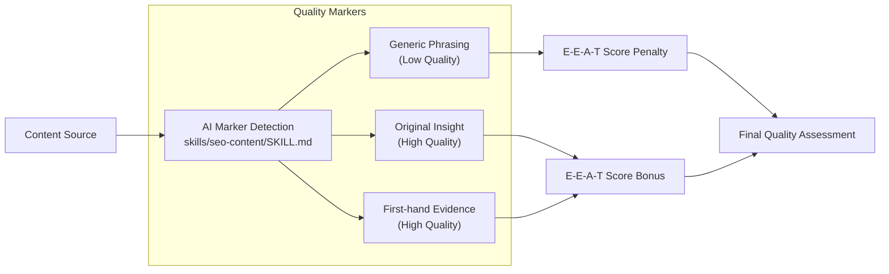

<!-- source: DeepWiki mcp.deepwiki.com · repo AgriciDaniel/claude-seo · page 11.2 E-E-A-T Evaluation Criteria · fetched 2026-10-26 -->

# E-E-A-T Evaluation Criteria

Relevant source files

The following files were used as context for generating this wiki page:

- [agents/seo-content.md](agents/seo-content.md)
- [agents/seo-ecommerce.md](agents/seo-ecommerce.md)
- [agents/seo-performance.md](agents/seo-performance.md)
- [agents/seo-schema.md](agents/seo-schema.md)
- [agents/seo-sxo.md](agents/seo-sxo.md)
- [agents/seo-technical.md](agents/seo-technical.md)
- [agents/seo-visual.md](agents/seo-visual.md)
- [scripts/google_report.py](scripts/google_report.py)
- [skills/seo-content/SKILL.md](skills/seo-content/SKILL.md)
- [skills/seo-geo/SKILL.md](skills/seo-geo/SKILL.md)
- [skills/seo-image-gen/SKILL.md](skills/seo-image-gen/SKILL.md)
- [skills/seo-local/SKILL.md](skills/seo-local/SKILL.md)
- [skills/seo-maps/SKILL.md](skills/seo-maps/SKILL.md)
- [tests/test_audit_instructions.py](tests/test_audit_instructions.py)

This document provides the technical reference for the Experience-Expertise-Authoritativeness-Trustworthiness (E-E-A-T) evaluation framework used throughout the `claude-seo` system. It specifies the weighted scoring model, signal detection criteria, and implementation details based on Google's September 2025 Quality Rater Guidelines (QRG) update.

## Purpose and Scope

The E-E-A-T framework is a core component of the `seo-content` subagent's evaluation logic. It provides a quantitative assessment of four quality dimensions weighted according to their importance for ranking outcomes in both traditional search and AI-powered generative engines. The system implements these criteria through the `Who/How/Why` heuristic and specific signal detection patterns.

**Sources:** [agents/seo-content.md:9-20](), [skills/seo-content/SKILL.md:16-36]()

---

## The Who/How/Why Heuristic

Before calculating individual factor scores, the `seo-content` agent applies Google's canonical three-question heuristic for helpful content.

| Question | Evaluation Criteria | Implementation Detail |
|----------|---------------------|-----------------------|
| **Who** | Is there a visible byline, bio, and credentials? | Non-negotiable for YMYL; extracted from `extracted_text` [agents/seo-content.md:79]() |
| **How** | Is the creation process disclosed (especially for AI)? | Looks for process documentation and original research [skills/seo-content/SKILL.md:26]() |
| **Why** | Is the intent to help people or attract search clicks? | Detects word-count targeting vs. topical depth [skills/seo-content/SKILL.md:27]() |

**Sources:** [skills/seo-content/SKILL.md:18-34](), [agents/seo-content.md:9-19]()

---

## Weighted Scoring Model

The E-E-A-T framework uses a four-factor model with differential weighting that reflects the September 2025 QRG emphasis on trustworthiness and AI-readiness.

| Factor | Weight | Maximum Points | Primary Signals |
|--------|--------|----------------|-----------------|
| **Experience** | 20% | 20 | First-hand signals, case studies, original photos |
| **Expertise** | 25% | 25 | Author credentials, technical accuracy, citations |
| **Authoritativeness** | 25% | 25 | Brand mentions, external recognition, backlinks |
| **Trustworthiness** | 30% | 30 | HTTPS, contact info, transparency, security |

**Sources:** [agents/seo-content.md:21-30](), [skills/seo-content/SKILL.md:40-64]()

---

## System Architecture: E-E-A-T Evaluation Pipeline

The following diagram illustrates how the `seo-content` agent (`agents/seo-content.md`) utilizes the `seo-content` skill (`skills/seo-content/SKILL.md`) and the `render_page.py` script to perform E-E-A-T scoring.

Title: E-E-A-T Data Flow and Entity Mapping

The system prioritizes `extracted_text` (boilerplate-stripped via `trafilatura`) over raw HTML for E-E-A-T scoring to ensure navigation chrome and footers do not dilute the signal [agents/seo-content.md:79]().

**Sources:** [agents/seo-content.md:68-79](), [skills/seo-content/SKILL.md:38-64](), [scripts/render_page.py:1-10]()

---

## Factor Detection Criteria

### 1. Experience (20%)
Focuses on first-hand signals and direct involvement.
*   **Strong Signals:** Original research, case studies, before/after results, unique proprietary data, and photos/videos from direct experience [skills/seo-content/SKILL.md:40-44]().
*   **Detection:** Look for first-person narratives and process documentation.

### 2. Expertise (25%)
Focuses on subject matter credentials and technical depth.
*   **Strong Signals:** Author byline with credentials (degrees, certifications), professional background relevant to the topic, and accurate, well-sourced claims [skills/seo-content/SKILL.md:46-50]().
*   **Detection:** Validates author bio sections and technical terminology density.

### 3. Authoritativeness (25%)
Focuses on external recognition and brand reputation.
*   **Strong Signals:** External citations, backlinks from authoritative sources, brand mentions in industry outlets, and entity presence in Wikipedia/Wikidata [skills/seo-content/SKILL.md:52-56]().
*   **Note:** Brand mentions correlate 3x more strongly with AI visibility than backlinks [skills/seo-geo/SKILL.md:53-54]().

### 4. Trustworthiness (30%)
The most important factor, focusing on transparency and safety.
*   **Strong Signals:** Secure site (HTTPS), visible contact information (physical address), privacy policy, terms of service, and transparent correction policies [skills/seo-content/SKILL.md:58-63]().
*   **Detection:** Verified via `seo-technical` security header checks and on-page element detection [agents/seo-technical.md:48]().

**Sources:** [skills/seo-content/SKILL.md:40-64](), [skills/seo-geo/SKILL.md:51-64](), [agents/seo-content.md:21-30]()

---

## AI Content Assessment (Sept 2025 QRG)

The system formally assesses whether content appears AI-generated and if it meets E-E-A-T standards. AI content is acceptable IF it demonstrates genuine E-E-A-T [agents/seo-content.md:46]().

Title: AI Content Quality Decision Logic

**Markers of Low-Quality AI Content:**
*   Generic phrasing and lack of specificity [skills/seo-content/SKILL.md:127]().
*   No original insight or unique perspective [skills/seo-content/SKILL.md:128]().
*   Repetitive structure across multiple pages [skills/seo-content/SKILL.md:129]().

**Sources:** [skills/seo-content/SKILL.md:116-132](), [agents/seo-content.md:44-53]()

---

## GEO and AI Citation Readiness

E-E-A-T is a primary driver for Generative Engine Optimization (GEO). The `seo-geo` skill applies specific weights to content structure to facilitate AI citation.

| Dimension | Weight | GEO Signal Example |
|-----------|--------|--------------------|
| **Citability Score** | 25% | Optimal passage length: 134-167 words [skills/seo-geo/SKILL.md:72]() |
| **Structural Readability** | 20% | Question-based headings (matches query patterns) [skills/seo-geo/SKILL.md:96]() |
| **Authority & Brand Signals** | 20% | Author byline with credentials and recency (<3 months) [skills/seo-geo/SKILL.md:122-124]() |
| **Technical Accessibility**| 20% | Server-side rendering (SSR) for AI crawlers [skills/seo-geo/SKILL.md:139-142]() |
| **Multi-Modal Content** | 15% | Text + relevant images/video [skills/seo-geo/SKILL.md:108-113]() |

**Sources:** [skills/seo-geo/SKILL.md:68-146](), [agents/seo-content.md:17]()

---

## Content Minimums and Quality Gates

While Google does not use word count as a direct ranking factor, the system enforces "topical coverage floors" based on page type.

| Page Type | Minimum Words | logic |
|-----------|---------------|-------|
| Homepage | 500 | [skills/seo-content/SKILL.md:71]() |
| Service page | 800 | [skills/seo-content/SKILL.md:72]() |
| Blog post | 1,500 | [skills/seo-content/SKILL.md:73]() |
| Product page | 300-400 | [skills/seo-content/SKILL.md:74]() |
| Location page | 500-600 | [skills/seo-content/SKILL.md:75]() |

**Sources:** [skills/seo-content/SKILL.md:67-77](), [agents/seo-content.md:32-42]()

---

## Implementation Reference

### Class and Function Mapping

| Code Entity | File | Role |
|-------------|------|------|
| `seo-content` (Agent) | [agents/seo-content.md]() | Orchestrates the E-E-A-T evaluation and word count analysis. |
| `seo-geo` (Skill) | [skills/seo-geo/SKILL.md]() | Defines Generative Engine Optimization (GEO) scoring criteria. |
| `render_page.py` | [scripts/render_page.py]() | Provides `extracted_text` used for boilerplate-free analysis. |
| `url_safety.py` | [scripts/url_safety.py]() | Protects against SSRF and DNS-rebinding during content fetching. |
| `seo-technical` (Agent) | [agents/seo-technical.md]() | Validates security headers and HTTPS status for Trustworthiness. |

**Sources:** [agents/seo-content.md:68-79](), [skills/seo-geo/SKILL.md:1-18](), [agents/seo-technical.md:44-54](), [scripts/url_safety.py:1-10]()

---

