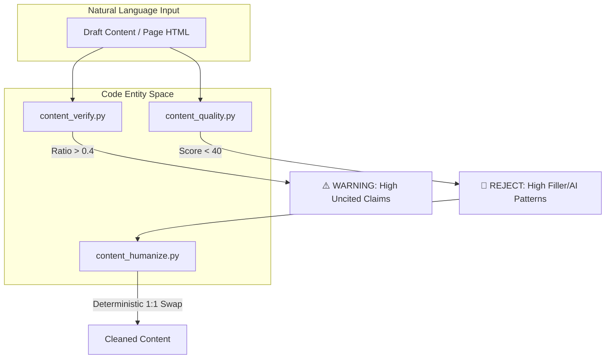
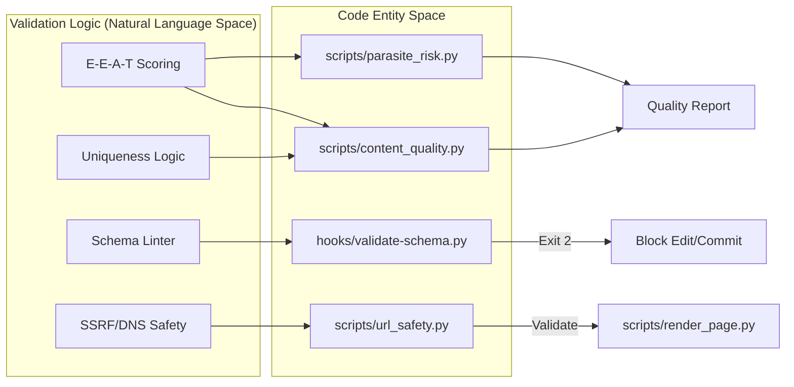

<!-- source: DeepWiki mcp.deepwiki.com · repo AgriciDaniel/claude-seo · page 11.3 Quality Gate Thresholds · fetched 2026-10-26 -->

# Quality Gate Thresholds

Relevant source files

The following files were used as context for generating this wiki page:

- [docs/MIGRATION-v1-to-v2.md](docs/MIGRATION-v1-to-v2.md)
- [extensions/firecrawl/install.ps1](extensions/firecrawl/install.ps1)
- [extensions/firecrawl/uninstall.sh](extensions/firecrawl/uninstall.sh)
- [hooks/validate-schema.py](hooks/validate-schema.py)
- [skills/seo-content/SKILL.md](skills/seo-content/SKILL.md)
- [skills/seo-geo/SKILL.md](skills/seo-geo/SKILL.md)
- [skills/seo-image-gen/SKILL.md](skills/seo-image-gen/SKILL.md)
- [skills/seo-local/SKILL.md](skills/seo-local/SKILL.md)
- [skills/seo-maps/SKILL.md](skills/seo-maps/SKILL.md)
- [tests/test_schema_hook_policy.py](tests/test_schema_hook_policy.py)

This document provides a complete reference of all content quality thresholds, uniqueness requirements, page count limits, and enforcement actions used throughout the `claude-seo` system. These thresholds prevent thin content penalties, scaled content abuse violations, and index bloat.

**Sources:** [skills/seo-content/SKILL.md:65-81](), [skills/seo-programmatic/SKILL.md:66-112]()

---

## GEO Health Score Weighting

The Generative Engine Optimization (GEO) Health Score evaluates how well content is prepared for AI search surfaces (Google AI Overviews, ChatGPT, Perplexity). The score is a weighted average of five critical categories, used by the `seo-geo` skill.

| Category | Weight | Primary Focus |
| :--- | :--- | :--- |
| **Citability** | 25% | Passage-level optimization (134-167 words), fact density, and attribution. |
| **Structural** | 20% | Heading hierarchy (H1-H3), scannable lists, and question-based formatting. |
| **Authority** | 20% | E-E-A-T signals, author credentials, and primary source citations. |
| **Technical** | 20% | SSR vs CSR, AI crawler access (robots.txt), and `llms.txt` presence. |
| **Multi-Modal** | 15% | Presence of relevant images, videos, and infographics. |

**Sources:** [skills/seo-geo/SKILL.md:68-132]()

---

## Content Quality Thresholds

The system utilizes specialized scripts to programmatically score content based on Google's September 2025 Quality Rater Guidelines (QRG).

### Scoring Metrics

| Metric | Tool | Logic |
| :--- | :--- | :--- |
| **Information Density** | `content_quality.py` | Ratio of named entities and specific data points to total word count. |
| **Filler Score** | `content_quality.py` | Detects "In today's fast-paced world" style fluff and generic phrasing. |
| **AI Pattern Score** | `content_quality.py` | Detects specific LLM idioms (e.g., "delve into", "tapestry of"). |
| **Uncited Ratio** | `content_verify.py` | Percentage of verifiable claims lacking a markdown/HTML citation. |

### Enforcement Actions

**Sources:** [docs/MIGRATION-v1-to-v2.md:43-52](), [skills/seo-content/SKILL.md:116-132](), [skills/seo-geo/SKILL.md:70-89]()

---

## Content Minimums by Page Type

These are **topical coverage floors**. While word count is not a direct ranking factor, these thresholds represent the minimum depth required to demonstrate E-E-A-T for specific intents.

| Page Type | Minimum Words | Rationale |
| :--- | :--- | :--- |
| **Homepage** | 500 | Core value proposition and trust signals. |
| **Service Page** | 800 | Process, benefits, and specific FAQs. |
| **Blog Post** | 1,500 | Comprehensive topic coverage and actionable insights. |
| **Product Page** | 300+ | Basic specs (400+ for complex technical products). |
| **Location Page** | 500-600 | Local trust signals and service area details. |

**Sources:** [skills/seo-content/SKILL.md:67-77]()

---

## Programmatic & Scaled Content Gates

To prevent "Scaled Content Abuse" (March 2024 Policy), the system enforces strict uniqueness and volume limits, particularly for location and service pages.

### Uniqueness Requirements
**Unique Content %** = `(Words Unique to Page / Total Words) × 100` (excluding global nav/footer).

| Unique % | Severity | Action |
| :--- | :--- | :--- |
| **<30%** | 🛑 HARD STOP | Block publication; requires template redesign. |
| **30-60%** | ⚠️ WARNING | Flag for human review (High risk of doorway page penalty). |
| **>60-70%** | ✅ PASS | Compliant for programmatic scale. |

### Page Count Limits (Location Pages)

| Entity | Gate 1 (Warning) | Gate 2 (Hard Stop) |
| :--- | :--- | :--- |
| **Location Pages** | 30 Pages (Enforce 60% Unique) | 50 Pages (Manual Audit Required) |

**Sources:** [skills/seo-local/SKILL.md:132-135](), [docs/MIGRATION-v1-to-v2.md:71-75]()

---

## Technical & Schema Validation

Technical gates are enforced via the `hooks/validate-schema.py` post-edit hook and specific technical audit scripts.

### Schema Enforcement
The `validate-schema.py` hook returns exit code `2` to block edits if critical errors are found:
*   **Deprecated Types:** `HowTo` (Sept 2023), `SpecialAnnouncement` (July 2025), `CourseInfo` (June 2025), `ClaimReview` (June 2025).
*   **Placeholder Text:** Blocks strings like `[Business Name]` or `[URL]` within JSON-LD.
*   **Context/Type:** Missing `@context` or `@type` fields.

**Note:** `FAQPage` remains a valid Schema.org type and does **not** block edits, despite Google retiring rich result support in May 2026.

**Sources:** [hooks/validate-schema.py:66-121](), [tests/test_schema_hook_policy.py:29-34](), [docs/MIGRATION-v1-to-v2.md:136-148]()

### AI Crawler Management
Technical SEO audits check `robots.txt` for specific AI tokens.

| Crawler | Token | Owner | Obeys robots.txt? |
| :--- | :--- | :--- | :--- |
| **OpenAI** | `GPTBot` | OpenAI | Yes |
| **Anthropic** | `ClaudeBot` | Anthropic | Yes |
| **Perplexity** | `PerplexityBot` | Perplexity | Yes |
| **Google** | `Google-Extended` | Google | Yes (Training Opt-out) |
| **Google Agent** | `Google-Agent` | Google | **No (User-triggered)** |

**Sources:** [skills/seo-geo/SKILL.md:151-172]()

---

## Enforcement Architecture

The following diagram maps the relationship between validation logic and the code entities that execute them, bridging natural language requirements to technical implementation.

**Sources:** [scripts/url_safety.py:1-50](), [hooks/validate-schema.py:172-194](), [docs/MIGRATION-v1-to-v2.md:28-41](), [docs/MIGRATION-v1-to-v2.md:75-82]()

---

