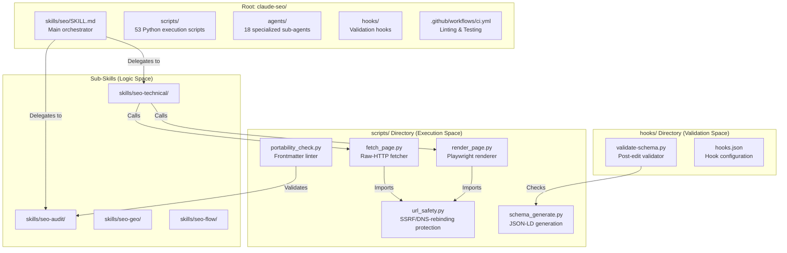
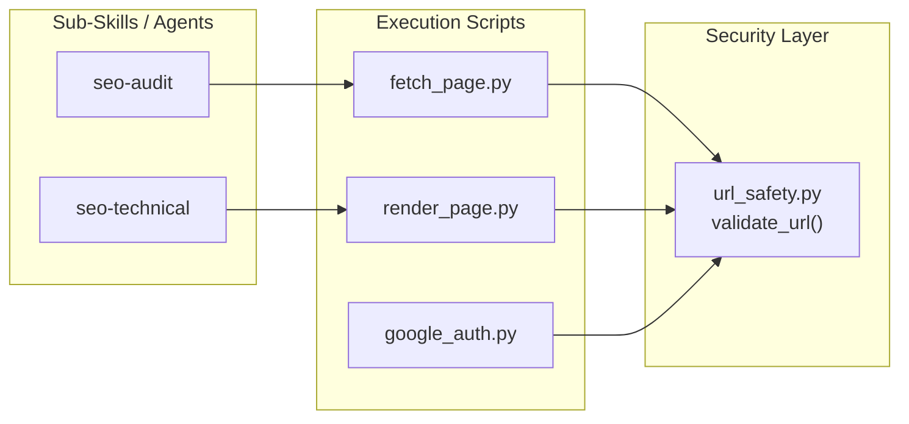

<!-- source: DeepWiki mcp.deepwiki.com · repo AgriciDaniel/claude-seo · page 12 Development Guide · fetched 2026-10-26 -->

# Development Guide

<details>
<summary>Relevant source files</summary>

The following files were used as context for generating this wiki page:

- [.github/workflows/ci.yml](.github/workflows/ci.yml)
- [AGENTS.md](AGENTS.md)
- [CITATION.cff](CITATION.cff)
- [pyproject.toml](pyproject.toml)
- [requirements.txt](requirements.txt)
- [scripts/portability_check.py](scripts/portability_check.py)
- [tests/test_portability.py](tests/test_portability.py)
- [tests/test_pyproject_metadata.py](tests/test_pyproject_metadata.py)

</details>


**Purpose**: This page provides technical documentation for developers who need to work with, extend, or contribute to the claude-seo system. It covers development environment setup, dependency management, the validation hook system, code organization patterns, and extension points.

**Scope**: This document focuses on the developer-facing aspects of the codebase—dependency management, validation infrastructure, file organization, and contribution patterns. For usage documentation of individual SEO analysis commands, see [Command Reference](#3). For architectural patterns and data flow, see [System Architecture](#4).

---

## Development Environment Requirements

### Python Runtime

The claude-seo system requires **Python 3.10 or higher** [pyproject.toml:5](). All skills and validation hooks are written in Python and depend on the packages defined in `requirements.txt`.

### Core Dependencies

The system uses several primary dependencies with security-conscious version bounds. For a detailed breakdown of version pinning rationale and CVE fix tracking, see [Dependencies and Security](#12.1).

**Installation**:

```bash
pip install -r requirements.txt
```

### CI/CD and Linting

The project uses GitHub Actions for continuous integration. The `lint` job performs syntax checks on Python scripts using `py_compile` [.github/workflows/ci.yml:13-28](). The `test` job executes the `pytest` suite after installing the full dependency set to match the runtime contract [.github/workflows/ci.yml:30-57](). A `secret-scan` job also runs to detect leaked credentials using high-signal patterns [.github/workflows/ci.yml:58-80]().

**Sources**: [.github/workflows/ci.yml:1-80](), [requirements.txt:1-27](), [pyproject.toml:1-23]()

---

## Code Organization and File Structure

The claude-seo system follows a hierarchical skill-based architecture. The plugin ships 25 sub-skills and 18 sub-agents [AGENTS.md:57-59]().

**File Structure Diagram**: Skill and Script Organization



**Sources**: [AGENTS.md:55-59](), [.github/workflows/ci.yml:26-27](), [scripts/portability_check.py:57-65]()

### Key Component Types

| Component | Directory | Purpose |
|-----------|-----------|---------|
| **Skills** | `skills/` | Markdown files (`SKILL.md`) defining capabilities and instructions [AGENTS.md:12-13](). |
| **Subagents** | `agents/` | Specialized workers that can be delegated tasks [AGENTS.md:58](). |
| **Scripts** | `scripts/` | Python execution scripts for network, parsing, and API tasks [AGENTS.md:103-104](). |
| **Hooks** | `hooks/` | Post-edit validation scripts to enforce schema and quality standards. |

---

## Validation Hook System

The validation hook system is the **quality enforcement layer** that prevents invalid schema markup or malformed project files from being committed. 

For details on the post-edit schema validation (e.g., `hooks/validate-schema.py`), exit codes, and extending validation rules, see [Validation Hook System](#12.2).

### Portability Linter

The system includes a portability check script (`scripts/portability_check.py`) to ensure `SKILL.md` files remain compatible across different agent harnesses like Cursor, Cline, and Aider [AGENTS.md:10-17]().

**Command**:
```bash
python scripts/portability_check.py
```
This script confirms that each `SKILL.md` contains the minimum required frontmatter (`name`, `description`) and warns on Claude-Code-specific features that other harnesses may ignore [scripts/portability_check.py:5-20](). It specifically checks for kebab-case naming [scripts/portability_check.py:141-144]() and description length limits [scripts/portability_check.py:153-160]().

**Sources**: [AGENTS.md:10-22](), [scripts/portability_check.py:1-186](), [tests/test_portability.py:28-96]()

---

## Technical SEO and Safety Layer

Developers extending the system must adhere to the security architecture, specifically regarding network requests.

**Safety Layer Diagram**: SSRF Protection Flow



Every script that performs URL fetching **must** interface with the safety layer to protect against SSRF and DNS-rebinding attacks. This is a critical requirement for scripts like `fetch_page.py` [AGENTS.md:108-109]().

**Sources**: [.github/workflows/ci.yml:47-50](), [requirements.txt:6-9](), [AGENTS.md:108-109]()

---

## Future Enhancements

The roadmap for the claude-seo system includes several deferred features and planned improvements to stay aligned with 2026 SEO trends.

For details on planned features such as fake freshness detection, mobile parity checks, and brand mention analysis, see [Future Enhancements](#12.3).

---

## Contributing to the Project

The project is licensed under the MIT license [CITATION.cff:13](). 

### Development Guidelines
- **Metadata**: Every skill must include `metadata.version` for consistency tests [scripts/portability_check.py:176-184]().
- **Naming**: Names must be kebab-case (lowercase, hyphens, no leading/trailing dash) [scripts/portability_check.py:142-143]().
- **Portability**: Skills should use a portable subset of the Claude Code skill spec to ensure compatibility with Cursor, Gemini CLI, and others [AGENTS.md:10-13]().
- **Style**: The project uses `ruff` for linting with a target version of `py310` and a line length of 100 [pyproject.toml:17-23]().

**Sources**: [CITATION.cff:1-22](), [pyproject.toml:1-23](), [scripts/portability_check.py:131-186](), [AGENTS.md:26-53]()

---

