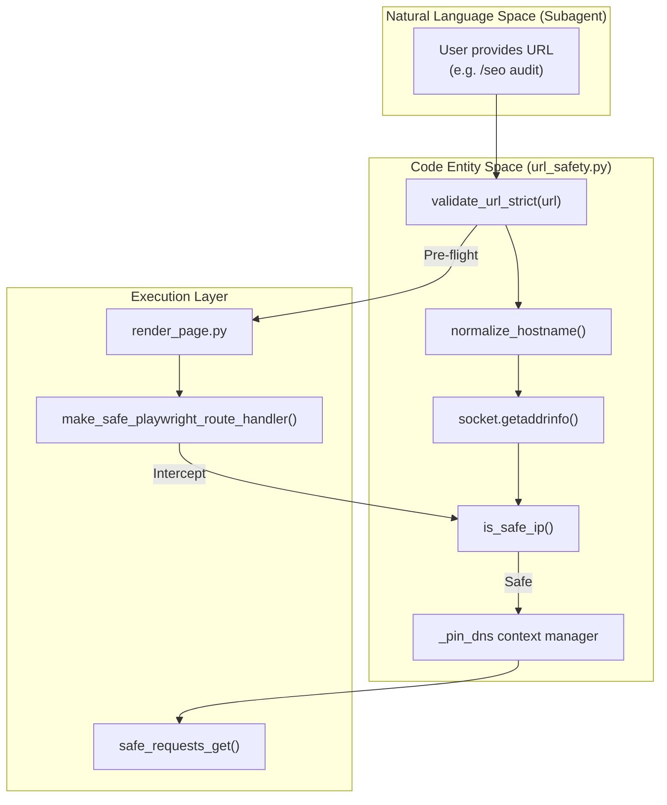
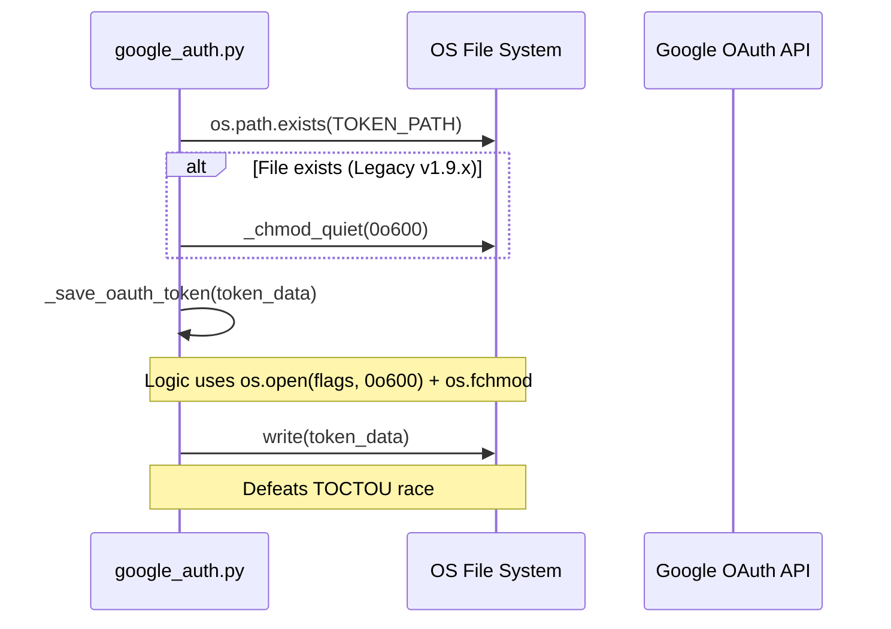

<!-- source: DeepWiki mcp.deepwiki.com · repo AgriciDaniel/claude-seo · page 12.1 Dependencies and Security · fetched 2026-10-26 -->

# Dependencies and Security

Relevant source files

The following files were used as context for generating this wiki page:

- [.github/CODEOWNERS](.github/CODEOWNERS)
- [.github/dependabot.yml](.github/dependabot.yml)
- [.github/workflows/v2.yml](.github/workflows/v2.yml)
- [.gitignore](.gitignore)
- [CITATION.cff](CITATION.cff)
- [CODE_OF_CONDUCT.md](CODE_OF_CONDUCT.md)
- [SECURITY.md](SECURITY.md)
- [pyproject.toml](pyproject.toml)
- [requirements.txt](requirements.txt)
- [scripts/google_auth.py](scripts/google_auth.py)
- [scripts/render_page.py](scripts/render_page.py)
- [scripts/url_safety.py](scripts/url_safety.py)
- [skills/seo-flow/references/flow-framework.md](skills/seo-flow/references/flow-framework.md)
- [tests/test_pyproject_metadata.py](tests/test_pyproject_metadata.py)
- [tests/test_url_safety.py](tests/test_url_safety.py)

## Purpose and Scope

This document details the Python dependencies required by the `claude-seo` system, their version pinning rationale, security vulnerability tracking, and the architecture of the safety layers (SSRF/DNS-rebinding). It provides a comprehensive reference for the security posture of the v2.2.4 release, including how the system handles untrusted URLs and protects sensitive credentials.

Sources: [requirements.txt:1-12](), [scripts/url_safety.py:1-67](), [SECURITY.md:40-55](), [CITATION.cff:14-15]()

---

## Dependency Inventory (v2.2.4)

The `claude-seo` system maintains a set of core dependencies with bounded version constraints (`>=min,<next_major`). This strategy ensures critical security patches are included while preventing breaking API changes.

| Package | Version Constraint | Primary Use | Security Status / CVE Fixes |
|---------|-------------------|-------------|-----------------------------|
| `beautifulsoup4` | `>=4.12.0,<5.0.0` | HTML parsing, DOM traversal | No known CVEs [requirements.txt:5]() |
| `requests` | `>=2.32.4,<3.0.0` | HTTP requests, API calls | CVE-2024-47081, CVE-2024-35195 [requirements.txt:6]() |
| `lxml` | `>=6.1.1,<7.0.0` | XML/HTML parsing, XPath | CVE-2025-24928 + libxml2 patches [requirements.txt:7]() |
| `playwright` | `>=1.59.0,<2.0.0` | Headless browser automation | CVE-2025-59288 (macOS) [requirements.txt:8]() |
| `urllib3` | `>=2.7.0,<3.0.0` | Low-level HTTP (requests dep) | GHSA-mf9v-mfxr-j63j, GHSA-qccp-gfcp-xxvc [requirements.txt:9]() |
| `trafilatura` | `>=2.0.0,<3.0.0` | Content extraction (SPA-safe) | Headless rendering across agents [requirements.txt:12]() |
| `htmldate` | `>=1.9.0,<2.0.0` | Publication-date detection | Freshness signals [requirements.txt:13]() |
| `google-auth` | `>=2.20.0,<3.0.0` | Google API authentication | Secure 0o600 file handling [requirements.txt:24]() |
| `numpy` | `>=1.26.0,<3.0.0` | Data processing for reports | Used in `google_report.py` [requirements.txt:18]() |
| `google-ads` | `>=25.0.0,<40.0.0` | Keyword Planner integration | Used in `keyword_planner.py` [requirements.txt:27]() |

Sources: [requirements.txt:5-27](), [scripts/google_auth.py:200-213]()

---

## Safety Layer Architecture

The core of `claude-seo` security is the `url_safety.py` module. Every script that accepts a user-supplied URL MUST validate it through this module before issuing network requests [scripts/url_safety.py:5-7]().

### SSRF and DNS-Rebinding Protection Flow

**Security Data Flow**

The system uses a multi-stage validation process:
1.  **Normalization**: `normalize_hostname` canonicalizes obfuscated IPv4 forms (hex, octal, decimal) and trailing dots to prevent blocklist bypasses [scripts/url_safety.py:118-121](), [tests/test_url_safety.py:36-58]().
2.  **Strict Validation**: `validate_url_strict` resolves the hostname via `socket.getaddrinfo` and checks every returned IP against `is_safe_ip` [scripts/url_safety.py:19-25]().
3.  **DNS Pinning**: For standard HTTP, `safe_requests_get` uses a `threading.Lock` and a DNS-pinning context manager to ensure the connection goes to the pre-validated IP, preventing DNS rebinding [scripts/url_safety.py:27-32, 51-53]().
4.  **Browser Protection**: Since Chromium handles its own DNS, `render_page.py` must call `validate_url_strict()` as a pre-flight check and attach a Playwright `route()` handler that re-validates the IP of every subresource request [scripts/url_safety.py:59-68]().

Sources: [scripts/url_safety.py:1-102](), [tests/test_url_safety.py:36-147](), [SECURITY.md:42-46]()

---

## Credential Security

The system handles sensitive OAuth tokens for Google APIs and backlink services. In v2.x, file system permissions are strictly enforced to prevent local privilege escalation.

### Secure Token Lifecycle

**Credential Protection Implementation**

- **Strict Permissions**: `google_auth.py` remediates legacy file permissions (0o644) by forcing `0o600` (user read/write only) on every load of `oauth-token.json` [scripts/google_auth.py:200-209]().
- **API Key Redaction**: The system includes a `redact_google_api_key` function to strip Google API keys from exception strings and console outputs to prevent accidental leakage [scripts/google_auth.py:75-90]().
- **Environment Fallbacks**: Configuration loads from `~/.config/claude-seo/google-api.json` with fallbacks to environment variables like `GOOGLE_API_KEY` and `GOOGLE_APPLICATION_CREDENTIALS` [scripts/google_auth.py:92-132]().

Sources: [scripts/google_auth.py:75-214](), [SECURITY.md:52-55]()

---

## Dependabot and CI Integration

Security maintenance is automated via GitHub Actions and Dependabot.

### Dependabot Configuration
The system tracks two ecosystems weekly:
- **pip**: Monitors `requirements.txt` for security updates to core analysis libraries [ .github/dependabot.yml:4-18]().
- **github-actions**: Keeps CI workflows updated [ .github/dependabot.yml:19-33]().

### Continuous Integration (CI)
The "v2 audit" pipeline (`.github/workflows/v2.yml`) enforces security through:
- **Secret Scanning**: Scans tracked files for high-signal credential patterns (e.g., `AIza...`, `ghp_...`, `sk-...`) [ .github/workflows/v2.yml:94-117]().
- **Regression Testing**: Runs the `url_safety` regression battery in `tests/test_url_safety.py` to verify SSRF protections against obfuscated IPv4 and authority confusion [ .github/workflows/v2.yml:43-60](), [tests/test_url_safety.py:81-118]().
- **Syntactic Integrity**: Confirms that safety and renderer modules (e.g., `url_safety.py`, `render_page.py`, `google_auth.py`) compile correctly [ .github/workflows/v2.yml:62-70]().

Sources: [ .github/dependabot.yml:1-33](), [ .github/workflows/v2.yml:1-135]()

---

## Security Disclosure Policy

`claude-seo` follows a **90-day coordinated disclosure** policy [SECURITY.md:20]().

1.  **Reporting**: Vulnerabilities should be reported via [GitHub Security Advisories](https://github.com/AgriciDaniel/claude-seo/security/advisories/new) or by emailing the maintainer listed in `CITATION.cff` [SECURITY.md:5-9]().
2.  **Triage**: The maintainer acknowledges receipt (Day 0) and performs initial triage/severity classification within 3 days [SECURITY.md:24-25]().
3.  **Fix**: A mitigation or fix candidate is proposed within 14 days and released in a patch version within 30 days [SECURITY.md:26-27]().
4.  **Publicity**: A public advisory is published at the 90-day mark if not earlier [SECURITY.md:28]().

### Supported Versions
- **2.x**: ✅ Fully supported (Active development; security and bug fixes) [SECURITY.md:36]().
- **1.9.x**: ✅ Patch-only for security (Final 1.x line; only CVSS ≥ High issues backported) [SECURITY.md:37]().

Sources: [SECURITY.md:1-40](), [CITATION.cff:1-15]()

---

