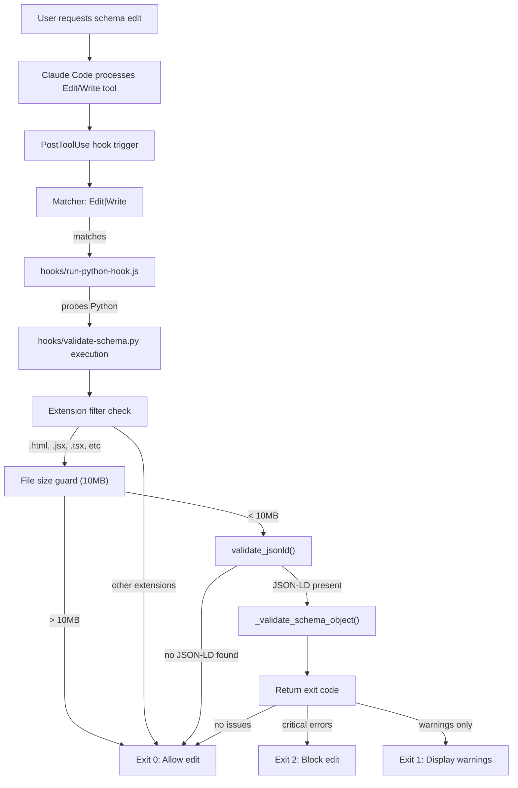
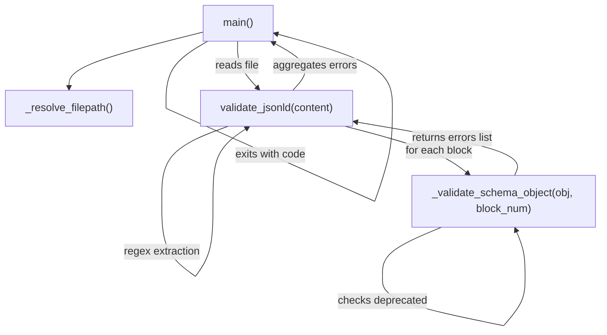
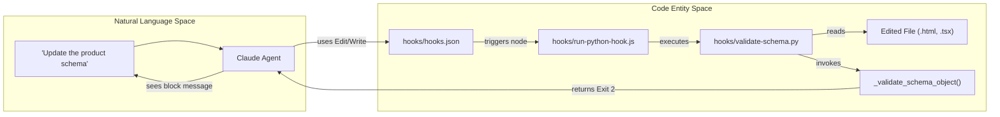

<!-- source: DeepWiki mcp.deepwiki.com · repo AgriciDaniel/claude-seo · page 12.2 Validation Hook System · fetched 2026-10-26 -->

# Validation Hook System

<details>
<summary>Relevant source files</summary>

The following files were used as context for generating this wiki page:

- [.github/workflows/ci.yml](.github/workflows/ci.yml)
- [AGENTS.md](AGENTS.md)
- [agents/seo-cluster.md](agents/seo-cluster.md)
- [docs/MIGRATION-v1-to-v2.md](docs/MIGRATION-v1-to-v2.md)
- [extensions/firecrawl/install.ps1](extensions/firecrawl/install.ps1)
- [extensions/firecrawl/uninstall.sh](extensions/firecrawl/uninstall.sh)
- [hooks/hooks.json](hooks/hooks.json)
- [hooks/run-python-hook.js](hooks/run-python-hook.js)
- [hooks/validate-schema.py](hooks/validate-schema.py)
- [scripts/drift_baseline.py](scripts/drift_baseline.py)
- [scripts/portability_check.py](scripts/portability_check.py)
- [tests/test_cross_platform_hooks.py](tests/test_cross_platform_hooks.py)
- [tests/test_drift_portability.py](tests/test_drift_portability.py)
- [tests/test_fetch_page_decoding.py](tests/test_fetch_page_decoding.py)
- [tests/test_portability.py](tests/test_portability.py)
- [tests/test_schema_hook_policy.py](tests/test_schema_hook_policy.py)

</details>


## Purpose and Scope

This document describes the post-edit schema validation hook system in `claude-seo`. The validation hook (`hooks/validate-schema.py`) runs automatically after file edits to enforce schema quality standards and prevent publication of invalid, placeholder-filled, or deprecated structured data. This system implements the final quality control checkpoint in the schema generation pipeline [hooks/validate-schema.py:1-7]().

For schema detection and generation workflows, see **7.1 Schema Detection and Validation**. For broader quality control mechanisms including quality gates, see **4.3 Quality Control System**.

---

## Hook Architecture

The validation hook integrates with Claude Code's `PostToolUse` hook system, executing after `Edit` or `Write` tool operations [hooks/validate-schema.py:7-13](). The hook filters files by extension, extracts JSON-LD blocks, validates schema structure, and returns exit codes that determine whether the edit proceeds or is blocked [hooks/validate-schema.py:146-193]().

### Hook Integration Flow



**Sources:** [hooks/validate-schema.py:1-31](), [hooks/hooks.json:1-20](), [hooks/run-python-hook.js:40-63]()

### Configuration

The hook is configured via `hooks/hooks.json` (and mirrored in the user's `~/.claude/settings.json`). It uses a Node.js wrapper `hooks/run-python-hook.js` to ensure Python environment portability across platforms [hooks/run-python-hook.js:10-25]().

```json
{
  "hooks": {
    "PostToolUse": [
      {
        "matcher": "Edit|Write",
        "hooks": [
          {
            "type": "command",
            "command": "node",
            "args": [
              "${CLAUDE_PLUGIN_ROOT}/hooks/run-python-hook.js",
              "${CLAUDE_PLUGIN_ROOT}/hooks/validate-schema.py",
              "${tool_input.file_path}"
            ]
          }
        ]
      }
    ]
  }
}
```

| Configuration Key | Value | Purpose |
|------------------|-------|---------|
| `matcher` | `"Edit\|Write"` | Triggers on Edit or Write tool operations [hooks/hooks.json:5]() |
| `command` | `node` | Uses Node.js to execute the portable Python wrapper [hooks/hooks.json:9]() |
| `${tool_input.file_path}` | Event variable | Passes the path of the file just modified to the script [hooks/hooks.json:13]() |
| `run-python-hook.js` | Wrapper script | Probes for `CLAUDE_SEO_PYTHON`, `python3`, or `py` [hooks/run-python-hook.js:19-23]() |

**Sources:** [hooks/hooks.json:1-20](), [hooks/run-python-hook.js:10-38](), [hooks/validate-schema.py:7-27]()

---

## Validation Process

The validation process executes in five stages: file filtering, JSON-LD extraction, structure validation, rule enforcement, and error categorization.

### Function Call Graph



**Sources:** [hooks/validate-schema.py:40-197]()

---

## Exit Code System

The validation hook returns three exit codes with distinct behaviors [hooks/validate-schema.py:177-193]():

| Exit Code | Meaning | Behavior | Trigger Conditions |
|-----------|---------|----------|-------------------|
| `0` | Success | Edit allowed, no output | No schema found OR all validations pass [hooks/validate-schema.py:175]() |
| `1` | Warning | Edit allowed, warnings displayed | Non-critical issues only [hooks/validate-schema.py:193]() |
| `2` | Block | Edit blocked | Critical issues: placeholders, deprecated types, retired types [hooks/validate-schema.py:191]() |

### Exit Code Implementation

The categorization logic at [hooks/validate-schema.py:177-193]():

```python
critical_keywords = ["placeholder", "deprecated", "retired"]
critical = [e for e in errors if any(kw in e.lower() for kw in critical_keywords)]
warnings = [e for e in errors if e not in critical]

if critical:
    print("🛑 Schema validation ERRORS (blocking):")
    for e in critical:
        print(f"  - {e}")
    sys.exit(2)  # Block the edit

sys.exit(1)  # Warnings only; proceed
```

**Sources:** [hooks/validate-schema.py:177-193]()

---

## Portability Linter (`portability_check.py`)

The system includes a cross-platform portability linter to ensure `SKILL.md` files are compatible with other agent harnesses like Cursor, Cline, and Aider [scripts/portability_check.py:5-7]().

### Portability Validation Rules

The linter walks every `SKILL.md` under `skills/` and `extensions/` and reports findings based on severity [scripts/portability_check.py:21-32]():

- **Error:** Missing `name` or `description`, malformed YAML, or non-kebab-case name [scripts/portability_check.py:131-152]().
- **Warning:** Overly long descriptions (Codex truncates > 1024 chars) or inline comments in the `tools` list [scripts/portability_check.py:153-172]().
- **Info:** Missing `metadata.version` field [scripts/portability_check.py:176-184]().

### Tool Compatibility Table

`AGENTS.md` documents how Claude Code tools are aliased across different platforms to maintain portability [AGENTS.md:37-53]().

| Claude Code | Codex | Cline | Aider | Cursor |
|---|---|---|---|---|
| Read | read_file | read_file | (inline) | read |
| Write | write_file | write_file | /add then edit | write |
| Edit | apply_diff | replace_in_file | /edit | edit |
| Bash | bash | execute_command | /run | shell |

**Sources:** [scripts/portability_check.py:1-186](), [AGENTS.md:37-53](), [tests/test_portability.py:28-96]()

---

## Core Validation Rules

The hook enforces specific schema requirements and returns error messages with block number context [hooks/validate-schema.py:66-121]().

### Rule: Placeholder Detection

Detects common placeholder patterns indicating incomplete schema generation. This is a **blocking** validation [hooks/validate-schema.py:82-97]().

**Implementation:** [hooks/validate-schema.py:82-93]()
- Detects: `[Business Name]`, `[City]`, `[State]`, `[Phone]`, `[Address]`, `[Your`, `[INSERT`, `REPLACE`, `[URL]`, `[Email]`.

### Rule: Deprecated Type Check

Blocks retired schema types that no longer generate rich results or have been officially discontinued by Google [hooks/validate-schema.py:99-111]().

| Deprecated Type | Status |
|-----------------|--------|
| `HowTo` | Deprecated Sept 2023 |
| `SpecialAnnouncement` | Deprecated July 31, 2025 |
| `CourseInfo`, `EstimatedSalary`, `LearningVideo` | Retired June 2025 |
| `ClaimReview`, `VehicleListing` | Retired June 2025 |

**Note on FAQPage:** `FAQPage` is intentionally NOT blocked. While Google retired FAQ rich results for most sites, it remains a valid Schema.org type and does not trigger a blocking exit code [hooks/validate-schema.py:113-116](), [tests/test_schema_hook_policy.py:29-30]().

### Rule: File Size Guard

To maintain performance and prevent memory issues during hook execution, files larger than 10 MiB are skipped [hooks/validate-schema.py:156-164]().

**Sources:** [hooks/validate-schema.py:66-121](), [hooks/validate-schema.py:156-164](), [tests/test_schema_hook_policy.py:1-34]()

---

## Validation Hook Data Flow



**Sources:** [hooks/hooks.json:1-20](), [hooks/run-python-hook.js:40-63](), [hooks/validate-schema.py:66-121](), [hooks/validate-schema.py:187-191]()

---

