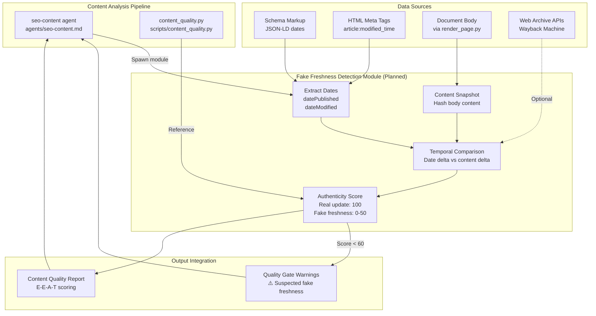
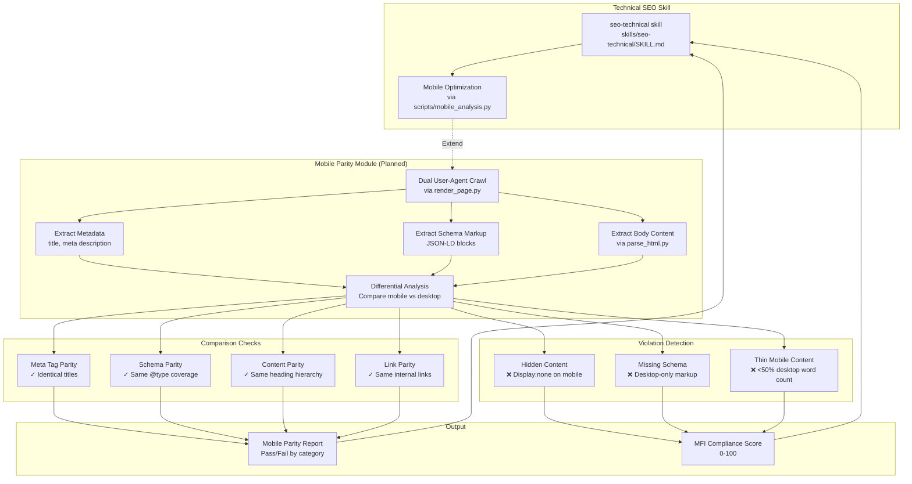
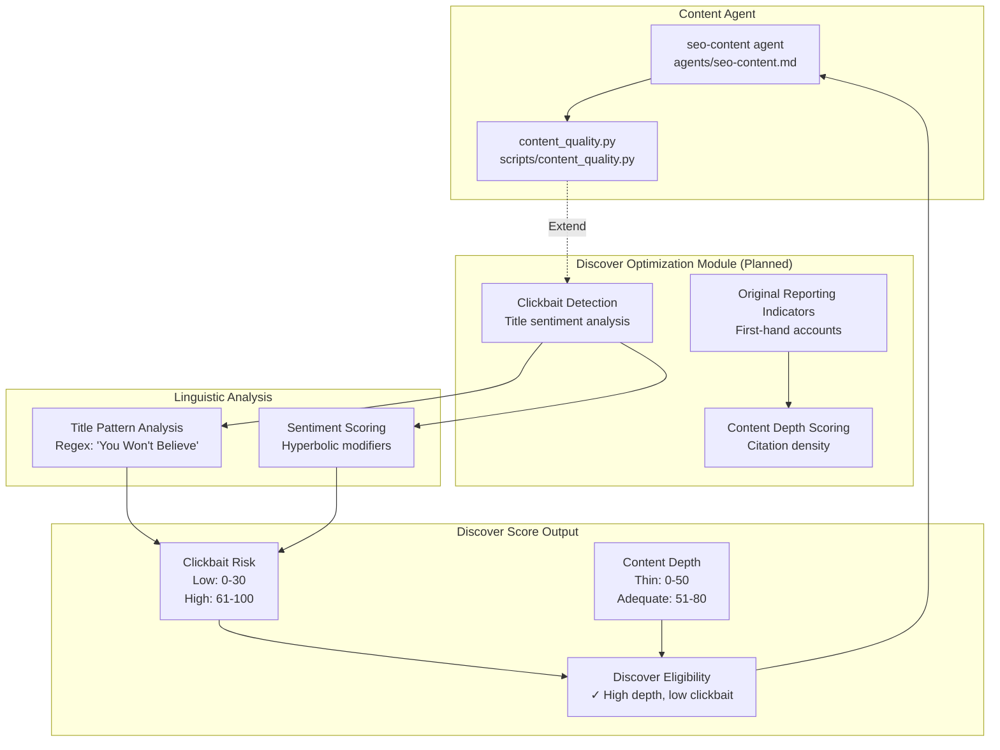
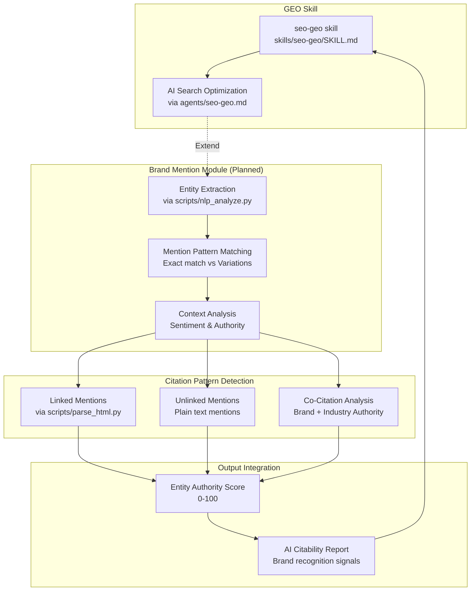
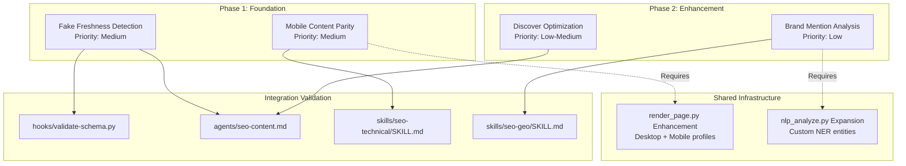

<!-- source: DeepWiki mcp.deepwiki.com · repo AgriciDaniel/claude-seo · page 12.3 Future Enhancements · fetched 2026-10-26 -->

# Future Enhancements

Relevant source files

The following files were used as context for generating this wiki page:

- [CHANGELOG.md](CHANGELOG.md)
- [CLAUDE.md](CLAUDE.md)
- [docs/WORKFLOW-public-private.md](docs/WORKFLOW-public-private.md)

## Purpose and Scope

This document outlines the roadmap for enhancements to the `claude-seo` system that were identified during the v2 architecture transition but deferred for future implementation. These features address gaps in content authenticity detection, mobile-first indexing compliance, Google Discover optimization, brand mention analysis, and deeper MCP integrations.

For information about currently implemented validation systems, see [12.2 Validation Hook System](). For current dependencies and security considerations, see [12.1 Dependencies and Security]().

**Sources:** [CHANGELOG.md:8-30](), [CLAUDE.md:3-14]()

---

## Deferred Feature Overview

The following table summarizes the four deferred features, their priority levels, and their intended integration points within the existing architecture:

| Feature | Priority | Target Skill/Agent | Validation Type | Policy Context |
|---------|----------|-------------------|-----------------|----------------|
| Fake Freshness Detection | Medium | `seo-content` agent | Content integrity | March 2024 Scaled Content Abuse |
| Mobile Content Parity | Medium | `seo-technical` skill | Mobile-first indexing | December 2024 MFI enforcement |
| Discover Optimization | Low-Medium | `seo-content` agent | Content quality | February 2026 Discover Core Update |
| Brand Mention Analysis | Low | `seo-geo` skill | Entity recognition | AI citation readiness |

**Sources:** [CHANGELOG.md:21-26](), [CLAUDE.md:26-43]()

---

## 1. Fake Freshness Detection

### Current State

The system currently validates `datePublished` and `dateModified` schema properties for correct formatting ([ISO 8601](https://en.wikipedia.org/wiki/ISO_8601) compliance) via `hooks/validate-schema.py` but does not compare these timestamps against actual content modification signals. This creates a blind spot for a spam pattern where publishers update timestamps without changing substantive content to appear "fresh" in search results.

**Sources:** [hooks/validate-schema.py:96-108](), [CHANGELOG.md:22-23]()

### Planned Implementation

**Diagram: Fake Freshness Detection Integration Architecture**

**Sources:** [CHANGELOG.md:21-23](), [scripts/render_page.py:1-20]()

### Detection Signals

The implementation would compare signals extracted via `scripts/render_page.py` and `scripts/parse_html.py`:

| Signal Type | Indicator of Real Update | Indicator of Fake Freshness |
|-------------|-------------------------|----------------------------|
| `dateModified` increment | +7 days or more | Updated daily/hourly |
| Content hash change | >15% body content modified | <5% change (only timestamps) |
| Paragraph count delta | New sections added | Identical paragraph count |
| Heading structure | H2/H3 tags changed | Identical heading structure |
| External link additions | New citations, references | No new outbound links |

**Sources:** [CHANGELOG.md:21-23](), [scripts/parse_html.py:1-30]()

---

## 2. Mobile Content Parity Check

### Current State

The `seo-technical` agent validates mobile optimization through viewport configuration and touch target sizing via `scripts/capture_screenshot.py`, but does not systematically compare mobile versus desktop content equivalence. This is critical for mobile-first indexing (MFI) compliance.

**Sources:** [agents/seo-technical.md:1-20](), [scripts/capture_screenshot.py:35-40]()

### Planned Implementation

**Diagram: Mobile Content Parity Validation Architecture**

**Sources:** [CHANGELOG.md:21-22](), [scripts/render_page.py:21-23](), [scripts/mobile_analysis.py:1-114]()

---

## 3. Discover Optimization Checks

### Current State

The `seo-content` agent evaluates E-E-A-T signals and content density via `scripts/content_quality.py` but does not specifically optimize for Google Discover, which has distinct requirements for clickbait prevention and original reporting.

**Sources:** [agents/seo-content.md:1-15](), [scripts/content_quality.py:22-23]()

### Planned Implementation

**Diagram: Google Discover Optimization Module Architecture**

**Sources:** [CHANGELOG.md:22-23](), [scripts/content_quality.py:22-23]()

---

## 4. Brand Mention Analysis (Entity Recognition)

### Current State

The `seo-geo` skill focuses on AI search optimization and citability via `skills/seo-geo/references/llmstxt-evidence.md`, but lacks programmatic implementation for detecting unlinked brand mentions and co-citation patterns which are critical for entity-based SEO.

**Sources:** [skills/seo-geo/SKILL.md:1-37](), [CHANGELOG.md:25-26]()

### Planned Implementation

**Diagram: Brand Mention Analysis and Entity Recognition Architecture**

**Sources:** [scripts/nlp_analyze.py:1-103](), [agents/seo-geo.md:1-74](), [CHANGELOG.md:25-26]()

---

## Implementation Roadmap

The following diagram maps feature dependencies and suggested implementation sequencing:

**Diagram: Feature Implementation Roadmap and Dependencies**

**Sources:** [CHANGELOG.md:8-30](), [CLAUDE.md:16-82]()

### Integration Points

1. **Schema Validation** ([hooks/validate-schema.py:1-163]()): Extend date authenticity checks to compare JSON-LD `dateModified` against HTML body hashes.
2. **Content Quality** ([scripts/content_quality.py:22-23]()): Integrate clickbait detection and freshness scores into the core E-E-A-T scorecard.
3. **AI Search Readiness** ([agents/seo-geo.md:72-74]()): Incorporate brand mention density and unlinked entity analysis into the citability report.
4. **Technical Audit** ([agents/seo-technical.md:1-65]()): Add mobile parity compliance checks to the existing crawlability and indexability workflows.

**Sources:** [CHANGELOG.md:21-26](), [CLAUDE.md:83-85]()

---

