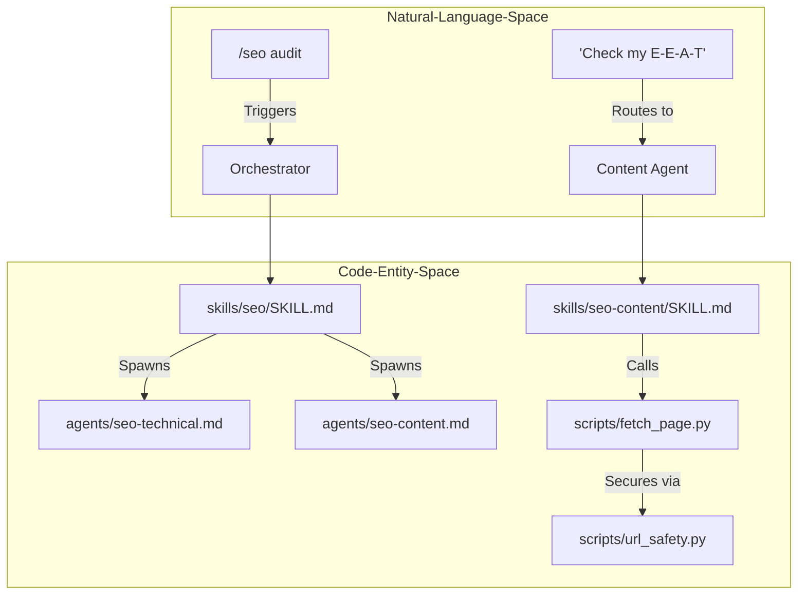
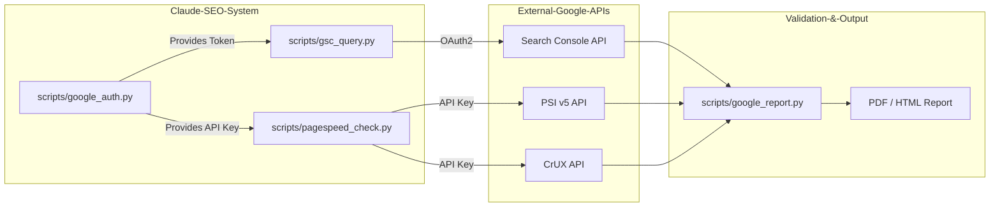

<!-- source: DeepWiki mcp.deepwiki.com · repo AgriciDaniel/claude-seo · page 13 Glossary · fetched 2026-10-26 -->

# Glossary

Relevant source files

The following files were used as context for generating this wiki page:

- [.claude-plugin/marketplace.json](.claude-plugin/marketplace.json)
- [.claude-plugin/plugin.json](.claude-plugin/plugin.json)
- [.github/workflows/ci.yml](.github/workflows/ci.yml)
- [AGENTS.md](AGENTS.md)
- [CHANGELOG.md](CHANGELOG.md)
- [CLAUDE.md](CLAUDE.md)
- [README.md](README.md)
- [scripts/portability_check.py](scripts/portability_check.py)
- [skills/seo-audit/SKILL.md](skills/seo-audit/SKILL.md)
- [skills/seo-cluster/SKILL.md](skills/seo-cluster/SKILL.md)
- [skills/seo-content/SKILL.md](skills/seo-content/SKILL.md)
- [skills/seo-drift/SKILL.md](skills/seo-drift/SKILL.md)
- [skills/seo-ecommerce/SKILL.md](skills/seo-ecommerce/SKILL.md)
- [skills/seo-flow/SKILL.md](skills/seo-flow/SKILL.md)
- [skills/seo-geo/SKILL.md](skills/seo-geo/SKILL.md)
- [skills/seo-image-gen/SKILL.md](skills/seo-image-gen/SKILL.md)
- [skills/seo-local/SKILL.md](skills/seo-local/SKILL.md)
- [skills/seo-maps/SKILL.md](skills/seo-maps/SKILL.md)
- [skills/seo-sxo/SKILL.md](skills/seo-sxo/SKILL.md)
- [tests/test_portability.py](tests/test_portability.py)

This glossary defines the technical terms, SEO domain concepts, and architectural jargon used within the **Claude SEO** codebase. It is intended to help onboarding engineers navigate the 3-layer agent system and understand the specific implementation details of the 25 sub-skills.

## System Architecture Terms

### 3-Layer Architecture
The structural design pattern used by Claude SEO to separate concerns between user intent, task management, and tool execution.
*   **Directive Layer:** The top-level user prompt or command (e.g., `/seo audit`).
*   **Orchestration Layer:** The `seo` skill that interprets the command and delegates to subagents. [skills/seo/SKILL.md:1-28]()
*   **Execution Layer:** The individual scripts (Python) and sub-skills that perform the actual data fetching and analysis.
*   **Code Pointers:** [CLAUDE.md:5-15](), [skills/seo/SKILL.md:1-28]().

### Sub-Skill
A modular unit of functionality defined by a `SKILL.md` file. There are 25 sub-skills in the system, including core SEO functions and extension mirrors.
*   **Code Pointers:** [CLAUDE.md:26-64](), [.claude-plugin/plugin.json:4-4]().

### Subagent
A specialized agent persona defined in `agents/*.md`. These agents are spawned by the orchestrator to handle specific domains (e.g., `seo-technical`, `seo-content`). In a full audit, up to 15 subagents may run in parallel. [skills/seo-audit/SKILL.md:20-35]()
*   **Code Pointers:** [CLAUDE.md:65-82](), [README.md:20-21](), [skills/seo-audit/SKILL.md:20-35]().

### Quality Gate
Automated validation checks enforced by the system to ensure recommendations are high-quality and data-backed. This includes the `hooks/validate-schema.py` validator and content minimums. [hooks/hooks.json:1-5]()
*   **Code Pointers:** [CLAUDE.md:83-84](), [skills/seo-content/SKILL.md:67-78](), [hooks/hooks.json:1-5]().

### DNS Pinning
A security technique used in `scripts/url_safety.py` to prevent **DNS Rebinding** attacks. The system resolves a hostname once, validates the IP, and then forces the HTTP client to use that specific IP for the duration of the request.
*   **Code Pointers:** [scripts/url_safety.py:27-32](), [CHANGELOG.md:41-43]().

### Natural Language to Code Entity Mapping (Architecture)

**Sources:** [CLAUDE.md:16-116](), [README.md:131-135](), [scripts/url_safety.py:1-67]().

---

## SEO Domain Terms

### E-E-A-T
**Experience, Expertise, Authoritativeness, and Trustworthiness.** A framework from Google's Quality Rater Guidelines (QRG) used to evaluate content quality.
*   **Implementation:** Evaluated by the `seo-content` agent using the "Who/How/Why" heuristic. [skills/seo-content/SKILL.md:18-35]()
*   **Code Pointers:** [skills/seo-content/SKILL.md:16-64](), [agents/seo-content.md:1-20]().

### GEO (Generative Engine Optimization)
The practice of optimizing content for AI-powered search engines like ChatGPT, Perplexity, and Google AI Overviews.
*   **Implementation:** Focuses on "Citability Scores" (25% weight) and "Passage-level optimization" (134-167 words). [skills/seo-geo/SKILL.md:70-75]()
*   **Code Pointers:** [skills/seo-geo/SKILL.md:1-20](), [agents/seo-geo.md:1-15]().

### Core Web Vitals (CWV)
A set of three metrics that measure the user experience of a page: **LCP** (Largest Contentful Paint), **INP** (Interaction to Next Paint), and **CLS** (Cumulative Layout Shift).
*   **Note:** INP replaced FID in March 2024.
*   **Code Pointers:** [skills/seo-technical/SKILL.md:101-108](), [scripts/pagespeed_check.py:1-50]().

### SSRF (Server-Side Request Forgery)
A vulnerability where an attacker forces the server to make requests to internal resources. Claude SEO mitigates this via a "Hardened Safety Layer" in `url_safety.py`.
*   **Code Pointers:** [scripts/url_safety.py:119-143](), [CHANGELOG.md:41-45]().

### SPA (Single Page Application)
Websites built with frameworks like React or Vue that render content in the browser via JavaScript.
*   **Implementation:** Handled by `scripts/render_page.py` using Playwright to ensure content is visible to the audit agents.
*   **Code Pointers:** [scripts/render_page.py:1-30](), [CHANGELOG.md:34-35]().

### Semantic Topic Clustering
Grouping keywords by actual Google SERP overlap (shared top-10 results) rather than text similarity to design hub-and-spoke content architectures. [skills/seo-cluster/SKILL.md:23-26]()
*   **Implementation:** Managed by the `seo-cluster` skill and `scripts/cluster-map.html` visualization.
*   **Code Pointers:** [skills/seo-cluster/SKILL.md:1-19](), [CLAUDE.md:50-53]().

---

## API & Integration Terminology

### MCP (Model Context Protocol)
A protocol used to extend Claude's capabilities with external data sources. Claude SEO supports 8+ MCP extensions for live SEO data. [README.md:62-63]()
*   **Supported Servers:** DataForSEO, Ahrefs, SE Ranking, Bing Webmaster, Unlighthouse, etc.
*   **Code Pointers:** [.claude-plugin/plugin.json:4-4](), [CLAUDE.md:61-64]().

### GSC (Google Search Console)
A Google service that provides data on how a site is performing in search.
*   **Implementation:** Managed via `scripts/gsc_query.py` and `scripts/gsc_inspect.py`. [CLAUDE.md:97-98]()
*   **Code Pointers:** [scripts/google_auth.py:29-34](), [scripts/gsc_query.py:1-20]().

### CrUX (Chrome User Experience Report)
A dataset of real-user experience data for millions of websites.
*   **Implementation:** Queried via `scripts/crux_history.py` to get 25-week performance trends. [CLAUDE.md:96-96]()
*   **Code Pointers:** [scripts/google_auth.py:54-61](), [scripts/crux_history.py:1-15]().

### IndexNow
An open protocol that allows website owners to instantly notify search engines (Bing, Yandex) about recent content changes.
*   **Implementation:** Triggered via `scripts/indexing_notify.py` (for Google) or Bing extensions.
*   **Code Pointers:** [skills/seo-technical/SKILL.md:131-135](), [CHANGELOG.md:28-29]().

### Technical Data Flow (API Integration)

**Sources:** [scripts/google_auth.py:28-61](), [CLAUDE.md:85-110](), [CHANGELOG.md:21-30](), [skills/seo-audit/SKILL.md:58-58]().