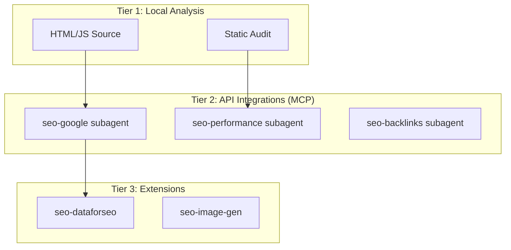

<!-- source: DeepWiki mcp.deepwiki.com · repo AgriciDaniel/claude-seo · page 2 Getting Started · fetched 2026-10-26 -->

# Getting Started

<details>
<summary>Relevant source files</summary>

The following files were used as context for generating this wiki page:

- [docs/ARCHITECTURE.md](docs/ARCHITECTURE.md)
- [docs/COMMANDS.md](docs/COMMANDS.md)
- [docs/INSTALLATION.md](docs/INSTALLATION.md)
- [docs/TROUBLESHOOTING.md](docs/TROUBLESHOOTING.md)
- [install.ps1](install.ps1)
- [install.sh](install.sh)
- [uninstall.ps1](uninstall.ps1)
- [uninstall.sh](uninstall.sh)

</details>


This document provides an overview of how to install, configure, and begin using the **claude-seo** system. It covers essential prerequisites, the installation process, basic configuration, and how to run your first SEO analysis commands.

For detailed installation steps including Python dependency management and Playwright setup, see [Installation](#2.1). For comprehensive configuration of API keys and MCP integrations, see [Configuration](#2.2). For step-by-step workflow examples, see [Quick Start Guide](#2.3).

---

## Prerequisites

Before installing claude-seo, ensure your system meets these requirements:

| Requirement | Minimum Version | Purpose |
|------------|-----------------|---------|
| **Python** | 3.10+ | Runs validation hooks, scripts, and MCP servers [install.ps1:75-76](), [install.sh:23-24]() |
| **Claude Code CLI** | Latest | Provides the `/seo` command interface [docs/INSTALLATION.md:7]() |
| **Git** | Any | Clones the repository and submodules [install.sh:25](), [install.ps1:105-111]() |

**Optional but Recommended:**

| Component | Purpose | Impact if Missing |
|-----------|---------|-------------------|
| **Playwright** | Visual analysis & screenshots | Falls back to `WebFetch` [docs/INSTALLATION.md:10](), [docs/COMMANDS.md:39]() |
| **MCP Servers** | Live SEO data (Ahrefs, GSC, etc.) | Analysis relies on HTML-only inspection [docs/ARCHITECTURE.md:126-129]() |

Sources: [install.sh:23-35](), [install.ps1:75-111](), [docs/INSTALLATION.md:3-10]()

---

## Installation Overview

The installation process deploys a modular architecture consisting of 25 sub-skills and 18 sub-agents into the Claude Code environment [docs/ARCHITECTURE.md:9]().

### Installation Artifacts Mapping

```mermaid
graph TB
    subgraph "Source (Code Entity Space)"
        [install.sh] -->|"Executes"| MainLogic["main() function"]
        [install.ps1] -->|"Executes"| MainPS["Main function"]
    end
    
    subgraph "Target: ~/.claude/ (Natural Language Space)"
        MainLogic -->|"Copies to /skills/seo/"| Orchestrator["Main Orchestrator"]
        MainLogic -->|"Copies to /agents/"| AgentMD["18 Specialist Subagents"]
        MainPS -->|"Creates .venv/"| PythonEnv["Isolated Runtime"]
    end

    subgraph "System Entities"
        Orchestrator --- ["skills/seo/SKILL.md"]
        AgentMD --- ["agents/seo-technical.md"]
        PythonEnv --- ["bin/claude-seo"]
    end
```

**Installation Methods:**

1.  **Plugin Install (Recommended)**: Uses Claude Code's internal marketplace via `/plugin install claude-seo@agricidaniel-claude-seo` [docs/INSTALLATION.md:14-22]().
2.  **Automated Script**: The `install.sh` (Unix) or `install.ps1` (Windows) scripts automate directory creation, file copying, and virtual environment setup [install.sh:7-82](), [install.ps1:135-200]().
3.  **Manual Setup**: Cloning the repo and running the installer to create the managed runtime at `~/.claude/skills/seo/.venv/` [docs/INSTALLATION.md:53-76]().

Sources: [install.sh:7-92](), [install.ps1:135-210](), [docs/INSTALLATION.md:12-47](), [docs/ARCHITECTURE.md:7-62]()

---

## Python Dependencies

The system requires specific Python packages to handle parsing, network requests, and visual analysis. These are managed within an isolated virtual environment to avoid global conflicts [docs/INSTALLATION.md:70-72]().

| Component | Purpose | Related Script |
|---------|---------|------------------|
| `beautifulsoup4` | HTML Parsing | `parse_html.py` [docs/TROUBLESHOOTING.md:211]() |
| `requests` | HTTP Client | `fetch_page.py` [docs/TROUBLESHOOTING.md:208]() |
| `playwright` | Browser Automation | `capture_screenshot.py` [docs/TROUBLESHOOTING.md:214]() |

Sources: [docs/INSTALLATION.md:70-76](), [docs/TROUBLESHOOTING.md:48-65](), [install.sh:127-129]()

---

## Configuration Overview

While the system works out-of-box via HTML parsing, connecting to external APIs through the Model Context Protocol (MCP) provides significantly deeper insights.

### Integration Tiers Diagram



**Configuration Storage:**
- **MCP Registration**: Configured in the Claude Code `settings.json` file [uninstall.sh:64]().
- **Runtime Setup**: The `/seo setup` command initializes the Python environment and Playwright Chromium [docs/COMMANDS.md:9-13]().

Sources: [docs/COMMANDS.md:9-13](), [docs/ARCHITECTURE.md:125-133](), [uninstall.sh:64]()

---

## First Commands

Once installed, the `/seo` command acts as the primary entry point.

### Common Workflows

*   **Full Site Audit**: `/seo audit <url>` — Crawls up to 500 pages, detects business type, and spawns parallel subagents [docs/COMMANDS.md:20-35]().
*   **Technical Deep Dive**: `/seo technical <url>` — Audits 9 categories including crawlability, security, and IndexNow [docs/COMMANDS.md:62-82]().
*   **Content & E-E-A-T**: `/seo content <url>` — Evaluates Experience, Expertise, Authoritativeness, and Trustworthiness [docs/COMMANDS.md:84-101]().
*   **Schema Check**: `/seo schema <url>` — Validates JSON-LD/Microdata against Google requirements [docs/COMMANDS.md:121-136]().

Sources: [docs/COMMANDS.md:1-136](), [docs/ARCHITECTURE.md:105-146]()

---

## Verification Steps

To ensure a successful setup, perform the following checks:

1.  **Skill Loading**: Run `/seo` in Claude Code; it should return a help message [docs/INSTALLATION.md:102-108]().
2.  **Health Check**: Run `/seo doctor` to verify runtime, dependency, and Chromium readiness [docs/COMMANDS.md:15-18]().
3.  **File Integrity**: Verify `SKILL.md` exists at `~/.claude/skills/seo/SKILL.md` [docs/INSTALLATION.md:143-151]().
4.  **Runtime Verification**: Ensure the virtual environment is present at `~/.claude/skills/seo/.venv/` [docs/INSTALLATION.md:85-91]().

Sources: [docs/INSTALLATION.md:93-108](), [docs/COMMANDS.md:15-18](), [install.sh:77-81]()

---

## Next Steps

*   For detailed setup of API keys for Google Search Console or Ahrefs, see [Configuration](#2.2).
*   To learn about the 18 specialized subagents and how they process data, see [System Architecture](#4).
*   To explore the full list of available commands, see [Command Reference](#3).

---

