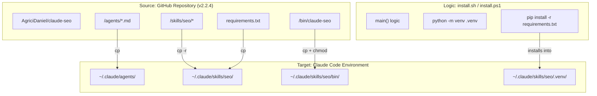
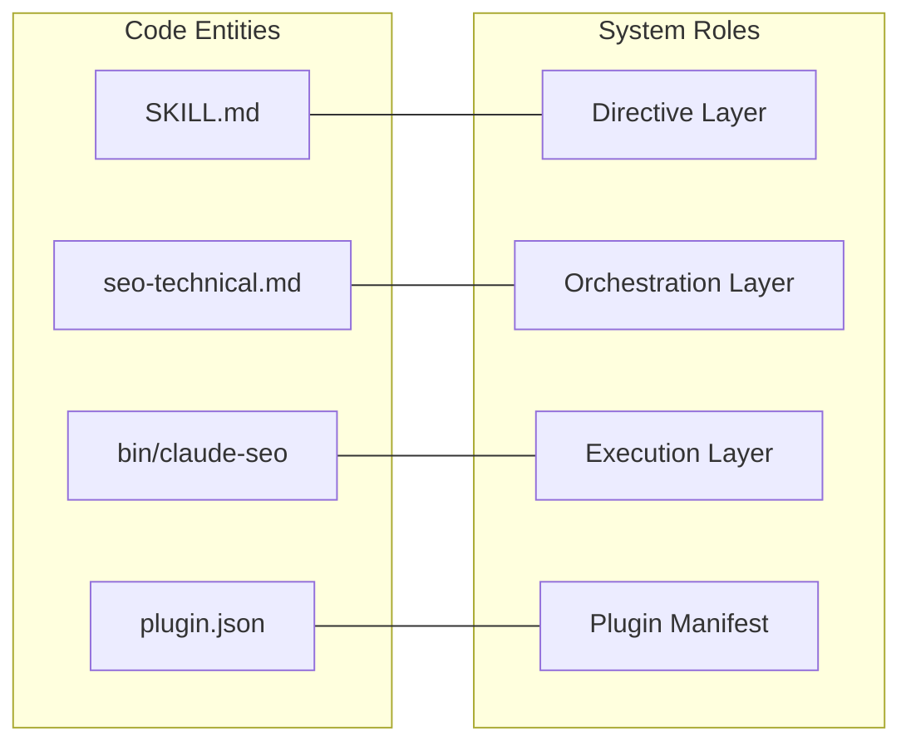

<!-- source: DeepWiki mcp.deepwiki.com · repo AgriciDaniel/claude-seo · page 2.1 Installation · fetched 2026-10-26 -->

# Installation

<details>
<summary>Relevant source files</summary>

The following files were used as context for generating this wiki page:

- [CITATION.cff](CITATION.cff)
- [docs/ARCHITECTURE.md](docs/ARCHITECTURE.md)
- [docs/COMMANDS.md](docs/COMMANDS.md)
- [docs/INSTALLATION.md](docs/INSTALLATION.md)
- [docs/TROUBLESHOOTING.md](docs/TROUBLESHOOTING.md)
- [install.ps1](install.ps1)
- [install.sh](install.sh)
- [pyproject.toml](pyproject.toml)
- [requirements.txt](requirements.txt)
- [tests/test_pyproject_metadata.py](tests/test_pyproject_metadata.py)
- [uninstall.ps1](uninstall.ps1)
- [uninstall.sh](uninstall.sh)

</details>


## Purpose and Scope

This document provides detailed technical instructions for installing the `claude-seo` system. It covers automated installation via shell and PowerShell scripts, manual dependency management using Python virtual environments, Playwright browser setup for visual analysis, and Model Context Protocol (MCP) server integration for external data sources.

---

## Automated Installation

The project provides dedicated installers for Unix-based systems (macOS/Linux) and Windows to automate the creation of skill directories, cloning of the repository, and environment setup. The system is designed to run in an isolated runtime environment to prevent global package pollution.

### Plugin Install (Recommended)
For Claude Code 1.0.33+, the recommended path is via the marketplace. This method integrates with Claude's native plugin lifecycle [docs/INSTALLATION.md:14-22]().

```bash
/plugin marketplace add AgriciDaniel/claude-seo
/plugin install claude-seo@agricidaniel-claude-seo
/seo setup
```

### Unix/macOS (install.sh)
The `install.sh` script performs a comprehensive setup by targeting the Claude Code skill and agent directories.

1.  **Environment Check**: Validates Git presence and minimum Python requirements [install.sh:23-25]().
2.  **Directory Initialization**: Creates `~/.claude/skills/seo` and `~/.claude/agents` [install.sh:27-29]().
3.  **Component Distribution**: 
    *   Clones the repository (pinned to version `v2.2.4` by default) [install.sh:15,37]().
    *   Installs 18+ subagents into the agent directory [install.sh:66-67]().
    *   Deploys 25+ sub-skills, schema templates, and reference PDFs into the skill directory [install.sh:40-63]().
    *   Copies the stable runtime launcher `bin/claude-seo` [install.sh:77-81]().
4.  **Python Environment**: Creates a virtual environment (`.venv`) inside the skill directory and installs dependencies pinned in `requirements.txt` [install.sh:176-180]().

### Windows (install.ps1)
The `install.ps1` script mirrors the Unix functionality for PowerShell environments. It includes a `Resolve-Python` function to detect `py -3`, `python3`, or `python` and validates that the version is `3.10` or higher [install.ps1:12-27, 75](). It targets `$env:USERPROFILE\.claude\skills\seo` for deployment [install.ps1:114]().

**Sources:** [install.sh:1-198](), [install.ps1:1-200](), [docs/INSTALLATION.md:28-51]()

---

## Technical Dependency Management

The system relies on a specific set of Python libraries for SEO analysis, scraping, and validation, with bounded version pinning for security.

### Python Requirements
The `requirements.txt` file pins dependencies to ensure stability and fix known CVEs:

| Package | Version | Role |
| :--- | :--- | :--- |
| `beautifulsoup4` | `>=4.12.0` | HTML parsing and DOM traversal [requirements.txt:5]() |
| `requests` | `>=2.32.4` | HTTP requests (CVE-2024-47081 fix) [requirements.txt:6]() |
| `lxml` | `>=6.1.1` | XML/HTML processing (CVE-2025-24928 fix) [requirements.txt:7]() |
| `playwright` | `>=1.59.0` | Headless rendering (CVE-2025-59288 fix) [requirements.txt:8]() |
| `trafilatura` | `>=2.0.0` | Boilerplate-free content extraction [requirements.txt:12]() |
| `weasyprint` | `>=68.1` | PDF report generation [requirements.txt:19]() |
| `google-api-python-client` | `>=2.196.0` | GSC and Google API integration [requirements.txt:23]() |

**Sources:** [requirements.txt:1-27](), [pyproject.toml:1-12]()

### Playwright and Managed Runtime
The system uses an isolated runtime. The command `/seo setup` explicitly creates or refreshes the isolated Python runtime and Playwright Chromium [docs/COMMANDS.md:9-13]().

```bash
# Manual check of the managed runtime
~/.claude/skills/seo/bin/claude-seo doctor
```

The installer attempts to provision Chromium automatically. If it fails, the system falls back to raw-fetch analysis without headless rendering [docs/INSTALLATION.md:78-80]().

---

## System Entity Mapping

The following diagrams illustrate how the installation process bridges the repository structure to the runtime environment.

### Installer Data Flow



**Sources:** [install.sh:39-81, 176-180](), [install.ps1:142-198]()

### Component Association



**Sources:** [docs/ARCHITECTURE.md:66-98](), [install.sh:77-81, 128]()

---

## Extension and MCP Setup

The system supports modular extensions (e.g., DataForSEO, Banana) which are installed into the same skill/agent structure.

### Extension Distribution
The `install.sh` script iterates through the `/extensions` directory, copying extension-specific skills, agents, and scripts to the respective Claude directories [install.sh:94-124]().

### MCP Registration
Manual installers copy hook files (e.g., `hooks/validate-schema.py`), but enforcement requires a plugin install which loads the hooks through the plugin manifest [install.sh:89-91](). MCP server registration for extensions typically involves adding entries to `~/.claude/settings.json`.

**Sources:** [install.sh:84-124](), [docs/INSTALLATION.md:24-26]()

---

## Uninstallation

To remove the system, dedicated uninstallation scripts are provided. They use glob enumeration to ensure all `seo-*` sub-skills and agents are removed.

*   **Unix**: `uninstall.sh` removes `~/.claude/skills/seo`, all `seo-*` sub-skills, and `seo-*.md` agent files [uninstall.sh:28-51]().
*   **Windows**: `uninstall.ps1` performs the same cleanup using `Remove-Item -Recurse -Force` [uninstall.ps1:31-55]().

If installed as a plugin, users should use the native command:
```bash
/plugin uninstall claude-seo@agricidaniel-claude-seo
```

**Sources:** [uninstall.sh:1-64](), [uninstall.ps1:1-69](), [docs/INSTALLATION.md:109-126]()

---

