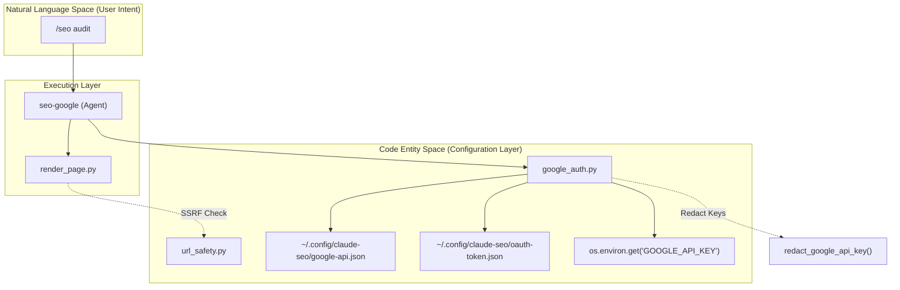
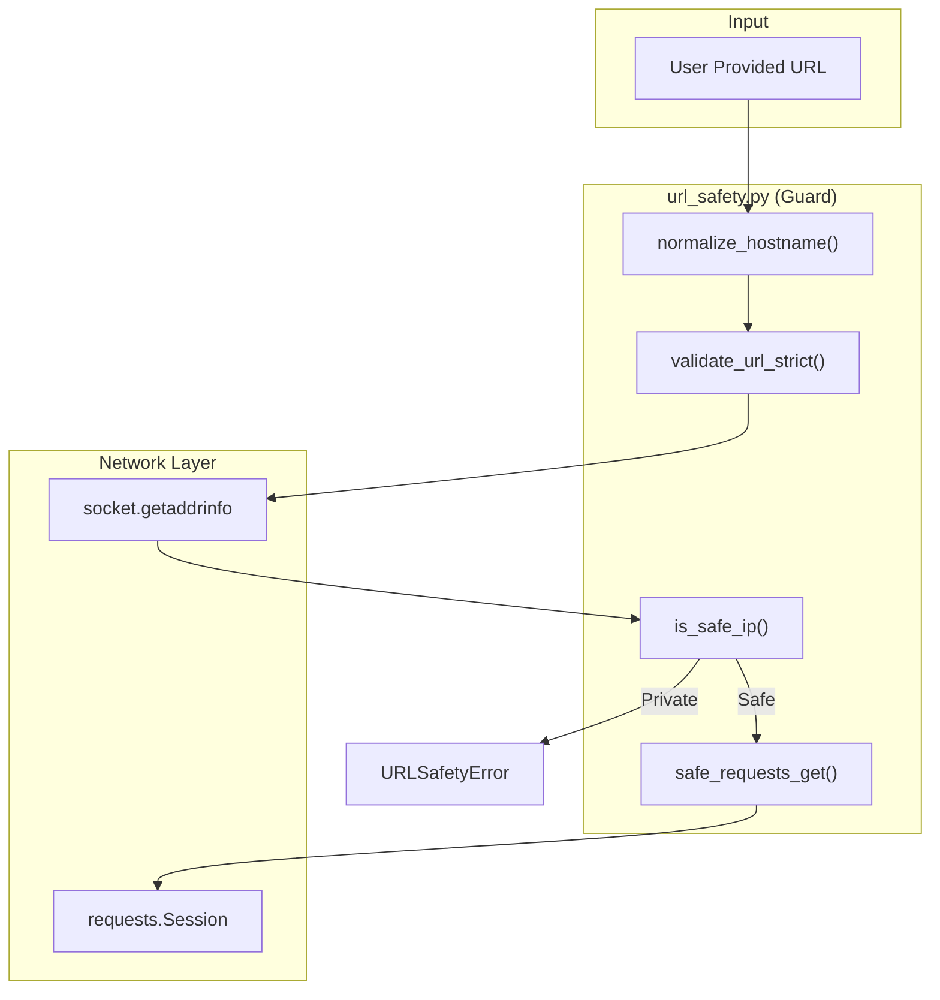

<!-- source: DeepWiki mcp.deepwiki.com · repo AgriciDaniel/claude-seo · page 2.2 Configuration · fetched 2026-10-26 -->

# Configuration

<details>
<summary>Relevant source files</summary>

The following files were used as context for generating this wiki page:

- [.github/CODEOWNERS](.github/CODEOWNERS)
- [.github/dependabot.yml](.github/dependabot.yml)
- [.github/workflows/v2.yml](.github/workflows/v2.yml)
- [.gitignore](.gitignore)
- [CODE_OF_CONDUCT.md](CODE_OF_CONDUCT.md)
- [SECURITY.md](SECURITY.md)
- [docs/MCP-INTEGRATION.md](docs/MCP-INTEGRATION.md)
- [extensions/banana/scripts/edit.py](extensions/banana/scripts/edit.py)
- [extensions/banana/scripts/generate.py](extensions/banana/scripts/generate.py)
- [scripts/google_auth.py](scripts/google_auth.py)
- [scripts/render_page.py](scripts/render_page.py)
- [scripts/url_safety.py](scripts/url_safety.py)
- [skills/seo-flow/references/flow-framework.md](skills/seo-flow/references/flow-framework.md)
- [skills/seo-google/references/auth-setup.md](skills/seo-google/references/auth-setup.md)
- [skills/seo-google/references/nlp-api.md](skills/seo-google/references/nlp-api.md)
- [skills/seo-google/references/pagespeed-crux-api.md](skills/seo-google/references/pagespeed-crux-api.md)
- [skills/seo/references/cwv-thresholds.md](skills/seo/references/cwv-thresholds.md)
- [tests/test_url_safety.py](tests/test_url_safety.py)

</details>


This document explains how to configure `claude-seo` to work with external data sources, Model Context Protocol (MCP) servers, and API integrations. The system manages credentials through a multi-tier storage model, primarily using `~/.config/claude-seo/` for local configuration and `~/.claude/settings.json` for MCP registration.

---

## Configuration Architecture

The configuration is split into three functional layers: credential storage, environment variable overrides, and MCP server registration.

### Credential Storage Model
The system centralizes SEO-specific credentials in the user's home directory to avoid project-level leaks.
*   **Google APIs**: Managed by `google_auth.py`, configuration stored in `~/.config/claude-seo/google-api.json`. [scripts/google_auth.py:26-26]()
*   **OAuth Tokens**: Securely stored with `0o600` permissions in `~/.config/claude-seo/oauth-token.json`. The system automatically remediates legacy `0o644` permissions on load. [scripts/google_auth.py:27-27](), [scripts/google_auth.py:200-209]()
*   **Backlink APIs**: Managed by `backlinks_auth.py`, stored in `~/.config/claude-seo/backlinks-api.json`. [scripts/SECURITY.md:73-73]()

### Data Flow Diagram
This diagram shows how the `google_auth.py` and `url_safety.py` modules bridge the gap between physical configuration files and the execution logic used by subagents.


**Sources**: [scripts/google_auth.py:26-27](), [scripts/google_auth.py:92-132](), [scripts/url_safety.py:9-37](), [scripts/render_page.py:97-106]()

---

## Google API Configuration

The `google_auth.py` script handles authentication for Google Search Console (GSC), PageSpeed Insights (PSI), Chrome UX Report (CrUX), and GA4.

### Supported Credential Tiers
The system detects the "tier" of access based on available configuration:
*   **Tier 0**: No credentials. Only public HTML analysis via `render_page.py`. [docs/MCP-INTEGRATION.md:142-152]()
*   **Tier 1**: API Key only. Used for PageSpeed Insights and CrUX. [scripts/google_auth.py:38-41]()
*   **Tier 2**: Service Account or OAuth. Required for GSC, Indexing API, and GA4. [scripts/google_auth.py:42-45]()

### Setup via CLI
Users can configure Google credentials using the built-in setup command:
```bash
python scripts/google_auth.py --setup
```
[scripts/google_auth.py:13-13]()

### Manual Config File (`google-api.json`)
The file structure at `~/.config/claude-seo/google-api.json` supports:
```json
{
  "service_account_path": "~/path/to/sa.json",
  "api_key": "AIza...",
  "default_property": "https://example.com/",
  "ga4_property_id": "123456789"
}
```
[scripts/google_auth.py:103-108]()

**Sources**: [scripts/google_auth.py:29-62](), [scripts/google_auth.py:92-132](), [docs/MCP-INTEGRATION.md:9-22]()

---

## MCP Server Registration

`claude-seo` integrates with external tools via the Model Context Protocol. These are registered in the Claude Code `settings.json` file.

### Registration Mapping
The following table maps system requirements to specific MCP server configurations.

| Integration | Command | Required Env Vars |
| :--- | :--- | :--- |
| **Search Console** | `npx -y mcp-server-gsc` | `GOOGLE_CREDENTIALS_PATH` |
| **PageSpeed** | `npx -y mcp-server-pagespeed` | `PAGESPEED_API_KEY` |
| **Ahrefs** | `npx -y @ahrefs/mcp` | `AHREFS_API_TOKEN` |
| **DataForSEO** | `dataforseo-mcp-server` | `DATAFORSEO_LOGIN`, `DATAFORSEO_PASSWORD` |

**Sources**: [docs/MCP-INTEGRATION.md:30-42](), [docs/MCP-INTEGRATION.md:52-62](), [docs/MCP-INTEGRATION.md:64-77]()

---

## Security & URL Safety

A critical part of the configuration is the `url_safety.py` module, which enforces SSRF protection and DNS-rebinding mitigation for all network requests.

### Safety Mechanisms
*   **Hostname Normalization**: Collapses FQDN trailing dots and glibc-friendly IPv4 obfuscation (hex/octal/decimal) to prevent bypasses. [scripts/url_safety.py:105-121](), [tests/test_url_safety.py:36-59]()
*   **Strict Validation**: Resolves hostnames via `socket.getaddrinfo` and checks every returned IP against private/reserved ranges. [scripts/url_safety.py:19-25]()
*   **DNS Pinning**: The `safe_requests_get` function uses a DNS-pinning context manager to prevent "Time of Check to Time of Use" (TOCTOU) attacks. [scripts/url_safety.py:27-32]()
*   **Browser Safety**: For Playwright-based fetches in `render_page.py`, a `route()` handler intercepts subresource requests to block private IP resolutions inside Chromium. [scripts/render_page.py:48-56](), [scripts/url_safety.py:101-102]()

### System Safety Diagram
This diagram illustrates how the `URLSafetyError` and `validate_url_strict` functions protect the configuration and execution layer from malicious inputs.


**Sources**: [scripts/url_safety.py:151-182](), [scripts/url_safety.py:183-190](), [tests/test_url_safety.py:125-148]()

---

## Extension Configuration (Claude Banana)

For image generation and editing tasks, the `banana` extension uses the Gemini REST API as a fallback when MCP is unavailable.

### API Configuration
These scripts use environment variables for authentication:
*   `GOOGLE_AI_API_KEY` or `GOOGLE_API_KEY`: The API key for Gemini. [extensions/banana/scripts/generate.py:155-158]()
*   `NANOBANANA_MODEL`: The default model ID (e.g., `gemini-2.0-flash`). [extensions/banana/scripts/generate.py:22-22]()

### Output Management
Generated images are stored in `~/Documents/nanobanana_generated`. [extensions/banana/scripts/generate.py:25-25]()

**Sources**: [extensions/banana/scripts/generate.py:22-30](), [extensions/banana/scripts/edit.py:22-28]()

---

