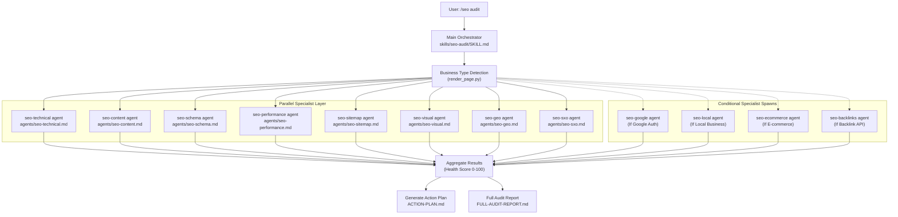
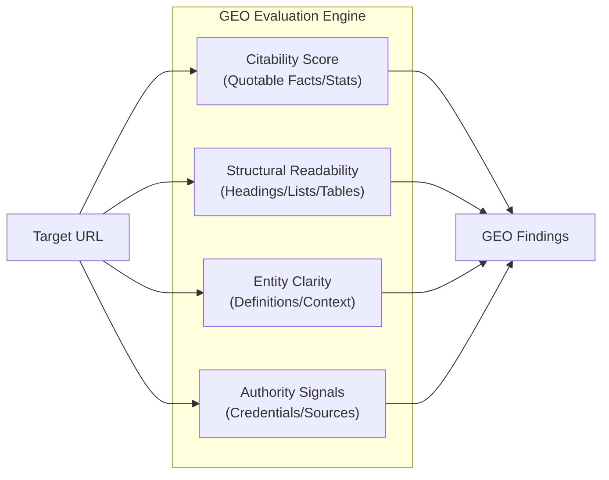

<!-- source: DeepWiki mcp.deepwiki.com · repo AgriciDaniel/claude-seo · page 2.3 Quick Start Guide · fetched 2026-10-26 -->

# Quick Start Guide

<details>
<summary>Relevant source files</summary>

The following files were used as context for generating this wiki page:

- [docs/ARCHITECTURE.md](docs/ARCHITECTURE.md)
- [docs/COMMANDS.md](docs/COMMANDS.md)
- [docs/INSTALLATION.md](docs/INSTALLATION.md)
- [docs/TROUBLESHOOTING.md](docs/TROUBLESHOOTING.md)
- [skills/seo-audit/SKILL.md](skills/seo-audit/SKILL.md)
- [skills/seo-cluster/SKILL.md](skills/seo-cluster/SKILL.md)
- [skills/seo-drift/SKILL.md](skills/seo-drift/SKILL.md)
- [skills/seo-ecommerce/SKILL.md](skills/seo-ecommerce/SKILL.md)
- [skills/seo-flow/SKILL.md](skills/seo-flow/SKILL.md)
- [skills/seo-sxo/SKILL.md](skills/seo-sxo/SKILL.md)
- [uninstall.ps1](uninstall.ps1)
- [uninstall.sh](uninstall.sh)

</details>


This guide provides step-by-step walkthroughs of the most common SEO analysis workflows in `claude-seo`. It covers practical examples from initial setup verification through running your first analyses and interpreting results.

For detailed command parameters and options, see [Command Reference](). For installation procedures, see [Installation](). For configuration of external integrations, see [Configuration]().

---

## Prerequisites Verification

Before running SEO analyses, verify your installation is functional:

```bash
# Start Claude Code CLI
claude

# Verify the main SEO skill is loaded
/seo
```

The system is a multi-skill architecture composed of 25 sub-skills and 18 specialist agents across technical SEO, content quality, and strategic planning. [docs/ARCHITECTURE.md:5-9](). Use the `/seo doctor` command to verify the runtime environment, dependencies, and Chromium readiness without altering the system. [docs/COMMANDS.md:15-18]().

**Sources:** [docs/ARCHITECTURE.md:5-9](), [docs/COMMANDS.md:15-18](), [docs/INSTALLATION.md:93-107]()

---

## Workflow 1: Full Site Audit

The `/seo audit` command performs a comprehensive website audit by spawning up to 15 specialist subagents in parallel (8 always-on + 7 conditional). [skills/seo-audit/SKILL.md:3-5]().

### Basic Usage

```bash
/seo audit https://example.com
```

### Execution Flow and Data Orchestration

The orchestrator identifies the business type from homepage signals (SaaS, Local, Ecommerce, Publisher, Agency) and tailors the analysis by conditionally spawning relevant subagents. [skills/seo-audit/SKILL.md:18-35]().

**Diagram: /seo audit Orchestration Flow**


### Expected Output Structure

The audit produces artifacts under a `{domain}-audit/` directory: [skills/seo-audit/SKILL.md:37-38]().
1. **`FULL-AUDIT-REPORT.md`**: Comprehensive findings across all categories. [skills/seo-audit/SKILL.md:53]().
2. **`ACTION-PLAN.md`**: Prioritized recommendations (Critical > High > Medium > Low). [skills/seo-audit/SKILL.md:54]().
3. **`audit-data.json`**: Structured data envelope for report generation. [skills/seo-audit/SKILL.md:55]().
4. **`findings/*.md`**: Per-category specialist findings (e.g., `technical.md`, `content.md`). [skills/seo-audit/SKILL.md:56]().

**Sources:** [skills/seo-audit/SKILL.md:3-58](), [docs/COMMANDS.md:20-40](), [docs/ARCHITECTURE.md:105-146]()

---

## Workflow 2: Single Page Deep Analysis

For detailed analysis of one specific page, use `/seo page`. This command evaluates on-page elements, content quality, and technical health for a single URL. [docs/COMMANDS.md:43-59]().

### Basic Usage

```bash
/seo page https://example.com/about
```

### What Gets Analyzed

| Category | Specific Checks |
|----------|-----------------|
| **On-Page** | Title tags, meta descriptions, heading structure, URL patterns. [docs/COMMANDS.md:53]() |
| **Content** | Word count, readability, E-E-A-T (Experience, Expertise, Authoritativeness, Trustworthiness). [docs/COMMANDS.md:54]() |
| **Technical** | Canonical tags, robots directives, Open Graph tags. [docs/COMMANDS.md:55]() |
| **Schema** | Detection of JSON-LD, Microdata, and RDFa. [docs/COMMANDS.md:56]() |
| **Images** | Alt text, file sizes, formats, and CLS prevention. [docs/COMMANDS.md:57]() |

**Sources:** [docs/COMMANDS.md:43-59]()

---

## Workflow 3: Schema Markup Management

The `/seo schema` command handles detection, validation, and generation of structured data. [docs/COMMANDS.md:121-136]().

### Detection and Validation

```bash
/seo schema https://example.com
```

The system detects existing schema and validates it against Google's requirements, identifying missing opportunities for rich snippets. [docs/COMMANDS.md:131-133]().

### Generation Example

The system can generate ready-to-use JSON-LD. For e-commerce sites, the `seo-ecommerce` sub-skill provides specialized product schema validation and enhancement. [skills/seo-ecommerce/SKILL.md:34]().

```bash
# Example: Generate product schema for an e-commerce page
/seo ecommerce schema https://example.com/product-p
```

**Sources:** [docs/COMMANDS.md:121-136](), [skills/seo-ecommerce/SKILL.md:21-35]()

---

## Workflow 4: AI Search Optimization (GEO)

The `/seo geo` command focuses on "Generative Engine Optimization," ensuring content is optimized for AI search engines like Perplexity, ChatGPT, and Google AI Overviews. [docs/COMMANDS.md:138-154]().

### Analysis Metrics

**Diagram: GEO Analysis Data Flow**


**Key Optimization Points:**
- **Citability**: Measures how easily AI models can extract and cite facts from the content. [docs/COMMANDS.md:148]().
- **Structural Readability**: Enforces use of headings, lists, and tables for generative parsing. [docs/COMMANDS.md:149]().

**Sources:** [docs/COMMANDS.md:138-154](), [skills/seo-audit/SKILL.md:27](), [skills/seo-flow/SKILL.md:68]()

---

## Workflow 5: SEO Drift Monitoring

The `seo-drift` skill acts as "Git for SEO," capturing baselines and detecting regressions. [skills/seo-drift/SKILL.md:3-8]().

### Pre/Post Deployment Check

```bash
# 1. Capture "known good" state before a change
/seo drift baseline https://example.com

# 2. After deployment, compare current state to baseline
/seo drift compare https://example.com
```

The comparison engine applies 17 rules across 3 severity levels (Critical, Warning, Info) to detect changes in titles, meta tags, schema, and Core Web Vitals. [skills/seo-drift/SKILL.md:57-70]().

**Sources:** [skills/seo-drift/SKILL.md:3-215]()

---

## Common CLI Operations Summary

| Command | Use Case | Primary Output |
|---------|----------|----------------|
| `/seo audit <url>` | Full site health check | `FULL-AUDIT-REPORT.md` |
| `/seo page <url>` | Deep single-page analysis | Terminal Analysis |
| `/seo cluster plan <seed>` | Topic clustering & architecture | `cluster-map.html` |
| `/seo sxo <url> <keyword>` | Search Experience / Intent check | `SXO-ANALYSIS.md` |
| `/seo drift compare <url>` | Detect SEO regressions | JSON Diff / HTML Report |
| `/seo flow` | Framework-led SEO prompts | Stage-specific prompts |

**Sources:** [docs/COMMANDS.md:1-303](), [skills/seo-cluster/SKILL.md:32-40](), [skills/seo-sxo/SKILL.md:33-41](), [skills/seo-flow/SKILL.md:31-43]()

---

