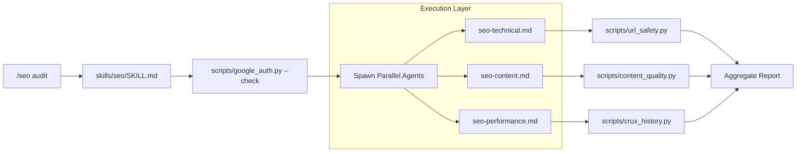

<!-- source: DeepWiki mcp.deepwiki.com · repo AgriciDaniel/claude-seo · page 3 Command Reference · fetched 2026-10-26 -->

# Command Reference

<details>
<summary>Relevant source files</summary>

The following files were used as context for generating this wiki page:

- [docs/ARCHITECTURE.md](docs/ARCHITECTURE.md)
- [docs/COMMANDS.md](docs/COMMANDS.md)
- [docs/INSTALLATION.md](docs/INSTALLATION.md)
- [docs/TROUBLESHOOTING.md](docs/TROUBLESHOOTING.md)
- [extensions/firecrawl/skills/seo-firecrawl/SKILL.md](extensions/firecrawl/skills/seo-firecrawl/SKILL.md)
- [skills/seo-backlinks/SKILL.md](skills/seo-backlinks/SKILL.md)
- [skills/seo/SKILL.md](skills/seo/SKILL.md)
- [uninstall.ps1](uninstall.ps1)
- [uninstall.sh](uninstall.sh)

</details>


This document provides a comprehensive reference for all `/seo` commands available in the `claude-seo` system. It covers command syntax, parameters, use cases, and execution behavior. For detailed implementation documentation of specific analysis types, see [Full Site Audit](#3.1), [Individual Analysis Commands](#3.2), and [Strategic Planning Commands](#3.3). For system architecture details, see [System Architecture](#4).

## Command Structure

All commands follow the pattern `/seo <subcommand> [parameters]` and are invoked within the Claude Code CLI environment. Commands are parsed by the main orchestration skill and routed to specialized sub-skills or spawned as parallel subagents depending on the command type.

**Invocation Context:**
```bash
claude                    # Start Claude Code CLI
/seo audit example.com    # Execute command
```

Commands are defined in the main skill manifest at [skills/seo/SKILL.md:29-59]() and orchestration logic determines routing behavior based on the subcommand.

Sources: [docs/COMMANDS.md:1-7](), [skills/seo/SKILL.md:13-25]()

## Command Routing Architecture

The following diagram bridges the natural language commands to the specific code entities (skills and agents) responsible for their execution.

**System Routing Map**

```mermaid
graph TB
    CLI["Claude Code CLI"]
    MainSkill["seo orchestrator<br/>skills/seo/SKILL.md"]
    Router["Orchestration Logic"]
    
    subgraph "Direct Sub-Skill Routing"
        SSPage["seo-page<br/>skills/seo-page/SKILL.md"]
        SSTechnical["seo-technical<br/>skills/seo-technical/SKILL.md"]
        SSContent["seo-content<br/>skills/seo-content/SKILL.md"]
        SSSchema["seo-schema<br/>skills/seo-schema/SKILL.md"]
        SSImages["seo-images<br/>skills/seo-images/SKILL.md"]
        SSSitemap["seo-sitemap<br/>skills/seo-sitemap/SKILL.md"]
        SSGEO["seo-geo<br/>skills/seo-geo/SKILL.md"]
        SSPlan["seo-plan<br/>skills/seo-plan/SKILL.md"]
        SSBacklinks["seo-backlinks<br/>skills/seo-backlinks/SKILL.md"]
    end
    
    subgraph "Parallel Subagent Delegation"
        SSAudit["seo-audit<br/>skills/seo-audit/SKILL.md"]
        SA1["seo-technical.md agent"]
        SA2["seo-content.md agent"]
        SA3["seo-schema.md agent"]
        SA4["seo-performance.md agent"]
        SA5["seo-visual.md agent"]
        SA6["seo-geo.md agent"]
    end
    
    CLI -->|"/seo <subcommand>"| MainSkill
    MainSkill --> Router
    
    Router -->|"/seo page"| SSPage
    Router -->|"/seo technical"| SSTechnical
    Router -->|"/seo content"| SSContent
    Router -->|"/seo schema"| SSSchema
    Router -->|"/seo images"| SSImages
    Router -->|"/seo sitemap"| SSSitemap
    Router -->|"/seo geo"| SSGEO
    Router -->|"/seo plan"| SSPlan
    Router -->|"/seo backlinks"| SSBacklinks
    
    Router -->|"/seo audit"| SSAudit
    SSAudit -->|"spawn subagents"| SA1
    SSAudit -->|"spawn subagents"| SA2
    SSAudit -->|"spawn subagents"| SA3
    SSAudit -->|"spawn subagents"| SA4
    SSAudit -->|"spawn subagents"| SA5
    SSAudit -->|"spawn subagents"| SA6
    
    SSAudit --> Report["Unified Report<br/>Health Score: 0-100"]
```


**Command Routing Behavior:**

The router at [skills/seo/SKILL.md:70-91]() implements two execution patterns:

1. **Direct Routing**: Single commands (`/seo page`, `/seo technical`, etc.) route directly to their corresponding sub-skill for synchronous execution [skills/seo/SKILL.md:89]().
2. **Parallel Delegation**: The `/seo audit` command triggers the orchestration logic to spawn up to 15 specialist agents simultaneously [skills/seo/SKILL.md:72-83]().

Sources: [skills/seo/SKILL.md:70-91](), [docs/ARCHITECTURE.md:103-146]()

## Command Categories

Commands are organized into functional categories:

| Category | Commands | Purpose |
|----------|----------|---------|
| **Full Site Analysis** | `audit`, `firecrawl crawl` | Comprehensive multi-dimensional site audit or deep site-wide crawling. |
| **Individual Analysis** | `page`, `technical`, `content`, `schema`, `images`, `sitemap`, `geo`, `backlinks`, `local`, `maps` | Focused analysis of specific SEO dimensions on target URLs or local search presence. |
| **Strategic Planning** | `plan`, `programmatic`, `competitor-pages`, `hreflang`, `cluster`, `drift`, `flow` | Content strategy, scaled generation, internationalization, and search experience optimization. |

Sources: [skills/seo/SKILL.md:29-59](), [docs/COMMANDS.md:7-300]()

## Full Command Reference

### `/seo audit <url>`

Executes a comprehensive website audit across all SEO dimensions using parallel subagent delegation.

**Syntax:**
```bash
/seo audit https://example.com
```

**Execution Flow:**
1. **Business Detection**: Identifies type (SaaS, Local, Ecommerce, Publisher, Agency) from homepage signals [skills/seo/SKILL.md:73]().
2. **Parallel Spawning**: Spawns core agents: `seo-technical`, `seo-content`, `seo-schema`, `seo-sitemap`, `seo-performance`, `seo-visual`, `seo-geo` [skills/seo/SKILL.md:74]().
3. **Conditional Spawning**: Spawns `seo-google` (if credentials detected), `seo-local` (if local business), `seo-backlinks` (if APIs available), or `seo-ecommerce` (if store detected) [skills/seo/SKILL.md:75-81]().
4. **Aggregation**: Collects results and generates a unified report with an SEO Health Score (0-100) [skills/seo/SKILL.md:84]().

**Output Components:**
- `FULL-AUDIT-REPORT.md`: Comprehensive findings [docs/COMMANDS.md:37]().
- `ACTION-PLAN.md`: Prioritized task list with dependency sequencing [docs/COMMANDS.md:38]().
- Optional PDF report: Generated via `scripts/google_report.py` [skills/seo/SKILL.md:90]().

For detailed audit implementation, see [Full Site Audit](#3.1).

Sources: [skills/seo/SKILL.md:70-91](), [docs/COMMANDS.md:20-40]()

### `/seo page <url>`

Performs deep single-page analysis across all SEO dimensions including on-page elements, E-E-A-T, and images.

**Syntax:**
```bash
/seo page https://example.com/about
```

Routes to `skills/seo-page/SKILL.md`. Analyzes metadata, headings, content quality, technical tags, and images [docs/COMMANDS.md:52-58]().

Sources: [docs/COMMANDS.md:43-60](), [skills/seo/SKILL.md:32]()

### `/seo technical <url>`

Executes technical SEO audit across 9 categories including crawlability, indexability, security, and Core Web Vitals.

**Syntax:**
```bash
/seo technical https://example.com
```

**Audit Categories:**
1. Crawlability & Indexability
2. Security & URL Structure
3. Mobile Optimization
4. Core Web Vitals (LCP, INP, CLS)
5. JavaScript Rendering
6. IndexNow Protocol

For detailed technical analysis documentation, see [Technical SEO Analysis](#5).

Sources: [docs/COMMANDS.md:62-82](), [skills/seo/SKILL.md:36]()

### `/seo content <url>`

Analyzes content quality using the E-E-A-T framework and September 2025 Quality Rater Guidelines.

**Syntax:**
```bash
/seo content https://example.com/blog/post
```

**Analysis Dimensions:**
- **Experience**: First-hand knowledge signals [docs/COMMANDS.md:94]().
- **Expertise**: Author credentials and depth [docs/COMMANDS.md:95]().
- **Authoritativeness**: External recognition [docs/COMMANDS.md:96]().
- **Trustworthiness**: Transparency and security [docs/COMMANDS.md:97]().
- **AI Citation Readiness**: Passage-level factual density for AI overviews [docs/COMMANDS.md:98]().

For complete E-E-A-T documentation, see [Content Quality & E-E-A-T](#6).

Sources: [docs/COMMANDS.md:84-101](), [skills/seo/SKILL.md:37]()

### `/seo schema <url>`

Detects existing markup, validates against Google's requirements, and generates ready-to-use JSON-LD.

**Syntax:**
```bash
/seo schema https://example.com
```

**Capabilities:**
- Detects JSON-LD, Microdata, and RDFa [docs/COMMANDS.md:131]().
- Validates against Google's rich result requirements [docs/COMMANDS.md:132]().
- Identifies missing opportunities and generates JSON-LD [docs/COMMANDS.md:133-134]().

For complete schema documentation, see [Schema Markup Management](#7).

Sources: [docs/COMMANDS.md:121-136](), [skills/seo/SKILL.md:34]()

### `/seo geo <url>`

Optimizes content for AI-powered search engines (Generative Engine Optimization) such as ChatGPT, Perplexity, and Google AI Overviews.

**Syntax:**
```bash
/seo geo https://example.com
```

**Metrics:**
- **Citability Score**: Evaluates quotable facts and statistics [docs/COMMANDS.md:148]().
- **Structural Readability**: Headings, lists, and tables analysis [docs/COMMANDS.md:149]().

Sources: [docs/COMMANDS.md:138-154](), [skills/seo/SKILL.md:39]()

### `/seo backlinks <url>`

Analyzes backlink profile using a 3-tier data cascade: free (Common Crawl), free with signup (Moz, Bing), and premium (DataForSEO extension) [skills/seo-backlinks/SKILL.md:18-26]().

**Syntax:**
```bash
/seo backlinks https://example.com
/seo backlinks gap <url1> <url2>
/seo backlinks toxic <url>
```

Sources: [skills/seo-backlinks/SKILL.md:1-42](), [skills/seo/SKILL.md:47]()

## Command Execution Flow

The following diagram bridges the "Natural Language" intent to the "Code Entity" space by showing how a command flows through specific scripts and agents.

**Command Execution Pipeline**


Sources: [skills/seo/SKILL.md:70-91](), [docs/ARCHITECTURE.md:103-146]()

## Quality Gates and Enforcement

The system enforces hard content thresholds and policy-aligned rules during command execution to prevent scaled content abuse.

| Threshold / Rule | Action | Source |
|------------------|--------|--------|
| 30+ location pages | WARNING (60% unique required) | [docs/COMMANDS.md:208]() |
| 50+ location pages | HARD STOP (Justification required) | [docs/COMMANDS.md:208]() |
| HowTo Schema | Never recommend (Deprecated) | [docs/TROUBLESHOOTING.md:175]() |
| FAQ Schema | Retired for all sites (2026-05-07) | [docs/TROUBLESHOOTING.md:176]() |
| FID Metric | Replace with INP (interaction to next paint) | [docs/COMMANDS.md:77]() |

Sources: [docs/COMMANDS.md:205-212](), [docs/TROUBLESHOOTING.md:167-179]()

---

