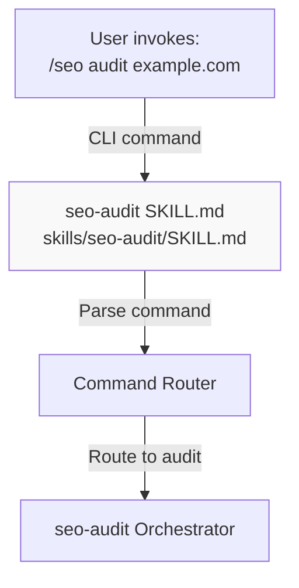
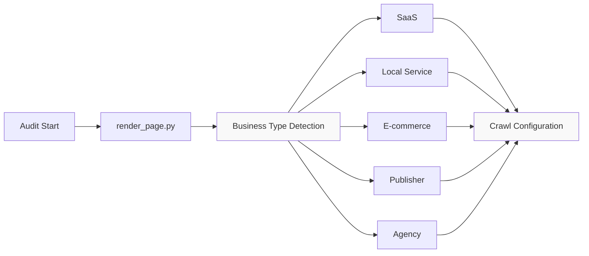
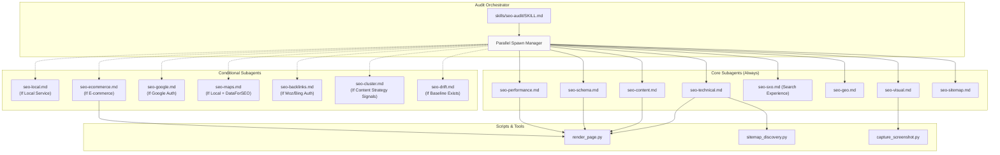

<!-- source: DeepWiki mcp.deepwiki.com · repo AgriciDaniel/claude-seo · page 3.1 Full Site Audit · fetched 2026-10-26 -->

# Full Site Audit

Relevant source files

The following files were used as context for generating this wiki page:

- [agents/seo-content.md](agents/seo-content.md)
- [agents/seo-ecommerce.md](agents/seo-ecommerce.md)
- [agents/seo-performance.md](agents/seo-performance.md)
- [agents/seo-schema.md](agents/seo-schema.md)
- [agents/seo-sxo.md](agents/seo-sxo.md)
- [agents/seo-technical.md](agents/seo-technical.md)
- [agents/seo-visual.md](agents/seo-visual.md)
- [scripts/google_report.py](scripts/google_report.py)
- [skills/seo-audit/SKILL.md](skills/seo-audit/SKILL.md)
- [skills/seo-cluster/SKILL.md](skills/seo-cluster/SKILL.md)
- [skills/seo-drift/SKILL.md](skills/seo-drift/SKILL.md)
- [skills/seo-ecommerce/SKILL.md](skills/seo-ecommerce/SKILL.md)
- [skills/seo-flow/SKILL.md](skills/seo-flow/SKILL.md)
- [skills/seo-sxo/SKILL.md](skills/seo-sxo/SKILL.md)
- [tests/test_audit_instructions.py](tests/test_audit_instructions.py)

The Full Site Audit is the primary analysis command in the `claude-seo` system, accessible via `/seo audit <url>`. It performs a comprehensive website evaluation by spawning up to 15 parallel subagents (8 core specialists and up to 7 conditional specialists) that analyze different aspects of SEO simultaneously. The process aggregates findings into a unified report with an overall health score and a prioritized action plan.

---

## Command Invocation and Routing

The audit command follows a specific routing path from user invocation through to execution:

**Sources:** [skills/seo-audit/SKILL.md:1-11](), [skills/seo-audit/SKILL.md:13-20]()

When invoked, the command:
1. User executes `/seo audit <url>` in Claude Code CLI [skills/seo-audit/SKILL.md:4-5]().
2. The `seo-audit` skill at `skills/seo-audit/SKILL.md` receives the command [skills/seo-audit/SKILL.md:2-3]().
3. The system initiates the process by rendering the homepage using `claude-seo run render_page.py <url> --mode auto --json` to capture raw/rendered HTML and SPA status [skills/seo-audit/SKILL.md:17]().

---

## Business Type Detection and Crawl Phase

Before spawning subagents, the system detects the website's business type to tailor analysis and begins a controlled crawl:

**Sources:** [skills/seo-audit/SKILL.md:17-19](), [skills/seo-audit/SKILL.md:35](), [agents/seo-ecommerce.md:6]()

### Crawl Configuration
The audit implements a strict crawl policy to ensure performance and respect site resources:
*   **Max pages:** 500 [skills/seo-audit/SKILL.md:43]().
*   **Delay between requests:** 1 second [skills/seo-audit/SKILL.md:48]().
*   **Concurrent requests:** 5 [skills/seo-audit/SKILL.md:47]().
*   **Timeout per page:** 30 seconds [skills/seo-audit/SKILL.md:46]().
*   **Respect robots.txt:** Yes [skills/seo-audit/SKILL.md:44]().

---

## Parallel Subagent Execution

The audit architecture spawns specialized subagents concurrently. Some are always active, while others are spawned conditionally based on business type, content signals, or credential availability.

**Sources:** [skills/seo-audit/SKILL.md:20-35](), [agents/seo-technical.md:58](), [agents/seo-content.md:70](), [agents/seo-visual.md:29-34]()

### Specialist Roles
| Subagent | Conditional Trigger | Key Responsibilities |
|----------|---------------------|----------------------|
| `seo-technical` | Always | robots.txt, sitemaps, canonicals, security headers [skills/seo-audit/SKILL.md:21](). |
| `seo-content` | Always | E-E-A-T, readability, thin content, AI citation readiness [skills/seo-audit/SKILL.md:22](). |
| `seo-schema` | Always | Detection, validation, JSON-LD recommendations [skills/seo-audit/SKILL.md:23](). |
| `seo-performance`| Always | LCP, INP, CLS measurements [skills/seo-audit/SKILL.md:25](). |
| `seo-sxo` | Always | Search experience analysis: page-type mismatch, user stories [skills/seo-audit/SKILL.md:33](). |
| `seo-geo` | Always | AI crawler access, llms.txt, citability, brand mention signals [skills/seo-audit/SKILL.md:27](). |
| `seo-local` | Business = Local | GBP signals, NAP consistency, local schema [skills/seo-audit/SKILL.md:28](). |
| `seo-ecommerce` | Business = E-commerce | Product schema, marketplace intelligence [skills/seo-audit/SKILL.md:35](). |
| `seo-maps` | Local + DataForSEO | Geo-grid rank tracking, competitor radius mapping [skills/seo-audit/SKILL.md:29](). |
| `seo-google` | Google Credentials | CrUX field data, GSC indexation, GA4 traffic [skills/seo-audit/SKILL.md:30](). |
| `seo-cluster` | Content Signals | Semantic topic clustering analysis [skills/seo-audit/SKILL.md:32](). |

---

## Scoring Methodology

The audit calculates an overall SEO Health Score (0-100) as a weighted aggregate of individual category findings.

| Category | Weight |
|----------|--------|
| Content Quality | 23% |
| Technical SEO | 22% |
| On-Page SEO | 20% |
| Schema / Structured Data | 10% |
| Performance (CWV) | 10% |
| AI Search Readiness | 10% |
| Images | 5% |

**Sources:** [skills/seo-audit/SKILL.md:104-112]()

### Priority Definitions
*   **Critical**: Blocks indexing or causes penalties (fix immediately) [skills/seo-audit/SKILL.md:162]().
*   **High**: Significantly impacts rankings (fix within 1 week) [skills/seo-audit/SKILL.md:163]().
*   **Medium**: Optimization opportunity (fix within 1 month) [skills/seo-audit/SKILL.md:164]().
*   **Low**: Nice to have (backlog) [skills/seo-audit/SKILL.md:165]().

---

## Reporting Outputs

The audit generates three primary types of documentation and structured data artifacts:

1.  **`{domain}-audit/FULL-AUDIT-REPORT.md`**: Comprehensive technical findings across all categories [skills/seo-audit/SKILL.md:53]().
2.  **`{domain}-audit/ACTION-PLAN.md`**: Prioritized recommendations (Critical > High > Medium > Low) [skills/seo-audit/SKILL.md:54]().
3.  **`{domain}-audit/audit-data.json`**: A structured JSON envelope containing scores, summary, and action plan phases used for report generation [skills/seo-audit/SKILL.md:55](), [skills/seo-audit/SKILL.md:64-100]().
4.  **PDF Report**: A professional white-cover enterprise report generated via `claude-seo run google_report.py --type full`. It includes executive summaries, charts (Lighthouse gauges, query bars), and implementation roadmaps [skills/seo-audit/SKILL.md:58]().
5.  **`{domain}-audit/screenshots/`**: Desktop and mobile captures generated via Playwright [skills/seo-audit/SKILL.md:57]().

**Sources:** [skills/seo-audit/SKILL.md:51-58](), [skills/seo-audit/SKILL.md:64-100]()

---

## Data Integration Options

### DataForSEO Integration
If DataForSEO MCP tools are available, the system spawns the `seo-dataforseo` agent to enrich the audit with live SERP positions, backlink profiles with spam scores, and AI visibility checks (ChatGPT scraper/LLM mentions) [skills/seo-audit/SKILL.md:169]().

### Google API Integration
If credentials are configured, the `seo-performance` agent prioritizes CrUX field data (28-day Chrome user average) over Lighthouse lab data for Core Web Vitals assessment [agents/seo-performance.md:79-87]().

**Sources:** [skills/seo-audit/SKILL.md:169-171](), [agents/seo-performance.md:79-87]()

---

