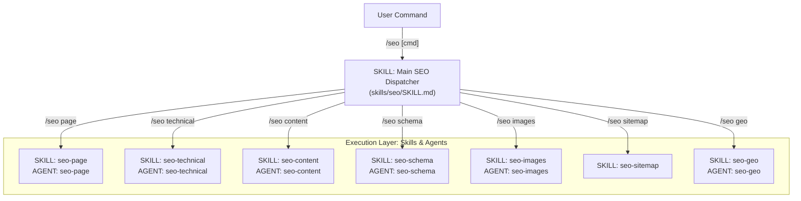
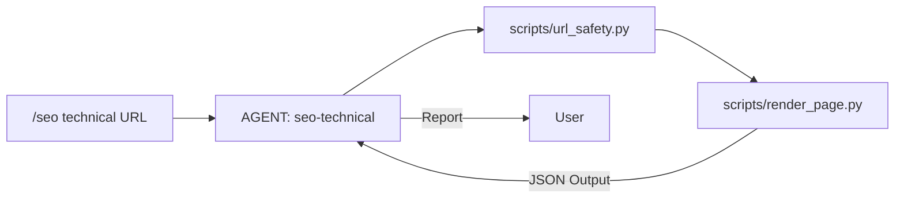

<!-- source: DeepWiki mcp.deepwiki.com · repo AgriciDaniel/claude-seo · page 3.2 Individual Analysis Commands · fetched 2026-10-26 -->

# Individual Analysis Commands

Relevant source files

The following files were used as context for generating this wiki page:

- [skills/seo-competitor-pages/SKILL.md](skills/seo-competitor-pages/SKILL.md)
- [skills/seo-content/SKILL.md](skills/seo-content/SKILL.md)
- [skills/seo-geo/SKILL.md](skills/seo-geo/SKILL.md)
- [skills/seo-hreflang/SKILL.md](skills/seo-hreflang/SKILL.md)
- [skills/seo-image-gen/SKILL.md](skills/seo-image-gen/SKILL.md)
- [skills/seo-images/SKILL.md](skills/seo-images/SKILL.md)
- [skills/seo-local/SKILL.md](skills/seo-local/SKILL.md)
- [skills/seo-maps/SKILL.md](skills/seo-maps/SKILL.md)
- [skills/seo-page/SKILL.md](skills/seo-page/SKILL.md)
- [skills/seo-plan/SKILL.md](skills/seo-plan/SKILL.md)
- [skills/seo-programmatic/SKILL.md](skills/seo-programmatic/SKILL.md)
- [skills/seo-schema/SKILL.md](skills/seo-schema/SKILL.md)
- [skills/seo-sitemap/SKILL.md](skills/seo-sitemap/SKILL.md)
- [skills/seo-technical/SKILL.md](skills/seo-technical/SKILL.md)

This page documents the focused SEO analysis commands that target specific domains: technical infrastructure, content quality, schema markup, images, AI search optimization (GEO), sitemaps, and single-page deep dives. These commands route directly to specialized sub-skills and agents without the full parallel orchestration used by `/seo audit`.

---

## Command Routing and Execution Architecture

When an individual analysis command is invoked, the system uses a dispatcher model to route the request to the specific skill and agent responsible for that domain.

### System Entity Mapping

**Sources:** [skills/seo-page/SKILL.md:1-15](), [skills/seo-technical/SKILL.md:1-15](), [skills/seo-content/SKILL.md:1-14](), [skills/seo-schema/SKILL.md:1-14](), [skills/seo-geo/SKILL.md:1-18]()

---

## `/seo page` — Single-Page Deep Analysis

### Purpose
Performs a comprehensive audit of a single URL by aggregating checks from technical, content, schema, and image domains.

### Data Flow & Processing
The `seo-page` skill uses `python scripts/render_page.py` with `--mode auto` to retrieve content. It prioritizes:
1.  **On-Page SEO**: Title (50-60 chars), Meta Description (150-160 chars), H1 presence [skills/seo-page/SKILL.md:22-24]().
2.  **Content Quality**: Readability scoring (Flesch Reading Ease) and E-E-A-T signals [skills/seo-page/SKILL.md:30-35]().
3.  **Image Audit**: Reporting `lazy_method` (native, perfmatters, ewww, etc.) to avoid false negatives on JS-based lazy loaders [skills/seo-page/SKILL.md:55]().

**Sources:** [skills/seo-page/SKILL.md:17-61]()

---

## `/seo technical` — Technical SEO Audit

### Purpose
Audits 9 categories of technical infrastructure, including crawlability, security, and JavaScript rendering.

### Key Implementation Details
- **JS Rendering**: Detects CSR vs SSR. As of Dec 2025, it flags content that requires JS execution [skills/seo-technical/SKILL.md:28-30]().
- **Core Web Vitals**: LCP (target ≤2.5s) and INP (target ≤200ms). INP replaced FID as the primary interactivity metric in March 2024 [skills/seo-technical/SKILL.md:114-117]().
- **AI Crawler Management**: Checks `robots.txt` for tokens like `GPTBot`, `ClaudeBot`, and `Google-Extended` [skills/seo-technical/SKILL.md:34-49]().
- **Security**: Flags "Back-button hijacking" (spam policy violation) as a Critical issue [skills/seo-technical/SKILL.md:93-94]().

### Technical Data Flow

**Sources:** [skills/seo-technical/SKILL.md:17-135]()

---

## `/seo content` — E-E-A-T & Quality Analysis

### Purpose
Evaluates content based on Google’s September 2025 Quality Rater Guidelines (QRG).

### Evaluation Framework
- **The "Who/How/Why" Test**: Checks for visible bylines (Who), process disclosure for AI content (How), and people-first intent (Why) [skills/seo-content/SKILL.md:18-27]().
- **E-E-A-T Scoring**: Evaluates Experience (first-hand signals), Expertise, Authoritativeness, and Trustworthiness [skills/seo-content/SKILL.md:36-64]().
- **Topical Floors**: Enforces minimum word counts (e.g., 1,500 for blog posts) as coverage guidelines, not rigid ranking factors [skills/seo-content/SKILL.md:67-77]().
- **AI Citation Readiness**: Assesses clear, quotable statements and structured answers for AI search visibility [skills/seo-content/SKILL.md:139-156]().

**Sources:** [skills/seo-content/SKILL.md:16-156]()

---

## `/seo schema` — Structured Data Management

### Purpose
Detects, validates, and generates Schema.org markup in JSON-LD format.

### Rules and Deprecations (June 2026)
- **Active**: `Organization`, `LocalBusiness`, `Product` (with Certification markup), `DiscussionForumPosting` [skills/seo-schema/SKILL.md:42-43]().
- **Retired/Restricted**: `FAQPage` rich results were retired for ALL sites on May 7, 2026. `QAPage` is recommended for genuine Q&A [skills/seo-schema/SKILL.md:53-54]().
- **Deprecated**: `HowTo` (Sept 2023), `SpecialAnnouncement` (July 2025), and `Practice Problem` (Jan 2026) are no longer recommended [skills/seo-schema/SKILL.md:55-63]().

**Sources:** [skills/seo-schema/SKILL.md:16-173]()

---

## `/seo images` — Image Optimization

### Purpose
Analyzes image performance and SEO, focusing on formats, lazy loading, and CLS prevention.

### Technical Thresholds
- **Format Strategy**: Prefers AVIF (92%+ support) and WebP (97%+ support) over JPEG/PNG [skills/seo-images/SKILL.md:51-60]().
- **Performance**: Flags `loading="lazy"` on above-the-fold/hero images as a critical error that harms LCP [skills/seo-images/SKILL.md:132]().
- **Lazy Method Detection**: Differentiates between `native`, `perfmatters`, `ewww`, and `js-generic` loaders [skills/seo-images/SKILL.md:107-119]().
- **LCP Optimization**: Recommends `fetchpriority="high"` for hero images [skills/seo-images/SKILL.md:124-126]().

**Sources:** [skills/seo-images/SKILL.md:19-196]()

---

## `/seo geo` — AI Search Optimization

### Purpose
Optimizes for Generative Engine Optimization (GEO) and AI citation in platforms like ChatGPT, Perplexity, and Google AI Overviews.

### GEO Analysis Criteria
The `seo-geo` skill evaluates content across five dimensions [skills/seo-geo/SKILL.md:68-146]:
1.  **Citability Score (25%)**: Optimal passage length is **134-167 words**. Front-load answers in the first 30% of the page [skills/seo-geo/SKILL.md:70-74]().
2.  **Structural Readability (20%)**: Uses question-based headings and short paragraphs [skills/seo-geo/SKILL.md:90-100]().
3.  **Authority & Brand Signals (20%)**: Brand mentions correlate 3x more strongly with AI visibility than backlinks. Recency is critical (under 3 months) [skills/seo-geo/SKILL.md:51-62, 124]().
4.  **Technical Accessibility (20%)**: AI crawlers do NOT execute JavaScript; Server-Side Rendering (SSR) is critical [skills/seo-geo/SKILL.md:137-142]().
5.  **Multi-Modal Content (15%)**: Text combined with relevant images or video increases selection rates by 156% [skills/seo-geo/SKILL.md:108-117]().

**Sources:** [skills/seo-geo/SKILL.md:20-170]()

---

## `/seo sitemap` — Analysis & Generation

### Purpose
Validates existing XML sitemaps or generates new ones using industry-specific templates.

### Validation and Quality Gates
- **Scale Limits**: Enforces a per-file limit of **≤50,000 URLs AND ≤50MB uncompressed** [skills/seo-sitemap/SKILL.md:34]().
- **Generation Safeguards**: Triggers a **WARNING** at 30+ location pages and a **HARD STOP** at 50+ pages to prevent Scaled Content Abuse [skills/seo-sitemap/SKILL.md:90-91]().
- **Freshness**: Validates `<lastmod>` against W3C Datetime standards [skills/seo-sitemap/SKILL.md:36-38]().

**Sources:** [skills/seo-sitemap/SKILL.md:18-135]()

---

