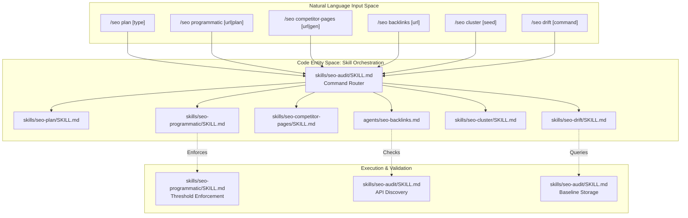
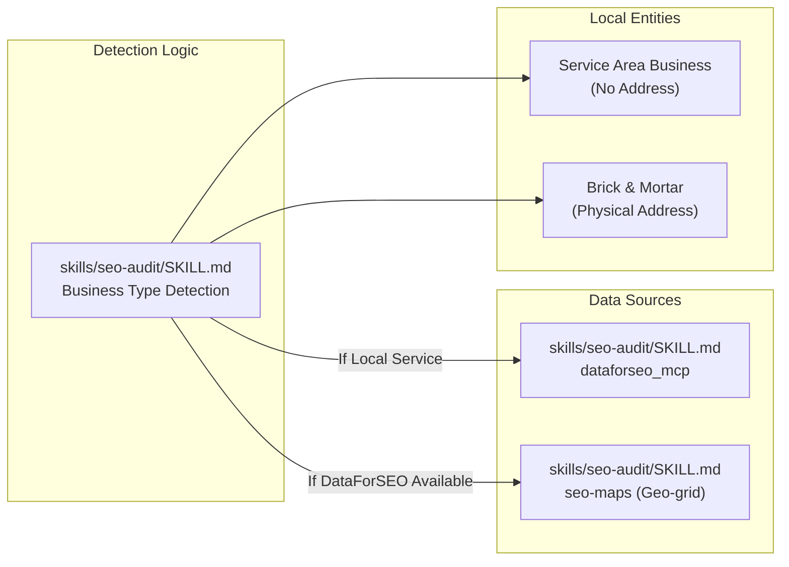

<!-- source: DeepWiki mcp.deepwiki.com · repo AgriciDaniel/claude-seo · page 3.3 Strategic Planning Commands · fetched 2026-10-26 -->

# Strategic Planning Commands

Relevant source files

The following files were used as context for generating this wiki page:

- [agents/seo-backlinks.md](agents/seo-backlinks.md)
- [agents/seo-geo.md](agents/seo-geo.md)
- [agents/seo-local.md](agents/seo-local.md)
- [skills/seo-audit/SKILL.md](skills/seo-audit/SKILL.md)
- [skills/seo-cluster/SKILL.md](skills/seo-cluster/SKILL.md)
- [skills/seo-competitor-pages/SKILL.md](skills/seo-competitor-pages/SKILL.md)
- [skills/seo-drift/SKILL.md](skills/seo-drift/SKILL.md)
- [skills/seo-ecommerce/SKILL.md](skills/seo-ecommerce/SKILL.md)
- [skills/seo-flow/SKILL.md](skills/seo-flow/SKILL.md)
- [skills/seo-hreflang/SKILL.md](skills/seo-hreflang/SKILL.md)
- [skills/seo-plan/SKILL.md](skills/seo-plan/SKILL.md)
- [skills/seo-programmatic/SKILL.md](skills/seo-programmatic/SKILL.md)
- [skills/seo-schema/SKILL.md](skills/seo-schema/SKILL.md)
- [skills/seo-sitemap/SKILL.md](skills/seo-sitemap/SKILL.md)
- [skills/seo-sxo/SKILL.md](skills/seo-sxo/SKILL.md)

This document covers the strategic planning commands in the `claude-seo` system: `/seo plan`, `/seo programmatic`, `/seo competitor-pages`, `/seo hreflang`, `/seo cluster`, `/seo drift`, `/seo backlinks`, and `/seo maps`. These commands focus on high-level strategy, content architecture, competitive positioning, and multi-channel intelligence.

---

## Overview of Strategic Planning Commands

Strategic planning commands operate at a higher abstraction level than individual page analysis. While analysis commands inspect existing assets (e.g., `/seo page`), strategic commands design and audit initiatives spanning multiple pages, domains, or historical timelines.

### Strategic Command Architecture

Title: Strategic Command Routing and Data Flow

**Sources:** [skills/seo-audit/SKILL.md:20-35](), [skills/seo-programmatic/SKILL.md:74-82]()

---

## `/seo plan` — Business-Type Strategy

Generates tailored SEO strategy recommendations based on detected or specified business models.

### Industry Templates
The command loads industry-specific configurations from `skills/seo-plan/assets/` to tailor recommendations:
*   **SaaS**: Focuses on `/features`, `/integrations`, and `/docs` [skills/seo-plan/SKILL.md:85-85]().
*   **Local Service**: Prioritizes NAP consistency and service area pages [skills/seo-plan/SKILL.md:86-86]().
*   **E-commerce**: Focuses on product variants and shipping schema [skills/seo-plan/SKILL.md:87-87]().
*   **Publisher**: Prioritizes article schema and author E-E-A-T [skills/seo-plan/SKILL.md:88-88]().

**Sources:** [skills/seo-plan/SKILL.md:1-126]()

---

## `/seo programmatic` — Scaled Content Strategy

Builds and audits pages generated at scale from structured data (CSV, JSON, APIs).

### Quality Gate Enforcement
The system enforces strict thresholds to prevent "Scaled Content Abuse" penalties (March 2024 policy) [skills/seo-programmatic/SKILL.md:83-89]().

| Metric | Threshold | Action |
| :--- | :--- | :--- |
| Pages without content review | 100+ | ⚠️ WARNING: require content audit [skills/seo-programmatic/SKILL.md:78-78]() |
| Pages without justification | 500+ | 🛑 HARD STOP: require user approval [skills/seo-programmatic/SKILL.md:79-79]() |
| Unique content per page | <40% | ❌ Flag as thin content [skills/seo-programmatic/SKILL.md:80-80]() |
| Uniqueness for safety | <30% | 🛑 HARD STOP: Scaled Content Abuse risk [skills/seo-programmatic/SKILL.md:98-98]() |

### Implementation Patterns
*   **URL Strategy**: Recommends patterns like `/[city]/[service]` or `/tools/[name]` [skills/seo-programmatic/SKILL.md:48-54]().
*   **Uniqueness Calculation**: `(words unique to page) / (total words) * 100` [skills/seo-programmatic/SKILL.md:115-115]().

**Sources:** [skills/seo-programmatic/SKILL.md:1-140]()

---

## `/seo cluster` — Semantic Topic Architecture

Performs SERP-overlap-driven keyword clustering to design hub-and-spoke site architectures.

### Clustering Methodology
Unlike text-similarity clustering, `seo-cluster` uses actual Google SERP overlap (top 10 organic results) to group keywords [skills/seo-cluster/SKILL.md:23-26]().

| Shared Results | Relationship | Action |
| :--- | :--- | :--- |
| 7-10 | Same post | Merge into single target page [skills/seo-cluster/SKILL.md:72-72]() |
| 4-6 | Same cluster | Group under same spoke cluster [skills/seo-cluster/SKILL.md:73-73]() |
| 2-3 | Interlink | Place in adjacent clusters, add cross-links [skills/seo-cluster/SKILL.md:74-74]() |
| 0-1 | Separate | Assign to different clusters or exclude [skills/seo-cluster/SKILL.md:75-75]() |

### Internal Link Matrix
The skill generates a mandatory bidirectional linking structure [skills/seo-cluster/SKILL.md:132-140]():
*   **Spoke to Pillar**: Mandatory for every spoke [skills/seo-cluster/SKILL.md:137-137]().
*   **Pillar to Spoke**: Mandatory for every spoke [skills/seo-cluster/SKILL.md:138-138]().
*   **Spoke to Spoke**: 2-3 links per post within the same cluster [skills/seo-cluster/SKILL.md:139-139]().

**Sources:** [skills/seo-cluster/SKILL.md:1-173]()

---

## `/seo hreflang` — Internationalization

Validates and generates tags for multi-language/region sites.

### Validation Rules
*   **Return Tags**: Every relationship must be bidirectional (A→B and B→A); missing tags invalidate the signal [skills/seo-hreflang/SKILL.md:31-33]().
*   **Self-Referencing**: Every page must point to itself; missing this causes Google to ignore the set [skills/seo-hreflang/SKILL.md:25-28]().
*   **x-default**: Designates fallback for unmatched regions [skills/seo-hreflang/SKILL.md:37-40]().
*   **Code Validation**: Enforces ISO 639-1 for languages and ISO 3166-1 Alpha-2 for regions [skills/seo-hreflang/SKILL.md:42-53]().

**Sources:** [skills/seo-hreflang/SKILL.md:1-152]()

---

## `/seo competitor-pages` — Comparison Strategy

Generates "X vs Y" and "Alternatives to X" layouts with high-converting feature matrices.

### Implementation Requirements
*   **Schema**: Recommends `Product` schema with `AggregateRating` [skills/seo-competitor-pages/SKILL.md:67-86]() and `ItemList` for roundup pages [skills/seo-competitor-pages/SKILL.md:104-121]().
*   **Fairness**: Requires verifiable public data and "as of [date]" pricing disclaimers to maintain E-E-A-T and legal compliance [skills/seo-competitor-pages/SKILL.md:173-183]().
*   **Layout**: Prioritizes value advantages over just lowest price [skills/seo-competitor-pages/SKILL.md:163-163]().

**Sources:** [skills/seo-competitor-pages/SKILL.md:1-208]()

---

## `/seo maps` & `/seo local` — Geo-Intelligence

Focuses on Local Pack (Map Pack) performance and Google Business Profile (GBP) optimization.

### Local Ranking Factors
The system weights analysis based on modern local ranking signals [agents/seo-local.md:26-36]():
*   **GBP Primary Category**: Identified as the most critical local factor [agents/seo-local.md:85-85]().
*   **Review Velocity**: The "18-day rule"—potential rankings drop if no new reviews are acquired for 3 weeks [agents/seo-local.md:90]().
*   **Proximity**: Weighted at ~55% of ranking variance [agents/seo-local.md:29-29]().

### Local Data Integration
Title: Local SEO Data Orchestration

**Sources:** [skills/seo-audit/SKILL.md:28-29](), [agents/seo-local.md:40-60]()

---

## `/seo drift` — Temporal Monitoring

Captures and compares site states to monitor ranking or technical decay.

*   **Baseline**: Triggered when a drift baseline exists for a URL via `claude-seo run drift_history.py <url>` [skills/seo-audit/SKILL.md:34-34]().
*   **Comparison**: Compares current technical and content metrics against the stored baseline to identify lost schema, metadata changes, or performance drops.

**Sources:** [skills/seo-audit/SKILL.md:34-34]()

---

