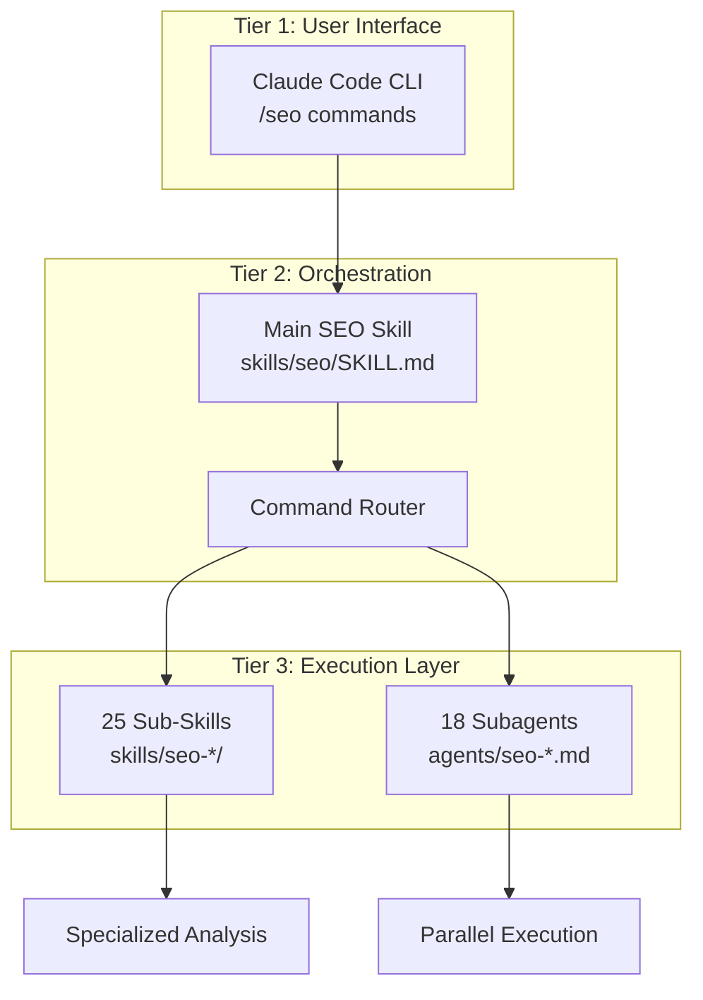
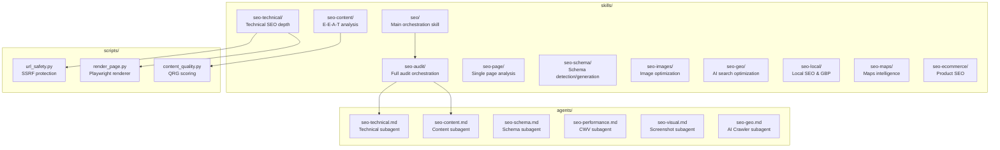
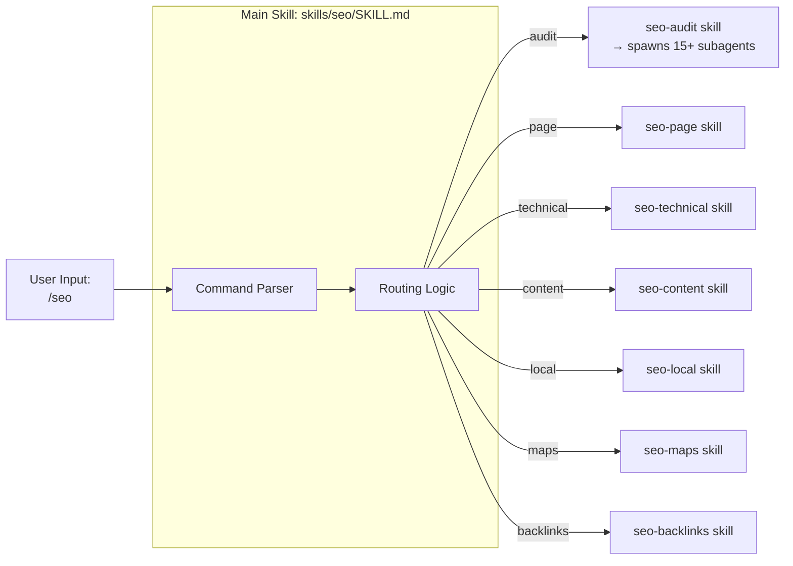
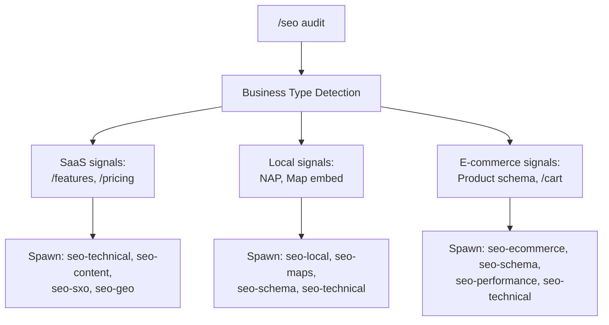

<!-- source: DeepWiki mcp.deepwiki.com · repo AgriciDaniel/claude-seo · page 4 System Architecture · fetched 2026-10-26 -->

# System Architecture

Relevant source files

The following files were used as context for generating this wiki page:

- [.claude-plugin/marketplace.json](.claude-plugin/marketplace.json)
- [.claude-plugin/plugin.json](.claude-plugin/plugin.json)
- [CHANGELOG.md](CHANGELOG.md)
- [CLAUDE.md](CLAUDE.md)
- [README.md](README.md)

This document describes the internal architecture of the claude-seo system, including the orchestration layer, skill delegation model, subagent parallelization, and data flow patterns. For installation and configuration details, see [Getting Started](#2). For command-specific behavior, see [Command Reference](#3). For details on the skill and subagent models, see [Skill and Subagent Model](#4.1).

## Architectural Overview

The claude-seo system implements a **three-tier architecture** that separates user interaction, command orchestration, and specialized analysis:

**Tier 1 (User Interface)**: Users invoke commands through the Claude Code CLI using the `/seo` command prefix. All commands route through the main skill.

**Tier 2 (Orchestration)**: The main skill at `skills/seo/SKILL.md` receives commands, parses arguments, and dispatches to appropriate sub-skills or subagents. The orchestration layer handles business type detection, quality gate enforcement, and result aggregation.

**Tier 3 (Execution)**: Specialized sub-skills perform focused analysis (technical, content, schema, etc.), while subagents execute in parallel during comprehensive audits.

**Sources**: [CLAUDE.md:5-16](), [skills/seo/SKILL.md:1-28]()

## File System Layout

The system distributes its components across the Claude Code skill and agent directories with a predictable naming convention. As of v2.2.4, the codebase includes 25 sub-skills and 18 sub-agents [CLAUDE.md:7-9]().

| Component | Path | Count | Purpose |
|-----------|------|-------|---------|
| Main Skill | `skills/seo/` | 1 | Command parsing, routing, business detection |
| Sub-skills | `skills/seo-*/` | 25 | Specialized domain analysis [CLAUDE.md:26-66]() |
| Sub-agents | `agents/` | 18 | Specialized workers with tool access [CLAUDE.md:67-85]() |
| Reference Files | `skills/*/references/` | 30+ | On-demand knowledge base files [CLAUDE.md:29]() |
| Core Scripts | `scripts/` | 53 | Python-based execution logic [CLAUDE.md:88-140]() |

**Sources**: [CLAUDE.md:16-85](), [.claude-plugin/plugin.json:3-4]()

## Command Routing and Dispatch

The main skill implements a command router that maps `/seo` subcommands to execution targets:

### Command-to-Skill Mapping

| Command | Target Skill | Execution Pattern |
|---------|--------------|-------------------|
| `/seo audit` | `seo-audit/` | Parallel (up to 15 specialists) [README.md:21]() |
| `/seo page` | `seo-page/` | Sequential deep-dive [README.md:130]() |
| `/seo technical` | `seo-technical/` | 9-category technical audit [CLAUDE.md:32]() |
| `/seo content` | `seo-content/` | E-E-A-T and QRG evaluation [CLAUDE.md:33]() |
| `/seo maps` | `seo-maps/` | Geo-grid and GBP intelligence [CLAUDE.md:40]() |
| `/seo geo` | `seo-geo/` | AI search optimization [CLAUDE.md:38]() |

The `/seo audit` command is the primary entry point for parallel execution, spawning up to 15 specialist agents simultaneously [README.md:21]().

**Sources**: [README.md:120-140](), [CLAUDE.md:26-66]()

## Business Type Detection

The orchestration layer identifies the business type from homepage signals to conditionally spawn relevant subagents. For details, see [Business Type Detection](#4.2).

**Sources**: [CLAUDE.md:13-14](), [README.md:34-36]()

## Orchestration Workflow

The orchestration logic follows a strict hierarchy. The `seo` skill acts as the Directive layer, `seo-audit` as Orchestration, and the subagents as Execution.

1.  **Directive**: User issues command to `seo/SKILL.md`.
2.  **Orchestration**: `seo-audit` analyzes the URL, detects the business type, and creates a task list.
3.  **Execution**: Specialized subagents (e.g., `seo-technical.md`) run Python scripts like `scripts/render_page.py` or `scripts/fetch_page.py` [CLAUDE.md:105-106]().
4.  **Aggregation**: Findings are collected into a unified prioritized action plan [README.md:5]().

**Sources**: [CLAUDE.md:5-14](), [README.md:5-22]()

## Quality Control and Safety

The system architecture includes a mandatory safety and quality layer. For details, see [Quality Control System](#4.3).

*   **SSRF Protection**: The system uses hardened SSRF/DNS-rebinding safe fetchers via `scripts/url_safety.py` [CLAUDE.md:117]() and [.claude-plugin/plugin.json:4]().
*   **Validation Hooks**: The `hooks/hooks.json` file defines `PostToolUse` validation, ensuring that any file edits (like schema generation) adhere to strict standards via `hooks/validate-schema.py` [CLAUDE.md:86-87]().
*   **Portability**: The `scripts/portability_check.py` script ensures that frontmatter remains compatible across platforms [CHANGELOG.md:27]().

**Sources**: [CHANGELOG.md:41-44](), [CLAUDE.md:86-87](), [CLAUDE.md:117]()

## External Integrations

The system extends its capabilities via MCP (Model Context Protocol) servers and external APIs. For details, see [External Integrations](#4.4).

*   **MCP Extensions**: 8 optional MCP extensions are supported, including DataForSEO, Firecrawl, Banana, Ahrefs, SE Ranking, Profound, Bing Webmaster, and Unlighthouse [.claude-plugin/marketplace.json:8]().
*   **Direct APIs**: The system interfaces directly with Google Search Console (`gsc_query.py`), PageSpeed Insights (`pagespeed_check.py`), and Moz (`moz_api.py`) [CLAUDE.md:91-98]().
*   **Headless Rendering**: `scripts/render_page.py` provides SPA-aware rendering for all subagents requiring JavaScript execution [CHANGELOG.md:34-35]().

**Sources**: [CLAUDE.md:88-115](), [.claude-plugin/marketplace.json:8](), [CHANGELOG.md:15-31]()

## Detailed Sub-Architecture Pages

- [Skill and Subagent Model](#4.1) — 18 agents and 25 sub-skills hierarchy, task delegation, and the SKILL.md contract.
- [Business Type Detection](#4.2) — Conditional spawning based on homepage signals (SaaS, Local, Ecommerce, etc.).
- [Quality Control System](#4.3) — SSRF protection, validation hooks, and portability checks.
- [External Integrations](#4.4) — MCP servers, Google APIs, and SEO data flow.

---

