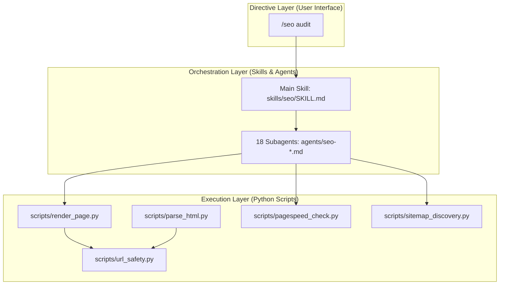
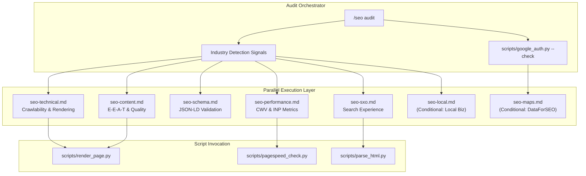

<!-- source: DeepWiki mcp.deepwiki.com · repo AgriciDaniel/claude-seo · page 4.1 Skill and Subagent Model · fetched 2026-10-26 -->

# Skill and Subagent Model

Relevant source files

The following files were used as context for generating this wiki page:

- [.github/workflows/ci.yml](.github/workflows/ci.yml)
- [AGENTS.md](AGENTS.md)
- [agents/seo-content.md](agents/seo-content.md)
- [agents/seo-ecommerce.md](agents/seo-ecommerce.md)
- [agents/seo-performance.md](agents/seo-performance.md)
- [agents/seo-schema.md](agents/seo-schema.md)
- [agents/seo-sxo.md](agents/seo-sxo.md)
- [agents/seo-technical.md](agents/seo-technical.md)
- [agents/seo-visual.md](agents/seo-visual.md)
- [extensions/firecrawl/skills/seo-firecrawl/SKILL.md](extensions/firecrawl/skills/seo-firecrawl/SKILL.md)
- [scripts/google_report.py](scripts/google_report.py)
- [scripts/portability_check.py](scripts/portability_check.py)
- [skills/seo-backlinks/SKILL.md](skills/seo-backlinks/SKILL.md)
- [skills/seo/SKILL.md](skills/seo/SKILL.md)
- [tests/test_audit_instructions.py](tests/test_audit_instructions.py)
- [tests/test_portability.py](tests/test_portability.py)

## Purpose and Scope

This document explains the skill and subagent architecture that powers the `claude-seo` system. It covers the 3-layer hierarchy (Directive/Orchestration/Execution), the 18 subagents and 25 sub-skills architecture, parallel processing, task delegation, and the `SKILL.md` frontmatter contract that ensures cross-platform portability.

For details on business type detection logic, see [Business Type Detection](4.2). For quality control mechanisms enforced during execution, see [Quality Control System](4.3). For external data integrations used by skills and subagents, see [External Integrations](4.4).

---

## Skills vs Subagents: Two Execution Models

The `claude-seo` system employs two distinct execution models that serve different architectural purposes:

**Skills** are the native plugin mechanism. Each skill is a self-contained directory with a `SKILL.md` manifest that defines its name, description, trigger phrases, and allowed tools [skills/seo/SKILL.md:1-11](). Skills execute synchronously within the main session. The main `seo` skill acts as an orchestrator, routing commands to 25 specialized sub-skills based on command syntax [skills/seo/SKILL.md:23-25]().

**Subagents** are parallel worker processes spawned for concurrent analysis. Each subagent is defined by a markdown file in `agents/` with YAML frontmatter specifying its role, capabilities, and tool permissions [agents/seo-technical.md:1-7](). Subagents execute independently and return structured results to the parent skill for aggregation. Only the `/seo audit` command uses subagents—all other commands execute through direct skill invocation [skills/seo/SKILL.md:70-72]().

**Key Distinction**: Skills enable modular command routing and code reuse. Subagents enable parallel data collection and analysis. The audit workflow uses both: the `seo` skill spawns subagents, which may delegate back to skills or scripts for specific analysis tasks [skills/seo/SKILL.md:72-84]().

**Sources**: [skills/seo/SKILL.md:23-25](), [skills/seo/SKILL.md:70-72](), [AGENTS.md:57-59](), [agents/seo-technical.md:1-7]()

---

## 3-Layer Hierarchy

The architecture follows a strict 3-layer model to manage complexity:

1.  **Directive Layer (Natural Language Space)**: The user intent expressed through commands like `/seo audit` or `/seo page` [skills/seo/SKILL.md:15]().
2.  **Orchestration Layer (Code Entity Space)**: The `seo` skill ([skills/seo/SKILL.md]()) and the subagents in `agents/` that handle industry detection, spawning, and result synthesis [skills/seo/SKILL.md:70-86]().
3.  **Execution Layer (Script Space)**: The 53+ Python scripts in `scripts/` that perform the actual work (e.g., `render_page.py`, `pagespeed_check.py`) [AGENTS.md:59]().

### Hierarchy Mapping Diagram

**Sources**: [skills/seo/SKILL.md:15-25](), [skills/seo/SKILL.md:70-86](), [AGENTS.md:57-59](), [agents/seo-technical.md:12-19]()

---

## Parallel Subagent Execution Model

The `/seo audit` command implements a unique parallel processing architecture. When invoked, the system spawns independent subagents that analyze different aspects of the site concurrently [skills/seo/SKILL.md:72-84]().

### Parallel Execution Flow

**Execution Characteristics**:
*   **Concurrency**: Subagents run in parallel to minimize wall-clock time for full audits [skills/seo/SKILL.md:72]().
*   **Conditional Spawning**: Agents like `seo-local`, `seo-maps`, `seo-backlinks`, or `seo-ecommerce` are only spawned if specific signals or credentials are detected [skills/seo/SKILL.md:75-82]().
*   **Tool Isolation**: Each agent specifies its own toolset (e.g., `seo-technical` requires `Read, Bash, Write, Glob, Grep` [agents/seo-technical.md:6]()).

**Sources**: [skills/seo/SKILL.md:70-84](), [agents/seo-technical.md:1-7](), [agents/seo-performance.md:1-7]()

---

## The SKILL.md Frontmatter Contract

To ensure cross-platform portability across Claude Code, Cursor, and Gemini CLI, every skill follows a strict frontmatter contract [AGENTS.md:10-23](). This is validated via `scripts/portability_check.py` [AGENTS.md:16]().

### Manifest Structure

| Field | Purpose | Example |
| :--- | :--- | :--- |
| `name` | Unique identifier for the skill | `seo-technical` [agents/seo-technical.md:2]() |
| `description` | Trigger logic and system role | "Technical SEO specialist..." [agents/seo-technical.md:3]() |
| `model` | Recommended LLM for this task | `sonnet` [agents/seo-technical.md:4]() |
| `maxTurns` | Safety limit for agent loops | `20` [agents/seo-technical.md:5]() |
| `tools` | List of allowed capability tools | `Read, Bash, Write, Glob, Grep` [agents/seo-technical.md:6]() |

**Sources**: [AGENTS.md:10-23](), [agents/seo-technical.md:1-7](), [.github/workflows/ci.yml:26-27]()

---

## Task Delegation and Synthesis

The system uses a 10-principle thinking framework grouped into four phases: **PERCEIVE**, **ANALYZE**, **VALIDATE**, and **ACT** [skills/seo/SKILL.md:95-98]().

### Synthesis Methodology
*   **PERCEIVE**: Observation of signals using `scripts/render_page.py` [skills/seo/SKILL.md:96]().
*   **ANALYZE**: Lateral and systemic thinking performed by specialized agents like `seo-sxo` [agents/seo-sxo.md:14-17]().
*   **VALIDATE**: Quality gate enforcement and falsifiability checks [skills/seo/SKILL.md:97]().
*   **ACT**: Creation of a prioritized action plan with dependency sequencing [skills/seo/SKILL.md:86]().

### Weighted Scoring
Results are synthesized into a unified SEO Health Score (0-100) [skills/seo/SKILL.md:84](). Subagents also maintain internal scoring models, such as the E-E-A-T breakdown:
*   **Experience**: 20% [agents/seo-content.md:25]()
*   **Expertise**: 25% [agents/seo-content.md:26]()
*   **Authoritativeness**: 25% [agents/seo-content.md:27]()
*   **Trustworthiness**: 30% [agents/seo-content.md:28]()

**Sources**: [skills/seo/SKILL.md:84-86](), [skills/seo/SKILL.md:92-104](), [agents/seo-content.md:21-30]()

---

## Implementation Details: Script Layer

Agents invoke a suite of 53+ Python scripts to interface with the real world. All scripts must be run through the `claude-seo` launcher to ensure environment isolation [skills/seo/SKILL.md:17-20]().

| Agent | Primary Script | Role |
| :--- | :--- | :--- |
| `seo-technical` | `scripts/render_page.py` | Renders JS-heavy sites using Playwright; includes SSRF protection [agents/seo-technical.md:58](). |
| `seo-performance`| `scripts/pagespeed_check.py` | Fetches lab/field data from PageSpeed Insights API [agents/seo-performance.md:70](). |
| `seo-schema` | `scripts/render_page.py` | Extracts `structured_data` summary for JSON-LD detection [agents/seo-schema.md:73](). |
| `seo-backlinks` | `scripts/backlinks_auth.py` | Detects and verifies credentials for Moz, Bing, and DataForSEO [skills/seo-backlinks/SKILL.md:26](). |
| `seo-ecommerce` | `scripts/dataforseo_costs.py` | Enforces cost guardrails before calling Merchant APIs [agents/seo-ecommerce.md:28-31](). |

**Sources**: [skills/seo/SKILL.md:17-20](), [agents/seo-technical.md:56-58](), [agents/seo-performance.md:68-70](), [agents/seo-ecommerce.md:28-35](), [skills/seo-backlinks/SKILL.md:16-26]()

---

