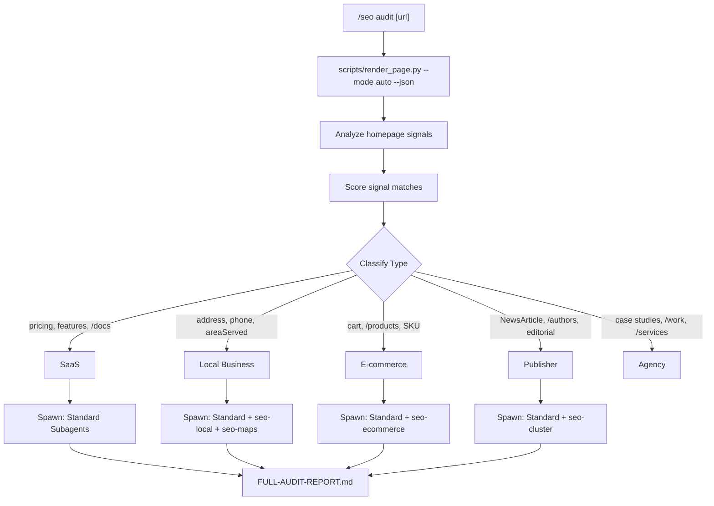
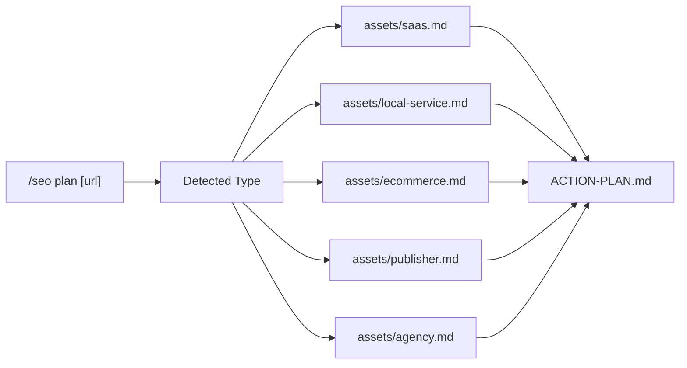
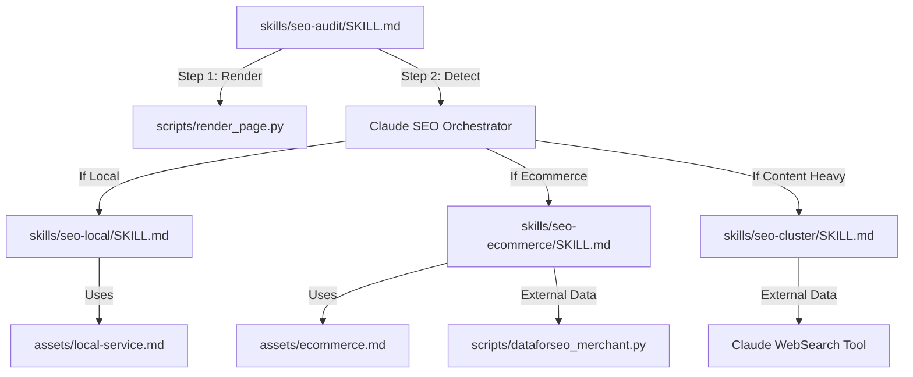

<!-- source: DeepWiki mcp.deepwiki.com · repo AgriciDaniel/claude-seo · page 4.2 Business Type Detection · fetched 2026-10-26 -->

# Business Type Detection

Relevant source files

The following files were used as context for generating this wiki page:

- [skills/seo-audit/SKILL.md](skills/seo-audit/SKILL.md)
- [skills/seo-cluster/SKILL.md](skills/seo-cluster/SKILL.md)
- [skills/seo-drift/SKILL.md](skills/seo-drift/SKILL.md)
- [skills/seo-ecommerce/SKILL.md](skills/seo-ecommerce/SKILL.md)
- [skills/seo-flow/SKILL.md](skills/seo-flow/SKILL.md)
- [skills/seo-plan/assets/agency.md](skills/seo-plan/assets/agency.md)
- [skills/seo-plan/assets/ecommerce.md](skills/seo-plan/assets/ecommerce.md)
- [skills/seo-plan/assets/generic.md](skills/seo-plan/assets/generic.md)
- [skills/seo-plan/assets/local-service.md](skills/seo-plan/assets/local-service.md)
- [skills/seo-plan/assets/publisher.md](skills/seo-plan/assets/publisher.md)
- [skills/seo-plan/assets/saas.md](skills/seo-plan/assets/saas.md)
- [skills/seo-sxo/SKILL.md](skills/seo-sxo/SKILL.md)

## Purpose and Scope

This document explains how the `claude-seo` system automatically identifies the business model of a target website (SaaS, Local Business, E-commerce, Publisher, or Agency) and uses this classification to tailor all subsequent SEO analysis. Business type detection occurs at the beginning of every audit workflow and determines which analysis rules, quality thresholds, and specialized subagents are conditionally spawned.

For information about how detected business types influence quality enforcement, see [4.3 Quality Control System](). For details on business-specific strategic planning templates, see [3.3 Strategic Planning Commands]().

**Sources:** [skills/seo-audit/SKILL.md:17-18](), [skills/seo-audit/SKILL.md:68-68]()

---

## Overview of Business Type Classification

The system classifies websites into primary business types. Each business type has distinct SEO priorities, quality thresholds, and schema requirements.

### Business Type Taxonomy

| Business Type | Primary SEO Focus | Key Subagents | Schema Priorities |
|---------------|-------------------|---------------|-------------------|
| **SaaS** | Feature depth, integrations, pricing transparency | `seo-technical`, `seo-content` | `SoftwareApplication`, `Product`, `Offer` |
| **Local Business** | NAP consistency, GBP signals, local authority | `seo-local`, `seo-maps` | `LocalBusiness`, `Service`, `GeoCoordinates` |
| **E-commerce** | Product catalog, marketplace visibility, shopping ads | `seo-ecommerce`, `seo-backlinks` | `Product`, `Offer`, `ProductGroup`, `OfferShippingDetails` |
| **Publisher** | Content freshness, E-E-A-T, semantic clustering | `seo-content`, `seo-cluster` | `Article`, `NewsArticle`, `Person`, `ProfilePage` |
| **Agency** | Case studies, portfolio social proof, services | `seo-content`, `seo-sxo` | `ProfessionalService`, `Service`, `ProfilePage` |

**Sources:** [skills/seo-audit/SKILL.md:21-35](), [skills/seo-plan/assets/saas.md:79-86](), [skills/seo-plan/assets/ecommerce.md:48-60](), [skills/seo-plan/assets/local-service.md:60-67](), [skills/seo-plan/assets/publisher.md:41-49](), [skills/seo-plan/assets/agency.md:49-55]()

---

## Detection Mechanism

### Signal-Based Detection Process

Business type detection operates as a multi-signal classifier that analyzes the target website's homepage and primary navigation structure. The detection occurs during the `seo-audit` process after fetching the initial page using `render_page.py`.

**Diagram: Business Type Detection Flow**

**Sources:** [skills/seo-audit/SKILL.md:17-35](), [skills/seo-ecommerce/SKILL.md:44-48](), [skills/seo-sxo/SKILL.md:46-50]()

### Detection Signals by Business Type

#### Local Business Detection Signals
The system identifies local service businesses based on geographic markers and industry-specific keywords.

*   **Brick-and-Mortar vs SAB**: Detects physical addresses (Brick-and-Mortar) vs. service area descriptions (SAB). [skills/seo-local/SKILL.md:28-28]()
*   **Industry Verticals**: Recognizes specific local sectors such as restaurants, legal, or medical based on specialized schema or navigation items. [skills/seo-plan/assets/local-service.md:138-142]()
*   **Schema Signals**: Presence of `LocalBusiness`, `PostalAddress`, or `GeoCoordinates`. [skills/seo-plan/assets/local-service.md:60-91]()

#### E-commerce Detection Signals
Identified via `seo-ecommerce` logic and `ecommerce.md` template patterns.

*   **URL Patterns**: Presence of `/products`, `/collections`, `/cart`, or `/checkout`. [skills/seo-plan/assets/ecommerce.md:15-44]()
*   **Content Signals**: "Add to cart" buttons, SKU numbers, price currency, and shipping/return policy links. [skills/seo-ecommerce/SKILL.md:52-88]()
*   **Schema Signals**: `Product`, `Offer`, `AggregateRating`, and `ProductGroup` for variants. [skills/seo-plan/assets/ecommerce.md:50-60]()

---

## Impact on Analysis Pipeline

### Conditional Subagent Spawning

The `seo-audit` orchestrator uses the detected business type to determine which of the 15 available subagents are relevant.

| Subagent | Spawning Condition | Role |
|----------|-------------------|------|
| `seo-local` | Local Service industry detected | NAP consistency, GBP signals, industry-specific local factors. [skills/seo-audit/SKILL.md:28-28]() |
| `seo-maps` | Local Service + DataForSEO MCP | Geo-grid rank tracking, competitor radius mapping. [skills/seo-audit/SKILL.md:29-29]() |
| `seo-ecommerce`| E-commerce industry detected | Product schema validation, marketplace intelligence. [skills/seo-audit/SKILL.md:35-35]() |
| `seo-cluster` | Content strategy signals detected | Semantic topic clustering and hub-and-spoke planning. [skills/seo-audit/SKILL.md:32-32]() |
| `seo-backlinks` | Moz/Bing API credentials detected | DA/PA, referring domains, and toxic link analysis. [skills/seo-audit/SKILL.md:31-31]() |
| `seo-drift` | Existing baseline found for URL | Regression analysis against previous snapshots. [skills/seo-audit/SKILL.md:34-34]() |

**Sources:** [skills/seo-audit/SKILL.md:21-35](), [skills/seo-drift/SKILL.md:30-31]()

### Strategic Planning Integration

The `seo-plan` skill loads specific templates from the `assets/` directory based on the detection to generate tailored roadmaps.

**Diagram: Strategy Template Mapping**

**Sources:** [skills/seo-plan/SKILL.md:37-38](), [skills/seo-audit/SKILL.md:54-54]()

---

## Implementation Architecture

### Code Entity Mapping

The following diagram bridges the natural language business concepts to the specific code entities that handle detection and specialized analysis.

**Diagram: Detection Code Entities**

**Sources:** [skills/seo-audit/SKILL.md:17-35](), [skills/seo-ecommerce/SKILL.md:45-48](), [skills/seo-cluster/SKILL.md:47-52]()

### Scoring Weights and Priorities

The `seo-audit` skill applies different scoring weights to the SEO Health Score based on the detected type. For example, E-commerce sites place higher weight on Schema (Product/Offer), while Publishers prioritize Content Quality (E-E-A-T).

| Category | Standard Weight | Key Metric for Type |
|----------|-----------------|---------------------|
| Technical SEO | 22% | Indexability (All) |
| Content Quality | 23% | E-E-A-T (Publisher/Agency) |
| On-Page SEO | 20% | Title/Meta (All) |
| Schema | 10% | Product/Offer (E-commerce) |
| Performance | 10% | Core Web Vitals (SaaS/E-commerce) |
| AI Search Readiness | 10% | Citability (All) |

**Sources:** [skills/seo-audit/SKILL.md:104-112](), [skills/seo-ecommerce/SKILL.md:91-98]()

---

## Error Handling and Fallbacks

*   **Ambiguous Detection**: If the homepage does not provide clear signals, the system defaults to the `generic.md` template to ensure a baseline audit is still performed. [skills/seo-plan/assets/generic.md:2-6]()
*   **Credential-Based Spawning**: If a business type is detected but required API credentials (e.g., DataForSEO for `seo-maps`) are missing, the system skips the subagent and logs a requirement notice in the audit artifacts. [skills/seo-audit/SKILL.md:29-31]()
*   **Drift Detection**: The `seo-drift` subagent is only spawned if a previous SQLite baseline exists for the specific URL in `~/.cache/claude-seo/drift/baselines.db`. [skills/seo-drift/SKILL.md:75-79]()

**Sources:** [skills/seo-audit/SKILL.md:34-34](), [skills/seo-drift/SKILL.md:178-179]()

---

