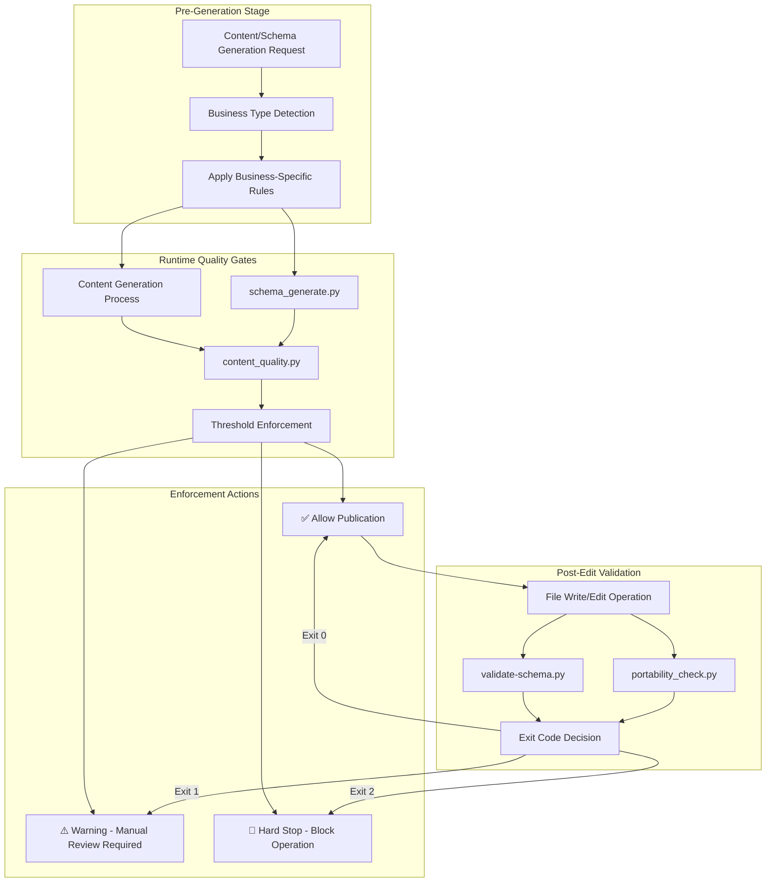
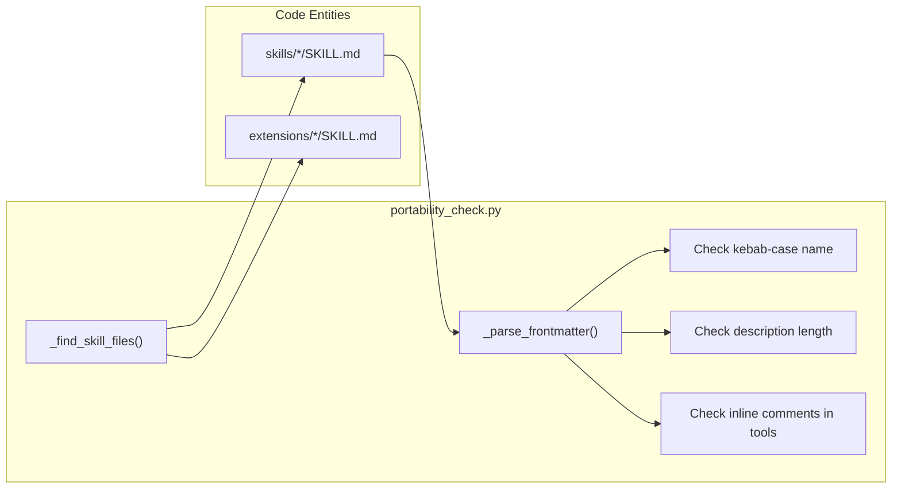

<!-- source: DeepWiki mcp.deepwiki.com · repo AgriciDaniel/claude-seo · page 4.3 Quality Control System · fetched 2026-10-26 -->

# Quality Control System

<details>
<summary>Relevant source files</summary>

The following files were used as context for generating this wiki page:

- [.github/workflows/ci.yml](.github/workflows/ci.yml)
- [AGENTS.md](AGENTS.md)
- [agents/seo-cluster.md](agents/seo-cluster.md)
- [docs/MIGRATION-v1-to-v2.md](docs/MIGRATION-v1-to-v2.md)
- [extensions/firecrawl/install.ps1](extensions/firecrawl/install.ps1)
- [extensions/firecrawl/uninstall.sh](extensions/firecrawl/uninstall.sh)
- [hooks/hooks.json](hooks/hooks.json)
- [hooks/run-python-hook.js](hooks/run-python-hook.js)
- [hooks/validate-schema.py](hooks/validate-schema.py)
- [scripts/drift_baseline.py](scripts/drift_baseline.py)
- [scripts/portability_check.py](scripts/portability_check.py)
- [tests/test_cross_platform_hooks.py](tests/test_cross_platform_hooks.py)
- [tests/test_drift_portability.py](tests/test_drift_portability.py)
- [tests/test_fetch_page_decoding.py](tests/test_fetch_page_decoding.py)
- [tests/test_manifest_consistency.py](tests/test_manifest_consistency.py)
- [tests/test_portability.py](tests/test_portability.py)
- [tests/test_schema_hook_policy.py](tests/test_schema_hook_policy.py)

</details>


The quality control system enforces content quality standards, prevents schema markup errors, and mitigates scaled content abuse risks through a multi-stage validation pipeline. This system operates at three checkpoints: pre-generation validation, runtime quality gates, and post-edit validation hooks.

## Architecture Overview

The quality control system implements defense-in-depth validation across three stages, integrating automated scripts and manual-aligned logic.



**Quality Control Architecture**: Three-stage validation pipeline. Runtime gates evaluate content thresholds, while post-edit hooks like `validate-schema.py` and `portability_check.py` validate schema markup and cross-platform compatibility before file commits.

Sources: [hooks/validate-schema.py:1-31](), [scripts/portability_check.py:1-39](), [hooks/hooks.json:1-20]()

## Quality Gate Thresholds

The system enforces tiered quality gates with escalating severity. Gates trigger warnings or hard stops based on content characteristics and page counts.

### Content Quality Thresholds

The system acts as a QRG-aligned (Quality Rater Guidelines) scorer for filler, AI patterns, and information density.

| Metric | Warning Threshold | Hard Stop Threshold | Enforcement Action |
|--------|------------------|---------------------|-------------------|
| Unique content percentage | 30-40% | < 30% | Block pages with scaled content abuse risk |
| Location pages count | 30+ pages | 50+ pages | Prevent doorway page penalties |
| Programmatic pages count | 100+ pages | 500+ pages | Require comprehensive quality audit |
| Homepage word count | < 500 words | N/A | Flag for content expansion |
| Blog post word count | < 1500 words | N/A | Flag for content expansion |
| Service page word count | < 800 words | N/A | Flag for content expansion |

### AI Citation and Humanization

To meet September 2025 standards, the system utilizes specialized scripts to remediate AI-generated content patterns:

*   **`content_humanize.py`**: Performs 40+ deterministic replacements of common AI-phrasing (e.g., "delve into", "tapestry of").
*   **`content_verify.py`**: Extracts claims and identifies citation gaps to ensure E-E-A-T compliance.
*   **`parasite_risk.py`**: Scans for site-reputation-abuse risks as per November 2024 Google policy.

## Schema Validation Hook System

The `validate-schema.py` hook executes automatically after file edit/write operations, providing final validation before changes are committed.

### Hook Configuration

The hook is configured in `~/.claude/settings.json` or via `hooks/hooks.json` in the plugin root. It uses `run-python-hook.js` to probe for a valid Python environment before execution [hooks/run-python-hook.js:10-25]().

```json
{
  "hooks": {
    "PostToolUse": [
      {
        "matcher": "Edit|Write",
        "hooks": [
          {
            "type": "command",
            "command": "node",
            "args": [
              "${CLAUDE_PLUGIN_ROOT}/hooks/run-python-hook.js",
              "${CLAUDE_PLUGIN_ROOT}/hooks/validate-schema.py",
              "${tool_input.file_path}"
            ]
          }
        ]
      }
    ]
  }
}
```

Sources: [hooks/validate-schema.py:7-27](), [hooks/hooks.json:1-20](), [hooks/run-python-hook.js:40-63]()

### Validation Functions

The validation logic is implemented in two core functions:

**`validate_jsonld(content: str) -> List[str]`** [hooks/validate-schema.py:40-63]()
- Extracts JSON-LD blocks using regex pattern: `<script\s+type=["\']application/ld\+json["\']\s*>(.*?)</script>` [hooks/validate-schema.py:43-44]().
- Parses JSON and delegates to `_validate_schema_object` for each block.

**`_validate_schema_object(obj: dict, block_num: int) -> List[str]`** [hooks/validate-schema.py:66-121]()
- Validates `@context` is `https://schema.org` or `http://schema.org` [hooks/validate-schema.py:72-75]().
- Validates `@type` is present [hooks/validate-schema.py:78-79]().
- Checks for placeholder text patterns like `[Business Name]`, `[City]`, and `[INSERT]` [hooks/validate-schema.py:82-97]().
- Validates against deprecated types and restricted types.

### Deprecated and Restricted Schema Types

The hook enforces schema deprecation policy based on the 2024-2026 timeline [hooks/validate-schema.py:99-112]():

| Type | Status | Context |
|------|--------|---------|
| `HowTo` | Deprecated | September 2023 |
| `SpecialAnnouncement` | Deprecated | July 31, 2025 |
| `CourseInfo` | Retired | June 2025 |
| `ClaimReview` | Retired | June 2025; fact-check rich results discontinued |
| `VehicleListing` | Retired | June 2025; discontinued |

**Note on FAQPage**: Per system policy, `FAQPage` does NOT block edits even though Google retired rich results for most sites in May 2026, as it remains a valid Schema.org type [hooks/validate-schema.py:114-116](). This is verified by regression tests [tests/test_schema_hook_policy.py:29-30]().

Sources: [hooks/validate-schema.py:99-121](), [tests/test_schema_hook_policy.py:1-34]()

## Portability Linter

The `portability_check.py` script ensures that `SKILL.md` files remain compatible across multiple agent harnesses like Cursor, Gemini CLI, and Aider [scripts/portability_check.py:5-7]().



**Portability Linter Logic**: The linter parses frontmatter to ensure compliance with a portable subset of the Claude Code skill spec [AGENTS.md:10-17]().

*   **Name Validation**: Must be kebab-case and < 64 characters [scripts/portability_check.py:53](), [scripts/portability_check.py:131-144]().
*   **Description Validation**: Warns if length > 1024 characters to prevent truncation in Codex [scripts/portability_check.py:153-160]().
*   **Tools Validation**: Warns if the `tools` list contains inline comments (`#`), which can break parsing in Cline or Codex [scripts/portability_check.py:165-172]().

Sources: [scripts/portability_check.py:1-186](), [AGENTS.md:10-23](), [tests/test_portability.py:28-97]()

## Manifest Consistency Tests

The system includes a specialized test suite `tests/test_manifest_consistency.py` to prevent "skill-count drift" where documentation and manifests fall out of sync with actual files on disk [tests/test_manifest_consistency.py:5-12]().

| Test Function | Validation Logic |
|---------------|------------------|
| `test_plugin_json_skill_count_matches_disk` | Counts `SKILL.md` directories vs `plugin.json` description [tests/test_manifest_consistency.py:49-58]() |
| `test_plugin_json_subagent_count_matches_disk` | Counts `agents/seo-*.md` files vs `plugin.json` [tests/test_manifest_consistency.py:67-76]() |
| `test_version_triangulation` | Ensures `plugin.json` version matches `CITATION.cff` [tests/test_manifest_consistency.py:123-134]() |
| `test_pyproject_version_matches_plugin_json` | Syncs `pyproject.toml` version with `plugin.json` [tests/test_manifest_consistency.py:137-155]() |
| `test_install_scripts_default_tag_matches_plugin_version` | Ensures `install.sh` and `install.ps1` target the correct release tag [tests/test_manifest_consistency.py:158-174]() |

Sources: [tests/test_manifest_consistency.py:1-174]()

## Enforcement Actions

The quality control system implements three enforcement levels via exit codes in the validation scripts:

| Exit Code | Meaning | Action |
|-----------|---------|--------|
| `0` | Success | Allow edit/write to proceed [hooks/validate-schema.py:174-175](). |
| `1` | Warnings | Allow edit but display non-blocking warnings [hooks/validate-schema.py:193](). |
| `2` | Critical errors | Block the edit/write operation (e.g., deprecated schema, placeholder text) [hooks/validate-schema.py:187-191](). |

Sources: [hooks/validate-schema.py:146-197](), [scripts/portability_check.py:31-32](), [tests/test_schema_hook_policy.py:33-34]()

---

