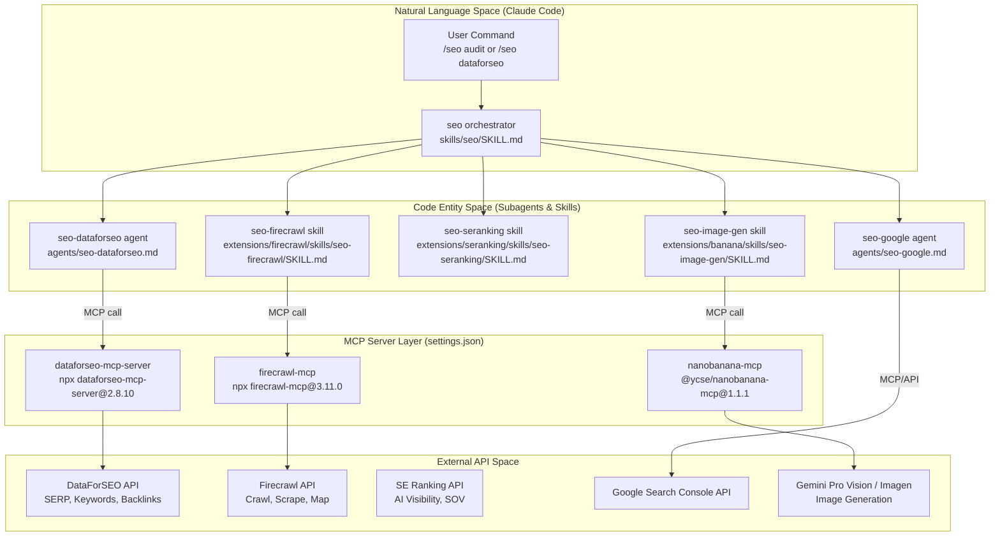
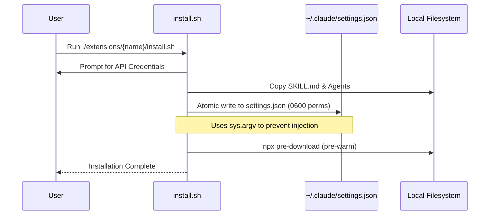

<!-- source: DeepWiki mcp.deepwiki.com · repo AgriciDaniel/claude-seo · page 4.4 External Integrations · fetched 2026-10-26 -->

# External Integrations

Relevant source files

The following files were used as context for generating this wiki page:

- [docs/MCP-INTEGRATION.md](docs/MCP-INTEGRATION.md)
- [extensions/ahrefs/skills/seo-ahrefs/SKILL.md](extensions/ahrefs/skills/seo-ahrefs/SKILL.md)
- [extensions/banana/install.sh](extensions/banana/install.sh)
- [extensions/banana/scripts/edit.py](extensions/banana/scripts/edit.py)
- [extensions/banana/scripts/generate.py](extensions/banana/scripts/generate.py)
- [extensions/banana/scripts/validate_setup.py](extensions/banana/scripts/validate_setup.py)
- [extensions/banana/skills/seo-image-gen/SKILL.md](extensions/banana/skills/seo-image-gen/SKILL.md)
- [extensions/banana/uninstall.sh](extensions/banana/uninstall.sh)
- [extensions/bing-webmaster/skills/seo-bing/SKILL.md](extensions/bing-webmaster/skills/seo-bing/SKILL.md)
- [extensions/dataforseo/install.sh](extensions/dataforseo/install.sh)
- [extensions/dataforseo/skills/seo-dataforseo/SKILL.md](extensions/dataforseo/skills/seo-dataforseo/SKILL.md)
- [extensions/firecrawl/install.sh](extensions/firecrawl/install.sh)
- [extensions/profound/skills/seo-profound/SKILL.md](extensions/profound/skills/seo-profound/SKILL.md)
- [extensions/seranking/skills/seo-seranking/SKILL.md](extensions/seranking/skills/seo-seranking/SKILL.md)
- [extensions/unlighthouse/skills/seo-unlighthouse/SKILL.md](extensions/unlighthouse/skills/seo-unlighthouse/SKILL.md)
- [skills/seo-google/references/auth-setup.md](skills/seo-google/references/auth-setup.md)
- [skills/seo-google/references/nlp-api.md](skills/seo-google/references/nlp-api.md)
- [skills/seo-google/references/pagespeed-crux-api.md](skills/seo-google/references/pagespeed-crux-api.md)
- [skills/seo/references/cwv-thresholds.md](skills/seo/references/cwv-thresholds.md)
- [tests/test_extension_installer_injection.py](tests/test_extension_installer_injection.py)
- [tests/test_parasite_risk_and_extensions.py](tests/test_parasite_risk_and_extensions.py)

## Purpose and Scope

This document describes how the claude-seo system integrates with external SEO data providers through two primary mechanisms: the Model Context Protocol (MCP) and direct API calls. These integrations enable the system to access real-time backlink data, search performance metrics, Core Web Vitals measurements, AI visibility tracking, and automated asset generation that cannot be determined through static HTML analysis alone.

The system utilizes specialized extensions for DataForSEO, Firecrawl, Banana (Image Gen), Ahrefs, and others, which are installed via dedicated shell scripts to configure the local environment and MCP settings.

**Sources:** [docs/MCP-INTEGRATION.md:1-77](), [extensions/dataforseo/install.sh:7-176](), [extensions/firecrawl/install.sh:7-145]()

---

## Integration Architecture Overview

The system implements a multi-layered architecture combining local Python scripts, specialized subagents, and MCP servers. The orchestrator (`seo` skill) delegates to these entities based on the detected business type and available credentials.

### Data Flow and Entity Mapping

The following diagram bridges the Natural Language commands used in the terminal to the specific code entities and external APIs they trigger.

**Sources:** [extensions/dataforseo/install.sh:128-137](), [extensions/firecrawl/install.sh:100-106](), [extensions/banana/install.sh:111-117](), [extensions/banana/skills/seo-image-gen/SKILL.md:20-28]()

---

## Core Extension Modules

### DataForSEO Integration
The DataForSEO extension provides live search data via the `dataforseo-mcp-server`. It covers 9 API modules including SERP, Keywords, Backlinks, and AI Visibility.

*   **Implementation:** Installed via `extensions/dataforseo/install.sh`. It copies `SKILL.md` to `~/.claude/skills/seo-dataforseo` [extensions/dataforseo/install.sh:93-97]() and the agent to `~/.claude/agents/seo-dataforseo.md` [extensions/dataforseo/install.sh:100-102]().
*   **Cost Management:** Before every call, the system runs `dataforseo_costs.py check <endpoint>` to enforce daily budget limits [extensions/dataforseo/skills/seo-dataforseo/SKILL.md:49-56]().
*   **Key Tools:** Includes `serp_organic_live_advanced` for live rankings and `dataforseo_labs_google_keyword_ideas` for research [extensions/dataforseo/skills/seo-dataforseo/SKILL.md:106-161]().

### Firecrawl Integration
Firecrawl is used for advanced crawling and scraping, particularly useful for complex SPAs or large-scale mapping.

*   **Capabilities:** Provides `crawl` (up to 500 pages), `scrape` (markdown conversion), and `map` (site structure discovery) [extensions/firecrawl/install.sh:138-141]().
*   **Setup:** Registers `firecrawl-mcp@3.11.0` in `settings.json` with the user's API key [extensions/firecrawl/install.sh:100-106]().

### Banana (AI Image Generation)
The Banana extension leverages Gemini models via `nanobanana-mcp` to generate SEO assets like OG images and blog headers.

*   **Pipeline:** Uses a "Creative Director" pipeline defined in `references/prompt-engineering.md` to map SEO needs to specific aspect ratios (e.g., 16:9 for OG images) [extensions/banana/skills/seo-image-gen/SKILL.md:54-78]().
*   **Direct Fallback:** If the MCP server is unavailable, the system can use `extensions/banana/scripts/generate.py` to call the Gemini REST API directly using Python's standard library [extensions/banana/scripts/generate.py:1-10]().
*   **SEO Checklist:** Automatically suggests Alt text, file naming conventions, and WebP conversion commands after generation [extensions/banana/skills/seo-image-gen/SKILL.md:91-118]().

### Ahrefs Integration
Launched in July 2025, the official Ahrefs integration provides high-confidence backlink and organic traffic data.

*   **Routing:** Commands like `/seo ahrefs metrics` and `/seo ahrefs backlinks` route to the `@ahrefs/mcp` server [extensions/ahrefs/skills/seo-ahrefs/SKILL.md:27-32]().
*   **Confidence Weighting:** Data is often paired with `seo-backlinks` for multi-source validation against Common Crawl and Moz [extensions/ahrefs/skills/seo-ahrefs/SKILL.md:40-44]().

**Sources:** [extensions/dataforseo/skills/seo-dataforseo/SKILL.md:20-68](), [extensions/banana/skills/seo-image-gen/SKILL.md:1-89](), [extensions/ahrefs/skills/seo-ahrefs/SKILL.md:1-53]()

---

## Performance and Google APIs

The system integrates with multiple Google Cloud APIs to retrieve both "Lab" (simulated) and "Field" (real-user) data.

| API | Code Entity / Script | Tier | Use Case |
|-----|----------------------|------|----------|
| **PageSpeed Insights** | `pagespeed_check.py` | Tier 1 | Lighthouse lab metrics (LCP, CLS, TBT) |
| **Chrome UX Report** | `crux_history.py` | Tier 1 | 75th percentile field data for CWV |
| **Search Console** | `gsc_query.py` | Tier 2 | Organic clicks, impressions, and indexing status |
| **Indexing API** | `indexing_submit.py` | Tier 2 | Fast indexing for new or updated pages |
| **GA4 Data API** | `ga4_metrics.py` | Tier 2 | Conversion and organic traffic attribution |

**Sources:** [docs/MCP-INTEGRATION.md:9-77](), [skills/seo-google/references/auth-setup.md:1-12]()

---

## Extension Installation Lifecycle

The system uses a standardized installation pattern to ensure security and portability.

### Security Guardrails in Installers
Installers (DataForSEO, Firecrawl, Banana) use a hardened pattern to prevent credential injection:
1.  **Quoted Heredocs:** Credentials are passed as `sys.argv` via a quoted `<<'PY'` heredoc to prevent shell interpolation vulnerabilities [extensions/dataforseo/install.sh:114-117]().
2.  **Atomic Writing:** The `settings.json` file is written using `tempfile.mkstemp` and `os.replace` to ensure atomicity [extensions/dataforseo/install.sh:139-145]().
3.  **Strict Permissions:** New configuration files are created with `0600` permissions (read/write only by the owner) [extensions/dataforseo/install.sh:144]().

**Sources:** [tests/test_extension_installer_injection.py:1-68](), [extensions/dataforseo/install.sh:112-152](), [extensions/firecrawl/install.sh:84-121]()

---

## Integration Summary Table

| Integration | Command Prefix | Primary MCP Server | Required Key |
|-------------|----------------|--------------------|--------------|
| **DataForSEO** | `/seo dataforseo` | `dataforseo-mcp-server` | User/Pass |
| **Firecrawl** | `/seo firecrawl` | `firecrawl-mcp` | API Key |
| **Banana** | `/seo image-gen` | `nanobanana-mcp` | Google AI Key |
| **Ahrefs** | `/seo ahrefs` | `@ahrefs/mcp` | API Token |
| **Unlighthouse**| `/seo unlighthouse`| Local CLI (Node) | None |
| **Bing** | `/seo bing` | `seo-bing` skill | API Key |

**Sources:** [extensions/dataforseo/skills/seo-dataforseo/SKILL.md:72-97](), [extensions/banana/skills/seo-image-gen/SKILL.md:43-50](), [extensions/unlighthouse/skills/seo-unlighthouse/SKILL.md:25-29](), [docs/MCP-INTEGRATION.md:68-76]()

---

