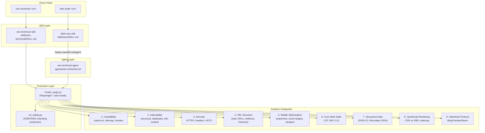
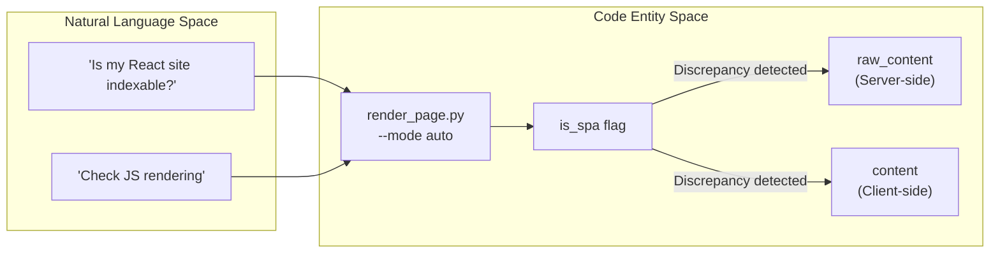
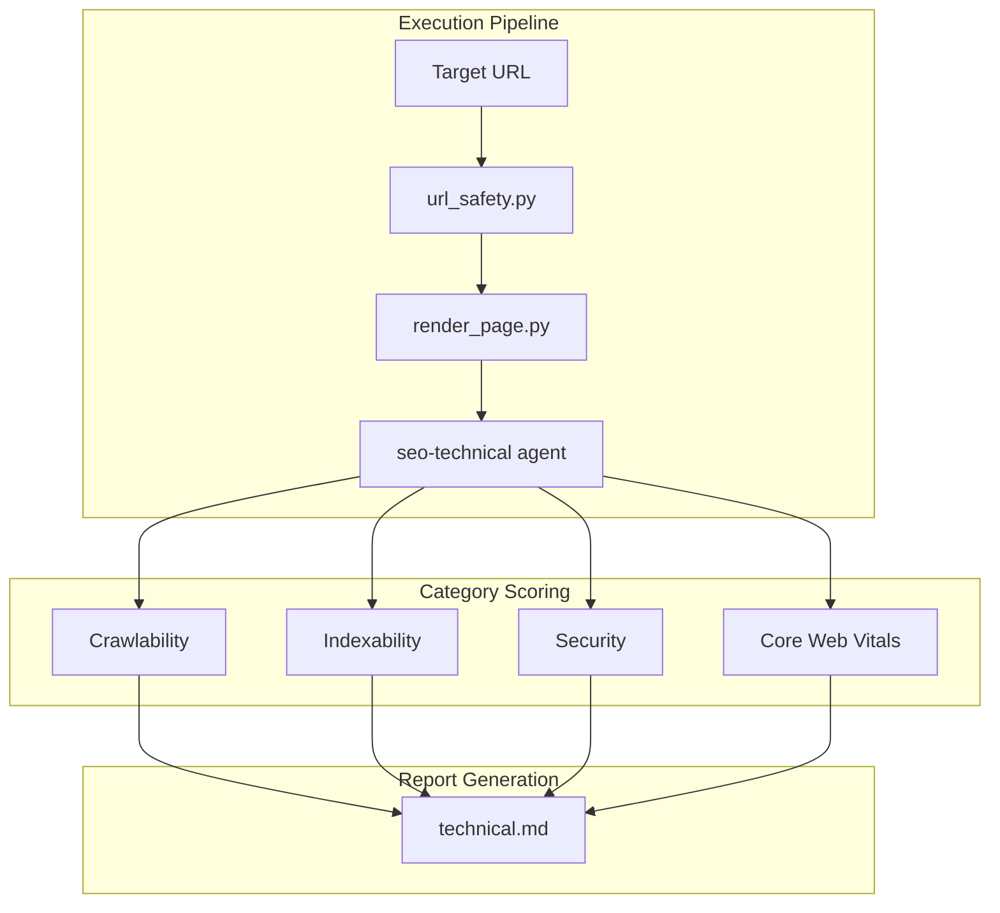

<!-- source: DeepWiki mcp.deepwiki.com · repo AgriciDaniel/claude-seo · page 5 Technical SEO Analysis · fetched 2026-10-26 -->

# Technical SEO Analysis

Relevant source files

The following files were used as context for generating this wiki page:

- [agents/seo-content.md](agents/seo-content.md)
- [agents/seo-ecommerce.md](agents/seo-ecommerce.md)
- [agents/seo-performance.md](agents/seo-performance.md)
- [agents/seo-schema.md](agents/seo-schema.md)
- [agents/seo-sxo.md](agents/seo-sxo.md)
- [agents/seo-technical.md](agents/seo-technical.md)
- [agents/seo-visual.md](agents/seo-visual.md)
- [scripts/google_report.py](scripts/google_report.py)
- [skills/seo-images/SKILL.md](skills/seo-images/SKILL.md)
- [skills/seo-page/SKILL.md](skills/seo-page/SKILL.md)
- [skills/seo-technical/SKILL.md](skills/seo-technical/SKILL.md)
- [tests/test_audit_instructions.py](tests/test_audit_instructions.py)

## Purpose and Scope

This document describes the technical SEO analysis system implemented in the `seo-technical` sub-skill. Technical SEO analysis evaluates website infrastructure, crawlability, security, mobile optimization, performance metrics, and rendering capabilities across nine distinct categories.

The technical analysis can be invoked directly via `/seo technical <url>` or as part of the full `/seo audit` command, where it runs as one of several parallel subagents [agents/seo-technical.md:9-20](). For content quality analysis, see [Content Quality & E-E-A-T](#6). For performance-specific deep dives, see [Performance Analysis](#8). For schema markup validation, see [Schema Markup Management](#7).

**Sources:** [skills/seo-technical/SKILL.md:1-15](), [agents/seo-technical.md:1-17]()

## System Architecture

The technical SEO system operates as both a standalone sub-skill and a parallel subagent within the audit workflow. It utilizes `render_page.py` for content acquisition, which features a hybrid `auto` mode to minimize overhead while ensuring SPA (Single Page Application) content is captured [agents/seo-technical.md:56-58]().

**Technical SEO Analysis Architecture**

The system enforces strict security via `scripts/url_safety.py` to prevent SSRF and DNS-rebinding attacks when fetching user-supplied URLs [agents/seo-technical.md:58](). The `render_page.py` script provides the primary data interface, exposing `raw_content` (pre-JS) and `content` (post-JS) to detect rendering discrepancies [agents/seo-ecommerce.md:68]().

**Sources:** [agents/seo-technical.md:54-58](), [skills/seo-technical/SKILL.md:1-15](), [agents/seo-ecommerce.md:66-72]()

## Analysis Categories

### 1. Crawlability and Indexability

Crawlability analysis evaluates whether search engines can discover and access site content, while indexability identifies factors preventing page inclusion in search results. The system uses `sitemap_discovery.py` to validate XML sitemaps [skills/seo-technical/SKILL.md:23-25]().

For detailed documentation on AI crawler management and sitemap protocols, see [Crawlability and Indexability](#5.1).

**AI Crawler Management**

The system evaluates `robots.txt` directives for AI crawlers. As of 2025-2026, the system distinguishes between training crawlers (e.g., `GPTBot`, `Google-Extended`) and browsing crawlers (e.g., `ChatGPT-User`) [skills/seo-technical/SKILL.md:34-49]().

| Crawler | Company | `robots.txt` Token | Purpose | Block Impact |
|---------|---------|-------------------|---------|--------------|
| `GPTBot` | OpenAI | `GPTBot` | Model training | Prevents training, NOT browsing citations |
| `ChatGPT-User` | OpenAI | `ChatGPT-User` | Real-time browsing | Prevents citations in ChatGPT answers |
| `ClaudeBot` | Anthropic | `ClaudeBot` | Model training | Prevents training data collection |
| `Google-Extended` | Google | `Google-Extended` | Gemini training | Prevents Gemini training, NOT search or AIO |

**Sources:** [skills/seo-technical/SKILL.md:21-61](), [agents/seo-technical.md:28-30]()

### 2. Security and URL Structure

Security analysis evaluates HTTPS implementation and HTTP security headers (CSP, HSTS, X-Frame-Options) [skills/seo-technical/SKILL.md:84-92](). The system specifically flags **Back-button hijacking** as a critical spam-policy violation since June 2026 [skills/seo-technical/SKILL.md:93](). For detailed implementation details on SSRF protection and DNS-rebinding mitigation, see [Security and URL Structure](#5.2).

**Sources:** [skills/seo-technical/SKILL.md:84-93]()

### 3. Mobile Optimization

Mobile optimization analysis validates mobile-first indexing compliance. As of 2024, Googlebot Smartphone is the primary crawler [skills/seo-technical/SKILL.md:107](). The system checks for mobile/desktop content parity, touch target sizing (48x48px), and intrusive interstitials [skills/seo-technical/SKILL.md:102-111](). For responsive design validation, see [Mobile Optimization](#5.3).

**Sources:** [skills/seo-technical/SKILL.md:102-111]()

### 4. Core Web Vitals

The system measures user experience metrics against official 2026 thresholds [agents/seo-technical.md:21-26](). Evaluation uses the **75th percentile** of page visits [agents/seo-performance.md:21-23]().

| Metric | Threshold | Measurement |
|--------|-----------|-------------|
| **LCP** | ≤ 2.5s | Largest Contentful Paint |
| **INP** | ≤ 200ms | Interaction to Next Paint |
| **CLS** | ≤ 0.1 | Cumulative Layout Shift |

**Critical Update:** INP replaced FID on **March 12, 2024**. FID was fully removed from all Chrome tools on **September 9, 2024** [agents/seo-performance.md:19](). The system never references FID. For performance optimization strategies, see [Performance Analysis](#8).

**Sources:** [agents/seo-technical.md:21-29](), [agents/seo-performance.md:11-23]()

### 5. JavaScript Rendering

JavaScript rendering analysis identifies client-side vs server-side rendering patterns. The `seo-technical` agent uses `render_page.py --mode auto` to detect if an SPA shell is present and requires Playwright execution [agents/seo-technical.md:58](). For detailed CSR vs SSR detection, see [JavaScript Rendering](#5.4).

**Sources:** [agents/seo-technical.md:53-58](), [agents/seo-ecommerce.md:68-70]()

### 6. Structured Data

Structured data detection identifies JSON-LD (preferred), Microdata, and RDFa markup [agents/seo-schema.md:13](). Full validation is delegated to the `seo-schema` agent, which checks against Google's rich result requirements [agents/seo-schema.md:1-18](). For type status and generation templates, see [Schema Markup Management](#7).

**Sources:** [agents/seo-schema.md:1-18](), [agents/seo-technical.md:52]()

### 7. IndexNow Protocol

The system checks for IndexNow implementation, enabling instant indexing notifications to Bing, Yandex, and Naver [agents/seo-technical.md:54]().

**Sources:** [agents/seo-technical.md:54]()

## Analysis Execution Flow

**Sources:** [agents/seo-technical.md:37-64](), [tests/test_audit_instructions.py:45-62]()

## Output Format

The technical SEO analysis outputs a standardized report containing:
- **Pass/Fail Status:** Per category (Crawlability, Security, etc.) [agents/seo-technical.md:39]().
- **Technical Score:** 0-100 overall rating [agents/seo-technical.md:40]().
- **Prioritized Issues:** Ranked from Critical to Low [agents/seo-technical.md:41]().
- **Recommendations:** Specific implementation details for remediation [agents/seo-technical.md:42]().

Findings are persisted to `output_dir/findings/technical.md` and `audit-data.json` when part of a full audit [agents/seo-technical.md:60-65]().

**Sources:** [agents/seo-technical.md:37-65](), [tests/test_audit_instructions.py:45-62]()

---

