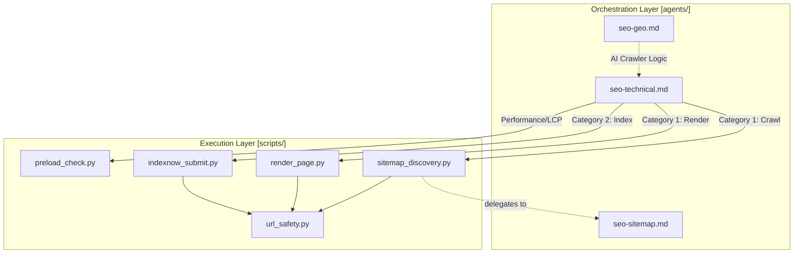
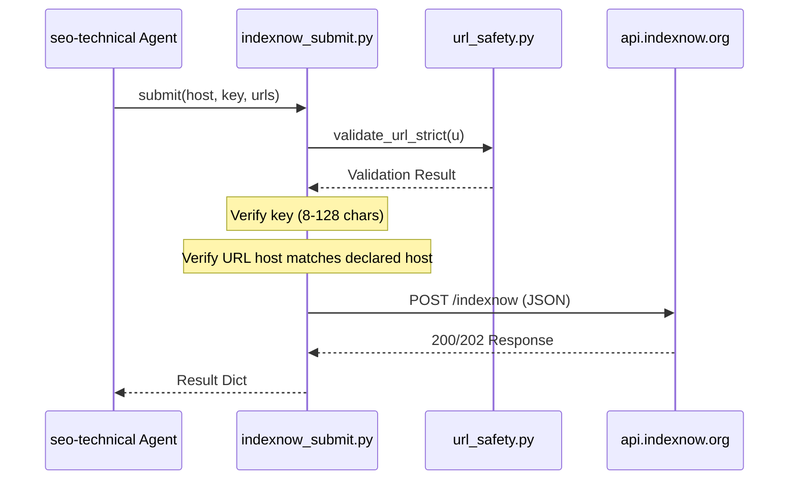

<!-- source: DeepWiki mcp.deepwiki.com · repo AgriciDaniel/claude-seo · page 5.1 Crawlability and Indexability · fetched 2026-10-26 -->

# Crawlability and Indexability

Relevant source files

The following files were used as context for generating this wiki page:

- [agents/seo-maps.md](agents/seo-maps.md)
- [agents/seo-sitemap.md](agents/seo-sitemap.md)
- [scripts/indexnow_submit.py](scripts/indexnow_submit.py)
- [scripts/preload_check.py](scripts/preload_check.py)
- [scripts/unlighthouse_run.py](scripts/unlighthouse_run.py)
- [skills/seo-images/SKILL.md](skills/seo-images/SKILL.md)
- [skills/seo-page/SKILL.md](skills/seo-page/SKILL.md)
- [skills/seo-technical/SKILL.md](skills/seo-technical/SKILL.md)
- [tests/test_technical_depth.py](tests/test_technical_depth.py)

## Purpose and Scope

This document describes the crawlability and indexability analysis components of the `claude-seo` system, primarily housed within the `seo-technical` skill. These categories represent the foundation of technical SEO: ensuring search engines and AI agents can discover, access, and index website content.

**Crawlability** analysis examines factors that control search engine bot access: `robots.txt` directives (including modern AI crawler tokens), XML sitemaps, crawl depth, and JavaScript rendering requirements.

**Indexability** analysis evaluates factors that determine which pages enter search engine indexes: canonical tags, meta robots directives, duplicate content detection, and the IndexNow protocol for instant indexing on non-Google engines.

**Sources:** [skills/seo-technical/SKILL.md:1-15]() | [agents/seo-technical.md:1-20]()

---

## System Context

The crawlability and indexability analysis operates as the first two categories within the broader technical SEO audit system. The `seo-technical` agent orchestrates these checks, delegating specific sitemap tasks to `seo-sitemap` and AI-specific visibility checks to `seo-geo`.

### Code Entity Space Mapping

**Diagram: Crawlability and Indexability Context within System Architecture**

**Sources:** [skills/seo-technical/SKILL.md:21-33](), [agents/seo-technical.md:42-53](), [scripts/unlighthouse_run.py:42-45]()

---

## Crawlability Analysis Components

### robots.txt and AI Crawler Management

The system validates `robots.txt` for existence and syntax, with a specific focus on the 2025-2026 AI crawler landscape. The `seo-technical` skill recognizes specific tokens for model training versus real-time browsing.

| Crawler | Company | robots.txt Token | Purpose |
|---------|---------|-----------------|---------|
| GPTBot | OpenAI | `GPTBot` | Model training |
| ChatGPT-User | OpenAI | `ChatGPT-User` | Real-time browsing |
| ClaudeBot | Anthropic | `ClaudeBot` | Model training |
| PerplexityBot | Perplexity | `PerplexityBot` | Search index + training |
| Google-Extended | Google | `Google-Extended` | Gemini training (NOT search) |
| Bytespider | ByteDance | `Bytespider` | Model training |

**Key Constraints:**
- **Fetch Limits:** Googlebot fetches the first **2MB of HTML** and **64MB of a PDF**. Critical content and JSON-LD must reside within this initial buffer. [skills/seo-technical/SKILL.md:30-31]()
- **User-Triggered Fetchers:** Agents like `Google-Agent` (Project Mariner) and `Google-NotebookLM` ignore `robots.txt` by design as they are user-triggered. [skills/seo-technical/SKILL.md:74-75]()

**Sources:** [skills/seo-technical/SKILL.md:34-75](), [skills/seo-page/SKILL.md:39-43]()

### XML Sitemap Discovery and Validation

Sitemap analysis is handled via `sitemap_discovery.py`. The `seo-sitemap` agent enforces quality gates, particularly for programmatic SEO and location pages.

- **URL Limits:** Enforces ≤50,000 URLs or ≤50MB uncompressed per file. [agents/seo-sitemap.md:19-20]()
- **Location Page Gates:** 
    - ⚠️ **Warning** at 30+ location pages: Requires 60%+ unique content. [agents/seo-sitemap.md:25-26]()
    - 🛑 **Hard Stop** at 50+ location pages: Requires explicit user justification to prevent "doorway page" penalties. [agents/seo-sitemap.md:26-27]()

**Sources:** [agents/seo-sitemap.md:11-31](), [skills/seo-technical/SKILL.md:22-25]()

---

## Indexability Analysis Components

### IndexNow Protocol Implementation

The `scripts/indexnow_submit.py` tool allows for immediate indexing notification to Bing, Naver, Seznam.cz, Yandex, and Yep.

**Diagram: IndexNow Submission Data Flow**

**Sources:** [scripts/indexnow_submit.py:70-134](), [tests/test_technical_depth.py:100-132]()

### Canonical and Rendering Conflicts

The system audits indexability signals that may be obscured by JavaScript rendering:
- **JS Parity:** Checks if `noindex` tags are added or removed dynamically via JS. Google typically honors the first `noindex` seen in the HTML. [skills/seo-technical/SKILL.md:125-126]()
- **Canonical Conflicts:** Identifies if HTML and JS-injected canonicals differ, which causes indexing signals to become unreliable. [skills/seo-technical/SKILL.md:124-125]()

**Sources:** [skills/seo-technical/SKILL.md:120-130](), [skills/seo-page/SKILL.md:37-43]()

---

## Preload and bfcache Audit

The `scripts/preload_check.py` script identifies advanced crawlability and performance signals that influence how browsers and crawlers handle navigation.

| Signal | Detection Method | SEO Impact |
|--------|------------------|------------|
| **Speculation Rules** | `_SPECULATION_BLOCK_RE` | Instant next-page paint via prefetch/prerender. |
| **bfcache Killers** | `Cache-Control: no-store` | Prevents instant back/forward navigation. |
| **LCP Hints** | `fetchpriority="high"` | Prioritizes critical resources for crawlers/browsers. |
| **Deprecated Prerender** | `rel="prerender"` | Flags for migration to Speculation Rules. |

**Sources:** [scripts/preload_check.py:66-88](), [scripts/preload_check.py:130-169](), [tests/test_technical_depth.py:38-75]()

---

