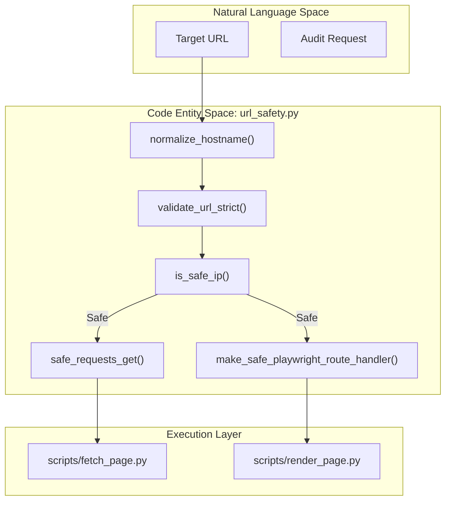
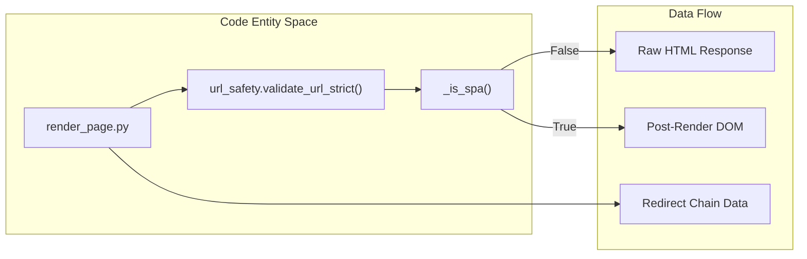

<!-- source: DeepWiki mcp.deepwiki.com · repo AgriciDaniel/claude-seo · page 5.2 Security and URL Structure · fetched 2026-10-26 -->

# Security and URL Structure

Relevant source files

The following files were used as context for generating this wiki page:

- [.github/CODEOWNERS](.github/CODEOWNERS)
- [.github/dependabot.yml](.github/dependabot.yml)
- [.github/workflows/v2.yml](.github/workflows/v2.yml)
- [.gitignore](.gitignore)
- [CODE_OF_CONDUCT.md](CODE_OF_CONDUCT.md)
- [SECURITY.md](SECURITY.md)
- [scripts/google_auth.py](scripts/google_auth.py)
- [scripts/render_page.py](scripts/render_page.py)
- [scripts/url_safety.py](scripts/url_safety.py)
- [skills/seo-flow/references/flow-framework.md](skills/seo-flow/references/flow-framework.md)
- [tests/test_url_safety.py](tests/test_url_safety.py)

## Purpose and Scope

This document covers the security and URL structure analysis components of the technical SEO audit system. These represent categories 3 and 4 of the 8-category technical audit framework implemented in the `seo-technical` skill. 

The system implements a hardened security layer in v2.0.0 to protect against **Server-Side Request Forgery (SSRF)** and **DNS-rebinding** attacks when fetching target URLs. Security analysis evaluates HTTPS enforcement, SSL certificate validity, mixed content, and security headers. URL structure analysis examines patterns, hierarchy, redirect chains, and trailing slash consistency.

For crawlability and indexability analysis, see [5.1](). For mobile optimization, see [5.3](). For JavaScript rendering concerns, see [5.4]().

---

## Security Layer Architecture

The codebase centralizes all network safety logic in `scripts/url_safety.py`. Every script in the repository that accepts a user-supplied URL MUST validate it through this module before issuing any network request [scripts/url_safety.py:5-7]().

### SSRF and DNS-Rebinding Protection

The system uses a multi-layered defense strategy to prevent malicious audit targets from accessing local-network or cloud-metadata endpoints [SECURITY.md:42-46]().

1.  **Normalization**: `normalize_hostname()` canonicalizes hostnames to prevent bypasses using trailing dots (FQDN), case sensitivity, or obfuscated IPv4 forms like decimal, hex, or octal [scripts/url_safety.py:118-121](), [scripts/url_safety.py:228-251]().
2.  **Strict Validation**: `validate_url_strict()` resolves hostnames via `socket.getaddrinfo` and validates every returned A record against a safety predicate before connection [scripts/url_safety.py:19-25](), [scripts/url_safety.py:277-310]().
3.  **DNS Pinning**: `safe_requests_get` and `safe_requests_session` wrap the `requests` library in a context manager that forces the OS-level resolver to use the pre-validated IP for the duration of the call [scripts/url_safety.py:27-38]().
4.  **Playwright Route Handling**: Since Chromium performs its own DNS resolution, the system attaches a `route()` handler via `make_safe_playwright_route_handler` to re-validate every subresource host [scripts/url_safety.py:59-68](), [scripts/url_safety.py:541-574]().

**Diagram: Security Validation and Code Entities**
Sources: [scripts/url_safety.py:92-102](), [scripts/render_page.py:98-106](), [SECURITY.md:42-46]()

---

## Security Analysis Components

### HTTPS Enforcement and Credentials
The system validates HTTPS enforcement and manages credentials with high security standards. OAuth token files (`oauth-token.json`) are written with `0o600` permissions to prevent local privilege escalation, and legacy world-readable files are remediated on first load [scripts/google_auth.py:200-209]().

- **HTTPS Validation**: Sites serving pages over HTTP receive a critical-severity flag in the technical audit.
- **Credential Tiering**: `google_auth.py` and `backlinks_auth.py` detect available tiers (API Key, OAuth, Service Account) to tailor analysis depth [scripts/google_auth.py:10-16]().
- **SSRF Hardening**: The `validate_url` function preserves a v1.9.9 contract for compatibility but has been hardened to reject obfuscated IPv4 and authority confusion (e.g., backslashes or userinfo in the authority string) [scripts/url_safety.py:12-17](), [scripts/url_safety.py:161-182]().

### Security Headers
The `seo-technical` subagent extracts and validates the following headers:
- `Content-Security-Policy` (CSP)
- `Strict-Transport-Security` (HSTS)
- `X-Frame-Options`
- `X-Content-Type-Options`
- `Referrer-Policy`

Sources: [scripts/google_auth.py:200-209](), [scripts/url_safety.py:161-182]()

---

## URL Structure Analysis

### Shared Rendering System
In v2.0.0, every subagent fetching HTML (technical, content, schema, etc.) calls `scripts/render_page.py` instead of `fetch_page.py` whenever JS execution might change what an audit can see [scripts/render_page.py:5-9](). This ensures that URL structures generated by Single Page Applications (SPAs) are correctly analyzed.

- **Mode `auto`**: Performs a raw fetch first, then renders with Playwright if an SPA shell is detected via `_is_spa` [scripts/render_page.py:23-24]().
- **Redirect Chains**: `render_page.py` tracks the full `redirect_chain` including status codes to identify hops and latency issues [scripts/render_page.py:40]().
- **SPA Detection**: The `_is_spa` function uses heuristics like `
`, `
`, and "please enable javascript" to determine if a render is required [scripts/render_page.py:124-133]().

### URL Pattern Validation
The system evaluates URLs against SEO best practices:
- **Hyphenation**: Enforces hyphens over underscores.
- **Case Sensitivity**: Enforces lowercase to prevent duplicate content.
- **Depth**: Flags hierarchies deeper than 4 levels.
- **Trailing Slashes**: Validates consistency across the site.

**Diagram: URL Processing Flow in render_page.py**
Sources: [scripts/render_page.py:124-133](), [scripts/render_page.py:50-55]()

---

## Implementation Details

### Key Functions and Classes
| Code Entity | File | Role |
| :--- | :--- | :--- |
| `validate_url_strict` | `scripts/url_safety.py` | DNS-resolving SSRF validator. [scripts/url_safety.py:19]() |
| `safe_requests_session` | `scripts/url_safety.py` | DNS-pinned HTTP session manager. [scripts/url_safety.py:38]() |
| `render_page` | `scripts/render_page.py` | Shared headless renderer with SSRF protection. [scripts/render_page.py:21-47]() |
| `_is_spa` | `scripts/render_page.py` | Heuristic detector for hydration shells. [scripts/render_page.py:124]() |
| `URLSafetyError` | `scripts/url_safety.py` | Exception for safety violations. [scripts/url_safety.py:151]() |
| `is_safe_ip` | `scripts/url_safety.py` | Checks if IP is public unicast. [scripts/url_safety.py:183]() |

### Security-Relevant Dependencies
The system tracks and manages dependencies via Dependabot to mitigate known vulnerabilities [SECURITY.md:79-80]().

- **Pip Ecosystem**: Monitored weekly for security updates [ .github/dependabot.yml:4-10]().
- **Credential Protection**: The `.gitignore` file includes comprehensive patterns to prevent committing secrets like `client_secret*.json`, `service_account*.json`, and `.env` files [ .gitignore:34-43]().
- **Audit Workflows**: The `v2 audit` GitHub Action runs the `url_safety` regression battery and scans for leaked credentials in tracked files before tagging releases [ .github/workflows/v2.yml:59-61](), [ .github/workflows/v2.yml:94-117]().

Sources: [scripts/url_safety.py:92-102](), [scripts/render_page.py:1-62](), [SECURITY.md:66-74]()

---

