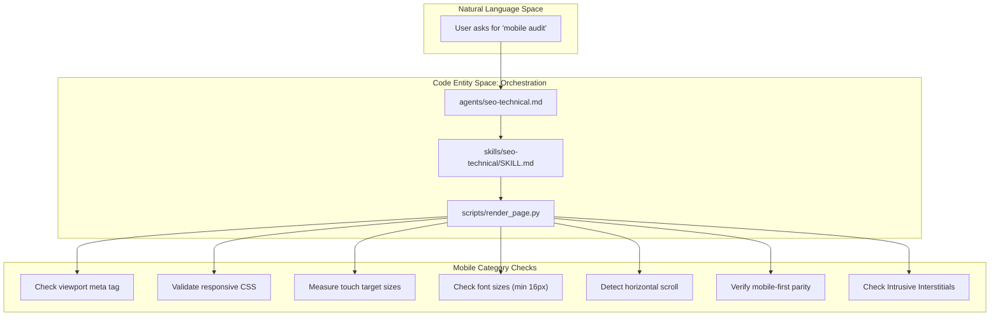
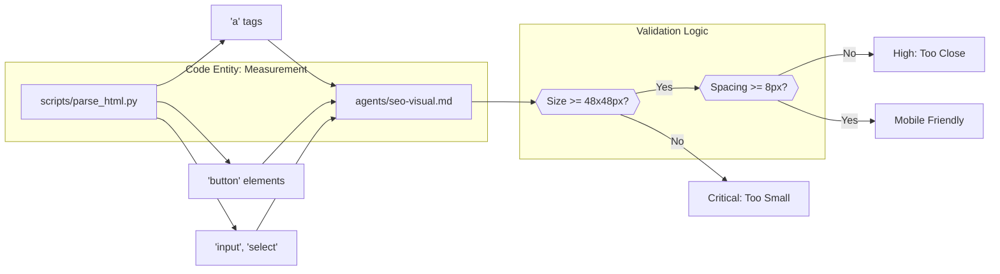

<!-- source: DeepWiki mcp.deepwiki.com · repo AgriciDaniel/claude-seo · page 5.3 Mobile Optimization · fetched 2026-10-26 -->

# Mobile Optimization

<details>
<summary>Relevant source files</summary>

The following files were used as context for generating this wiki page:

- [agents/seo-content.md](agents/seo-content.md)
- [agents/seo-ecommerce.md](agents/seo-ecommerce.md)
- [agents/seo-performance.md](agents/seo-performance.md)
- [agents/seo-schema.md](agents/seo-schema.md)
- [agents/seo-sxo.md](agents/seo-sxo.md)
- [agents/seo-technical.md](agents/seo-technical.md)
- [agents/seo-visual.md](agents/seo-visual.md)
- [scripts/google_report.py](scripts/google_report.py)
- [skills/seo-images/SKILL.md](skills/seo-images/SKILL.md)
- [skills/seo-page/SKILL.md](skills/seo-page/SKILL.md)
- [skills/seo-technical/SKILL.md](skills/seo-technical/SKILL.md)
- [tests/test_audit_instructions.py](tests/test_audit_instructions.py)

</details>


## Purpose and Scope

This page documents the mobile optimization analysis performed by the `seo-technical` skill as part of the technical SEO audit. Mobile optimization evaluation focuses on ensuring sites comply with Google's mobile-first indexing requirements, implement responsive design patterns correctly, and provide adequate touch targets for mobile users.

For Core Web Vitals analysis specific to mobile performance (LCP, INP, CLS), see [Core Web Vitals](#8.1). For JavaScript rendering considerations that affect mobile indexing, see [JavaScript Rendering](#5.4). For overall technical SEO context, see [Technical SEO Analysis](#5).

---

## Mobile-First Indexing Context

Googlebot Smartphone is now the primary crawler for all indexing [skills/seo-technical/SKILL.md:107](). While a mobile version is not strictly required for indexing, the primary risk is **content/parity loss** [skills/seo-technical/SKILL.md:107-108](). The `seo-technical` agent validates that the mobile version serves as the definitive source for Google's indexing systems.

Key requirements for compliance include:
- **Mobile/desktop content parity**: Equivalent primary content, matching robots meta tags, and matching titles/descriptions [skills/seo-technical/SKILL.md:108]().
- **Immediate visibility**: Primary content should be visible on load rather than hidden behind tabs or accordions, as content in expandable sections may not qualify for full weight [skills/seo-technical/SKILL.md:110]().
- **Resource crawlability**: All mobile resources must be crawlable by Googlebot Smartphone [skills/seo-technical/SKILL.md:108]().

Sources: [skills/seo-technical/SKILL.md:107-110]()

---

## Mobile Optimization Analysis Flow

The `seo-technical` agent coordinates the analysis of mobile-friendliness using a combination of static HTML analysis and dynamic rendering checks via `render_page.py` [agents/seo-technical.md:58]().

Title: Mobile Optimization Orchestration


Sources: [skills/seo-technical/SKILL.md:103-112](), [agents/seo-technical.md:9-17](), [agents/seo-technical.md:58]()

---

## Responsive Design Validation

The system validates that sites implement proper responsive design patterns required for mobile-first indexing [skills/seo-technical/SKILL.md:103]().

### Viewport Meta Tag

**Required element:**
```html
<meta name="viewport" content="width=device-width, initial-scale=1">
```
The viewport meta tag is checked for presence and correct configuration to ensure responsive CSS functions as intended [skills/seo-technical/SKILL.md:103]().

### Responsive CSS Implementation

The system checks for responsive CSS patterns:

| Pattern | Detection Method | Purpose |
|---------|------------------|---------|
| Media queries | Parse CSS for `@media` rules | Detect breakpoint-based styling |
| Viewport Meta | `scripts/parse_html.py` | Verify base scaling instruction |
| Fluid layouts | Check for flexible grid properties | Verify modern layout systems |

Sources: [skills/seo-technical/SKILL.md:103](), [agents/seo-technical.md:50]()

---

## Touch Target Analysis

Touch target validation ensures interactive elements meet minimum size requirements for mobile usability. The `seo-technical` skill enforces a minimum size of **48x48px** with **8px spacing** [skills/seo-technical/SKILL.md:104]().

Title: Touch Target Validation Logic


### Touch Target Thresholds

| Measurement | Minimum | Recommendation | Rationale |
|-------------|---------|----------------|-----------|
| Width | 48px | 56px | Average finger pad size [skills/seo-technical/SKILL.md:104]() |
| Height | 48px | 56px | Prevents misclicks [skills/seo-technical/SKILL.md:104]() |
| Adjacent spacing | 8px | 12px | Separates tap zones [skills/seo-technical/SKILL.md:104]() |

Sources: [skills/seo-technical/SKILL.md:104](), [agents/seo-visual.md:55]()

---

## Font Size and Layout Requirements

### Minimum Font Size
The system enforces a **minimum 16px base font size** for body text to ensure readability without zooming [skills/seo-technical/SKILL.md:105]().

### Horizontal Scroll Detection
Horizontal scrolling indicates layout breakage on small screens. The system flags pages where content does not fit within the mobile viewport [skills/seo-technical/SKILL.md:106]().

### Intrusive Interstitials
The auditor flags full-page interstitials, standalone consent-redirect pages, and persistent blocking dialogs that negatively impact the mobile user experience [skills/seo-technical/SKILL.md:109](). Small banners and standard legal dialogs are considered acceptable [skills/seo-technical/SKILL.md:109]().

Sources: [skills/seo-technical/SKILL.md:105-109]()

---

## Mobile-First Indexing Compliance

The `seo-technical` agent validates mobile-desktop parity by fetching pages and comparing structures [skills/seo-technical/SKILL.md:108]().

### Parity Checks

| Component | Validation | Impact |
|-----------|------------|--------|
| **Primary Content** | Must be equivalent on mobile and desktop [skills/seo-technical/SKILL.md:108](). | Google cannot index content hidden on mobile. |
| **Structured Data** | Schema (JSON-LD) must be equivalent [skills/seo-technical/SKILL.md:108](). | Incomplete schema on mobile leads to rich result loss. |
| **Meta Tags** | Robots meta tags must match [skills/seo-technical/SKILL.md:108](). | Mismatches cause indexing errors. |
| **Visibility** | Key content should be immediately visible [skills/seo-technical/SKILL.md:110](). | Content behind accordions may receive less weight. |

### Technical Implementation
The system uses `scripts/render_page.py` with `--mode auto` to handle JavaScript-heavy sites (SPAs) [agents/seo-technical.md:58](). For e-commerce sites, which often inject product schema client-side, the auditor prefers `--mode always` to ensure the full mobile DOM is analyzed [agents/seo-ecommerce.md:70]().

Sources: [skills/seo-technical/SKILL.md:108-110](), [agents/seo-technical.md:58](), [agents/seo-ecommerce.md:70]()

---

## Integration with Technical Audit

Mobile optimization is category 5 of 9 in the technical audit [agents/seo-technical.md:50](). The mobile category score flows into the overall technical score calculation.

| Check | Weight | Pass Criteria |
|-------|--------|---------------|
| Viewport meta tag | 15% | Present and valid [skills/seo-technical/SKILL.md:103](). |
| Touch targets | 25% | ≥48x48px with 8px spacing [skills/seo-technical/SKILL.md:104](). |
| Base font size | 15% | ≥16px [skills/seo-technical/SKILL.md:105](). |
| Horizontal scroll | 20% | No overflow [skills/seo-technical/SKILL.md:106](). |
| Mobile parity | 25% | Content/Meta/Schema identical to desktop [skills/seo-technical/SKILL.md:108](). |

Sources: [agents/seo-technical.md:44-50](), [skills/seo-technical/SKILL.md:103-112]()

---

