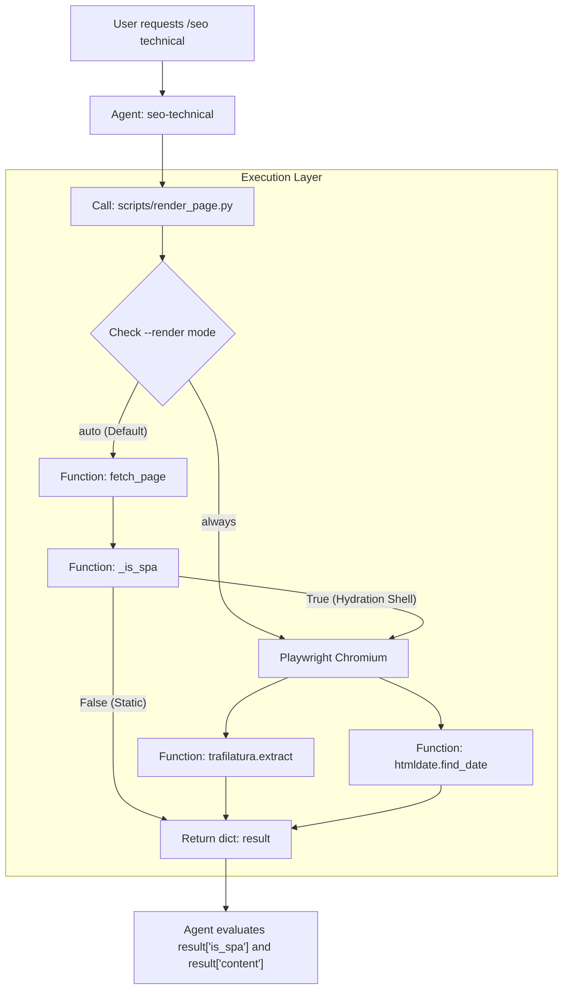

<!-- source: DeepWiki mcp.deepwiki.com · repo AgriciDaniel/claude-seo · page 5.4 JavaScript Rendering · fetched 2026-10-26 -->

# JavaScript Rendering

Relevant source files

The following files were used as context for generating this wiki page:

- [CITATION.cff](CITATION.cff)
- [pyproject.toml](pyproject.toml)
- [requirements.txt](requirements.txt)
- [scripts/analyze_visual.py](scripts/analyze_visual.py)
- [scripts/capture_screenshot.py](scripts/capture_screenshot.py)
- [scripts/fetch_page.py](scripts/fetch_page.py)
- [tests/test_pyproject_metadata.py](tests/test_pyproject_metadata.py)
- [tests/test_render_page.py](tests/test_render_page.py)

## Purpose and Scope

This document covers the JavaScript rendering analysis performed by the `seo-technical` skill. JavaScript rendering analysis determines whether site content is accessible to search engine crawlers in the initial HTML response or requires JavaScript execution to become visible. This is a critical component of technical SEO auditing, particularly for modern web applications.

The system utilizes `render_page.py` to detect Client-Side Rendering (CSR) versus Server-Side Rendering (SSR) and identify Single-Page Application (SPA) hydration shells. It enforces December 2025 guidance regarding AI crawler execution and JavaScript SEO best practices, specifically addressing how LLM crawlers like `ClaudeBot` and `GPTBot` interact with JS-heavy sites.

Sources: [scripts/render_page.py:1-14](), [requirements.txt:11-14]()

## Rendering Detection Flow

The system analyzes JavaScript rendering through a multi-stage detection process centered on the `render_page` function. It leverages `playwright` for headless rendering and `trafilatura` for boilerplate-free content extraction.

### System Flow: Natural Language to Code Entity Space

Sources: [scripts/render_page.py:245-280](), [scripts/fetch_page.py:107-132](), [requirements.txt:8-14]()

## Implementation Details

### SPA Shell Identification
The `_is_spa` heuristic in `render_page.py` identifies hydration shells by searching for common framework signatures and content volume thresholds.

| Pattern | Framework / Target |
|---------|--------------------|
| `

` | React (CRA, Vite, Remix) |
| `
` | Next.js |
| `

` | Vue.js / Generic JS apps |
| `
` | Nuxt.js |
| `data-svelte-h=` | Svelte |
| `<astro-island ` | Astro Islands |
| `you need to enable javascript` | General noscript fallback |
| `Wix.com Website Builder` | Wix (sparse builder shell) |

The detector also flags pages where the `<body>` contains fewer than 100 characters of text after stripping HTML tags, suggesting a JavaScript-dependent application.

Sources: [scripts/render_page.py:118-156](), [tests/test_render_page.py:41-66]()

### SSRF and DNS-Rebinding Protection
Because rendering requires a full browser context, the system implements a "Safe Playwright" architecture to prevent server-side request forgery.

1.  **Pre-flight**: `validate_url_strict` resolves the hostname and rejects non-public IPs before the browser starts.
2.  **In-flight**: `make_safe_playwright_route_handler` attaches a `page.route("**/*", ...)` interceptor that re-validates every subresource (images, scripts, fonts) against private/loopback IP ranges during the render.

Sources: [scripts/url_safety.py:1-40](), [scripts/render_page.py:255-265](), [scripts/capture_screenshot.py:122-135]()

## December 2025 Guidance & AI Crawlers

The system uses rendering data to assess "AI Citation Readiness," focusing on how LLMs perceive the page.

### AI Crawler JS Execution
As of late 2025, major AI crawlers (GPTBot, ClaudeBot) have limited JavaScript execution budgets compared to Googlebot.
- **Guidance**: Sites relying on CSR for main content passages (134-167 words) risk being invisible to LLM-based search engines.
- **Requirement**: Main content should be visible in `raw_content` to ensure high "Citability" scores.
- **Dynamic Rendering Detection**: The system compares response sizes between the `DEFAULT_USER_AGENT` and `GOOGLEBOT_USER_AGENT` to identify if a site serves pre-rendered content only to Googlebot.

Sources: [scripts/fetch_page.py:36-48](), [scripts/render_page.py:158-165]()

### Technical Validation Rules

| Category | Logic |
|----------|-------|
| **Canonical Conflicts** | Compare `<link rel="canonical">` in raw vs rendered content. Flag if different. |
| **Noindex Persistence** | Check if `noindex` exists in raw HTML but is removed by JS. Google honors the raw `noindex`. |
| **Status Code Parity** | If `status_code` is non-200, JS is typically not executed by crawlers. |
| **Schema Injection** | Compare JSON-LD in raw vs rendered. SPA-injected schema (via React Helmet) is flagged for delayed indexing. |

Sources: [scripts/render_page.py:28-46](), [scripts/fetch_page.py:169-180]()

## Analysis Categories

The JavaScript rendering audit evaluates primary aspects using `render_page.py` outputs:

| Analysis Type | Code Entity / Data Point | Purpose |
|--------------|-------------------------|--------------|
| **Content Visibility** | `result['extracted_text']` | Verify main content is extractable post-render via `trafilatura`. |
| **Rendering Method** | `result['mode_used']` | Identify if the page required Playwright (`rendered`) or raw HTTP (`raw`). |
| **Hydration Check** | `result['is_spa']` | Confirm if the server sent a shell or full content. |
| **JSON-LD Extraction** | `_extract_json_ld` | Parses structured data blocks before and after JS execution. |

Sources: [scripts/render_page.py:28-46](), [scripts/render_page.py:176-215]()

## Interaction with Other Skills

### Schema Markup
The system specifically monitors SPA sites because frameworks often inject JSON-LD client-side. The `_extract_json_ld` function in `render_page.py` enforces `JSON_LD_MAX_BLOCKS` (default 50) and `JSON_LD_MAX_BLOCK_BYTES` (default 100,000) to prevent memory exhaustion during audit.

Sources: [scripts/render_page.py:176-215](), [tests/test_render_page.py:159-174]()

### Visual Analysis
The `analyze_visual.py` script uses Playwright to determine if critical elements (H1, CTA) are visible "above the fold" (top 1080px for desktop) after JS execution, which is crucial for SPA usability.

Sources: [scripts/analyze_visual.py:106-112](), [scripts/analyze_visual.py:124-134]()

### Performance (Core Web Vitals)
JavaScript execution is a primary driver of performance issues. The system measures `render_ms` to identify pages where client-side rendering significantly delays the "Time to Interactive."

Sources: [scripts/render_page.py:38-40](), [requirements.txt:17-20]()

---

