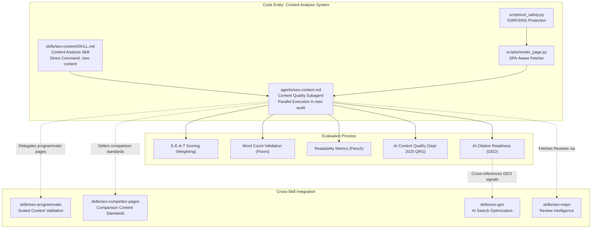
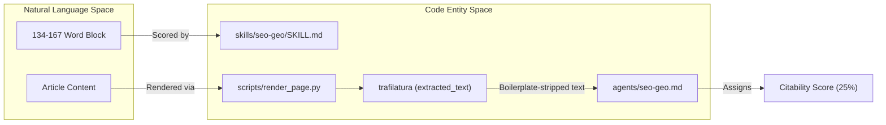

<!-- source: DeepWiki mcp.deepwiki.com · repo AgriciDaniel/claude-seo · page 6 Content Quality & E-E-A-T · fetched 2026-10-26 -->

# Content Quality & E-E-A-T

Relevant source files

The following files were used as context for generating this wiki page:

- [agents/seo-content.md](agents/seo-content.md)
- [agents/seo-ecommerce.md](agents/seo-ecommerce.md)
- [agents/seo-performance.md](agents/seo-performance.md)
- [agents/seo-schema.md](agents/seo-schema.md)
- [agents/seo-sxo.md](agents/seo-sxo.md)
- [agents/seo-technical.md](agents/seo-technical.md)
- [agents/seo-visual.md](agents/seo-visual.md)
- [scripts/google_report.py](scripts/google_report.py)
- [skills/seo-content/SKILL.md](skills/seo-content/SKILL.md)
- [skills/seo-geo/SKILL.md](skills/seo-geo/SKILL.md)
- [skills/seo-image-gen/SKILL.md](skills/seo-image-gen/SKILL.md)
- [skills/seo-local/SKILL.md](skills/seo-local/SKILL.md)
- [skills/seo-maps/SKILL.md](skills/seo-maps/SKILL.md)
- [tests/test_audit_instructions.py](tests/test_audit_instructions.py)

## Purpose and Scope

This page documents the content quality analysis system in `claude-seo`, specifically focused on evaluating content against Google's Experience, Expertise, Authoritativeness, and Trustworthiness (E-E-A-T) framework. The system analyzes content depth, readability, keyword optimization, AI citation readiness, and enforces quality gates to prevent thin content or scaled content abuse based on the September 2025 Quality Rater Guidelines (QRG).

For technical SEO evaluation, see [Technical SEO Analysis](#5). For schema markup validation, see [Schema Markup Management](#7). For AI search optimization workflows, see the AI Citation Readiness section below and consult the `seo-geo` skill.

**Sources:** [skills/seo-content/SKILL.md:1-14](), [agents/seo-content.md:1-7]()

---

## System Components and Code Mapping

The content quality analysis system consists of three primary components that work together to evaluate content against established quality standards.

**Diagram: Content Analysis System Architecture — Code Entities**

The `agents/seo-content.md` file defines the subagent spawned during parallel analysis in `/seo audit` [agents/seo-content.md:1-6](). The `skills/seo-content/SKILL.md` file provides the skill invoked by `/seo content <url>` for standalone content analysis [skills/seo-content/SKILL.md:1-8](). All content fetching is routed through `scripts/render_page.py` which utilizes `scripts/url_safety.py` to prevent SSRF and DNS-rebinding attacks [agents/seo-content.md:70-71]().

**Sources:** [agents/seo-content.md:1-7](), [skills/seo-content/SKILL.md:1-14](), [agents/seo-content.md:70-71]()

---

## E-E-A-T Framework

The system implements Google's September 2025 Quality Rater Guidelines (QRG) E-E-A-T framework with weighted scoring across four factors.

For a detailed breakdown of signals and scoring, see [E-E-A-T Framework](#6.1).

### Scoring Weights

The evaluation uses differential weighting to reflect Google's emphasis on trustworthiness as the foundation of content quality [agents/seo-content.md:21-30]():

| Factor | Weight | Primary Signals |
|--------|--------|----------------|
| **Experience** | 20% | First-hand signals, case studies, original research, photos/videos from direct experience [skills/seo-content/SKILL.md:40-44]() |
| **Expertise** | 25% | Author credentials, certifications, technical depth, accurate well-sourced claims [skills/seo-content/SKILL.md:46-50]() |
| **Authoritativeness** | 25% | External citations, brand mentions, industry recognition, cited by experts [skills/seo-content/SKILL.md:52-56]() |
| **Trustworthiness** | 30% | Contact info, privacy policy, secure site (HTTPS), transparent corrections [skills/seo-content/SKILL.md:58-63]() |

### The "Who / How / Why" Test
The system applies the canonical heuristic from Google's helpful-content guide [skills/seo-content/SKILL.md:18-34]():
- **Who**: Visible byline, author bio page, professional credentials.
- **How**: Process disclosure where readers would ask, especially for AI-assisted content.
- **Why**: "To help people" rather than "to attract search clicks."

**Sources:** [skills/seo-content/SKILL.md:18-63](), [agents/seo-content.md:21-30]()

---

## AI Citation Readiness

The system evaluates content optimization for Generative Engine Optimization (GEO) including Google AI Overviews (Gemini 2.5), ChatGPT, and Perplexity.

For optimization strategies for AI-generated answers, see [AI Citation Readiness](#6.2).

**Diagram: GEO Analysis Data Flow — Code Entities**

**Key GEO Metrics:**
- **Citability Score (25%)**: Focuses on optimal passage lengths (134-167 words) and self-contained answer blocks [skills/seo-geo/SKILL.md:70-82]().
- **Brand Mentions**: Correlate 3x more strongly with AI visibility than backlinks (YouTube, Reddit, Wikipedia) [skills/seo-geo/SKILL.md:51-63]().
- **Technical Accessibility**: AI crawlers (GPTBot, ClaudeBot, PerplexityBot) do NOT execute JavaScript; SSR is critical [skills/seo-geo/SKILL.md:137-146]().

**Sources:** [skills/seo-geo/SKILL.md:68-146](), [agents/seo-content.md:79]()

---

## Content Minimums and Quality Gates

The system enforces quantitative thresholds and qualitative "gates" to prevent thin content and scaled content abuse, aligned with the March 2024 Core Update.

For thresholds and enforcement actions, see [Content Minimums and Quality Gates](#6.3).

### Word Count Analysis
The system compares page content against topical coverage floors [skills/seo-content/SKILL.md:67-77]():
- **Homepage**: 500 words
- **Service Page**: 800 words
- **Blog Post**: 1,500 words
- **Product Page**: 300-400 words [agents/seo-content.md:39]()
- **Location Page**: 500-600 words

### AI Content Assessment (Sept 2025 QRG)
The system flags low-quality AI markers [skills/seo-content/SKILL.md:116-132]():
- **Generic Phrasing**: Lack of specificity or original insight.
- **Repetitive Structure**: Inconsistent structure across scaled pages.
- **Factual Inaccuracies**: Hallucinations or unverified claims.

### Local SEO Content Quality
For location-based pages, the system enforces a **60-70% unique content** minimum to avoid "doorway page" classification [skills/seo-local/SKILL.md:132-135]().

**Sources:** [skills/seo-content/SKILL.md:67-132](), [agents/seo-content.md:32-53](), [skills/seo-local/SKILL.md:123-140]()

---

## Google Updates and QRG Context

The system's logic is synchronized with current Google guidance:

- **March 2024 Core Update**: Merged the Helpful Content System into the core algorithm; helpfulness signals are now continuous [skills/seo-content/SKILL.md:133]().
- **September 2025 QRG Update**: Raters now assess scaled or AI-generated main content patterns rather than AI authorship itself [skills/seo-content/SKILL.md:116-118]().
- **June 2026 AI Guide**: Official guidance confirms AEO/GEO are rebranded SEO; no new AI-specific files (like `llms.txt`) are strictly required, but they are evaluated as signals [skills/seo-content/SKILL.md:135](), [skills/seo-geo/SKILL.md:22-37]().

**Sources:** [skills/seo-content/SKILL.md:133-138](), [skills/seo-geo/SKILL.md:20-37]()

---

