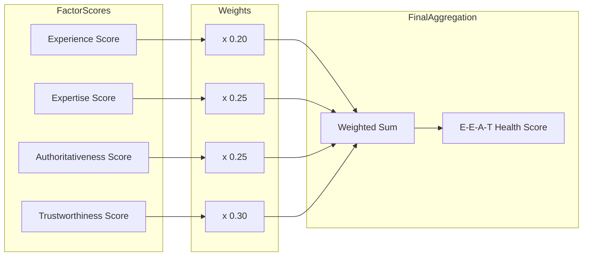

<!-- source: DeepWiki mcp.deepwiki.com · repo AgriciDaniel/claude-seo · page 6.1 E-E-A-T Framework · fetched 2026-10-26 -->

# E-E-A-T Framework

<details>
<summary>Relevant source files</summary>

The following files were used as context for generating this wiki page:

- [skills/seo-audit/SKILL.md](skills/seo-audit/SKILL.md)
- [skills/seo-cluster/SKILL.md](skills/seo-cluster/SKILL.md)
- [skills/seo-content/SKILL.md](skills/seo-content/SKILL.md)
- [skills/seo-drift/SKILL.md](skills/seo-drift/SKILL.md)
- [skills/seo-ecommerce/SKILL.md](skills/seo-ecommerce/SKILL.md)
- [skills/seo-flow/SKILL.md](skills/seo-flow/SKILL.md)
- [skills/seo-geo/SKILL.md](skills/seo-geo/SKILL.md)
- [skills/seo-image-gen/SKILL.md](skills/seo-image-gen/SKILL.md)
- [skills/seo-local/SKILL.md](skills/seo-local/SKILL.md)
- [skills/seo-maps/SKILL.md](skills/seo-maps/SKILL.md)
- [skills/seo-sxo/SKILL.md](skills/seo-sxo/SKILL.md)

</details>


## Purpose and Scope

This document details the E-E-A-T (Experience, Expertise, Authoritativeness, Trustworthiness) evaluation framework implemented in the `seo-content` skill and agent. The framework assesses content quality based on Google's September 2025 Quality Rater Guidelines (QRG) and produces quantitative scores that inform overall content quality assessments.

For content minimums and quality gate enforcement, see [Content Minimums and Quality Gates](6.3). For AI citation readiness optimization (GEO signals), see [AI Citation Readiness](6.2). For comprehensive content analysis workflows, refer to the `seo-content` skill implementation.

---

## Framework Architecture

The E-E-A-T framework operates as a weighted scoring system within the content quality analysis pipeline. Each factor receives a score from 0-100, which is then multiplied by its weight to produce the factor contribution to the overall E-E-A-T score.

### Weighted Factor Model

| Factor | Weight | Score Range | Max Contribution |
|--------|--------|-------------|------------------|
| **Experience** | 20% | 0-100 | 20 points |
| **Expertise** | 25% | 0-100 | 25 points |
| **Authoritativeness** | 25% | 0-100 | 25 points |
| **Trustworthiness** | 30% | 0-100 | 30 points |
| **Total** | 100% | 0-100 | 100 points |

The weighting reflects Google's September 2025 QRG emphasis on Trustworthiness as the most critical factor, followed by equal weighting for Expertise and Authoritativeness, with Experience as an important but less heavily weighted signal [skills/seo-content/SKILL.md:36-64]().

**Sources:** [skills/seo-content/SKILL.md:36-64](), [skills/seo-audit/SKILL.md:106-112]()

---

## E-E-A-T Factor Definitions

### Experience (20% Weight)

Experience evaluates first-hand signals that demonstrate the content creator has direct, personal experience with the topic. This is the differentiator between theoretical knowledge and practical application.

**Signal Categories:**

| Signal Type | Examples | Detection Method |
|-------------|----------|------------------|
| **Original Research** | Case studies, before/after results, A/B test data | Presence of unique data points, charts, statistical analysis |
| **Personal Anecdotes** | Process documentation, lessons learned, specific examples | First-person narrative, temporal markers ("when we...", "in our testing...") |
| **Proprietary Insights** | Unique methodologies, internal data, custom frameworks | Original diagrams, proprietary tools, non-generic advice |
| **Direct Evidence** | Photos from implementation, videos of process, screenshots | Embedded media showing actual work product |

**Scoring Criteria:**
- **80-100:** Multiple first-hand signals with specific, verifiable details [skills/seo-content/SKILL.md:40-45]().
- **60-79:** Some first-hand signals but lacks depth or specificity.
- **40-59:** Primarily theoretical with minimal personal experience markers.
- **0-39:** No discernible first-hand experience signals.

**Sources:** [skills/seo-content/SKILL.md:40-45]()

### Expertise (25% Weight)

Expertise assesses the content creator's qualifications, technical accuracy, and depth of knowledge appropriate for the topic and audience.

**Signal Categories:**

| Signal Type | Examples | Detection Method |
|-------------|----------|------------------|
| **Author Credentials** | Professional certifications, academic degrees, job titles | Presence of author bio, credential statements |
| **Professional Background** | Years in field, relevant industry experience | Author page with work history, LinkedIn profile links |
| **Technical Depth** | Advanced concepts explained accurately, proper terminology | Complexity analysis, technical term density, accuracy of definitions |
| **Source Quality** | Citations to academic papers, industry standards, authoritative sources | External link analysis, citation quality assessment |

**Scoring Criteria:**
- **80-100:** Clear expert credentials with deep technical accuracy [skills/seo-content/SKILL.md:46-51]().
- **60-79:** Demonstrated competence with good technical depth.
- **40-59:** Basic knowledge with some technical gaps.
- **0-39:** Insufficient expertise signals or factual inaccuracies.

**Sources:** [skills/seo-content/SKILL.md:46-51]()

### Authoritativeness (25% Weight)

Authoritativeness measures external recognition and reputation signals that indicate the content creator or brand is a recognized source in their field.

**Signal Categories:**

| Signal Type | Examples | Detection Method |
|-------------|----------|------------------|
| **External Citations** | Backlinks from authoritative domains, mentions in industry publications | Backlink profile analysis via `seo-backlinks` [skills/seo-audit/SKILL.md:31]() |
| **Brand Recognition** | Industry awards, media mentions, conference speaking | Presence of recognition badges, press mentions |
| **Published Elsewhere** | Guest posts on authoritative sites, quoted in news articles | Author bylines on external domains |
| **Peer Recognition** | Cited by other experts, referenced in academic papers | Inbound citation analysis |

**Scoring Criteria:**
- **80-100:** Strong external recognition with multiple authoritative citations [skills/seo-content/SKILL.md:52-57]().
- **60-79:** Moderate external recognition with some authoritative backlinks.
- **40-59:** Limited external recognition, few authoritative citations.
- **0-39:** No discernible external authority signals.

**Sources:** [skills/seo-content/SKILL.md:52-57](), [skills/seo-audit/SKILL.md:31]()

### Trustworthiness (30% Weight)

Trustworthiness evaluates signals that establish credibility, transparency, and security. This is the highest-weighted factor as of the September 2025 QRG update.

**Signal Categories:**

| Signal Type | Examples | Detection Method |
|-------------|----------|------------------|
| **Contact Information** | Physical address, phone number, email | Footer/contact page presence [skills/seo-content/SKILL.md:59]() |
| **Transparency** | Privacy policy, terms of service, about page | Legal page presence [skills/seo-content/SKILL.md:60]() |
| **Social Proof** | Customer testimonials, user reviews, ratings | Review schema detection [skills/seo-content/SKILL.md:61]() |
| **Temporal Signals** | Publication dates, last updated timestamps | Visible date stamps [skills/seo-content/SKILL.md:62]() |
| **Security** | HTTPS, security headers | Technical security audit [skills/seo-content/SKILL.md:63]() |

**Scoring Criteria:**
- **80-100:** Comprehensive trust signals including legal pages, contact info, and security [skills/seo-content/SKILL.md:58-64]().
- **60-79:** Most trust signals present but missing some elements.
- **40-59:** Basic trust signals only.
- **0-39:** Minimal or absent trust signals, security concerns.

**Sources:** [skills/seo-content/SKILL.md:58-64]()

---

## Implementation in Code

### E-E-A-T Analysis Flow

Title: "seo-content" Orchestration Logic
```mermaid
graph TB
    subgraph "ContentInput"
        [URL] --> [render_page.py]
        [render_page.py] --> [parse_html.py]
    end
    
    subgraph "Orchestration"
        [parse_html.py] --> [seo-content/SKILL.md]
        [seo-content/SKILL.md] --> "Who/How/Why Test"
    end
    
    subgraph "SignalDetection"
        "Who/How/Why Test" --> "Experience Analysis"
        "Who/How/Why Test" --> "Expertise Analysis"
        "Who/How/Why Test" --> "Authoritativeness Analysis"
        "Who/How/Why Test" --> "Trustworthiness Analysis"
    end
    
    subgraph "ExternalVerification"
        "Authoritativeness Analysis" -.-> [seo-backlinks]
        "Trustworthiness Analysis" -.-> [seo-technical]
        "Experience Analysis" -.-> [seo-geo]
    end
    
    subgraph "Scoring"
        "Experience Analysis" --> E[Score: 0.20]
        "Expertise Analysis" --> Ex[Score: 0.25]
        "Authoritativeness Analysis" --> A[Score: 0.25]
        "Trustworthiness Analysis" --> T[Score: 0.30]
        E & Ex & A & T --> [SEO Health Score]
    end
```

**Sources:** [skills/seo-content/SKILL.md:18-64](), [skills/seo-audit/SKILL.md:15-38](), [skills/seo-geo/SKILL.md:68-137]()

### Core Skill Logic

The E-E-A-T framework is implemented primarily through these core files:

**`skills/seo-content/SKILL.md`** - Primary skill documentation for direct `/seo content` invocations.
- Lines 18-34: Google's "Who / How / Why" canonical heuristic test [skills/seo-content/SKILL.md:18-34]().
- Lines 36-64: E-E-A-T framework detail with signal examples for each pillar [skills/seo-content/SKILL.md:36-64]().
- Lines 116-132: AI content assessment criteria integrated with E-E-A-T [skills/seo-content/SKILL.md:116-132]().
- Lines 135-157: AI Citation Readiness (GEO signals) as an extension of E-E-A-T [skills/seo-content/SKILL.md:135-157]().

**`skills/seo-geo/SKILL.md`** - GEO analysis that maps brand signals to authority.
- Lines 51-64: Correlation of brand mentions (YouTube, Reddit) to AI visibility [skills/seo-geo/SKILL.md:51-64]().
- Lines 119-136: Authority and Brand Signals weighting (20%) [skills/seo-geo/SKILL.md:119-136]().

**Sources:** [skills/seo-content/SKILL.md:1-159](), [skills/seo-geo/SKILL.md:1-170]()

---

## Scoring Algorithm

### Weighted Score Calculation

Title: "seo-content" Scoring Weights


**Sources:** [skills/seo-audit/SKILL.md:106-112](), [skills/seo-content/SKILL.md:36-64]()

---

## Integration with Content Analysis Pipeline

### Cross-Skill Delegation

The E-E-A-T framework integrates with other specialized skills for comprehensive content assessment:

- **Programmatic content** → `seo-programmatic` evaluates uniqueness and thin content prevention [skills/seo-audit/SKILL.md:35]().
- **Search Experience** → `seo-sxo` analyzes page-type mismatch which impacts perceived expertise [skills/seo-sxo/SKILL.md:77-90]().
- **Technical trust signals** → `seo-technical` provides security headers and HTTPS status for Trustworthiness [skills/seo-audit/SKILL.md:21]().
- **Brand authority** → `seo-geo` provides brand mention correlation (YouTube, Reddit, Wikipedia) which feeds into Authoritativeness [skills/seo-geo/SKILL.md:51-64]().

### AI Citation Readiness (GEO)

E-E-A-T is the foundation for AI search visibility. The `seo-geo` skill maps E-E-A-T signals to specific platform citation rates:

| Signal | Correlation with AI Citations | Pillar Mapping |
|--------|------------------------------|----------------|
| YouTube mentions | ~0.737 (Strongest) | Authoritativeness [skills/seo-geo/SKILL.md:58]() |
| Wikipedia Presence | High | Expertise/Authority [skills/seo-geo/SKILL.md:60]() |
| Author Bylines | Strong Signal | Expertise [skills/seo-geo/SKILL.md:122]() |
| Citations to Primary Sources | Strong Signal | Expertise [skills/seo-geo/SKILL.md:125]() |

**Sources:** [skills/seo-geo/SKILL.md:49-62](), [skills/seo-content/SKILL.md:135-157]()

---

## September 2025 QRG Updates

### AI Content Assessment Integration

The system flags low-quality AI content markers that negatively impact E-E-A-T scores:
- **Generic phrasing**: Lack of specificity reduces Expertise [skills/seo-content/SKILL.md:127]().
- **No original insight**: Lack of unique perspective reduces Experience [skills/seo-content/SKILL.md:128]().
- **Factual inaccuracies**: Directly impacts Trustworthiness [skills/seo-content/SKILL.md:131]().
- **Repetitive structure**: Indicates lack of human oversight [skills/seo-content/SKILL.md:129]().

### Helpful Content System (HCS) Status
As of March 2024, the Helpful Content System is merged into Google's core ranking algorithm. Helpfulness signals (Who/How/Why) are evaluated within every core update rather than through standalone classifiers [skills/seo-content/SKILL.md:133]().

**Sources:** [skills/seo-content/SKILL.md:116-133](), [skills/seo-geo/SKILL.md:22-37]()

---

