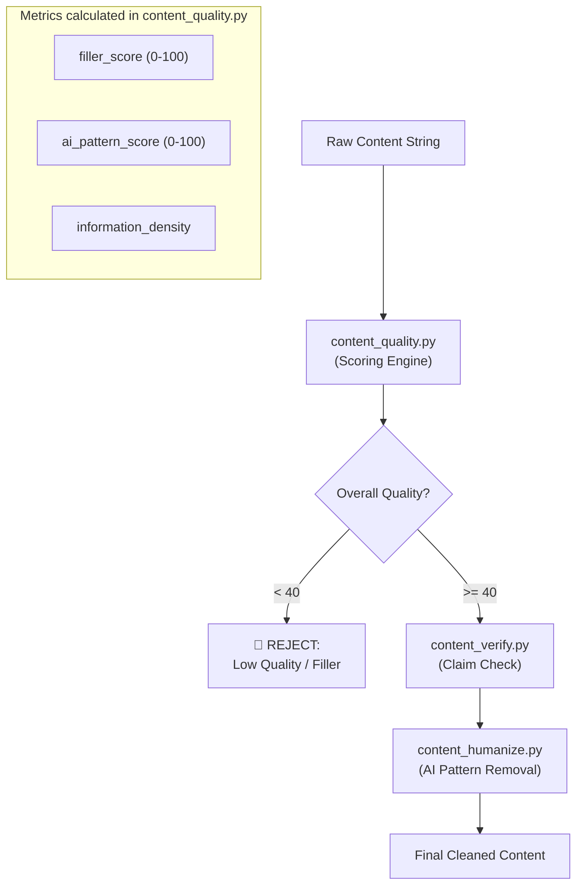
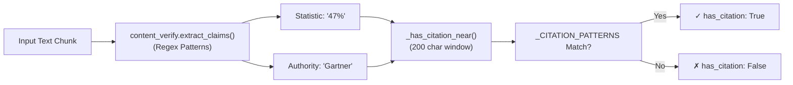
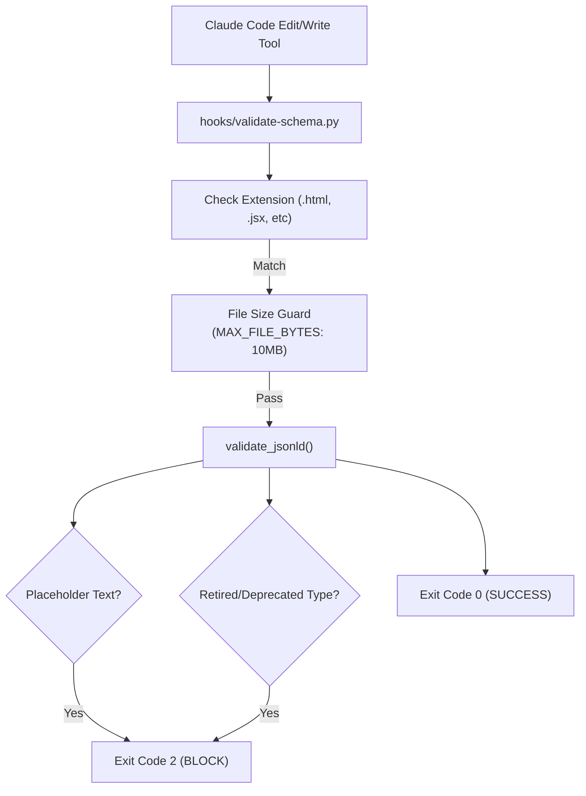

<!-- source: DeepWiki mcp.deepwiki.com · repo AgriciDaniel/claude-seo · page 6.3 Content Minimums and Quality Gates · fetched 2026-10-26 -->

# Content Minimums and Quality Gates

Relevant source files

The following files were used as context for generating this wiki page:

- [data/google-updates.json](data/google-updates.json)
- [docs/MIGRATION-v1-to-v2.md](docs/MIGRATION-v1-to-v2.md)
- [extensions/firecrawl/install.ps1](extensions/firecrawl/install.ps1)
- [extensions/firecrawl/uninstall.sh](extensions/firecrawl/uninstall.sh)
- [hooks/validate-schema.py](hooks/validate-schema.py)
- [scripts/content_humanize.py](scripts/content_humanize.py)
- [scripts/content_quality.py](scripts/content_quality.py)
- [scripts/content_verify.py](scripts/content_verify.py)
- [scripts/domain_history.py](scripts/domain_history.py)
- [scripts/seo_updates.py](scripts/seo_updates.py)
- [tests/test_content_quality.py](tests/test_content_quality.py)
- [tests/test_schema_hook_policy.py](tests/test_schema_hook_policy.py)

This page documents the quantitative thresholds and enforcement mechanisms that prevent low-quality content from entering production. The system implements a multi-tier quality gate architecture using `content_quality.py`, `content_humanize.py`, and `content_verify.py` to enforce word counts, uniqueness percentages, readability metrics, and AI content detection aligned with the September 2025 Quality Rater Guidelines (QRG).

## Content Minimum Thresholds

The system enforces minimum word counts per page type to ensure adequate topical coverage. These thresholds are defined in the content agent instructions and orchestration skills.

| Page Type | Minimum Words | Rationale |
|-----------|---------------|-----------|
| Homepage | 500 | Broad topical introduction to business/site |
| Service page | 800 | Comprehensive service description with benefits and differentiation |
| Blog post | 1,500 | In-depth topical coverage with actionable insights |
| Product page | 300+ | Specifications and use cases; validates against `schema_ecommerce_validate.py` |
| Location page | 500-600 | Unique location-specific content to avoid "doorway page" penalties |

**Important Context**: These are topical coverage floors. [skills/seo-content/SKILL.md:43-53]() explicitly states that word count is not a direct ranking factor, but a proxy for comprehensiveness.

**Diagram: Content Quality Pipeline**

Sources: [scripts/content_quality.py:167-211](), [skills/seo-content/SKILL.md:43-53]()

## AI Content Detection and Humanization

The system identifies and remediates low-quality AI-generated content using the `content_quality.py` and `content_humanize.py` modules. These tools align with the January 2025 and September 2025 QRG updates regarding "Scaled Content Abuse" (§4.6.5) [data/google-updates.json:92-97]().

### Detection Heuristics (`content_quality.py`)
The `analyse()` function scores content against several AI-typical markers:
*   **Filler Phrases**: Detects 26+ padding phrases like "it's important to note that" or "in today's fast-paced world" [scripts/content_quality.py:60-87]().
*   **AI Patterns**: Identifies 40+ LLM-typical phrasings such as "delve into", "tapestry of", and "ever-evolving landscape" [scripts/content_quality.py:94-141]().
*   **Information Density**: Calculates `density_per_100` based on entities (proper nouns via `_ENTITY_RE`) and numbers per 100 tokens. High-density content (>0.5) is favored over generic filler (<0.2) [scripts/content_quality.py:189-195]().
*   **Repetition Score**: Measures bigram repetition as a fraction of recurring bigrams [scripts/content_quality.py:157-164]().

### Remediation (`content_humanize.py`)
The `humanize()` function performs deterministic 1:1 swaps of detected AI idioms for direct prose using a predefined `_REPLACEMENTS` table [scripts/content_humanize.py:38-87](), [scripts/content_humanize.py:105-131]().
*   **Example**: "Delve into" → "Explore" [scripts/content_humanize.py:40]().
*   **Example**: "Leverage the power of" → "Use" [scripts/content_humanize.py:61]().
*   **Example**: "In today's fast-paced world" → "Today" [scripts/content_humanize.py:78-79]().
*   **Case Preservation**: The `_preserve_case()` helper ensures that if an original phrase starts a sentence (uppercase), the replacement is also capitalized [scripts/content_humanize.py:96-102]().

Sources: [scripts/content_quality.py:1-45](), [scripts/content_humanize.py:1-32](), [data/google-updates.json:92-97]()

## Claim Verification and Citations

To meet E-E-A-T standards for "Trustworthiness," the system uses `content_verify.py` to detect "citation gaps."

*   **Claim Extraction**: The `extract_claims()` function identifies statistics, quantities, authority mentions (e.g., "Forrester said"), and temporal claims using `_CLAIM_PATTERNS` [scripts/content_verify.py:64-87](), [scripts/content_verify.py:123-144]().
*   **Citation Window**: The `_has_citation_near()` function looks for a markdown link, HTML `<a>` tag, footnote, or proper noun attribution within a +/- 200 character window of the claim [scripts/content_verify.py:95-107](), [scripts/content_verify.py:110-120]().
*   **Quality Gate**: The `verify()` function calculates an `uncited_ratio`. An `uncited_ratio` exceeding the `--threshold` (default 0.4) triggers a non-zero exit code [scripts/content_verify.py:147-155](), [scripts/content_verify.py:168-169]().

**Diagram: Claim Verification Logic**

Sources: [scripts/content_verify.py:1-47](), [scripts/content_verify.py:147-155]()

## Uniqueness and Scaled Content Gates

The system enforces strict uniqueness thresholds to prevent "Scaled Content Abuse" violations (Google policy effective March 2024) [data/google-updates.json:29-34]().

| Uniqueness % | Action | Rationale |
|--------------|--------|-----------|
| < 30% | 🛑 **HARD STOP** | Critical risk of site-reputation or scaled abuse manual actions. |
| 30-40% | ⚠️ **WARNING** | Borderline thin content; requires human intervention. |
| > 60% | ✅ **PASS** | Required threshold for location pages once count exceeds 30. |

### Expired Domain Abuse
The `domain_history.py` script provides additional defense-in-depth by checking for "Expired Domain Abuse" (QRG §4.6.7).
*   **Heritage Signals**: It uses `_shell_whois()` or a `_socket_whois()` fallback to retrieve the `creation date` [scripts/domain_history.py:85-140]().
*   **Topical Shift**: The `assess_risk()` function compares registration age against a `current_topic`. A significant shift (e.g., Veterinary site → Crypto hub) triggers a "High Risk" alert [scripts/domain_history.py:5-9](), [scripts/domain_history.py:216-221]().

Sources: [scripts/domain_history.py:1-51](), [data/google-updates.json:43-48]()

## Automated Schema Validation Hook

The system uses `hooks/validate-schema.py` as a `PostToolUse` hook to prevent malformed or outdated schema from being saved to the codebase [hooks/validate-schema.py:7-27]().

*   **Validation Logic**: The `validate_jsonld()` function extracts `@context` and `@type` blocks and checks for placeholder text (e.g., "[Business Name]") [hooks/validate-schema.py:40-98]().
*   **Enforcement Actions**:
    *   **Critical (Exit 2)**: Blocks the edit if it contains placeholder text, deprecated types, or retired rich-result types [hooks/validate-schema.py:178-191]().
    *   **Warning (Exit 1)**: Allows the edit but surfaces non-critical warnings [hooks/validate-schema.py:182-193]().
*   **Policy Exceptions**: `FAQPage` is explicitly NOT blocked despite Google retiring rich results for it, as it remains a valid Schema.org type [hooks/validate-schema.py:114-116](), [tests/test_schema_hook_policy.py:29-30]().

**Diagram: Schema Validation Hook Flow**

Sources: [hooks/validate-schema.py:1-197](), [tests/test_schema_hook_policy.py:1-34](), [data/google-updates.json:121-126]()

---

