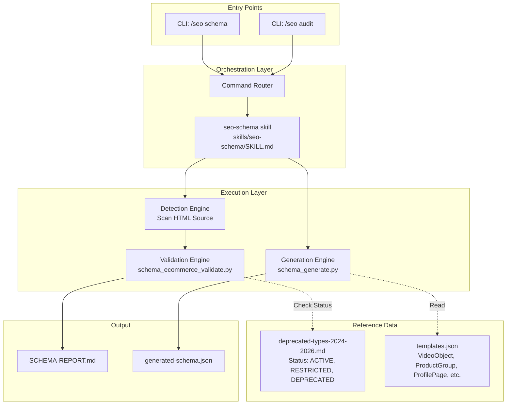
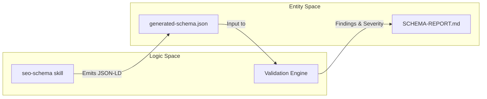

<!-- source: DeepWiki mcp.deepwiki.com · repo AgriciDaniel/claude-seo · page 7 Schema Markup Management · fetched 2026-10-26 -->

# Schema Markup Management

Relevant source files

The following files were used as context for generating this wiki page:

- [schema/templates.json](schema/templates.json)
- [skills/seo-competitor-pages/SKILL.md](skills/seo-competitor-pages/SKILL.md)
- [skills/seo-hreflang/SKILL.md](skills/seo-hreflang/SKILL.md)
- [skills/seo-plan/SKILL.md](skills/seo-plan/SKILL.md)
- [skills/seo-programmatic/SKILL.md](skills/seo-programmatic/SKILL.md)
- [skills/seo-schema/SKILL.md](skills/seo-schema/SKILL.md)
- [skills/seo-sitemap/SKILL.md](skills/seo-sitemap/SKILL.md)

This document provides a comprehensive guide to the schema markup system in `claude-seo`, covering detection, validation, and generation of Schema.org structured data. The system prioritizes JSON-LD format and enforces strict quality gates to prevent deprecated schema types and common implementation errors.

For detailed information on specific subsystems, see:
- [Schema Detection and Validation](#7.1) — How the system detects JSON-LD, Microdata, and RDFa, validates against Google's requirements, enforces ISO 8601 dates and absolute URLs, and uses `schema_ecommerce_validate.py` for Product schema policy.
- [Schema Generation and Templates](#7.2) — Using `schema_generate.py` for reservation, order, discussion, and profile subcommands; built-in templates in `schema/templates.json`; and best practices for JSON-LD implementation.
- [Schema Type Status Reference](#7.3) — Comprehensive reference of Active, Restricted, and Deprecated schema types with timelines from 2024–2026, including FAQPage restrictions and HowTo/SpecialAnnouncement deprecations.

---

## System Architecture

The schema markup system operates as a specialized sub-skill within the `claude-seo` ecosystem. It leverages Python scripts for generation and validation, referencing authoritative status lists to ensure compliance with the latest search engine policies.

### Schema Processing Pipeline

**Sources:** [skills/seo-schema/SKILL.md:1-168](), [skills/seo-schema/SKILL.md:40-48](), [skills/seo-schema/SKILL.md:151-165]()

---

## Detection Mechanisms

The system detects schema markup using three parallel detection methods, prioritizing JSON-LD as the recommended format per Google's explicit guidance [skills/seo-schema/SKILL.md:20-23]().

### Detection Methods

| Format | Detection Pattern | Priority | Notes |
|--------|------------------|----------|-------|
| JSON-LD | `<script type="application/ld+json">` | 1 (Recommended) | Google's stated preference [skills/seo-schema/SKILL.md:23]() |
| Microdata | `itemscope`, `itemprop` attributes | 2 | Legacy format [skills/seo-schema/SKILL.md:21]() |
| RDFa | `typeof`, `property` attributes | 3 | Legacy format [skills/seo-schema/SKILL.md:22]() |

**Sources:** [skills/seo-schema/SKILL.md:20-23]()

---

## Validation and Policy Enforcement

The system uses `schema_ecommerce_validate.py` to catch "policy errors"—fields that parse correctly but disqualify a product from rich features. This goes beyond structural JSON validation to enforce Google's 2025 Merchant Listing requirements.

### E-commerce Policy Checklist
- **Merchant Return Policy**: `hasMerchantReturnPolicy` is required for merchant listings.
- **Shipping Details**: `shippingDetails` is required for merchant listings.
- **EU Energy Compliance**: `energyEfficiencyClass` is flagged if missing in EU mode.
- **Product Variants**: Checks for `ProductGroup` usage for size/color variants.
- **Adult Products**: `hasAdultConsideration` (value `https://schema.org/SexualContentConsideration`) is required for adult products as of May 2026 [skills/seo-schema/SKILL.md:69]().

### Validation Severity Matrix

| Severity | Meaning | Example |
|----------|---------|---------|
| **Critical** | Blocks rich results or uses deprecated types | `@type="HowTo"` [skills/seo-schema/SKILL.md:56]() |
| **High** | Missing required Google merchant fields | Missing `shippingDetails` [skills/seo-schema/SKILL.md:27-28]() |
| **Medium** | Missing sub-properties of required fields | Relative URLs instead of absolute [skills/seo-schema/SKILL.md:34]() |
| **Info** | Optimization suggestions | Existing `FAQPage` (retired for rich results May 2026) [skills/seo-schema/SKILL.md:53]() |

**Sources:** [skills/seo-schema/SKILL.md:25-36](), [skills/seo-schema/SKILL.md:53-64](), [skills/seo-schema/SKILL.md:69]()

---

## Schema Type Status Reference

The system maintains a temporal awareness of schema deprecations. Using types retired in 2025 or 2026 is flagged as a policy violation [skills/seo-schema/SKILL.md:36]().

### Deprecation Timeline (2024–2026)

| Type | Status | Retirement Date | Replacement / Notes |
|------|--------|-----------------|---------------------|
| **VehicleListing** | Deprecated | June 2025 | Retired from rich results [skills/seo-schema/SKILL.md:60]() |
| **SpecialAnnouncement**| Deprecated | July 2025 | Retired from rich results [skills/seo-schema/SKILL.md:57]() |
| **Practice Problem** | Deprecated | Jan 2026 | Rich Results Test support removed [skills/seo-schema/SKILL.md:61]() |
| **FAQPage** | Restricted | May 7, 2026 | Retired for ALL sites; use `QAPage` for user Q&A [skills/seo-schema/SKILL.md:53]() |
| **HowTo** | Deprecated | Sept 2023 | Rich results removed [skills/seo-schema/SKILL.md:56]() |

**Sources:** [skills/seo-schema/SKILL.md:52-64](), [skills/seo-schema/SKILL.md:69]()

---

## Schema Generation Workflow

Generation is handled via the `seo-schema` skill, utilizing `schema/templates.json` for standardized JSON-LD output. The system focuses on high-leverage types that drive AI citations and specialized SERP features [skills/seo-schema/SKILL.md:48]().

### High-Leverage Templates

| Type | Template Source | Purpose |
|---------|---------------|---------|
| `VideoObject` | `templates.json` | Enables video rich results and "Key Moments" [schema/templates.json:4-25]() |
| `ProductGroup` | `templates.json` | Groups variants (size/color) for e-commerce [schema/templates.json:114-141]() |
| `ProfilePage` | `templates.json` | Enhances E-E-A-T via `Person` and `sameAs` links [schema/templates.json:143-159]() |
| `Certification` | `templates.json` | Replaced `EnergyConsumptionDetails` in April 2025 [schema/templates.json:161-176]() |

### Generation Quality Rules
1. **Absolute URLs**: All generated URLs must be absolute [skills/seo-schema/SKILL.md:34]().
2. **ISO 8601 Dates**: Date strings must follow standard formats (e.g., `YYYY-MM-DD`) [skills/seo-schema/SKILL.md:137-138]().
3. **Entity Disambiguation**: The `Organization` and `Person` templates use `sameAs` to correlate entities across social and professional graphs [skills/seo-schema/SKILL.md:95-99]().

**Sources:** [skills/seo-schema/SKILL.md:71-150](), [schema/templates.json:1-200]()

---

## Integration and Reporting

The schema system outputs two primary artifacts to the user after analysis or generation.

### System Data Flow

- **SCHEMA-REPORT.md**: Contains detection results, validation findings (✅/⚠️/❌), and missing opportunities [skills/seo-schema/SKILL.md:153-165]().
- **generated-schema.json**: Ready-to-use JSON-LD snippets with clearly marked placeholders for user review [skills/seo-schema/SKILL.md:154]().

**Sources:** [skills/seo-schema/SKILL.md:151-165]()

---

