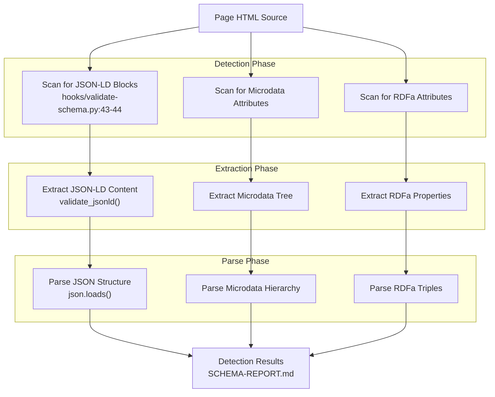
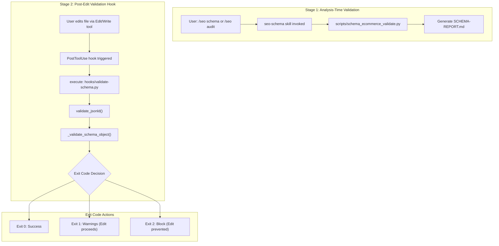
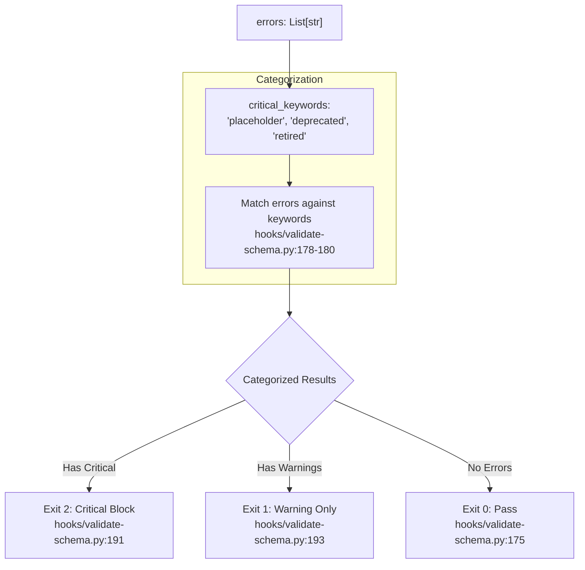

<!-- source: DeepWiki mcp.deepwiki.com · repo AgriciDaniel/claude-seo · page 7.1 Schema Detection and Validation · fetched 2026-10-26 -->

# Schema Detection and Validation

Relevant source files

The following files were used as context for generating this wiki page:

- [docs/MIGRATION-v1-to-v2.md](docs/MIGRATION-v1-to-v2.md)
- [extensions/firecrawl/install.ps1](extensions/firecrawl/install.ps1)
- [extensions/firecrawl/uninstall.sh](extensions/firecrawl/uninstall.sh)
- [hooks/validate-schema.py](hooks/validate-schema.py)
- [scripts/schema_ecommerce_validate.py](scripts/schema_ecommerce_validate.py)
- [scripts/schema_generate.py](scripts/schema_generate.py)
- [skills/seo-schema/references/deprecated-types-2024-2026.md](skills/seo-schema/references/deprecated-types-2024-2026.md)
- [tests/test_schema_hook_policy.py](tests/test_schema_hook_policy.py)
- [tests/test_schema_v2.py](tests/test_schema_v2.py)

## Purpose and Scope

This document covers how the `claude-seo` system detects and validates Schema.org structured data markup. Detection identifies three markup formats (JSON-LD, Microdata, RDFa) in HTML sources, while validation enforces structural correctness, deprecation policies, and content quality standards.

The system uses a combination of the `seo-schema` subagent for live analysis and a post-edit validation hook (`hooks/validate-schema.py`) to prevent invalid schema from being committed during file edits. Specialized validation for Merchant Center compliance is provided by `scripts/schema_ecommerce_validate.py`.

---

## Detection System

The system implements a three-format detection strategy to identify all Schema.org markup present on a page.

### Supported Formats

| Format | Detection Signature | Preference Rank | Notes |
|--------|---------------------|-----------------|-------|
| JSON-LD | `<script type="application/ld+json">` | 1 (Recommended) | Google's stated preference [hooks/validate-schema.py:43-44]() |
| Microdata | `itemscope`, `itemprop` attributes | 2 | Legacy format support |
| RDFa | `typeof`, `property` attributes | 3 | Legacy format support |

The system always recommends JSON-LD as the primary implementation format. The `validate_jsonld()` function in `hooks/validate-schema.py` implements JSON-LD detection using a regex pattern [hooks/validate-schema.py:43-44](). The function handles both single schema objects and arrays of schema objects [hooks/validate-schema.py:57-61]().

**Diagram: Schema Detection and Extraction Flow**

Sources: [hooks/validate-schema.py:40-63]()

---

## Validation Architecture

The system implements a **two-stage validation architecture**: real-time validation during analysis and post-edit validation via a hook system.

### Validation Stages

**Diagram: Dual-Stage Validation Pipeline**

Sources: [hooks/validate-schema.py:1-31](), [scripts/schema_ecommerce_validate.py:24-30](), [tests/test_schema_hook_policy.py:18-26]()

### Hook Configuration

The post-edit validation hook is configured in `~/.claude/settings.json` to intercept `Edit` and `Write` tool operations [hooks/validate-schema.py:7-27](). The script only processes HTML-like files: `.html`, `.htm`, `.jsx`, `.tsx`, `.vue`, `.svelte`, `.php`, `.ejs` [hooks/validate-schema.py:152-154]().

---

## Validation Policies

The validation system enforces structural correctness, policy compliance, and content quality.

### Validation Check Categories

*   **Structural**: Validates `@context` (must be `https://schema.org`) and `@type` presence [hooks/validate-schema.py:72-80]().
*   **Quality**: Detects placeholder text such as `[Business Name]`, `[URL]`, or `REPLACE` [hooks/validate-schema.py:82-97]().
*   **Policy**: Flags deprecated types that no longer produce rich results [hooks/validate-schema.py:99-112]().

### Deprecation Policy (2024-2026)

The system maintains an authoritative list of retired Schema.org types. The hook and the ecommerce validator both flag these as **Critical** findings [hooks/validate-schema.py:178-191](), [scripts/schema_ecommerce_validate.py:44-57]().

| Schema Type | Status | Retirement Date | replacement |
|-------------|--------|-----------------|-------------|
| `VehicleListing` | Retired | June 2025 | `Product` [skills/seo-schema/references/deprecated-types-2024-2026.md:16]() |
| `ClaimReview` | Retired | June 2025 | None [skills/seo-schema/references/deprecated-types-2024-2026.md:17]() |
| `EstimatedSalary` | Retired | June 2025 | `JobPosting` [skills/seo-schema/references/deprecated-types-2024-2026.md:18]() |
| `LearningVideo` | Retired | June 2025 | `VideoObject` [skills/seo-schema/references/deprecated-types-2024-2026.md:19]() |
| `SpecialAnnouncement`| Retired | July 2025 | `Event` / `Article` [skills/seo-schema/references/deprecated-types-2024-2026.md:26]() |
| `HowTo` | Deprecated | Sept 2023 | None (Rich Result removed) [skills/seo-schema/references/deprecated-types-2024-2026.md:34]() |
| `FAQPage` | Retired | May 7, 2026 | **Note: Valid type, but no SERP benefit.** [skills/seo-schema/references/deprecated-types-2024-2026.md:35]() |

**Policy Exception**: `FAQPage` is intentionally **NOT** blocked by the validation hook because it remains a valid Schema.org type, even though Google retired its rich results [hooks/validate-schema.py:114-116](), [tests/test_schema_hook_policy.py:29-31]().

---

## Ecommerce and Product Validation

The script `scripts/schema_ecommerce_validate.py` provides deep validation for Merchant Listing eligibility.

### Merchant Listing Requirements
The validator checks for four property groups that influence merchant diagnostics [scripts/schema_ecommerce_validate.py:5-16]():
1.  **Base Minimum**: `name`, `image`, and `offers` [scripts/schema_ecommerce_validate.py:60]().
2.  **Offer Type**: Must be `@type: Offer` (not `AggregateOffer`) for merchant listings [scripts/schema_ecommerce_validate.py:164-176]().
3.  **Policy Details**: `hasMerchantReturnPolicy` and `shippingDetails` [scripts/schema_ecommerce_validate.py:185-186]().
4.  **EU Compliance**: When `--eu` is passed, `energyEfficiencyClass` is required for relevant categories [scripts/schema_ecommerce_validate.py:14-15](), [tests/test_schema_v2.py:173-186]().

Sources: [scripts/schema_ecommerce_validate.py:1-31](), [tests/test_schema_v2.py:118-196]()

---

## Exit Code System

The validation hook `hooks/validate-schema.py` uses exit codes to communicate with Claude Code.

| Exit Code | Meaning | Action |
|-----------|---------|--------|
| `0` | Pass | No schema found or schema is valid [hooks/validate-schema.py:149](). |
| `1` | Warning | Non-critical issues found (e.g., missing recommended fields). Edit proceeds [hooks/validate-schema.py:193](). |
| `2` | Block | **Critical** issues found (placeholders, retired types). Edit is aborted [hooks/validate-schema.py:191](). |

**Diagram: Exit Code Decision Logic**

Sources: [hooks/validate-schema.py:172-197]()

---

## Guardrails and Performance

To maintain low latency during the hook execution, the system implements several guardrails:
*   **File Size Limit**: Files exceeding 10 MiB are skipped to prevent memory exhaustion [hooks/validate-schema.py:159-164]().
*   **Extension Filtering**: Only specific web-template and script extensions are validated [hooks/validate-schema.py:152-154]().
*   **Timeout/Error Handling**: The script exits gracefully (code 0) on file access errors to avoid blocking user workflow due to environment issues [hooks/validate-schema.py:169-170]().

Sources: [hooks/validate-schema.py:146-170]()

---

