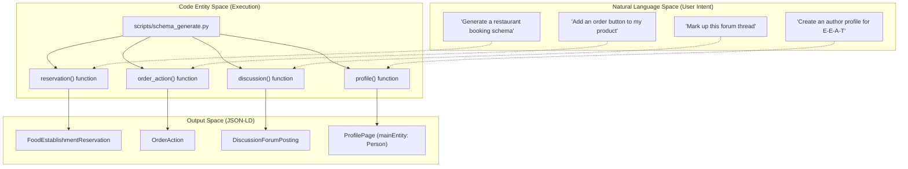
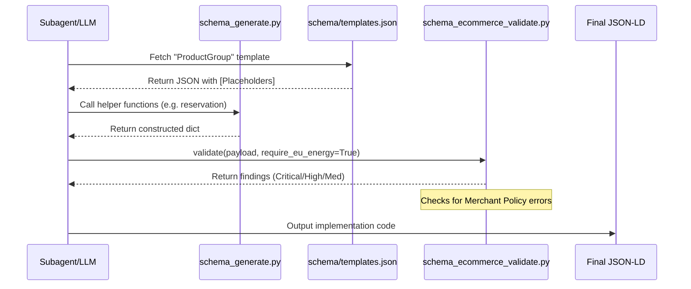

<!-- source: DeepWiki mcp.deepwiki.com · repo AgriciDaniel/claude-seo · page 7.2 Schema Generation and Templates · fetched 2026-10-26 -->

# Schema Generation and Templates

Relevant source files

The following files were used as context for generating this wiki page:

- [schema/templates.json](schema/templates.json)
- [scripts/schema_ecommerce_validate.py](scripts/schema_ecommerce_validate.py)
- [scripts/schema_generate.py](scripts/schema_generate.py)
- [skills/seo-schema/references/deprecated-types-2024-2026.md](skills/seo-schema/references/deprecated-types-2024-2026.md)
- [tests/test_schema_v2.py](tests/test_schema_v2.py)

## Purpose and Scope

This document describes the schema generation system and template library in `claude-seo`. It covers the implementation of `scripts/schema_generate.py` for high-leverage v2 schema types, the centralized template library in `schema/templates.json`, and best practices for JSON-LD implementation. The system is designed to bridge the gap between natural language SEO requests and valid, machine-readable structured data that meets Google's 2025-2026 requirements, including the retirement of legacy types.

**Sources:** [scripts/schema_generate.py:1-45](), [scripts/schema_ecommerce_validate.py:1-31]()

---

## Schema Generation System Architecture

The schema generation system utilizes two primary mechanisms: a script-based generator for complex v2 types and a JSON-based template library for standard rich result types.

### High-Leverage V2 Generation (`schema_generate.py`)

The `scripts/schema_generate.py` utility provides programmatic generation for four specific types identified as "high-leverage" in the 2026 SEO landscape:
1.  **Reservation**: For AI-driven booking actions, specifically `FoodEstablishmentReservation` [scripts/schema_generate.py:55-66]().
2.  **OrderAction**: To enable "Order this" potentialActions in SERPs [scripts/schema_generate.py:96-103]().
3.  **DiscussionForumPosting**: To target the "Discussions and forums" SERP features promoted in 2024 [scripts/schema_generate.py:145-156]().
4.  **ProfilePage**: To build entity graphs for AI citation correlation via `sameAs` and `knowsAbout` [scripts/schema_generate.py:184-202]().

**Diagram: Natural Language to Code Entity Mapping**

**Sources:** [scripts/schema_generate.py:55-202](), [tests/test_schema_v2.py:33-96]()

---

## Available Templates (`templates.json`)

The system provides production-ready JSON-LD templates in `schema/templates.json`. These templates use bracket notation (e.g., `[Placeholder]`) for user-fillable data and reflect 2025 updates like the `Certification` type.

| Template Type | Primary Use Case | Key Code Property / Logic |
|--------------|------------------|----------------------------|
| **VideoObject** | Standard video rich results | `duration` (ISO 8601) [schema/templates.json:4-25]() |
| **BroadcastEvent** | Live stream "LIVE" badge | `isLiveBroadcast: true` [schema/templates.json:26-45]() |
| **Clip** | Video chapters/key moments | `hasPart` array [schema/templates.json:46-74]() |
| **SeekToAction** | Jump-to-timestamp from search | `potentialAction` [schema/templates.json:75-92]() |
| **ProductGroup** | E-commerce variants | `variesBy`, `hasVariant` [schema/templates.json:113-141]() |
| **ProfilePage** | Author/creator identity | `mainEntity: Person` [schema/templates.json:142-159]() |
| **Certification** | Product safety/energy certs | Replaced EnergyConsumptionDetails [schema/templates.json:160-176]() |
| **OfferShippingDetails** | Shipping rates and times | `shippingDetails` [schema/templates.json:177-205]() |
| **SoftwareSourceCode** | Open source repositories | `codeRepository` [schema/templates.json:93-112]() |

**Diagram: Template Processing Flow**

**Sources:** [schema/templates.json:1-205](), [scripts/schema_ecommerce_validate.py:113-131]()

---

## Core Implementation Details

### V2 Generator Functions (`schema_generate.py`)

*   **`reservation()`**: Defaults to `FoodEstablishmentReservation`. It enforces `startTime` and builds a `provider` Organization object. It supports `customer_name` mapping to `underName` [scripts/schema_generate.py:55-93]().
*   **`order_action()`**: Generates an `OrderAction` designed to be attached to a `Product`. It includes `EntryPoint` templates and `actionPlatform` definitions for mobile/desktop [scripts/schema_generate.py:96-142]().
*   **`discussion()`**: Implements `DiscussionForumPosting`. It supports `interactionStatistic` for likes, which Google uses for the "Discussions and forums" SERP feature [scripts/schema_generate.py:145-181]().
*   **`profile()`**: Targets AI citation correlation by emphasizing `sameAs` (social/authority links) and `knowsAbout` (expertise strings) within a `mainEntity: Person` block [scripts/schema_generate.py:184-202]().

### E-commerce Policy Validation

`scripts/schema_ecommerce_validate.py` identifies **Merchant Listing eligibility** failures beyond simple syntax errors.

*   **Critical Findings**: Triggered if deprecated types (e.g., `VehicleListing`, `ClaimReview`) are used [scripts/schema_ecommerce_validate.py:44-57](), [scripts/schema_ecommerce_validate.py:117-124]().
*   **High Severity Findings**: Triggered by missing `name`, `image`, or `offers` [scripts/schema_ecommerce_validate.py:135-142](), or using `AggregateOffer` instead of `Offer` [scripts/schema_ecommerce_validate.py:164-170]().
*   **Medium Severity**: Missing `hasMerchantReturnPolicy` or `shippingDetails` [scripts/schema_ecommerce_validate.py:185-200]().
*   **EU Compliance**: The `--eu` flag enforces `energyEfficiencyClass` for EPREL-scoped products [scripts/schema_ecommerce_validate.py:14-15](), [scripts/schema_ecommerce_validate.py:202-209]().

**Sources:** [scripts/schema_ecommerce_validate.py:1-209](), [tests/test_schema_v2.py:118-186]()

---

## Best Practices and Deprecations

### 1. Format and Protocol
*   **JSON-LD**: The system exclusively generates JSON-LD [scripts/schema_generate.py:43]().
*   **Absolute URLs**: Generators expect absolute URLs for image and URL fields [scripts/schema_generate.py:44]().
*   **ISO 8601 Dates**: All date fields in `schema_generate.py` and `templates.json` use ISO 8601 [scripts/schema_generate.py:78](), [schema/templates.json:12]().

### 2. Avoiding Deprecated Types (2024–2026)
The system enforces the retirement of several types announced by Google.

| Retired Type | Retirement Date | Replacement Recommendation |
|--------------|-----------------|----------------------------|
| **VehicleListing** | June 2025 | Use `Product` [skills/seo-schema/references/deprecated-types-2024-2026.md:16]() |
| **ClaimReview** | June 2025 | None (Rich result removed) [skills/seo-schema/references/deprecated-types-2024-2026.md:17]() |
| **SpecialAnnouncement** | July 2025 | Use `Event` or `Article` [skills/seo-schema/references/deprecated-types-2024-2026.md:26]() |
| **HowTo** | Sept 2023 | None (Rich result removed) [skills/seo-schema/references/deprecated-types-2024-2026.md:34]() |
| **FAQPage** | May 2026 | Fully retired for all sites; use `QAPage` for user Q&A [skills/seo-schema/references/deprecated-types-2024-2026.md:35]() |

**Sources:** [skills/seo-schema/references/deprecated-types-2024-2026.md:1-65](), [scripts/schema_ecommerce_validate.py:44-57]()

---

