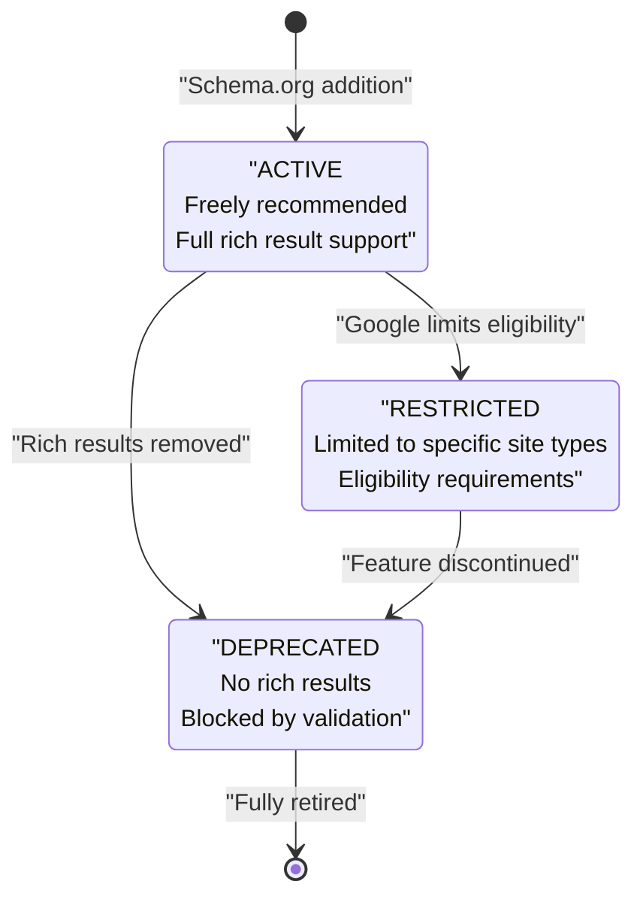
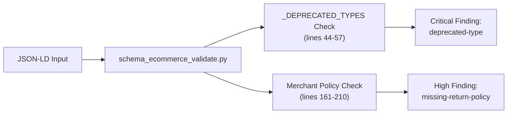
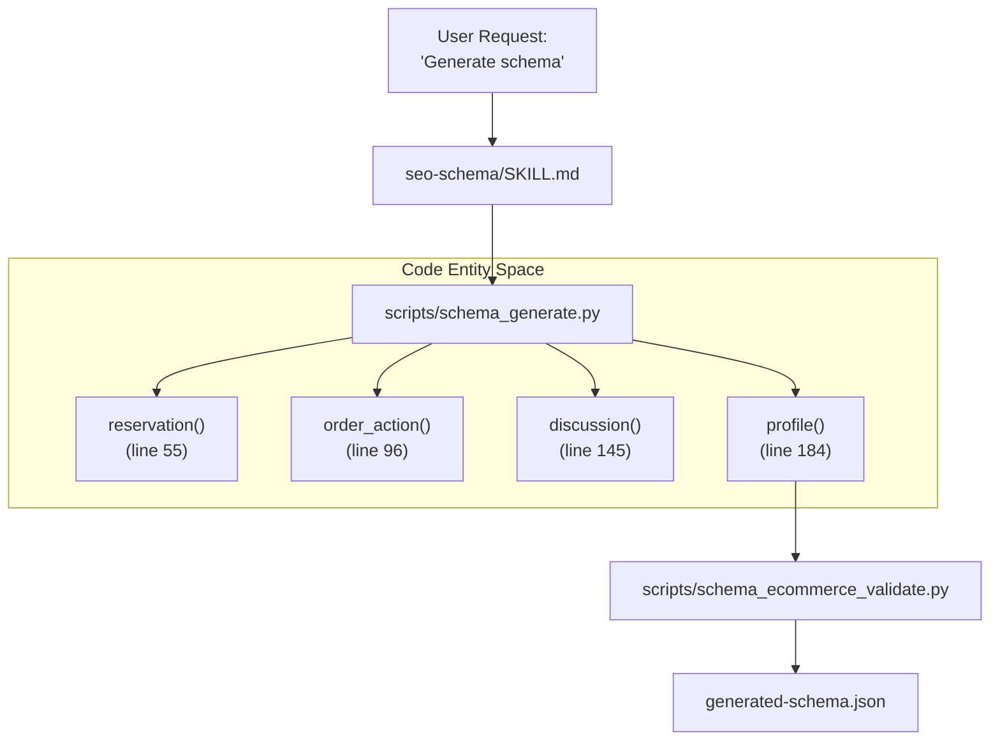

<!-- source: DeepWiki mcp.deepwiki.com · repo AgriciDaniel/claude-seo · page 7.3 Schema Type Status Reference · fetched 2026-10-26 -->

# Schema Type Status Reference

Relevant source files

The following files were used as context for generating this wiki page:

- [scripts/schema_ecommerce_validate.py](scripts/schema_ecommerce_validate.py)
- [scripts/schema_generate.py](scripts/schema_generate.py)
- [skills/seo-competitor-pages/SKILL.md](skills/seo-competitor-pages/SKILL.md)
- [skills/seo-hreflang/SKILL.md](skills/seo-hreflang/SKILL.md)
- [skills/seo-plan/SKILL.md](skills/seo-plan/SKILL.md)
- [skills/seo-programmatic/SKILL.md](skills/seo-programmatic/SKILL.md)
- [skills/seo-schema/SKILL.md](skills/seo-schema/SKILL.md)
- [skills/seo-schema/references/deprecated-types-2024-2026.md](skills/seo-schema/references/deprecated-types-2024-2026.md)
- [skills/seo-sitemap/SKILL.md](skills/seo-sitemap/SKILL.md)
- [tests/test_schema_v2.py](tests/test_schema_v2.py)

This document provides a comprehensive reference of Schema.org structured data types, categorized by their current status: **Active** (freely recommended), **Restricted** (limited use cases), and **Deprecated** (removed or discontinued). The reference tracks historical changes, deprecation timelines, and recent additions to help the `claude-seo` system make informed recommendations about schema implementation.

## Schema Type Status System

The `claude-seo` system maintains a time-aware reference of Schema.org types based on Google's search feature support and rich results eligibility. Schema types are classified into three categories based on their current status and recommended usage.

### Status Classification Diagram

**Sources:** [skills/seo-schema/SKILL.md:38-63](), [skills/seo-schema/references/deprecated-types-2024-2026.md:1-58]()

### Format and Implementation
Format preference is **JSON-LD** (`<script type="application/ld+json">`), as explicitly recommended by Google over Microdata and RDFa [skills/seo-schema/SKILL.md:20-23](). 

Per Google's December 2025 JS SEO guidance, structured data injected via JavaScript may face delayed processing. For time-sensitive markup (especially `Product`, `Offer`), it is recommended to include JSON-LD in the initial server-rendered HTML [skills/seo-schema/SKILL.md:50]().

## Active Schema Types

Active types are freely recommended with full rich results support. These types have no restrictions and can be implemented on any appropriate page type.

### Core Business and Organization Types

| Type | Use Case | Key Properties |
|------|----------|----------------|
| `Organization` | Company information | `name`, `url`, `logo`, `contactPoint`, `sameAs` |
| `LocalBusiness` | Physical business locations | `address`, `telephone`, `openingHours`, `geo` |
| `SoftwareApplication` | Desktop/mobile apps | `name`, `operatingSystem`, `applicationCategory` |
| `WebApplication` | Browser-based SaaS | `name`, `applicationCategory`, `offers` |

**Sources:** [skills/seo-schema/SKILL.md:43-46](), [skills/seo-schema/SKILL.md:76-119]()

### E-commerce and Product Types

| Type | Use Case | Notes |
|------|----------|-------|
| `Product` | Physical/digital products | Requires Certification markup as of April 2025 |
| `ProductGroup` | Product variants | For color/size variations |
| `Offer` | Pricing and availability | Required within Product or Service |
| `AggregateRating` | Rating summaries | Consolidated rating display |

**Sources:** [skills/seo-schema/SKILL.md:43](), [scripts/schema_ecommerce_validate.py:5-13]()

### Content and Publishing Types

| Type | Use Case | Notes |
|------|----------|-------|
| `Article` | Blog posts, news articles | Base article type |
| `BlogPosting` | Blog-specific content | Subtype of Article |
| `VideoObject` | Video content | Supports `Clip` and `SeekToAction` |
| `DiscussionForumPosting` | Forum threads | Promoted to first-class rich result in 2024 |
| `ProfilePage` | Author/entity pages | Uses `sameAs` + `knowsAbout` for AI citation |

**Sources:** [skills/seo-schema/SKILL.md:43-46](), [scripts/schema_generate.py:7-10]()

## Restricted Schema Types

Restricted types have eligibility requirements or limitations on how they appear in SERPs.

| Type | Restriction | Status | Notes |
|------|------------|--------|-------|
| `FAQPage` | **Fully Retired** from SERPs | May 7, 2026 | Google retired FAQ rich results for ALL sites. Flag existing at Info level; do not recommend for SERP benefit. |
| `Dataset` | Specialized Surface | Active | Consumed by Google Dataset Search only; no standard Search rich-result surface. |
| `QAPage` | Specific Use Case | Active | Use for genuine user Q&A pages instead of the retired FAQPage. Expanded comment-thread support added March 2024. |

**Sources:** [skills/seo-schema/SKILL.md:53-69](), [skills/seo-schema/references/deprecated-types-2024-2026.md:35-49]()

## Deprecated Schema Types

Deprecated types no longer generate rich results and should never be recommended. The `scripts/schema_ecommerce_validate.py` utility flags these as "Critical" findings.

### Deprecation Timeline (2024-2026)

| Type | Retired | Replacement / Notes |
|------|---------|---------------------|
| `VehicleListing` | June 2025 | Use `Product` with vehicle-specific properties |
| `ClaimReview` | June 2025 | None. Fact-check rich results discontinued |
| `EstimatedSalary` | June 2025 | Use `JobPosting` with `baseSalary` |
| `LearningVideo` | June 2025 | Use generic `VideoObject` |
| `Course Info` (Carousel) | June 2025 | Use single `Course` rich card (still live) |
| `SpecialAnnouncement` | July 31, 2025 | Use `Event` or `Article` |
| `Practice Problem` | Jan 6, 2026 | Support removed from Search Console / Rich Results Test |
| `HowTo` | Sept 2023 | Rich result removed from desktop and mobile |
| `Book Actions` | 2025/2026 | Removed from Google rich results; do not recommend |

**Sources:** [skills/seo-schema/references/deprecated-types-2024-2026.md:8-63](), [skills/seo-schema/SKILL.md:55-63](), [scripts/schema_ecommerce_validate.py:41-57]()

### Code Enforcement Logic

The system uses `scripts/schema_ecommerce_validate.py` to catch "policy" errors where types parse correctly but are disqualified from rich features.

**Sources:** [scripts/schema_ecommerce_validate.py:44-57](), [scripts/schema_ecommerce_validate.py:113-124](), [scripts/schema_ecommerce_validate.py:185-210]()

## Generation and Validation Flow

The system bridges Natural Language requests (e.g., "generate profile schema") to specific code entities.

**Sources:** [scripts/schema_generate.py:55](), [scripts/schema_generate.py:96](), [scripts/schema_generate.py:145](), [scripts/schema_generate.py:184](), [skills/seo-schema/SKILL.md:148]()

### Merchant Listing Eligibility (2025-2026)
For `Product` schema to be eligible for Google Merchant listings, the following properties are enforced by `schema_ecommerce_validate.py`:
1.  **`hasMerchantReturnPolicy`**: Required for eligibility [scripts/schema_ecommerce_validate.py:185-197]().
2.  **`shippingDetails`**: Required for eligibility [scripts/schema_ecommerce_validate.py:199-210]().
3.  **`energyEfficiencyClass`**: Required for EU-scope categories [scripts/schema_ecommerce_validate.py:14-15]().
4.  **`hasAdultConsideration`**: Required for adult products as of May 22, 2026 [skills/seo-schema/SKILL.md:69]().

### Validation Checklist
The system performs the following technical checks on all generated or detected markup:
*   **Absolute URLs**: All `@id` and `url` fields must be absolute [skills/seo-schema/SKILL.md:34]().
*   **ISO 8601 Dates**: Date formats must follow `YYYY-MM-DD` or full timestamps [skills/seo-schema/SKILL.md:35]().
*   **No Placeholders**: Checks for `[Company Name]`, `[Phone]`, etc. [skills/seo-schema/SKILL.md:33]().

**Sources:** [skills/seo-schema/SKILL.md:27-36](), [scripts/schema_ecommerce_validate.py:60-70]()

---

