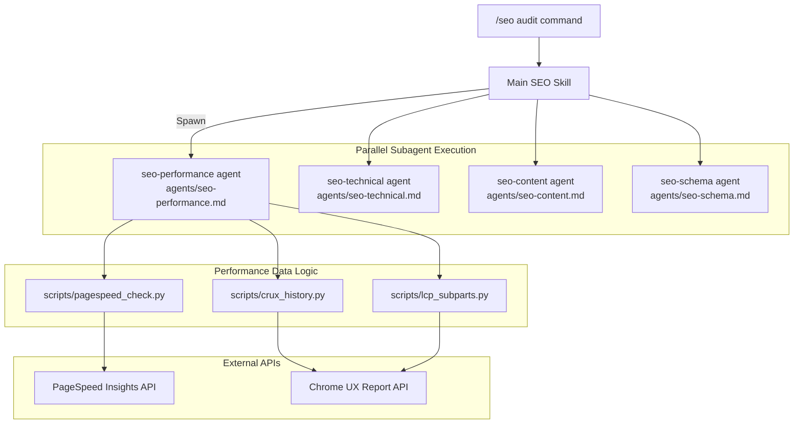
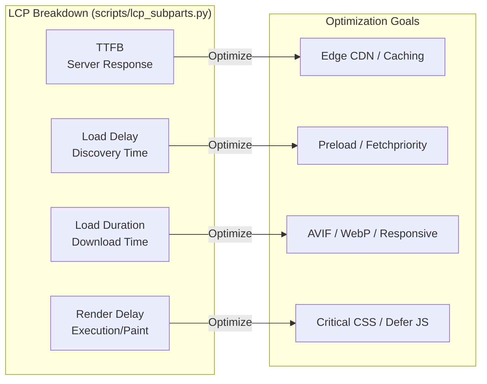

<!-- source: DeepWiki mcp.deepwiki.com · repo AgriciDaniel/claude-seo · page 8 Performance Analysis · fetched 2026-10-26 -->

# Performance Analysis

Relevant source files

The following files were used as context for generating this wiki page:

- [agents/seo-content.md](agents/seo-content.md)
- [agents/seo-ecommerce.md](agents/seo-ecommerce.md)
- [agents/seo-performance.md](agents/seo-performance.md)
- [agents/seo-schema.md](agents/seo-schema.md)
- [agents/seo-sxo.md](agents/seo-sxo.md)
- [agents/seo-technical.md](agents/seo-technical.md)
- [agents/seo-visual.md](agents/seo-visual.md)
- [scripts/crux_history.py](scripts/crux_history.py)
- [scripts/google_report.py](scripts/google_report.py)
- [scripts/lcp_subparts.py](scripts/lcp_subparts.py)
- [scripts/pagespeed_check.py](scripts/pagespeed_check.py)
- [scripts/verify_backlinks.py](scripts/verify_backlinks.py)
- [tests/test_audit_instructions.py](tests/test_audit_instructions.py)

## Purpose and Scope

This document covers the performance analysis system within `claude-seo`, which measures and evaluates website speed through Core Web Vitals (CWV) metrics. The system collects both laboratory (simulated) and field (real-user) performance data, applies Google's official thresholds, and generates prioritized optimization recommendations.

For technical SEO issues that impact performance indirectly (render-blocking resources, JavaScript rendering), see [Technical SEO Analysis](#5). For image-specific performance optimizations (format selection, lazy loading, LCP optimization), see [Image Optimization](#9).

**Sources:** [agents/seo-performance.md:1-101](), [agents/seo-technical.md:21-28]()

## Performance Analysis Agent

The `seo-performance` subagent operates as one of the parallel analyzers spawned during a full site audit. It specializes in measuring Core Web Vitals and page load performance, with deep knowledge of current metrics (LCP, INP, CLS), historical changes (INP replaced FID in March 2024), and performance tooling updates (Lighthouse 13.4.0).

**Diagram: Performance Analysis Agent Execution Flow**

The agent implements a fallback strategy: it attempts to use the PageSpeed Insights API via `scripts/pagespeed_check.py` [scripts/pagespeed_check.py:82-100](), otherwise analyzes HTML source for common performance issues. All measurements are validated against official Google thresholds [agents/seo-performance.md:13-17]().

**Sources:** [agents/seo-performance.md:1-10](), [agents/seo-performance.md:66-86](), [scripts/pagespeed_check.py:52-66]()

## Core Web Vitals Metrics

The system measures three official Core Web Vitals, each representing a critical aspect of user experience. Note that **INP** replaced FID as of March 12, 2024 [agents/seo-performance.md:19-20]().

| Metric | Full Name | Good | Needs Improvement | Poor |
|--------|-----------|------|-------------------|------|
| **LCP** | Largest Contentful Paint | ≤2.5s | 2.5s–4.0s | >4.0s |
| **INP** | Interaction to Next Paint | ≤200ms | 200ms–500ms | >500ms |
| **CLS** | Cumulative Layout Shift | ≤0.1 | 0.1–0.25 | >0.25 |

For details, see [Core Web Vitals](#8.1).

**Sources:** [agents/seo-performance.md:13-20](), [scripts/pagespeed_check.py:52-58]()

## Lab Data vs Field Data

The system distinguishes between **Lab Data** (controlled Lighthouse runs) and **Field Data** (real-world CrUX data).

- **Lab Data**: Captured via `scripts/pagespeed_check.py` [scripts/pagespeed_check.py:162-177](). Useful for debugging and instant feedback.
- **Field Data**: Fetched via `scripts/crux_history.py` or `scripts/pagespeed_check.py` [scripts/pagespeed_check.py:179-196](). Represents the **75th percentile** of actual Chrome users over a 28-day period [agents/seo-performance.md:21-23]().

For details, see [Lab Data vs Field Data](#8.2).

**Sources:** [agents/seo-performance.md:81-86](), [scripts/pagespeed_check.py:179-196]()

## Performance Optimization Strategies

The system identifies bottlenecks and suggests remediation. A key focus is **LCP Decomposition** using `scripts/lcp_subparts.py`, which breaks LCP into TTFB, resource load delay, resource load duration, and element render delay [scripts/lcp_subparts.py:45-50]().

**Diagram: LCP Optimization Workflow**

**Key Strategies:**
- **LCP Subpart Analysis**: Identifies if the bottleneck is server-side (TTFB), resource discovery (Load Delay), or browser execution (Render Delay) [scripts/lcp_subparts.py:128-152]().
- **Interactivity (INP)**: Recommends breaking long JavaScript tasks into <50ms chunks and reducing DOM size [agents/seo-performance.md:40-47]().
- **Layout Stability (CLS)**: Audits for images without dimensions and dynamically injected content [agents/seo-performance.md:48-55]().

For details, see [Performance Optimization Strategies](#8.3).

**Sources:** [scripts/lcp_subparts.py:128-152](), [agents/seo-performance.md:32-55]()

---

