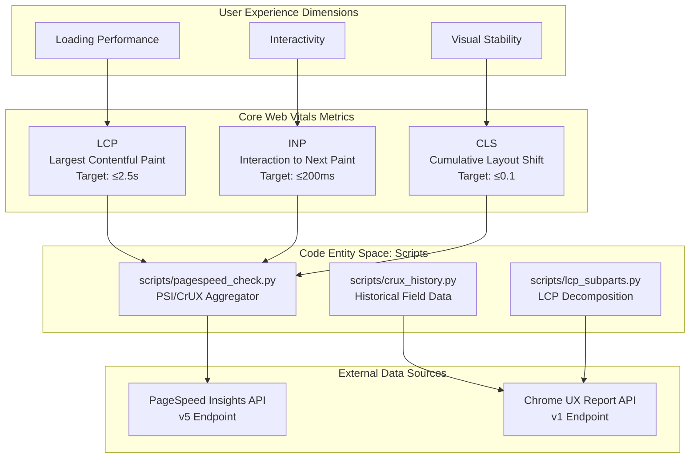
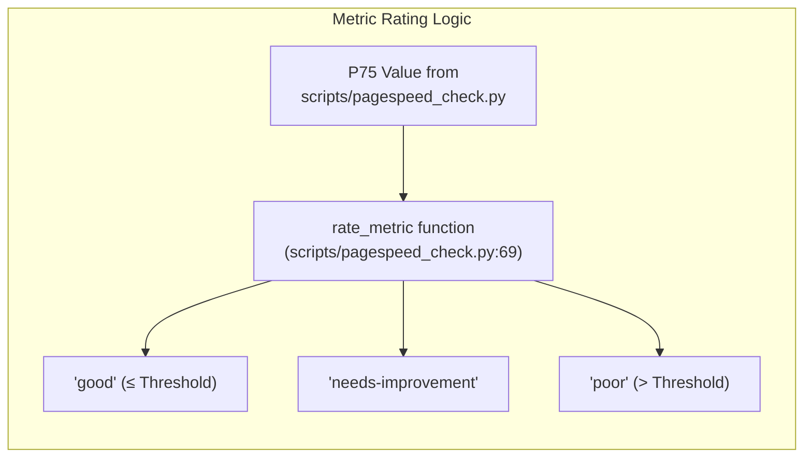

<!-- source: DeepWiki mcp.deepwiki.com · repo AgriciDaniel/claude-seo · page 8.1 Core Web Vitals · fetched 2026-10-26 -->

# Core Web Vitals

Relevant source files

The following files were used as context for generating this wiki page:

- [docs/MCP-INTEGRATION.md](docs/MCP-INTEGRATION.md)
- [extensions/banana/scripts/edit.py](extensions/banana/scripts/edit.py)
- [extensions/banana/scripts/generate.py](extensions/banana/scripts/generate.py)
- [scripts/crux_history.py](scripts/crux_history.py)
- [scripts/lcp_subparts.py](scripts/lcp_subparts.py)
- [scripts/pagespeed_check.py](scripts/pagespeed_check.py)
- [scripts/verify_backlinks.py](scripts/verify_backlinks.py)
- [skills/seo-google/references/auth-setup.md](skills/seo-google/references/auth-setup.md)
- [skills/seo-google/references/nlp-api.md](skills/seo-google/references/nlp-api.md)
- [skills/seo-google/references/pagespeed-crux-api.md](skills/seo-google/references/pagespeed-crux-api.md)
- [skills/seo/references/cwv-thresholds.md](skills/seo/references/cwv-thresholds.md)

## Purpose and Scope

This document provides technical specifications for the three Core Web Vitals metrics (LCP, INP, CLS), their threshold values, and the 75th percentile evaluation methodology used by Google. It details the implementation of performance auditing via `scripts/pagespeed_check.py`, `scripts/crux_history.py`, and the granular LCP decomposition provided by `scripts/lcp_subparts.py`.

## Overview

Core Web Vitals are a set of standardized metrics created by Google to measure real-world user experience. These metrics are incorporated into Google's ranking algorithm and directly impact search visibility. The `claude-seo` system evaluates Core Web Vitals through the `seo-performance` agent and the Core Web Vitals category within the `seo-technical` skill.

The three Core Web Vitals measure distinct aspects of page experience:

-   **LCP (Largest Contentful Paint)**: Loading performance.
-   **INP (Interaction to Next Paint)**: Interactivity and responsiveness (replaced FID in March 2024).
-   **CLS (Cumulative Layout Shift)**: Visual stability.

Sources: [docs/MCP-INTEGRATION.md:113-134](), [scripts/pagespeed_check.py:51-58](), [skills/seo/references/cwv-thresholds.md:4-11]()

## Core Web Vitals System Architecture

**Diagram: Core Web Vitals Logic Flow**

This diagram bridges the conceptual user experience dimensions to the specific Python scripts in the `scripts/` directory that interface with Google's APIs.

Sources: [scripts/pagespeed_check.py:48-50](), [scripts/lcp_subparts.py:42-50](), [scripts/crux_history.py:43-43](), [docs/MCP-INTEGRATION.md:87-111]()

## Metric Definitions and Thresholds

### LCP (Largest Contentful Paint)

LCP measures loading performance by recording the render time of the largest content element visible in the viewport.

**Thresholds:**

| Classification | Threshold | Description |
| :--- | :--- | :--- |
| Good | ≤2.5 seconds | Optimal user experience |
| Needs Improvement | 2.5s - 4.0s | Acceptable but room for optimization |
| Poor | >4.0 seconds | Unacceptable loading speed |

**LCP Subparts Analysis:**
The `scripts/lcp_subparts.py` script decomposes LCP into four actionable phases using CrUX data [scripts/lcp_subparts.py:5-15]():
1.  **TTFB**: Time to First Byte (Server response).
2.  **Resource Load Delay**: Time between TTFB and start of resource load.
3.  **Resource Load Duration**: Actual fetch time for the LCP image.
4.  **Element Render Delay**: Time between resource load and final paint.

Sources: [scripts/pagespeed_check.py:53-53](), [scripts/lcp_subparts.py:45-50](), [skills/seo/references/cwv-thresholds.md:21-34]()

### INP (Interaction to Next Paint)

INP measures responsiveness by evaluating the latency of all user interactions. It replaced FID (First Input Delay) on March 12, 2024 [skills/seo/references/cwv-thresholds.md:13-13]().

**Thresholds:**

| Classification | Threshold | Description |
| :--- | :--- | :--- |
| Good | ≤200ms | Responsive, feels instantaneous |
| Needs Improvement | 200ms - 500ms | Noticeable delay |
| Poor | >500ms | Sluggish experience |

**Important**: FID was fully removed from Chrome tools on September 9, 2024. The codebase enforces that FID is never referenced [skills/seo/references/cwv-thresholds.md:13-13]().

Sources: [scripts/pagespeed_check.py:54-54](), [skills/seo/references/cwv-thresholds.md:9-9]()

### CLS (Cumulative Layout Shift)

CLS measures visual stability by quantifying unexpected layout shifts.

**Thresholds:**

| Classification | Threshold | Description |
| :--- | :--- | :--- |
| Good | ≤0.1 | Stable |
| Needs Improvement | 0.1 - 0.25 | Moderate instability |
| Poor | >0.25 | Disruptive shifts |

Sources: [scripts/pagespeed_check.py:55-55](), [skills/seo/references/cwv-thresholds.md:10-10]()

## 75th Percentile Evaluation Method

Google evaluates Core Web Vitals at the **75th percentile** of page visits [skills/seo/references/cwv-thresholds.md:14-14]().

**Diagram: Code Implementation of P75 Rating**

The system uses the `rate_metric` function in `scripts/pagespeed_check.py` [scripts/pagespeed_check.py:69-80]() to categorize values retrieved from the `percentile` field of the PSI/CrUX response.

Sources: [scripts/pagespeed_check.py:69-80](), [scripts/pagespeed_check.py:187-195](), [skills/seo/references/cwv-thresholds.md:14-14]()

## Implementation and Data Flow

### Field Data via CrUX
Field data represents real-user experiences over a 28-day rolling window. 
- `scripts/pagespeed_check.py` fetches this via the `loadingExperience` and `originLoadingExperience` keys in the PSI API [scripts/pagespeed_check.py:179-183]().
- `scripts/crux_history.py` provides historical trends by fetching up to 25 weekly data points from the `queryHistoryRecord` endpoint [scripts/crux_history.py:5-12]().
- `scripts/lcp_subparts.py` queries the CrUX API directly for granular LCP data, identifying the "dominant" subpart that contributes >40% of overall LCP [scripts/lcp_subparts.py:90-118]().

### Lab Data via Lighthouse
Lab data is a synthetic test run in a controlled environment.
- `scripts/pagespeed_check.py` extracts Lighthouse scores (Performance, Accessibility, Best Practices, SEO) and lab metrics (FCP, LCP, TBT, CLS, Speed Index) from the `lighthouseResult` key [scripts/pagespeed_check.py:158-177]().
- The `run_pagespeed` function handles both `mobile` and `desktop` strategies [scripts/pagespeed_check.py:82-93]().

### Historical Analysis
The `scripts/crux_history.py` script implements trend detection [scripts/crux_history.py:208-210]():
- **Improving**: Metric value decreasing over time (or density increasing).
- **Stable**: Minimal variance in the timeseries.
- **Degrading**: Metric value increasing (worsening).

Sources: [scripts/pagespeed_check.py:82-205](), [scripts/crux_history.py:54-205](), [scripts/lcp_subparts.py:53-162](), [skills/seo-google/references/pagespeed-crux-api.md:152-198]()

## Integration and Authentication

The performance tools require a Google API Key with the `Chrome UX Report API` and `PageSpeed Insights API` enabled [skills/seo-google/references/auth-setup.md:27-28]().

- `google_auth.py` is used across all performance scripts to retrieve the key from `~/.config/claude-seo/google-api.json` or environment variables [scripts/pagespeed_check.py:28-46](), [scripts/crux_history.py:27-41]().
- API calls use the `X-Goog-Api-Key` header for security [scripts/lcp_subparts.py:60-60](), [scripts/crux_history.py:98-98]().

Sources: [skills/seo-google/references/auth-setup.md:1-38](), [docs/MCP-INTEGRATION.md:15-22](), [scripts/lcp_subparts.py:96-101]()

---

