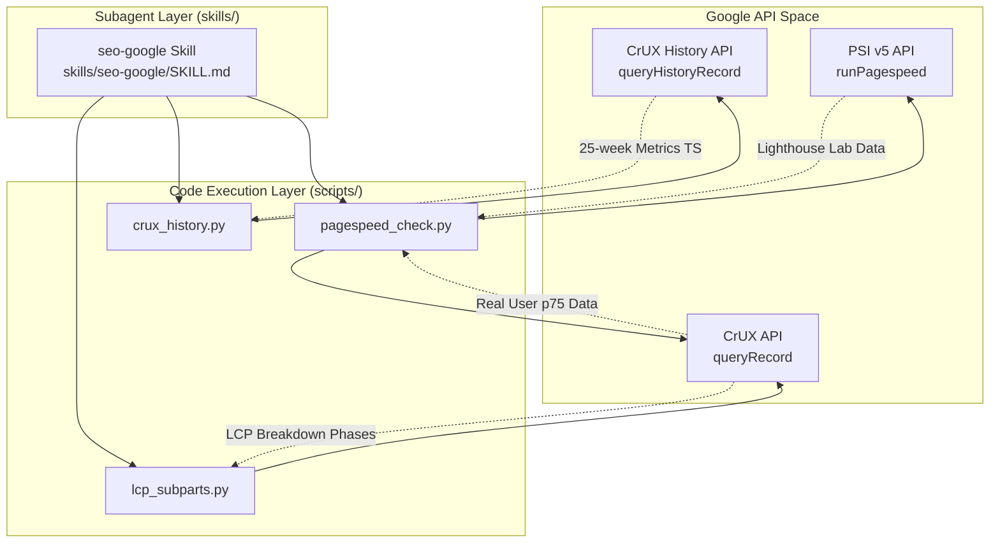
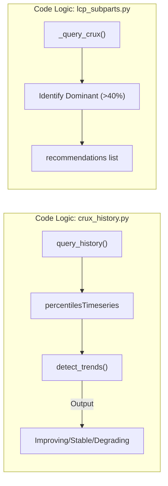

<!-- source: DeepWiki mcp.deepwiki.com · repo AgriciDaniel/claude-seo · page 8.2 Lab Data vs Field Data · fetched 2026-10-26 -->

# Lab Data vs Field Data

Relevant source files

The following files were used as context for generating this wiki page:

- [scripts/crux_history.py](scripts/crux_history.py)
- [scripts/lcp_subparts.py](scripts/lcp_subparts.py)
- [scripts/pagespeed_check.py](scripts/pagespeed_check.py)
- [scripts/verify_backlinks.py](scripts/verify_backlinks.py)
- [skills/seo-dataforseo/SKILL.md](skills/seo-dataforseo/SKILL.md)
- [skills/seo-google/SKILL.md](skills/seo-google/SKILL.md)
- [tests/test_google_api_key_safety.py](tests/test_google_api_key_safety.py)
- [tests/test_nlp_analyze.py](tests/test_nlp_analyze.py)

## Purpose and Scope

This document explains the distinction between lab data and field data in the context of Core Web Vitals (CWV) measurement, how the `claude-seo` system utilizes both data types, and when to prioritize each for actionable insights. Lab data provides controlled diagnostic measurements, while field data reflects real-world user experiences.

The system utilizes `scripts/pagespeed_check.py` to bridge these two worlds by fetching both Lighthouse lab metrics and Chrome UX Report (CrUX) field metrics in a single execution. Additionally, `scripts/crux_history.py` provides 25-week trend analysis, and `scripts/lcp_subparts.py` decomposes the Largest Contentful Paint into actionable network and rendering phases.

---

## Data Type Definitions

### Lab Data (Synthetic Testing)

Lab data is generated through **controlled, simulated environments** using tools like Lighthouse via the PageSpeed Insights API. These tests run in a consistent configuration with predetermined network conditions and device specifications.

**Characteristics:**
- Controlled environment (fixed CPU, network throttling).
- Reproducible results for debugging specific code changes.
- Instant feedback without waiting for user traffic accumulation.
- **Source in claude-seo**: `scripts/pagespeed_check.py` calls the PSI v5 API `runPagespeed` endpoint [scripts/pagespeed_check.py:48-48]().

### Field Data (Real User Monitoring)

Field data comes from **actual users** interacting with a site in production, collected through the Chrome User Experience Report (CrUX).

**Characteristics:**
- Reflects real user devices, networks, and geographic distributions.
- Aggregated over 28-day rolling windows.
- **75th percentile evaluation**: Google requires 75% of page visits to meet "good" thresholds for a passing score [scripts/pagespeed_check.py:51-58]().
- Reflects actual ranking signals used by Google's search algorithms.
- **Source in claude-seo**: `scripts/crux_history.py` and `scripts/lcp_subparts.py` query the CrUX API `queryRecord` and `queryHistoryRecord` endpoints [scripts/pagespeed_check.py:49-49](), [scripts/crux_history.py:43-43](), [scripts/lcp_subparts.py:42-42]().

**Sources:** [scripts/pagespeed_check.py:48-58](), [scripts/crux_history.py:43-51](), [scripts/lcp_subparts.py:5-15]()

---

## Data Source Architecture

**Diagram: Data Source Architecture**

This architecture illustrates how the `seo-google` skill delegates to specialized scripts. `pagespeed_check.py` is the primary interface for combined data [scripts/pagespeed_check.py:82-100](), while `lcp_subparts.py` provides deep-dive field diagnostics for LCP bottlenecks [scripts/lcp_subparts.py:90-103]().

**Sources:** [skills/seo-google/SKILL.md:88-112](), [scripts/pagespeed_check.py:48-50](), [scripts/crux_history.py:43-43](), [scripts/lcp_subparts.py:42-42]()

---

## Metric Availability Comparison

| Metric | Lab Data (PSI/Lighthouse) | Field Data (CrUX) | Implementation Note |
|--------|---------------------------|-------------------|---------------------|
| **LCP** | ✅ Simulated | ✅ 75th percentile | `CWV_THRESHOLDS` in [scripts/pagespeed_check.py:51-58]() |
| **INP** | ⚠️ Estimated (TBT) | ✅ 75th percentile | Replaced FID March 2024; requires user interaction [scripts/pagespeed_check.py:54]() |
| **CLS** | ✅ Simulated | ✅ 75th percentile | `cumulative_layout_shift` score [scripts/pagespeed_check.py:55]() |
| **TTFB** | ✅ Simulated | ✅ 75th percentile | `experimental_time_to_first_byte` [scripts/pagespeed_check.py:57]() |
| **LCP Subparts**| ❌ Not available | ✅ Since Jan 2025 | Handled by `scripts/lcp_subparts.py` [scripts/lcp_subparts.py:5-15]() |

### LCP Subparts Deep-Dive
The `scripts/lcp_subparts.py` tool decomposes field LCP into four actionable phases based on CrUX data [scripts/lcp_subparts.py:45-50]():
1. **Time to First Byte (TTFB)**: Server response time.
2. **Resource Load Delay**: Time until the browser discovers the LCP image.
3. **Resource Load Duration**: Network transfer time for the LCP resource.
4. **Element Render Delay**: Time spent waiting for render-blocking resources or main-thread availability after the resource is loaded.

**Sources:** [scripts/lcp_subparts.py:5-15](), [scripts/pagespeed_check.py:51-58]()

---

## Integration and Implementation

### Combined Check: `pagespeed_check.py`
This script fetches both datasets. It maps PSI internal metric names (e.g., `LARGEST_CONTENTFUL_PAINT_MS`) to standardized internal CWV keys [scripts/pagespeed_check.py:60-66](). It prioritizes URL-level field data but falls back to origin-level data if the specific page has insufficient traffic [scripts/pagespeed_check.py:183-185]().

### Trend Analysis: `crux_history.py`
This script fetches up to 25 weekly data points [scripts/crux_history.py:5-6](). It calculates trends by comparing the latest p75 value to the historical average, classifying metrics as "improving", "stable", or "degrading" [scripts/crux_history.py:208-230]().

### LCP Diagnostic: `lcp_subparts.py`
When field data indicates a "Dominant" subpart (contributing >40% of total LCP), the script generates specific remediation advice [scripts/lcp_subparts.py:118-126]():
- **TTFB Dominant**: Focus on server-side compute and CDN edge cache hit rates [scripts/lcp_subparts.py:130-134]().
- **Load Delay Dominant**: Preload the hero image with `fetchpriority=high` [scripts/lcp_subparts.py:135-140]().
- **Load Duration Dominant**: Use modern formats (AVIF/WebP) and responsive sizes [scripts/lcp_subparts.py:141-146]().
- **Render Delay Dominant**: Reduce render-blocking CSS/JS and avoid layout shifts [scripts/lcp_subparts.py:147-152]().

**Diagram: Code Entity Logic Flow**

**Sources:** [scripts/crux_history.py:208-230](), [scripts/lcp_subparts.py:118-152](), [scripts/pagespeed_check.py:183-195]()

---

## The 75th Percentile Evaluation Method

Google evaluates Core Web Vitals using the **75th percentile** (p75) of all page visits recorded in the CrUX dataset.
- **Good**: 75% of visits meet the "Good" threshold.
- **Needs Improvement**: p75 falls between "Good" and "Poor".
- **Poor**: p75 is above the "Poor" threshold.

The `rate_metric` function in `pagespeed_check.py` implements these thresholds for automated scoring [scripts/pagespeed_check.py:69-80]().

| Metric | Good Threshold | Poor Threshold |
|--------|----------------|----------------|
| LCP    | ≤ 2500ms       | > 4000ms       |
| INP    | ≤ 200ms        | > 500ms        |
| CLS    | ≤ 0.1          | > 0.25         |

**Sources:** [scripts/pagespeed_check.py:51-58](), [scripts/pagespeed_check.py:69-80]()

---

## When to Prioritize Each Data Type

### Prioritize Field Data (CrUX) When:
- **Assessing Ranking Impact**: Field data is the "source of truth" for Google's Search signals.
- **Analyzing Interaction**: Interaction to Next Paint (INP) cannot be fully simulated in a lab; it requires real user interaction [scripts/pagespeed_check.py:54]().
- **Decomposing LCP**: Use `lcp_subparts.py` to see where real users are getting stuck in the loading lifecycle [scripts/lcp_subparts.py:11-15]().

### Prioritize Lab Data (PSI/Lighthouse) When:
- **Debugging Specific Fixes**: Lab data provides immediate feedback on whether a code change (like reducing JavaScript bundle size) improved Total Blocking Time (TBT).
- **New or Low Traffic Pages**: If CrUX returns a 404 error, it indicates insufficient Chrome traffic for eligibility, making lab data the only available signal [scripts/crux_history.py:103-109]().
- **Comprehensive Auditing**: Lighthouse provides Accessibility, SEO, and Best Practices scores that CrUX does not cover [scripts/pagespeed_check.py:123-124]().

**Sources:** [skills/seo-google/SKILL.md:96-112](), [scripts/lcp_subparts.py:11-15](), [scripts/crux_history.py:103-109](), [scripts/pagespeed_check.py:123-133]()

---

