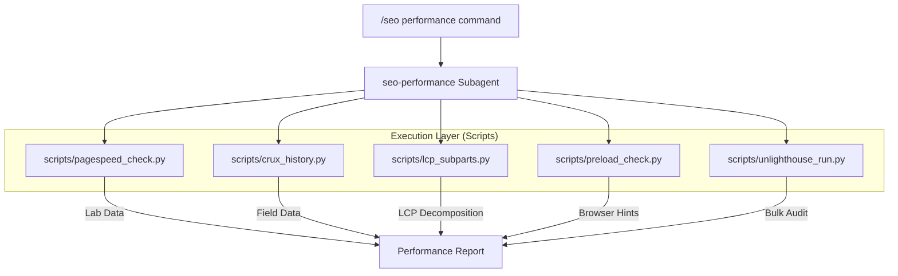
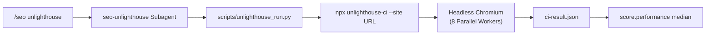

<!-- source: DeepWiki mcp.deepwiki.com · repo AgriciDaniel/claude-seo · page 8.3 Performance Optimization Strategies · fetched 2026-10-26 -->

# Performance Optimization Strategies

Relevant source files

The following files were used as context for generating this wiki page:

- [extensions/ahrefs/skills/seo-ahrefs/SKILL.md](extensions/ahrefs/skills/seo-ahrefs/SKILL.md)
- [extensions/bing-webmaster/skills/seo-bing/SKILL.md](extensions/bing-webmaster/skills/seo-bing/SKILL.md)
- [extensions/profound/skills/seo-profound/SKILL.md](extensions/profound/skills/seo-profound/SKILL.md)
- [extensions/seranking/skills/seo-seranking/SKILL.md](extensions/seranking/skills/seo-seranking/SKILL.md)
- [extensions/unlighthouse/skills/seo-unlighthouse/SKILL.md](extensions/unlighthouse/skills/seo-unlighthouse/SKILL.md)
- [scripts/indexnow_submit.py](scripts/indexnow_submit.py)
- [scripts/preload_check.py](scripts/preload_check.py)
- [scripts/unlighthouse_run.py](scripts/unlighthouse_run.py)
- [tests/test_parasite_risk_and_extensions.py](tests/test_parasite_risk_and_extensions.py)
- [tests/test_technical_depth.py](tests/test_technical_depth.py)

This document provides actionable optimization strategies for the three Core Web Vitals metrics: Largest Contentful Paint (LCP), Interaction to Next Paint (INP), and Cumulative Layout Shift (CLS). Each strategy includes specific bottleneck identification, remediation techniques, and expected impact ratings.

For metric definitions and threshold values, see [Core Web Vitals (8.1)](). For understanding measurement methodologies, see [Lab Data vs Field Data (8.2)]().

**Scope**: This page focuses on remediation strategies that the `seo-performance` agent recommends during analysis. It covers LCP subpart decomposition via `scripts/lcp_subparts.py`, browser optimization auditing via `scripts/preload_check.py`, and multi-page analysis via `scripts/unlighthouse_run.py`.

---

## Optimization Approach

The `seo-performance` agent follows a prioritized remediation framework based on expected impact and implementation complexity. In v2.0.0, the system uses `scripts/render_page.py` for headless analysis and delegates deep performance audits to specialized scripts.

### Performance Analysis Data Flow

The following diagram bridges the natural language intent of "Performance Analysis" to the specific Python entities and CLI tools used in the execution layer.

**Prioritization Framework**

| Impact Level | Criteria | Example |
|--------------|----------|---------|
| **Critical** | Moves metric from Poor → Good | Unoptimized hero image causing LCP >4s |
| **High** | Moves metric from Needs Improvement → Good | Render-blocking CSS delaying LCP by 800ms |
| **Medium** | Incremental improvement within same category | Optimizing non-LCP images |
| **Low** | Minor optimization, unlikely to affect passing status | Font preload for non-critical text |

**Sources**: [extensions/unlighthouse/skills/seo-unlighthouse/SKILL.md:43-47](), [scripts/preload_check.py:5-9]()

---

## LCP (Largest Contentful Paint) Optimization

LCP measures the time until the largest content element becomes visible. The threshold is ≤2.5s at the 75th percentile.

### LCP Subpart Decomposition
In v2.0.0, the system uses `scripts/lcp_subparts.py` to decompose a slow LCP into four actionable phases via the CrUX API. This turns a generic "slow LCP" finding into specific network or render tasks.

| Subpart | Remediation Focus | Script Signal |
|---------|-------------------|---------------|
| **TTFB** | Server response, CDN edge, caching | `largest_contentful_paint_image_time_to_first_byte` |
| **Load Delay** | Preloading, `fetchpriority`, discovery | `largest_contentful_paint_image_resource_load_delay` |
| **Load Duration** | Image compression, WebP/AVIF, `srcset` | `largest_contentful_paint_image_resource_load_duration` |
| **Render Delay** | Critical CSS, JS long tasks, font-blocking | `largest_contentful_paint_image_element_render_delay` |

**Implementation Logic**:
`scripts/lcp_subparts.py` identifies "dominant" subparts that contribute >40% of the overall LCP. If `resource_load_delay` is dominant, the agent recommends preloading the hero image with `fetchpriority=high`.

**Sources**: [scripts/lcp_subparts.py:5-15](), [scripts/preload_check.py:42-45](), [scripts/preload_check.py:79-82]()

### Browser Resource Hints Audit
The `scripts/preload_check.py` script performs a static analysis of the HTML to identify modern browser optimization signals.

*   **Speculation Rules**: Detects `<script type="speculationrules">` for prefetch/prerender instructions. [scripts/preload_check.py:14-15](). The `analyse` function parses these blocks using regex `_SPECULATION_BLOCK_RE` [scripts/preload_check.py:66-69]().
*   **Fetch Priority**: Checks for `fetchpriority="high"` on LCP candidates to reduce load delay. [scripts/preload_check.py:76-78]().
*   **Deprecated Prerender**: Flags `<link rel="prerender">` as deprecated in favor of Speculation Rules. [scripts/preload_check.py:17](). The script checks for these via `_PRERENDER_LINK_RE` [scripts/preload_check.py:73-75]().

**Sources**: [scripts/preload_check.py:66-82](), [tests/test_technical_depth.py:38-55]()

---

## INP (Interaction to Next Paint) Optimization

INP measures responsiveness to user interactions. The threshold is ≤200ms. **FID (First Input Delay) is deprecated** and was fully replaced from the system in March 2024.

### INP Bottleneck Identification
The `seo-performance` agent flags issues based on the following hierarchy:

1.  **Long JavaScript Tasks**: Tasks >50ms on the main thread.
2.  **Heavy Event Handlers**: Non-passive listeners or lack of debouncing.
3.  **DOM Size**: Trees exceeding 1,500 elements increase style recalculation time.

### BFcache (Back/Forward Cache) Optimization
`scripts/preload_check.py` analyzes signals that might "kill" the BFcache, which significantly impacts INP and LCP for returning users:
*   **Unload Listeners**: Flags `window.addEventListener('unload')` using regex `_UNLOAD_LISTENER_RE`. [scripts/preload_check.py:83-85]().
*   **Cache-Control**: Flags `no-store` headers that prevent caching. [scripts/preload_check.py:123-126]().

**Sources**: [scripts/preload_check.py:18-24](), [tests/test_technical_depth.py:57-67]()

---

## CLS (Cumulative Layout Shift) Optimization

CLS measures visual stability (threshold ≤0.1).

### Common Remediations
*   **Image Dimensions**: The agent checks for `width` and `height` attributes to reserve aspect-ratio space.
*   **Dynamic Content**: Flags ads or embeds injected without reserved `min-height` containers.
*   **Font Loading**: Recommends `font-display: swap` to prevent FOIT (Flash of Invisible Text).

---

## Multi-Page Performance Analysis

For site-wide audits, the system utilizes `scripts/unlighthouse_run.py`, which interfaces with the **Unlighthouse CLI**. This allows for bulk Lighthouse analysis across multiple pages rather than single-URL checks.

### Unlighthouse Integration Flow

**Implementation Details**:
`unlighthouse_run.py` validates the URL via `validate_url_strict` before execution to prevent SSRF in multi-page crawls [scripts/unlighthouse_run.py:68-71](). It requires Node.js/npx to be available, checked via `_check_node()` [scripts/unlighthouse_run.py:51-57](). The command is pinned to version `unlighthouse@0.13.5` [scripts/unlighthouse_run.py:48]().

**Sources**: [scripts/unlighthouse_run.py:11-17](), [extensions/unlighthouse/skills/seo-unlighthouse/SKILL.md:23-32](), [tests/test_technical_depth.py:165-175]()

---

## Tooling Reference

### Core Scripts

| Script | Purpose | Key Function/Class |
|--------|---------|-------------------|
| `scripts/pagespeed_check.py` | Lab/Field data fetcher | `run_pagespeed()` |
| `scripts/crux_history.py` | 25-week metric trends | `query_crux_history()` |
| `scripts/lcp_subparts.py` | LCP phase decomposition | `analyse()` |
| `scripts/preload_check.py` | Browser hint/BFcache audit | `analyse()` |
| `scripts/unlighthouse_run.py` | Bulk site performance | `run()` |

### Performance Evaluation Logic
The `seo-performance` agent evaluates the **75th percentile** of visits. 75% of visits must meet the "Good" threshold for a site to pass a metric. The `preload_check.py` script assigns a score from 0-100 based on the presence of speculation rules, LCP hints, and absence of BFcache killers [scripts/preload_check.py:130-169]().

**Sources**: [scripts/preload_check.py:104-189](), [scripts/unlighthouse_run.py:60-125](), [extensions/unlighthouse/skills/seo-unlighthouse/SKILL.md:34-42]()

---

