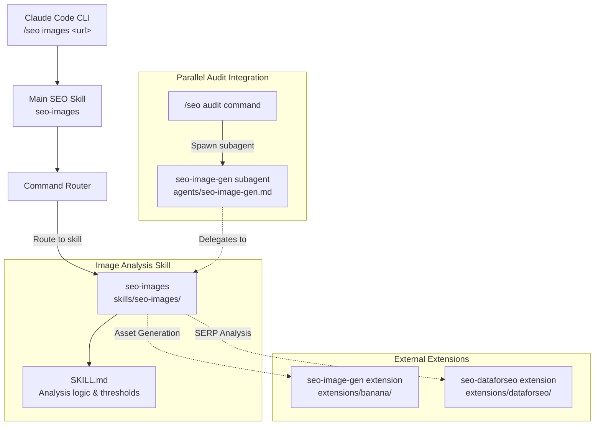
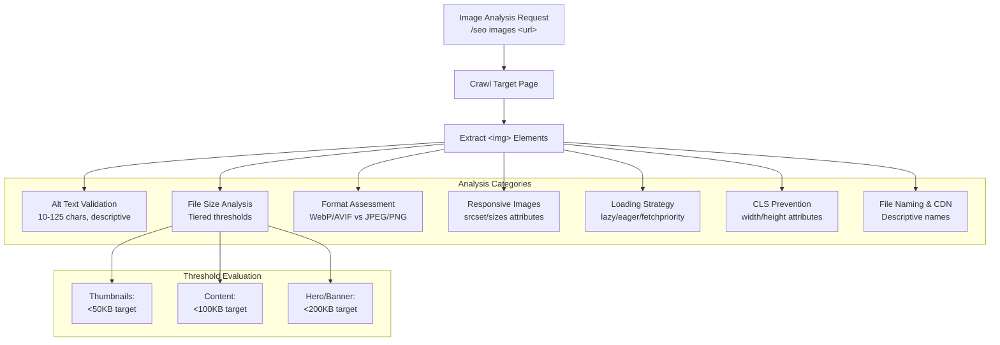

<!-- source: DeepWiki mcp.deepwiki.com · repo AgriciDaniel/claude-seo · page 9 Image Optimization · fetched 2026-10-26 -->

# Image Optimization

<details>
<summary>Relevant source files</summary>

The following files were used as context for generating this wiki page:

- [extensions/banana/skills/seo-image-gen/SKILL.md](extensions/banana/skills/seo-image-gen/SKILL.md)
- [extensions/dataforseo/skills/seo-dataforseo/SKILL.md](extensions/dataforseo/skills/seo-dataforseo/SKILL.md)
- [skills/seo-images/SKILL.md](skills/seo-images/SKILL.md)
- [skills/seo-page/SKILL.md](skills/seo-page/SKILL.md)
- [skills/seo-technical/SKILL.md](skills/seo-technical/SKILL.md)

</details>


## Purpose and Scope

This document covers the image optimization analysis system within `claude-seo`, accessible via the `/seo images <url>` command. The system analyzes images for SEO and performance optimization across seven categories: alt text validation, file size assessment, format selection, responsive image configuration, loading strategy, CLS (Cumulative Layout Shift) prevention, and file naming conventions.

Image optimization intersects with performance analysis—for Core Web Vitals measurement and LCP optimization strategies, see [Core Web Vitals](#8.1) and [Performance Optimization Strategies](#8.3). For programmatic generation of image-heavy pages, see [Programmatic SEO](#10).

**Sources:** [skills/seo-images/SKILL.md:1-17]()

---

## Image Optimization Skill Architecture

The `seo-images` sub-skill operates as a standalone analysis module within the execution layer, invoked either directly via `/seo images <url>` or as part of the comprehensive `/seo audit` workflow.

### Skill Location and Command Routing



**Analysis:** The `seo-images` skill is defined in `skills/seo-images/SKILL.md` [skills/seo-images/SKILL.md:1-9](). When part of a full audit, the `seo-image-gen` agent assesses existing assets and produces a generation plan [extensions/banana/skills/seo-image-gen/SKILL.md:27-28](). The system can also leverage the DataForSEO extension for image SERP analysis [extensions/dataforseo/skills/seo-dataforseo/SKILL.md:132-135]().

**Sources:** [skills/seo-images/SKILL.md:1-9](), [extensions/banana/skills/seo-image-gen/SKILL.md:20-28](), [extensions/dataforseo/skills/seo-dataforseo/SKILL.md:132-153]()

---

## Analysis Categories and Validation Workflow

The image optimization system performs seven distinct analysis categories, each with specific validation rules and quality thresholds.

### Analysis Workflow



**Analysis:** The workflow extracts all `` elements and evaluates them against specific criteria. File size analysis uses tiered thresholds [skills/seo-images/SKILL.md:43-47](). Loading strategy checks for both native `loading="lazy"` and third-party JS lazy-loaders [skills/seo-images/SKILL.md:107-123]().

**Sources:** [skills/seo-images/SKILL.md:21-167]()

---

## Alt Text Validation

Alt text validation ensures accessibility and SEO value for all images, with specific criteria for length and descriptiveness.

### Validation Rules

| Criterion | Requirement | Example (Good) |
|-----------|-------------|----------------|
| **Presence** | All `` elements except decorative (`role="presentation"`) | `alt="..."` |
| **Length** | 10-125 characters | "Professional plumber repairing kitchen sink faucet" |
| **Content** | Descriptive, keyword-rich but not stuffed | Avoid "image.jpg" or "click here" |

**Analysis:** Alt text must be present, descriptive, and fall within the 10-125 character range [skills/seo-images/SKILL.md:23-38]().

**Sources:** [skills/seo-images/SKILL.md:23-38]()

---

## File Size Thresholds and Analysis

File size analysis uses tiered thresholds based on the image's role on the page.

### Tiered Thresholds by Image Category

| Image Category | Target | Warning | Critical |
|----------------|--------|---------|----------|
| **Thumbnails** | < 50KB | > 100KB | > 200KB |
| **Content images** | < 100KB | > 200KB | > 500KB |
| **Hero/banner images** | < 200KB | > 300KB | > 700KB |

**Analysis:** The system categorizes images to apply appropriate pressure, acknowledging that hero images require higher fidelity than thumbnails [skills/seo-images/SKILL.md:41-49]().

**Sources:** [skills/seo-images/SKILL.md:41-49]()

---

## Format Strategy and Metadata

The system prioritizes modern formats (AVIF, WebP) and provides specific patterns for implementation.

### Format Selection Matrix

| Format | Browser Support | Use Case |
|--------|-----------------|----------|
| **WebP** | 97%+ | Default recommendation |
| **AVIF** | 92%+ | Best compression |
| **JPEG XL** | Emerging | Monitor (Chrome 145+ behind flag) |

**Analysis:** The system recommends WebP/AVIF over legacy formats [skills/seo-images/SKILL.md:52-60](). It also monitors emerging formats like JPEG XL, though they are not yet recommended for production [skills/seo-images/SKILL.md:77-79]().

For details, see [Image Format Strategy](#9.1).

**Sources:** [skills/seo-images/SKILL.md:51-79]()

---

## Loading and Performance

Loading strategy directly impacts LCP. The system detects various lazy-loading methods via the `lazy_method` field [skills/seo-images/SKILL.md:107-110]().

### Detected Lazy-Loader Methods

| `lazy_method` | Signal detected |
|---|---|
| `native` | `loading="lazy"` attribute |
| `perfmatters` | `data-perfmatters-src` / class `perfmatters-lazy` |
| `ewww` | `data-ewww-src` / class `lazyload-eio` |
| `js-generic` | `data-src` / class `lazyload` |

**Analysis:** The system differentiates between native and JS-based lazy loaders to avoid false positive "missing lazy load" flags [skills/seo-images/SKILL.md:120-123](). It also enforces `fetchpriority="high"` for hero images and `decoding="async"` for non-LCP images [skills/seo-images/SKILL.md:124-141]().

For details, see [Image Loading and Performance](#9.2).

**Sources:** [skills/seo-images/SKILL.md:94-141](), [skills/seo-page/SKILL.md:55-56]()

---

## CLS Prevention

CLS prevention requires explicit dimension specification or CSS aspect ratios for all images.

```html
<!-- Dimension attributes -->


<!-- CSS aspect ratio -->

```

**Analysis:** The system flags images without `width` and `height` attributes or `aspect-ratio` CSS [skills/seo-images/SKILL.md:142-157]().

**Sources:** [skills/seo-images/SKILL.md:142-157]()

---

## Output and Recommendations

The system generates a structured audit summary and a prioritized list of optimizations.

### Image Audit Summary Table

| Metric | Status | Count |
|--------|--------|-------|
| Total Images | - | XX |
| Missing Alt Text | ❌ | XX |
| Oversized (>200KB) | ⚠️ | XX |
| Wrong Format | ⚠️ | XX |
| No Dimensions | ⚠️ | XX |
| Not Lazy Loaded | ⚠️ | XX |

**Sources:** [skills/seo-images/SKILL.md:170-195]()

---

