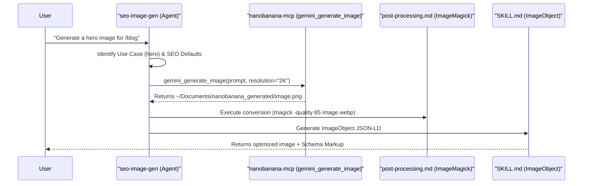

<!-- source: DeepWiki mcp.deepwiki.com · repo AgriciDaniel/claude-seo · page 9.1 Image Format Strategy · fetched 2026-10-26 -->

# Image Format Strategy

<details>
<summary>Relevant source files</summary>

The following files were used as context for generating this wiki page:

- [extensions/banana/agents/seo-image-gen.md](extensions/banana/agents/seo-image-gen.md)
- [extensions/banana/docs/BANANA-SETUP.md](extensions/banana/docs/BANANA-SETUP.md)
- [extensions/banana/references/gemini-models.md](extensions/banana/references/gemini-models.md)
- [extensions/banana/references/mcp-tools.md](extensions/banana/references/mcp-tools.md)
- [extensions/banana/references/post-processing.md](extensions/banana/references/post-processing.md)
- [extensions/banana/references/prompt-engineering.md](extensions/banana/references/prompt-engineering.md)
- [extensions/banana/references/seo-image-presets.md](extensions/banana/references/seo-image-presets.md)
- [extensions/banana/scripts/batch.py](extensions/banana/scripts/batch.py)
- [extensions/banana/scripts/cost_tracker.py](extensions/banana/scripts/cost_tracker.py)
- [extensions/banana/skills/seo-image-gen/SKILL.md](extensions/banana/skills/seo-image-gen/SKILL.md)
- [extensions/dataforseo/skills/seo-dataforseo/SKILL.md](extensions/dataforseo/skills/seo-dataforseo/SKILL.md)

</details>


## Purpose and Scope

This document defines the image format selection strategy used by the `claude-seo` system, primarily executed through the `seo-images` skill and supported by the `seo-image-gen` agent. It covers format selection criteria, progressive enhancement patterns using the `<picture>` element, browser support thresholds, and the post-generation conversion pipeline using ImageMagick recipes.

The strategy ensures that images are delivered in the most efficient format supported by the user's browser, directly impacting Core Web Vitals—specifically Largest Contentful Paint (LCP) and Cumulative Layout Shift (CLS).

---

## Format Selection Matrix

The system evaluates and generates images based on five primary format categories. Each category is optimized for specific use cases and browser support requirements.

| Format | Browser Support | Compression Type | Primary Use Case | Recommendation Priority |
|--------|----------------|------------------|------------------|------------------------|
| **AVIF** | 92%+ | Lossy & Lossless | Best compression ratio for photos | **HIGH** - Use with fallback |
| **WebP** | 97%+ | Lossy & Lossless | Default for photos and graphics | **HIGH** - Primary recommendation |
| **JPEG** | 100% | Lossy | Legacy fallback for photos | **MEDIUM** - Fallback only |
| **PNG** | 100% | Lossless | Graphics with transparency | **MEDIUM** - Specific use case |
| **SVG** | 100% | Vector | Icons, logos, illustrations | **HIGH** - When applicable |

**Sources:** [extensions/banana/references/post-processing.md:55-67](), [extensions/banana/skills/seo-image-gen/SKILL.md:97-100]()

---

## Progressive Enhancement Pattern

### The `<picture>` Element Strategy

The system enforces a progressive enhancement approach. By using the `<picture>` element, the browser is instructed to download the most efficient format it can decode, falling back to legacy formats only when necessary.

```html
<picture>
  <source srcset="image.avif" type="image/avif">
  <source srcset="image.webp" type="image/webp">
  
</picture>
```

The system validates that `<source>` elements are ordered by efficiency (AVIF > WebP > JPEG) to prevent browsers from selecting a less efficient format they happen to support.

**Sources:** [extensions/banana/skills/seo-image-gen/SKILL.md:91-100](), [extensions/banana/references/post-processing.md:55-67]()

---

## Image Generation and Conversion Pipeline

When new assets are required, the system follows a structured pipeline from generation via Gemini (Banana extension) to local optimization.

### 1. Generation via `seo-image-gen`
The `seo-image-gen` agent creates a generation plan based on page needs (e.g., missing `og:image` or low-res hero images) [extensions/banana/agents/seo-image-gen.md:37-45](). It uses the `nanobanana-mcp` tools, specifically `gemini_generate_image`, to generate assets based on pre-configured SEO presets [extensions/banana/skills/seo-image-gen/SKILL.md:67-80]().

### 2. Post-Processing with ImageMagick
Once generated, images are converted to modern formats using ImageMagick recipes. The system checks for `magick` (v7) or `convert` (v6) availability [extensions/banana/references/post-processing.md:5-14]().

#### Conversion Recipes:
*   **To WebP:** `magick output.png -quality 85 output.webp` [extensions/banana/skills/seo-image-gen/SKILL.md:98-100]()
*   **To AVIF:** `magick output.png -quality 80 output.avif` [extensions/banana/references/post-processing.md:62-63]()
*   **To OG (1200x630):** `magick output.png -resize 1200x630^ -gravity center -extent 1200x630 output-og.webp` [extensions/banana/references/seo-image-presets.md:23-23]()

---

## System Data Flow: Generation to Schema

The following diagram bridges the Natural Language prompts to the Code Entities responsible for image lifecycle management.



**Diagram: Image Generation and Optimization Flow**

**Sources:** [extensions/banana/skills/seo-image-gen/SKILL.md:67-80](), [extensions/banana/skills/seo-image-gen/SKILL.md:91-111](), [extensions/banana/references/mcp-tools.md:8-16](), [extensions/banana/references/post-processing.md:55-57]()

---

## Schema Markup Generation

Post-generation, the system recommends or generates `ImageObject` schema to ensure search engines correctly index the new assets.

### ImageObject Template:
The `seo-image-gen` skill provides a standardized JSON-LD template for generated images:
*   **@type**: `ImageObject`
*   **url**: Absolute URL to the optimized WebP/AVIF asset.
*   **width/height**: Dimensions matching the generation resolution (e.g., 1200x630 for OG).
*   **caption**: Descriptive caption with target keywords.

**Sources:** [extensions/banana/skills/seo-image-gen/SKILL.md:102-111]()

---

## Format Decision and Cost Tracking

The system integrates cost awareness into the generation workflow via `cost_tracker.py`.

```mermaid
flowchart TD
    [Start Generation Request] --> UseCase[Identify Use Case: OG/Hero/Product]
    UseCase --> Preset[Load Preset: seo-image-presets.md]
    Preset --> Estimate[cost_tracker.py estimate --count N]
    Estimate --> Approval{User Approved?}
    
    Approval -- "No" --> End[Cancel]
    Approval -- "Yes" --> Gen[MCP: gemini_generate_image]
    
    Gen --> Log[cost_tracker.py log --model --res]
    Log --> Convert[ImageMagick: Convert to WebP/AVIF]
    Convert --> Schema[Generate ImageObject Schema]
```

**Diagram: Generation Decision and Cost Flow**

**Sources:** [extensions/banana/scripts/cost_tracker.py:145-158](), [extensions/banana/scripts/cost_tracker.py:86-116](), [extensions/banana/skills/seo-image-gen/SKILL.md:120-130](), [extensions/banana/references/seo-image-presets.md:132-137]()

---

## Category-Specific Optimization Thresholds

The system applies different file size targets based on the image's role on the page.

| Image Category | Target Size | Aspect Ratio | Resolution |
| :--- | :--- | :--- | :--- |
| **Thumbnails** | < 100KB | `1:1` | `512` |
| **OG / Social** | < 200KB | `16:9` | `1K` |
| **Hero / Banner** | < 200KB | `16:9` | `2K` |
| **Infographic** | Scaled | `2:3` | `4K` |

**Sources:** [extensions/banana/skills/seo-image-gen/SKILL.md:52-65](), [extensions/banana/skills/seo-image-gen/SKILL.md:101-101]()

---

## Implementation Summary

The image format strategy is a multi-layered approach:
1.  **Analysis**: `seo-image-gen` agent audits existing images for format and size [extensions/banana/agents/seo-image-gen.md:13-22]().
2.  **Generation**: `seo-image-gen` skill uses Gemini models via MCP to create high-quality assets [extensions/banana/skills/seo-image-gen/SKILL.md:67-80]().
3.  **Optimization**: ImageMagick converts raw PNGs into WebP/AVIF for performance [extensions/banana/references/post-processing.md:53-67]().
4.  **Cost Management**: `cost_tracker.py` ensures transparency and budget adherence [extensions/banana/scripts/cost_tracker.py:86-116]().
5.  **Metadata**: `ImageObject` schema and OG meta tags are generated for SEO [extensions/banana/skills/seo-image-gen/SKILL.md:91-118]().

---

